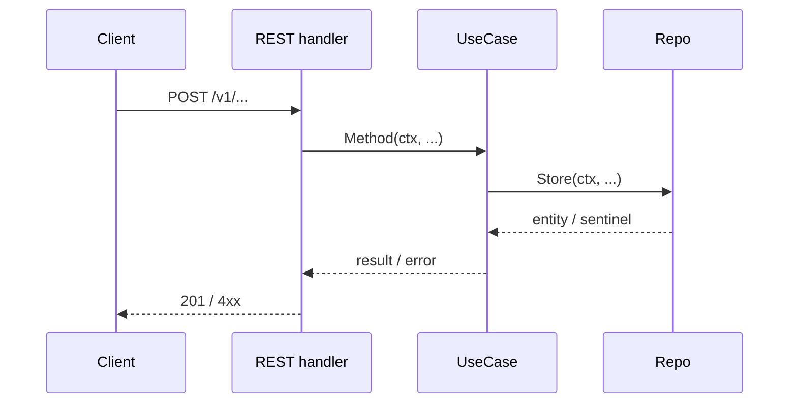

# Repository Guidelines — nexuslive-be

> Rules for AI agents and developers working in this repository. Read this whole file before
> starting any task.
>
> NexusLive backend: a Go monorepo of microservices (`services/<svc>/`, one Go module each) sharing
> `pkg/` through `go.work`. Module path: `github.com/minhnn/nexuslive-be` (services:
> `.../services/<svc>`). The Go version is declared in `go.mod`. Architecture and ADRs:
> `docs/architecture/`; product scope and roadmap: `docs/product/`; requirements and specs: `../docs/ba/`.
>
> **Paths.** Inside a service, `internal/...`, `config/...` and `migrations/` mean
> `services/<svc>/internal/...` etc. Services are layered entity → repo → usecase → controller, as in
> the clean-architecture template the repo started from; `services/stream` is the reference service.

**Contents:** the process ([Planning & Documentation Workflow](#planning--documentation-workflow-mandatory),
[Regression & Runtime Safety](#regression--runtime-safety-mandatory)), the codebase
([Commands](#commands--drive-everything-through-the-makefile) →
[Tests](#tests)), the closing rules ([Prohibitions](#prohibitions),
[Checklist Before Submitting](#checklist-before-submitting), [Commits & PRs](#commit--pull-request-guidelines)),
and the [plan document templates](#appendix--plan-document-templates).

---

## Planning & Documentation Workflow (MANDATORY)

Applies to **every** task in this repo. Design first, code second: no implementation starts before
the required plan document exists **and the user has approved it in chat**. Documentation is part
of the Definition of Done.

There is **no Jira, no Confluence and no external tracker** in this workflow. Every plan is a
Markdown file under `docs/plans/`. Never ask the user for a ticket key, an epic or a space key, and
never offer to publish anything outside this repo.

### Where plan documents live

Plan documents get their own subtree under `docs/`, which no generator touches (Swagger output lives
in `services/<svc>/docs/`):

```
docs/plans/
├── working/      → Working Plans        (before coding)
├── technical/    → Technical Solutions  (Full track, before coding)
└── completed/    → Completed Plans      (after verification)
```

One task = one `YYYY-MM-DD-<short-name>.md` basename, reused across the three folders. Templates
are in the [Appendix](#appendix--plan-document-templates); copy the skeleton, delete sections that
do not apply instead of writing `N/A`.

### Step 0 — Establish the requirement source (every time)

A master plan usually does **not** exist. **A description from the user in chat is a valid and
expected input** — never block waiting for a plan document.

1. Identify what you are building from, in this order:
   - a spec file the user names, or
   - an existing Working Plan or TSD in `docs/plans/`, or
   - **the user's description in this conversation** — the normal case.
2. If the source is a chat description, restate it as a **Task Brief** (4–8 lines) before writing
   anything else:
   - **Task name** — becomes the doc basename (`YYYY-MM-DD-<short-name>.md`)
   - **Goal** — what changes for the API consumer when this ships
   - **In scope / Out of scope**
   - **Impacted layers & transports** — the actual packages you expect to touch, and which of
     REST / internal HTTP / NATS events expose the change
   - **Assumptions** — the defaults you picked where the description is silent
   - **Open questions** — only those that change what gets built
3. Ask the user **only** about open questions where different answers produce materially different
   work. For everything else, state the assumption and keep going. Do not ask what the codebase
   already answers.
4. Read the existing code of the impacted domain on **every** layer (entity → repo → use case →
   each transport's controller) before proposing implementation steps. `services/stream` is the
   reference for everything.

The Task Brief goes into §1 of the Working Plan — it is not a separate artifact.

### Track selection

Pick the track before writing docs and name it in one line in your reply. When in doubt, pick the
heavier one.

| Track | When | Required docs |
| --- | --- | --- |
| **Lightweight** | **any bug fix** (however many files it touches), typo/README wording fix, dependency bump via `make deps`, lint-only or `make format`-only cleanup, regenerating stale generated files | none — implement, verify, summarize in the reply. *Regression & Runtime Safety* still applies in full |
| **Standard** | the common case: one new use-case method on an existing domain, exposed on one or more transports; a new field on an existing DTO; a new sentinel error and its mapping; a new `pkg/` helper with no contract change | Working Plan → Completed Plan |
| **Full** | a new domain; a new transport; a new or changed migration; any `.proto` change; JWT / auth middleware change; a new `required` env var; an API `v2`; a change to an existing method in a service's `internal/usecase/contracts.go` or `internal/repo/contracts.go`; a new service; anything multi-phase or touching more than one domain | Working Plan → TSD → Completed Plan |

**Automatic Full:** a change that touches `services/*/migrations/`, `services/*/config/config.go`,
`pkg/jwt/`, `pkg/eventbus/`, `pkg/events/` (event payloads are contracts between services),
`docker-compose.yml`, `deploy/`, any transport's auth middleware, or the signature of an existing
contract method is Full track, whatever its size.

### Steps (in order)

1. **Task Brief** — per Step 0. Confirm blocking questions only.
2. **Working Plan** → `docs/plans/working/YYYY-MM-DD-<short-name>.md`. Covers requirement brief,
   scope, the layer × transport matrix, contract changes, error mapping, generated artifacts,
   config, README impact, implementation steps, risks, validation checklist, acceptance criteria.
   **STOP — give the user the file path and wait for approval. Do not code yet.**
3. **TSD (Full track only)** → `docs/plans/technical/YYYY-MM-DD-<short-name>.md`. Covers objective,
   scope, scenarios (Given/When/Then + Mermaid sequence diagrams per transport), contracts (Go
   interfaces, DTOs, `.proto`, SQL schema), error handling, compatibility & rollback, estimation,
   document control.
   **STOP — give the user the file path and wait for approval.**
4. **Implement** strictly per the approved docs — nothing outside the agreed scope. If new scope
   appears mid-task, pause, update the Working Plan (and TSD), and get re-approval before
   continuing.
5. **Verify** — see [Verify before reporting done](#verify-before-reporting-done). Re-test the
   existing flows your change touches, not only the new one. Report failures honestly; never claim
   a check passed without running it.
6. **Completed Plan** → `docs/plans/completed/YYYY-MM-DD-<short-name>.md`, same basename: what was
   delivered, deviations, issues, validation results (with the commands run), follow-ups.
7. **Sync the TSD** (Full track) with as-shipped behavior and bump its Document Control version when
   a deviation is material.

### Cross-repo tasks (backend + web client)

When a feature needs both this repo and the web client (`../nexuslive-web`):

- Use the **same basename** for the task in both repos.
- The **TSD lives here** — this repo owns the contract. The client's Working Plan links to it
  instead of restating the request/response shapes.
- The client's API types (`src/features/*/types.ts`) and error codes are derived from the `response/`
  DTOs and error codes fixed in the TSD. A contract change after approval bumps the TSD version and is
  announced to the client side.
- Order: backend reaches a merged Completed Plan (or both sides agree on a frozen mock contract)
  before the client starts integrating.

### Rules (non-negotiable)

- Plan docs live in `docs/plans/`, **never** next to the generated files in `docs/` and never in a
  `documents/` folder.
- No coding before the Working Plan (and TSD when required) is approved. "Approved" means the user
  said so — silence is not approval.
- Scope is locked to what was approved. Out-of-scope findings go into §Follow-ups, not into the
  code on the side.
- Every non-Lightweight task ends with a Completed Plan. Without it, the task is not done.
- Plan docs are written in the language the user is using in the conversation (Vietnamese is fine).
  **Code, comments, commit messages and PRs stay in English** (see below).
- Every task — feature or bug fix — passes *Regression & Runtime Safety* before it is reported done.
  "It works on the endpoint I added" is not done.

---

## Regression & Runtime Safety (MANDATORY)

Applies to **every** new feature **and every bug fix** — the Lightweight track included. A change
is done when the new behavior works, the old behavior still works, every transport that shares the
use case still works, and nothing can panic or leak on it.

### Before you change anything shared

1. **Map the blast radius.** Find every caller before touching a shared symbol:
   `rg "usecase.Studio\b" services/stream/`, `rg "ErrAlreadyLive" services/`, or `gopls references`.
   These are **never** a local change:
   - anything in `internal/entity/` (every layer imports it),
   - `internal/usecase/contracts.go` and `internal/repo/contracts.go` (every transport and the
     mocks depend on them),
   - anything in `pkg/` (servers, middleware, logger, jwt, postgres, tracing),
   - a `request/` or `response/` DTO (it *is* the public API),
   - a route string, an internal API (`/internal/v1/...`), an event type or payload in `pkg/events`
     (other services consume it), a Nginx route in `deploy/nginx/nginx.conf`,
   - an env var or `config` field.
2. **Write the impacted flows into the Working Plan** (§Impacted areas + §Risks): which endpoints /
   RPCs on which transports can break. "Which existing callers can this break?" must have a
   written answer before coding.
3. **Prefer additive changes.** Add a new method instead of changing an existing signature; add a
   new optional DTO field instead of renaming one; add a new `.proto` field number instead of
   reusing or renumbering one; add a new migration instead of editing an applied one.

### Do not break existing behavior

- Do **not** change an exported function or interface method signature without updating every
  implementation, every caller on every transport, and the mocks (`go generate`) in the same change.
- Do **not** rename or remove a JSON tag, a route, a `.proto` field, or an RPC route key that a
  client may call. Removing one is a versioning decision (`v2`), not a cleanup.
- Do **not** change the status a sentinel maps to on one transport without checking the others —
  REST, the internal API and the web client's error handling must stay consistent.
- Do **not** edit a migration that has already been applied anywhere. Write a new one.
- Do **not** change a `pkg/` default to suit one caller — add an option instead.
- Auth (JWT issuing in identity, JWKS verification in other services, the internal shared secret),
  the error envelope, the Nginx edge routes and each service's `internal/app/app.go` wiring are high-risk: a change there must be justified in the
  plan and re-tested end to end on every transport.

### Runtime-safety rules (Go)

- **Context:** every method that crosses a layer takes `ctx context.Context` first and passes it
  on. In Fiber use `ctx.UserContext()`, never `ctx.Context()` (drops the trace). Never store a
  context in a struct, and never use `context.Background()` inside a request path.
- **No panics in request paths.** Type assertions use the two-value form
  (`userID, ok := ctx.Locals("userID").(string)`), slices are bounds-checked, pointers from the repo
  are nil-checked before dereference. A panic in a handler is an outage, not an error response.
- **Goroutines** started on a request path must be bounded and stop when their context is
  canceled; any goroutine started at startup must stop on graceful shutdown. `make nxl-test` runs with
  `-race` — a race report is a failure, not a flake.
- **Resources:** close `rows`, response bodies and channels on every path (`defer` right after the
  error check). A transaction is rolled back on every error branch.
- **Errors:** never discard an error (`_ =` needs a comment explaining why). Wrap with the layer
  path; map to a transport status only in controllers; log the wrapped error and return a generic
  message — never leak SQL, driver or stack details to the caller.
- **Input:** every DTO is validated with the injected validator before it reaches a use case.
  Queries are built with Squirrel placeholders — never string concatenation.
- **Migrations** must be reversible: run `up → down → up` locally before reporting done.
- **Config:** a new `required` env var must exist in `.env.example` and, if the container needs it,
  in `docker-compose.yml`, or the app will not start in CI.

### Verify before reporting done

All of these, actually run:

```bash
make format                   # gofumpt, gci, goimports through golangci-lint fmt
make nxl-lint                 # golangci-lint on every Go module of go.work
make nxl-test                 # unit tests (-race) of every module
```

Plus, when relevant:

```bash
NXL_TEST_PG_URL_STREAM=... make nxl-test          # stream repository tests against a real Postgres
make nxl-swag && git diff --exit-code             # Swagger in sync after a REST change
make nxl-up-all                                   # whole stack behind the edge; required on the Full track
cd ../nexuslive-web && pnpm e2e                   # web E2E on the running stack (VITE_DEV_GATEWAY_URL)
make deps-audit                                   # after any dependency change
```

Then:

- Re-run the **existing** flows that share code with your change, through the edge
  (`http://localhost:8080`): register/login → authenticated call → the endpoints listed in
  §Impacted areas; for livestream changes also publish with `make nxl-media-publish KEY=...`
  (interrupt, resume, end, VOD).
- Check the hostile paths: missing / expired / malformed token, invalid DTO, not-found, forbidden
  (another user's resource), invalid state transition, dependency down (Postgres / NATS / MinIO /
  another service unavailable), canceled context.
- In the Completed Plan §Validation, list every command run with its result and every existing flow
  re-tested. If something could not be tested, say so explicitly — never report a skipped check as
  passed.

---

## Commands — drive everything through the Makefile

The `Makefile` loads `.env` (falling back to `.env.example`) and exports it into every target. Use
the target, not the tool: it carries the flags CI uses. `make help` lists every target.

| Task | Use this | Not this |
| --- | --- | --- |
| Install tool binaries (`migrate`, linters, `swag`, `mockgen`) | `make bin-deps` | `go install ...` |
| Lint every module | `make nxl-lint` (alias `make linter-golangci`) | `golangci-lint run` at the root — it only covers `pkg/` |
| Unit tests of every module | `make nxl-test` (alias `make test`) | `go test ./...` at the root |
| One service's tests | `make nxl-stream-test`, `nxl-media-test`, `nxl-identity-test` | — |
| Format | `make format` | `gofmt` |
| Tidy / verify the root module | `make deps` | `go mod tidy` inside `services/*` — it cannot resolve `pkg/` outside the workspace |
| Vulnerability scan | `make deps-audit` | `govulncheck ./...` |
| Regenerate Swagger (identity, stream) | `make nxl-swag` | `swag init` |
| Regenerate mocks | `go generate ./...` in the service (the `//go:generate mockgen` line sits on the contract) | writing mocks by hand |
| Start infrastructure only (Postgres, NATS, MinIO, Redis, Mailpit) | `make nxl-infra-up` | `docker compose up` |
| Start everything behind the edge + Prometheus/Grafana | `make nxl-up-all` | `docker compose up` |
| Start the livestream services only | `make nxl-media-up` | — |
| Observability only | `make nxl-obs-up` | — |
| Tear down | `make nxl-down` | `docker compose down` |
| Create a migration | `make nxl-migrate-create SVC=<svc> NAME=<name>` | `migrate create ...` |
| Apply migrations | `make nxl-migrate-up` | `migrate -path ... up` |
| Publish a test stream (no OBS) | `make nxl-media-publish KEY=live_...` | — |
| Full check before pushing | `make pre-commit` | running the steps by hand |

Traps:

- **Windows without a C compiler:** `-race` needs cgo. Run `make nxl-test NXL_TEST_FLAGS=`; CI still
  runs with `-race`.
- **`make nxl-migrate-down` / `nxl-migrate-create` use `sh` syntax** — run them from Git Bash or WSL
  on Windows.
- **Adding a service module:** add it to `go.work`, to `NXL_GO_MODULES` in the `Makefile`, and to the
  module matrix in `.github/workflows/ci.yml`.

## Stack and ports

| Component | Port (host) | Notes |
| --- | --- | --- |
| Nginx edge | `8080` (`NXL_EDGE_PORT`) | The only entry point for browsers: `/v1/*` → services, `/hls/*` → MinIO; `/internal`, `/metrics`, `/swagger` blocked |
| identity-svc | `8090` | Auth, JWKS, `/metrics`, Swagger |
| stream-svc | `8092` public, `8093` internal | Studio, catalog, VOD; internal API for media-svc |
| media-svc | `1935` RTMP, `8091` HTTP | `/healthz`, `/metrics`, `/dev/player` |
| Postgres / NATS / MinIO | `5432` / `4222`, `8222` / `9000`, `9001` | One database per service (`nxl_<svc>`) |
| Redis / Mailpit | `6379` / `1025` SMTP, `8025` UI | |
| Prometheus / Grafana / Jaeger | `9090` / `3000` / `16686` | Profile `obs` |

A new public route must be added to `deploy/nginx/nginx.conf` in the same change, and a new service's
`/metrics` to `deploy/prometheus/prometheus.yml`.

---

## Dependency rule

Inside every service:

```
cmd/<svc> → internal/app → internal/controller/*  ─┐
                         → internal/repo/*        ─┤→ internal/usecase (interfaces)
                                                   └→ internal/entity
```

- `internal/entity` — domain types and sentinel errors. Imports nothing from this module.
- `internal/usecase/contracts.go` — the interfaces controllers call; `internal/usecase/<domain>/`
  implements them.
- `internal/repo/contracts.go` — the interfaces use cases call; `internal/repo/persistent/`
  (Postgres) implements them.
- `internal/controller/<transport>/` — `restapi/v1` (public REST, with `request/` and `response/`
  DTOs), `internal`/`internalapi` (service-to-service HTTP behind `X-Internal-Secret`), `events`
  (NATS consumers). Controllers never import each other.
- `pkg/` — infrastructure shared by services (eventbus, events, outbox, jwt, httpserver,
  httpmetrics, logger, postgres, tracing). Must not import `services/`.
- **Services never import each other.** They talk over HTTP (synchronous, ≤ 300 ms, one hop) or NATS
  events through the transactional outbox (architecture §5). Event types and payloads live in
  `pkg/events`.

Inner layers never import outer ones. Wiring happens exactly once, in the service's
`internal/app/app.go`.

## Where code goes

| The code knows about… | It belongs in | Shape |
| --- | --- | --- |
| nothing but the domain | `services/<svc>/internal/entity/` | struct + methods, sentinel errors |
| a domain rule that spans repositories | `services/<svc>/internal/usecase/<domain>/` | method on `UseCase` |
| SQL, a table, a driver error code | `services/<svc>/internal/repo/persistent/` | method on `Repo` |
| an HTTP status, a message envelope | `services/<svc>/internal/controller/<transport>/` | handler |
| an event published or consumed by several services | `pkg/events/` | type constant + payload struct |
| a server, client or middleware with no domain knowledge | `pkg/<name>/` | reusable package |
| compose, Nginx, Prometheus, Grafana | `docker-compose.yml`, `deploy/<tool>/` | config |
| a plan, design or delivery note | `docs/plans/{working,technical,completed}/` | `YYYY-MM-DD-<short-name>.md` |

Layout rules:

- Package name matches the directory name. Constructors are `New` and take their dependencies as
  arguments. No package-level state — `gochecknoglobals` and `gochecknoinits` are on (sentinel
  errors and compiled regexps are allowed).
- Unexported package constants are prefixed with an underscore. `mnd` rejects bare numeric
  literals, so add a named constant.
- Each service owns its database (`nxl_<svc>`) and its `migrations/`; no service reads another's tables.

## The handler contract

Every REST handler does the same six things in the same order. Copy the shape from a neighbouring
handler.

1. **Get the caller** from `ctx.Locals` (two-value form). A failure here is an auth error, not a 500.
2. **Decode into a transport-local DTO** from `restapi/v1/request/`. Never decode into an `entity`
   type, and never pass a `request.*` type into a use case.
3. **Validate the DTO** with the injected validator. Domain validation (state transitions, limits
   that need data) lives on the entity or the use case.
4. **Call the use case** with `ctx.UserContext()` (**not** `ctx.Context()`).
5. **Map the error.** `errors.Is` against the `entity.Err*` sentinels → status + `UPPER_SNAKE` code
   in the envelope `{"error":{"code","message","details"}}`. Log the wrapped error, return a generic
   message.
6. **Encode the response** as `{"data": …}` with a type from `restapi/v1/response/`.

Event consumers (`controller/events`) decode the payload, reject what can never succeed with
`eventbus.ErrSkip` (so it is not redelivered forever), and must be idempotent on the event id.

## Conventions that will bite you

**Error style.** Domain failures are sentinel errors in `internal/entity/`. Every other error is
wrapped with the layer path: `fmt.Errorf("Repo - Authorize - insert: %w", err)`. `err113` rejects
dynamic errors — add a sentinel (`ErrX = errors.New(...)`) instead.

**Events.** A state change and the event announcing it are written in the same transaction (outbox
table, `pkg/outbox` relays it to NATS). Metadata travels in NATS headers, the body is the payload:
`Nats-Msg-Id` is the event id (dedupes publishes), the type is the subject without `nxl.`. Event names,
headers and payload rules: NXL-00 §11 (`../docs/ba/specs/NXL-00-platform-foundation.md`).

**Config is environment-only.** Each service parses env vars in `services/<svc>/config/config.go`
with `caarlos0/env`. A new setting needs the struct field, an entry in `.env.example`, and — if the
container needs it — the `environment` block in `docker-compose.yml`.

**Metrics.** Every service serves `/metrics` from its own Prometheus registry (no global
registry); HTTP request metrics come from `pkg/httpmetrics` registered before the routes.

**The linter is strict.** `.golangci.yml` enables ~45 linters; the ones that reject otherwise-fine
code: `wsl_v5` and `nlreturn` (blank lines around blocks and before `return`), `funlen` (65 lines /
40 statements), `gocyclo` (10), `gocognit` (15), `mnd`, `gochecknoglobals`, `err113`, `exhaustive`,
`misspell` (US spelling). Fix the code; a `//nolint:<linter> // reason` is for wiring functions and
format-mandated code only.

## Code comments

**The test for keeping a comment:** could deleting it let a competent developer "fix" the code into
a bug? If not, delete it.

- Comments are in **English**. Plan documents may be in Vietnamese — code may not.
- Keep: the *why* the code cannot show — a protocol quirk (RTMP, FLV, HLS, ffmpeg), an ordering or
  race rule, a security constraint, a deliberate deviation from this file.
- Godoc on exported identifiers in `pkg/` and on contract interfaces, 1–2 lines.
- Swagger annotations above REST handlers are inputs to `make nxl-swag` and must stay accurate.
- Never: narration of what the code does, commented-out code, plan-document names, dates, people's
  names, bug history, real data (emails, tokens, user ids, stream keys).

## Generated files — do not hand-edit

- `services/<svc>/docs/{docs.go,swagger.json,swagger.yaml}` ← `make nxl-swag`.
- `services/<svc>/internal/usecase/mocks_*_test.go` ← `go generate` (mockgen).

Generated files are committed. After regenerating, `git diff` must show only changes your task
explains.

## Documentation to keep in sync

| Change | Update |
| --- | --- |
| New or changed public endpoint | `docs/api/README.md`, Swagger (`make nxl-swag`), Nginx route if it is a new prefix |
| New env var | `.env.example`, `docker-compose.yml` if the container needs it |
| New port, service or make target in the getting-started flow | `README.md` |
| Architecture decision | `docs/architecture/decisions.md` (ADR) |
| Requirement or spec change | `../docs/ba/` (specs, traceability) |

## Adding a use case to an existing domain

Usually the **Standard** track; **Full** if it changes an existing contract method or needs a
migration.

1. Add the method to the service's `internal/usecase/contracts.go` and implement it.
2. If it needs new persistence, add it to `internal/repo/contracts.go` and `internal/repo/persistent/`.
3. Regenerate mocks, then extend the use-case tests (table-driven, `t.Parallel()`).
4. Expose it: handler + route + Swagger annotations in `restapi/v1`, `make nxl-swag`; internal API or
   event if another service needs it.

## Adding a new service

Always the **Full** track. Copy the layout of `services/stream`.

1. `services/<svc>/` with `cmd/<svc>`, `config`, `internal/{app,entity,usecase,repo,controller}`,
   `migrations/`, `go.mod` (`module github.com/minhnn/nexuslive-be/services/<svc>`), `Dockerfile`
   (build context is the repo root).
2. Add it to `go.work`, `NXL_GO_MODULES` (Makefile), the CI matrices, `docker-compose.yml`
   (profile `nxl`), `deploy/nginx/nginx.conf` and `deploy/prometheus/prometheus.yml`.
3. Its database is created by `deploy/postgres/init-databases.sql` and migrated by `db-migrate`.
4. Document it in `README.md`, `docs/api/README.md` and the architecture service table.

## Database

Each service has `migrations/` with golang-migrate pairs (`<timestamp>_<name>.up.sql` /
`.down.sql`), applied by the `db-migrate` compose job (`make nxl-migrate-up`). Queries use pgx (and
Squirrel where it helps); no ORM, no string concatenation of values.

Migration rules: never edit an applied migration; every `.up.sql` has a working `.down.sql`; run
`up → down → up` locally; a destructive change is split into an additive step and a later cleanup
step, and the TSD states the order.

## Tests

- Unit tests live next to the code in each module and run with `make nxl-test` (`-race`). Use-case
  tests are table-driven and call `t.Parallel()` (`paralleltest` enforces it). Cover the success
  path **and** each sentinel error path.
- Repository tests run against a real Postgres when `NXL_TEST_PG_URL_<SVC>` is set and skip
  otherwise; CI sets it.
- End to end: the web E2E (`nexuslive-web`, `pnpm e2e`) on the running stack, with ffmpeg playing OBS.
- CI (`.github/workflows/ci.yml`) runs lint and tests per module and builds every service image; a
  task that would fail CI is not done.

---

## Prohibitions

1. Do **not** add a module dependency, Docker image or GitHub Action without asking first; after an
   approved one, run `make deps` and `make deps-audit`.
2. Do **not** run the underlying tool when a `make` target exists for it.
3. Do **not** hand-edit generated files (Swagger docs, `mocks_*_test.go`).
4. Do **not** import an outer layer from an inner one, import `services/` from `pkg/`, or import one
   service from another.
5. Do **not** pass `request.*` DTOs into a use case or decode a request directly into an `entity`.
6. Do **not** create dynamic errors with `errors.New`/`fmt.Errorf` for domain failures — add a sentinel.
7. Do **not** add package-level state, `init()` functions, or bare numeric literals.
8. Do **not** use `ctx.Context()` in Fiber handlers, or `context.Background()` inside a request path.
9. Do **not** build SQL with string concatenation of values, or edit an already-applied migration.
10. Do **not** read env vars outside the service's `config/config.go`.
11. Do **not** commit `.env`, secrets, tokens, private keys, stream keys or build output.
12. Do **not** expose `/internal/*` or `/metrics` through the edge.
13. Do **not** put plan documents anywhere except `docs/plans/`.
14. Do **not** silence a linter with `//nolint` without a reason on the same line.
15. Do **not** leave unused exported identifiers, dead handlers or unregistered routes behind.
16. Do **not** edit shared code (`pkg/`, `pkg/events` payloads, `contracts.go`, DTOs, route strings,
    config, compose, Nginx) without sweeping all its callers in the same change.

## Checklist Before Submitting

- [ ] Track named; Working Plan (and TSD on the Full track) approved before coding started
- [ ] Completed Plan written in `docs/plans/completed/` with the same basename
- [ ] Dependency rule respected; no service imports another; wiring only in `internal/app/app.go`
- [ ] Contract changes implemented everywhere; mocks regenerated
- [ ] Handlers follow the six-step contract; DTOs validated; `UserContext()` used in Fiber
- [ ] New domain failures are sentinels with one consistent code
- [ ] Migrations have a working `.down.sql` and were run `up → down → up`
- [ ] New config in `config.go` + `.env.example` (+ `docker-compose.yml` if needed)
- [ ] New public route in Nginx; new service in Prometheus, `go.work`, Makefile and CI
- [ ] Swagger regenerated; `docs/api/README.md` and `README.md` updated where they document the change
- [ ] Runtime safety: no unchecked type assertions, nil derefs, leaked goroutines or unclosed
      resources; transactions roll back on every error path
- [ ] Existing flows sharing this code re-tested; results in the Completed Plan
- [ ] `make format`, `make nxl-lint`, `make nxl-test` pass (and the stack on the Full track)

## Commit & Pull Request Guidelines

**Commit messages, PR titles and PR descriptions are written in English only** — even when the
conversation and the plan documents are in Vietnamese.

Use Conventional Commits with the service or area as scope, imperative mood:

```
feat(stream): refuse publishes during the end cooldown
fix(media): keep segment numbering when OBS reconnects
chore(deploy): add Grafana livestream dashboard
docs(api): document VOD expiry
```

A PR describes the behavior change, names the track and links the plan documents, lists the
affected services and transports, notes migration / config / event impact, and lists the
verification commands that were run with their result.

## Security & Configuration

Configuration comes only from environment variables parsed in each service's `config/config.go`;
`.env.example` documents every one of them. Secrets (JWT signing key, internal secret, database and
storage credentials, stream keys) never appear in code, logs, test fixtures, plan documents or
commit messages. Passwords and stream keys are stored only as hashes. Log the wrapped error
server-side; return a generic message to the caller.

---

## Appendix — Plan document templates

Copy the skeleton into the right folder, write in the conversation's language, and delete any
section that does not apply.

### Working Plan — `docs/plans/working/YYYY-MM-DD-<short-name>.md`

```markdown
# <Task name>

| Track | Status | Date |
| --- | --- | --- |
| Standard / Full | Draft → Approved | YYYY-MM-DD |

## 1. Task Brief
- **Goal:** …
- **In scope:** …
- **Out of scope:** …
- **Assumptions:** …
- **Open questions:** …

## 2. Impacted areas

| Layer | Package / file | Change |
| --- | --- | --- |
| entity | `services/<svc>/internal/entity/<x>.go` | … |
| repo contract + impl | `services/<svc>/internal/repo/...` | … |
| use-case contract + impl | `services/<svc>/internal/usecase/...` | … |
| migration | `services/<svc>/migrations/<ts>_<name>.{up,down}.sql` | … |
| wiring | `services/<svc>/internal/app/app.go` | … |

| Transport | Exposed? | Endpoint / RPC / route key |
| --- | --- | --- |
| REST (public, via edge) | yes / no | `POST /v1/...` |
| Internal HTTP | yes / no | `POST /internal/v1/...` |
| NATS event | yes / no | `nxl.<domain>.<event>.v1` |

Existing flows that can break: …

## 3. Contract changes
- New / changed interface methods (`usecase`, `repo`) — signatures
- DTOs (`request/`, `response/`), `.proto` messages

## 4. Error mapping

| Sentinel | HTTP status | Error code | Event consumer |
| --- | --- | --- | --- |
| `entity.Err…` | 404 | `NOT_FOUND` | skip / retry |

## 5. Generated artifacts, config & docs
- [ ] mocks (`go generate`) · [ ] `make nxl-swag`
- Env vars: …
- Docs to update (`README.md`, `docs/api/README.md`): …

## 6. Implementation steps
1. …

## 7. Risks
- …

## 8. Validation checklist
- [ ] `make format` · [ ] `make nxl-lint` · [ ] `make nxl-test`
- [ ] `make nxl-up-all` + affected flows through the edge (Full track)
- [ ] Hostile paths: invalid token, invalid DTO, not found, forbidden, dependency down
- [ ] Existing flows re-tested: …

## 9. Acceptance criteria
- Given … When … Then …
```

### Technical Solution (Full track) — `docs/plans/technical/YYYY-MM-DD-<short-name>.md`

````markdown
# TSD — <Task name>

## 1. Objective
## 2. Scope (in / out)

## 3. Scenarios
### S1 — <name>
- Given … When … Then …



## 4. Contracts
- Go interfaces (`usecase`, `repo`)
- Request / response DTOs per transport
- `.proto` messages (new field numbers only)
- SQL schema and migration (up / down)

## 5. Key technical details
- Transactions, concurrency, idempotency, tracing spans, config

## 6. Error handling
| Case | Sentinel | HTTP status | Error code | Event consumer |

## 7. Compatibility & rollback
- Client impact (link the client repo's Working Plan, same basename)
- Migration order, rollback procedure, versioning (v1 / v2)

## 8. Estimation
## 9. References

## 10. Document control
| Version | Date | Change |
| --- | --- | --- |
| 1.0 | YYYY-MM-DD | Initial |
````

### Completed Plan — `docs/plans/completed/YYYY-MM-DD-<short-name>.md`

```markdown
# Completed — <Task name>

## 1. Delivered
- …

## 2. Deviations from the plan
- … (why; TSD version bumped to …)

## 3. Issues encountered
- …

## 4. Validation
| Command | Result |
| --- | --- |
| `make format` | pass |
| `make nxl-lint` | pass |
| `make nxl-test` | pass (coverage …) |
| `make nxl-up-all` + E2E | pass / not run — reason |

| Existing flow re-tested | Transport | Result |
| --- | --- | --- |
| register → Studio key → publish → watch → end → VOD | REST via edge + RTMP | pass |

Not tested (and why): …

## 5. Follow-ups
- …
```
