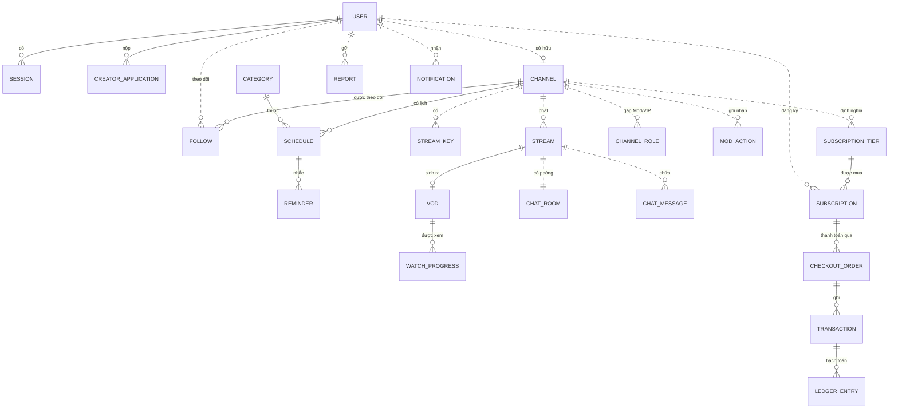

# NexusLive — Mô hình dữ liệu

| | |
| --- | --- |
| **Phiên bản** | 1.2 (Draft) |
| **Cập nhật** | 2026-10-13 (GĐ1) |
| **Nguồn** | PRD v2.1 §8.2, NXL-A §7, NXL-B §7, NXL-D §7 |

Mức khái niệm: entity, trường chính, trạng thái và quan hệ. ERD mức logic (bảng, cột, kiểu, ràng buộc)
nằm ở `DATN/docs/ba/analysis/erd/` (từ thư mục này: `../../../docs/ba/analysis/erd/`); migration lấy ERD làm chuẩn.

## Quy ước

- Khóa chính là UUID v7 (sắp xếp theo thời gian), tên cột `id`.
- Thời gian lưu UTC (`timestamptz`), tên `*_at`.
- Tham chiếu sang entity của **service khác** chỉ là cột ID, không có foreign key (đánh dấu ⇢ bên dưới).
- Trạng thái lưu dạng chuỗi in hoa (`LIVE`, `ACTIVE`…), khớp với state machine trong spec.
- Xóa mềm (`deleted_at`) cho dữ liệu người dùng nhìn thấy; dữ liệu tài chính không bao giờ xóa.
- Mỗi service có bảng `outbox` và `processed_events` (xem [system-architecture.md](system-architecture.md) §5.2).

## 1. identity-svc

| Entity | Trường chính | Trạng thái |
| --- | --- | --- |
| **User** | id, username (duy nhất, không phân biệt hoa thường), display_name, email, email_verified_at, birth_date, locale, timezone, global_role (`USER`/`ADMIN`), locked_until, failed_logins, last_failed_login_at (v1.2: khóa tạm BR-D09), preferences (jsonb, v1.2: `sidebarCollapsed`, `matureVisible`), created_at | `ACTIVE` · `LOCKED` · `DELETED` |
| **Credential** | user_id, password_hash (argon2id), updated_at | — |
| **Session** | id, user_id, refresh_token_hash, user_agent, ip, expires_at, revoked_at | — |
| **EmailToken** | user_id, token_hash, purpose (`VERIFY`/`RESET`), created_at (v1.2: giới hạn gửi lại), expires_at, used_at | Một token còn hiệu lực mỗi mục đích |
| **CreatorApplication** | id, user_id, legal_name, birth_date, note, reject_reason, reviewed_by, reviewed_at, updated_at (v1.2) | `PENDING` → `APPROVED` / `REJECTED` / `CANCELLED` (v1.2, NXL-D §7.2) |
| **UserChannel** (v1.2) | user_id (PK), channel_id ⇢ (duy nhất), handle, display_name — bản sao kênh để `/v1/me` trả `isCreator`, `channelId` | Bản sao từ `channel.created` |
| **UserBlock** | blocker_id, blocked_id, created_at | — |

## 2. channel-svc

| Entity | Trường chính | Trạng thái |
| --- | --- | --- |
| **Channel** | id, owner_id ⇢ User, handle (duy nhất), display_name, bio, avatar_url, banner_url, social_links (jsonb), verified, mature_default, is_live (bản sao), current_stream_id ⇢ (bản sao) | `ACTIVE` · `SUSPENDED` |
| **Category** | id, slug, name, poster_url, group (`GAMES`/`ESPORTS`/`MUSIC`/`IRL`/`CREATIVE`) | — |
| **Follow** | user_id ⇢, channel_id, notify_level (`ALL`/`LIVE_ONLY`/`OFF`), created_at | — |
| **Schedule** | id, channel_id, title, category_id, start_at, duration_min, rrule (tùy chọn) | `ACTIVE` · `CANCELLED` |
| **Reminder** | user_id ⇢, schedule_id, occurrence_at, notified_at | — |
| **SearchDocument** | entity_type, entity_id, title, title_unaccent, tsv, is_live, viewers | Bảng đọc dựng từ sự kiện |
| **SearchHistory** | user_id ⇢, query, created_at | Tối đa 20 mục mỗi người (UC-C07) |

## 3. stream-svc

| Entity | Trường chính | Trạng thái |
| --- | --- | --- |
| **StreamKey** | id, channel_id ⇢, key_hash, created_at, revoked_at | `ACTIVE` · `REVOKED` |
| **Stream** | id, channel_id ⇢, schedule_id ⇢, title, category_id ⇢, tags[], language, is_mature, scheduled_start_at, started_at, interrupted_at, ended_at, end_reason (`creator`/`ingest_timeout`/`admin_takedown`), peak_viewers | `SCHEDULED` → `LIVE` ⇄ `INTERRUPTED` → `ENDED`; `SCHEDULED` → `CANCELLED` (NXL-A §7A) |
| **StreamSettings** (v1.1) | channel_id ⇢ (PK), title, tags, language, is_mature, updated_at — cài đặt cho buổi phát kế tiếp, chép sang Stream khi OBS kết nối | — |
| **PlaybackSession** | id, stream_id hoặc vod_id, user_id ⇢ (rỗng với Guest), anon_id, mature_acknowledged, expires_at | — |
| **Vod** | id, stream_id, channel_id ⇢, duration_sec, playlist_path, thumbnail_url, visibility, expires_at | `PROCESSING` → `READY` → `EXPIRED` / `DELETED` (NXL-A §7C) |
| **WatchProgress** | user_id ⇢, vod_id, position_sec, updated_at | — |
| **MatureConsent** | user_id ⇢, channel_id ⇢, created_at | Ghi nhớ xác nhận mature theo tài khoản (FR-ST-12) |
| **CreatorChannel** (v1.2) | owner_id ⇢ User (PK), channel_id ⇢ (duy nhất), handle, display_name, avatar_url — Studio tra kênh của người gọi, catalog gắn `channel` vào stream/VOD | Bản sao từ `channel.created` |

Viewer count hiện tại nằm trong Redis; chỉ `peak_viewers` được ghi vào PostgreSQL khi stream kết thúc.

## 4. chat-svc

| Entity | Trường chính | Trạng thái |
| --- | --- | --- |
| **ChatRoom** | stream_id ⇢ (1–1), channel_id ⇢, status | `OPEN` · `READ_ONLY` · `CLOSED` (NXL-B §7A) |
| **ChatSettings** | channel_id ⇢, slow_sec, followers_min, subs_only, updated_by ⇢, updated_at | — |
| **ChatMessage** | id, stream_id ⇢, user_id ⇢, client_msg_id, body, fragments (jsonb), type (`NORMAL`/`SYSTEM`), deleted_at, deleted_by ⇢, pinned, created_at | Bảng phân vùng theo ngày |
| **ChannelRole** | channel_id ⇢, user_id ⇢, role (`MODERATOR`/`VIP`), granted_by ⇢ | — |
| **ModAction** | id, channel_id ⇢, actor_id ⇢, target_user_id ⇢, type (`DELETE`/`TIMEOUT`/`BAN`/`UNBAN`/`PIN`), message_id, reason, expires_at | — |
| **BlockedTerm** | channel_id ⇢, term, created_by ⇢ | — |
| **Emote** | id, scope (`GLOBAL`/`CHANNEL`), channel_id ⇢, code, image_url, animated, tier_required | — |

Bản sao trong Redis (không phải nguồn sự thật): `follow_since:{channel}:{user}`,
`sub_tier:{channel}:{user}`, `ban:{channel}:{user}`, `timeout:{channel}:{user}`.

## 5. safety-svc

| Entity | Trường chính | Trạng thái |
| --- | --- | --- |
| **Report** | id, reporter_id ⇢, target_type (`USER`/`CHANNEL`/`STREAM`/`MESSAGE`), target_id ⇢, reason (`SPAM`/`HARASSMENT`/`VIOLENCE`/`SENSITIVE`/`COPYRIGHT`/`OTHER`), evidence (jsonb: 10 tin gần nhất), note | `OPEN` → `IN_REVIEW` → `RESOLVED` / `DISMISSED` |
| **AdminAction** | id, admin_id ⇢, type (`LOCK_USER`/`SUSPEND_CHANNEL`/`TAKEDOWN_STREAM`/…), target_id ⇢, report_id, reason, expires_at | — |
| **AuditLog** | id, actor_id ⇢, action, resource_type, resource_id, metadata (jsonb), source_service, created_at | Chỉ thêm, không sửa |

## 6. notification-svc

| Entity | Trường chính | Trạng thái |
| --- | --- | --- |
| **Notification** | id, user_id ⇢, type (`CREATOR_LIVE`/`STREAM_STARTING`/`MENTION`/`REPORT_RESULT`/`SUBSCRIPTION`/`SYSTEM`), payload (jsonb), link, read_at, deleted_at | `UNREAD` → `READ` → `DELETED` |
| **NotificationSetting** | user_id ⇢, type, in_app, email | — |
| **EmailOutbox** | id, to, template, data, attempts, sent_at, last_error | `PENDING` → `SENT` / `FAILED` |

## 7. billing-svc

| Entity | Trường chính | Trạng thái |
| --- | --- | --- |
| **SubscriptionTier** | id, channel_id ⇢, level (1/2/3), price_vnd, benefits, active | — |
| **Subscription** | id, user_id ⇢, channel_id ⇢, tier_id, period (`MONTH`), current_period_end, auto_renew, gifted_by ⇢ | `PENDING` → `ACTIVE` → `CANCELLED_PENDING_END` → `EXPIRED` |
| **CheckoutOrder** | id, user_id ⇢, tier_id, subscription_id, amount_vnd, idempotency_key, psp, psp_ref, payment_url, expires_at | `PENDING` → `PAID` / `FAILED` / `EXPIRED` |
| **Transaction** | id, order_id, type (`CHARGE`/`REFUND`), amount_vnd, psp_ref, raw_webhook (jsonb), created_at | Chỉ thêm |
| **LedgerEntry** | id, channel_id ⇢, transaction_id, payout_request_id, direction (`CREDIT`/`DEBIT`), amount_vnd, kind (`SUB_REVENUE`/`PLATFORM_FEE`/`PAYOUT`), created_at | Chỉ thêm; số dư = tổng |
| **PayoutRequest** | id, channel_id ⇢, amount_vnd, bank_info (mã hóa), reviewed_by ⇢ | `REQUESTED` → `APPROVED` / `REJECTED` (không chi trả thật) |

Tiền lưu dạng số nguyên VND, không dùng số thực.

## 8. Quan hệ tổng thể

Đường liền là quan hệ trong cùng service (có foreign key); đường đứt là tham chiếu xuyên service chỉ bằng ID.

## 9. Dữ liệu sao chép giữa service

| Bản sao | Ở service | Nguồn sự thật | Cập nhật bằng sự kiện |
| --- | --- | --- | --- |
| `Channel.is_live`, `current_stream_id` | channel-svc | stream-svc | `stream.started`, `stream.ended` |
| `user_channels` (v1.2) | identity-svc | channel-svc | `channel.created` |
| `creator_channels` (v1.2) | stream-svc | channel-svc | `channel.created` (sau này `channel.updated`) |
| Thời điểm follow | chat-svc (Redis) | channel-svc | `follow.created`, `follow.deleted` |
| Tier subscription | chat-svc (Redis) | billing-svc | `subscription.*` |
| Username, display_name | channel-svc, chat-svc | identity-svc | `user.updated` |
| Trạng thái khóa tài khoản | chat-svc, stream-svc | identity-svc / safety-svc | `user.locked`, `safety.user_actioned` |
| SearchDocument | channel-svc | channel-svc, stream-svc | `stream.*`, `stream.viewers` |

Mỗi bản sao phải có cách dựng lại từ đầu (API đọc của service nguồn) khi phát hiện lệch.

## Lịch sử

| Phiên bản | Ngày | Thay đổi |
| --- | --- | --- |
| 1.1 | 2026-10-10 | StreamSettings |
| 1.2 | 2026-10-13 | GĐ1: khóa tạm và preferences của User, EmailToken.created_at, đơn `CANCELLED`, bản sao kênh `user_channels` (identity) và `creator_channels` (stream); một user có thể có nhiều đơn (nộp lại sau khi bị từ chối) |
