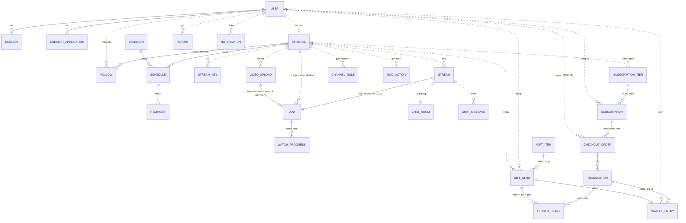

# NexusLive — Mô hình dữ liệu

| | |
| --- | --- |
| **Phiên bản** | 1.6 (Draft) |
| **Cập nhật** | 2026-11-28 (khách chat; overlay OBS) |
| **Nguồn** | PRD v2.1 §8.2, NXL-A §7, NXL-B §7, NXL-D §7 |

Mức khái niệm: entity, trường chính, trạng thái và quan hệ. ERD mức logic (bảng, cột, kiểu, ràng buộc)
nằm ở `DATN/docs/ba/analysis/erd/` (từ thư mục này: `../../../docs/ba/analysis/erd/`); migration lấy ERD làm chuẩn.

## Quy ước

- Khóa chính là UUID v7 (sắp xếp theo thời gian), tên cột `id`.
- Thời gian lưu UTC (`timestamptz`), tên `*_at`.
- Tham chiếu sang entity của **service khác** chỉ là cột ID, không có foreign key (đánh dấu ⇢ bên dưới).
- Trạng thái lưu dạng chuỗi in hoa (`LIVE`, `ACTIVE`…), khớp với state machine trong spec.
- Xóa mềm (`deleted_at`) cho dữ liệu người dùng nhìn thấy; dữ liệu tài chính không bao giờ xóa.
- Mỗi service có bảng `outbox` và `processed_events` (xem [system-architecture.md](system-architecture.md) §5.2).

## 1. identity-svc

| Entity | Trường chính | Trạng thái |
| --- | --- | --- |
| **User** | id, username (duy nhất, không phân biệt hoa thường), display_name, email, email_verified_at, birth_date, locale, timezone, global_role (`USER`/`ADMIN`), locked_until, failed_logins, last_failed_login_at (v1.2: khóa tạm BR-D09), preferences (jsonb, v1.2: `sidebarCollapsed`, `matureVisible`), created_at | `ACTIVE` · `LOCKED` · `DELETED` |
| **Credential** | user_id, password_hash (argon2id), updated_at | — |
| **Session** | id, user_id, refresh_token_hash, user_agent, ip, expires_at, revoked_at | — |
| **EmailToken** | user_id, token_hash, purpose (`VERIFY`/`RESET`), created_at (v1.2: giới hạn gửi lại), expires_at, used_at | Một token còn hiệu lực mỗi mục đích |
| **CreatorApplication** | id, user_id, legal_name, birth_date, note, reject_reason, reviewed_by, reviewed_at, updated_at (v1.2) | `PENDING` → `APPROVED` / `REJECTED` / `CANCELLED` (v1.2, NXL-D §7.2) |
| **UserChannel** (v1.2) | user_id (PK), channel_id ⇢ (duy nhất), handle, display_name — bản sao kênh để `/v1/me` trả `isCreator`, `channelId` | Bản sao từ `channel.created` |
| **UserBlock** | blocker_id, blocked_id, created_at | — |

## 2. channel-svc

| Entity | Trường chính | Trạng thái |
| --- | --- | --- |
| **Channel** | id, owner_id ⇢ User, handle (duy nhất), display_name, bio, avatar_url, banner_url, social_links (jsonb), verified, mature_default, is_live (bản sao), current_stream_id ⇢ (bản sao) | `ACTIVE` · `SUSPENDED` |
| **Category** | id, slug, name, poster_url, group (`GAMES`/`ESPORTS`/`MUSIC`/`IRL`/`CREATIVE`) | — |
| **Follow** | user_id ⇢, channel_id, notify_level (`ALL`/`LIVE_ONLY`/`OFF`), created_at | — |
| **Schedule** | id, channel_id, title, category_id, start_at, duration_min, rrule (tùy chọn) | `ACTIVE` · `CANCELLED` |
| **Reminder** | user_id ⇢, schedule_id, occurrence_at, notified_at | — |
| **SearchDocument** | entity_type, entity_id, title, title_unaccent, tsv, is_live, viewers | Bảng đọc dựng từ sự kiện |
| **SearchHistory** | user_id ⇢, query, created_at | Tối đa 20 mục mỗi người (UC-C07) |

## 3. stream-svc

| Entity | Trường chính | Trạng thái |
| --- | --- | --- |
| **StreamKey** | id, channel_id ⇢, key_hash, created_at, revoked_at | `ACTIVE` · `REVOKED` |
| **Stream** | id, channel_id ⇢, schedule_id ⇢, title, category_id ⇢, tags[], language, is_mature, scheduled_start_at, started_at, interrupted_at, ended_at, end_reason (`creator`/`ingest_timeout`/`admin_takedown`), peak_viewers | `SCHEDULED` → `LIVE` ⇄ `INTERRUPTED` → `ENDED`; `SCHEDULED` → `CANCELLED` (NXL-A §7A) |
| **StreamSettings** (v1.1) | channel_id ⇢ (PK), title, tags, language, is_mature, updated_at — cài đặt cho buổi phát kế tiếp, chép sang Stream khi OBS kết nối | — |
| **PlaybackSession** | id, stream_id hoặc vod_id, user_id ⇢ (rỗng với Guest), anon_id, mature_acknowledged, expires_at | — |
| **Vod** | id, stream_id (rỗng khi `source = UPLOAD`, v1.3), channel_id ⇢, source (`LIVE`/`UPLOAD`, v1.3), title, description (v1.3), category_id ⇢, is_mature, duration_sec, playlist_path, thumbnail_url, visibility, published_at (v1.3), expires_at (chỉ `LIVE`; rỗng với `UPLOAD`), failure_reason, failure_retryable, processing_percent, processing_stage (v1.3) | `LIVE`: `PROCESSING` → `READY` → `EXPIRED` / `DELETED`. `UPLOAD` (v1.3): `PROCESSING` → `READY` / `FAILED`; `FAILED` → `PROCESSING` (thử lại); → `DELETED`; không hết hạn (NXL-A §7C, NXL-G2 §7.5) |
| **VideoUpload** (v1.3) | id, channel_id ⇢, user_id ⇢, vod_id (có khi `COMPLETED`), file_name (chỉ hiển thị), content_type, size_bytes, part_size, part_count, s3_upload_id, object_key (`sources/{id}` trong `nxl-uploads`), title, description, category_id ⇢, is_mature, visibility, parts (jsonb: số phần → ETag, kích thước), source_deleted_at, expires_at (+24 giờ) | `UPLOADING` → `COMPLETED` / `ABORTED` / `EXPIRED` (ADR-014) |
| **WatchProgress** | user_id ⇢, vod_id, position_sec, updated_at | — |
| **MatureConsent** | user_id ⇢, channel_id ⇢, created_at | Ghi nhớ xác nhận mature theo tài khoản (FR-ST-12) |
| **CreatorChannel** (v1.2) | owner_id ⇢ User (PK), channel_id ⇢ (duy nhất), handle, display_name, avatar_url — Studio tra kênh của người gọi, catalog gắn `channel` vào stream/VOD | Bản sao từ `channel.created` |

Viewer count hiện tại nằm trong Redis; chỉ `peak_viewers` được ghi vào PostgreSQL khi stream kết thúc.

## 4. chat-svc

| Entity | Trường chính | Trạng thái |
| --- | --- | --- |
| **ChatRoom** | stream_id ⇢ (1–1), channel_id ⇢, status | `OPEN` · `READ_ONLY` · `CLOSED` (NXL-B §7A) |
| **ChatSettings** | channel_id ⇢, slow_sec, followers_min, subs_only, block_links (GĐ5), guest_chat (v1.6: khách chat, mặc định `false`), updated_by ⇢, updated_at | — |
| **ChatMessage** | id, stream_id ⇢, user_id ⇢, client_msg_id, body, fragments (jsonb), type (`NORMAL`/`SYSTEM`), deleted_at, deleted_by ⇢, pinned, created_at, guest_name (v1.6: `varchar(20)`, `NULL` = tin của tài khoản; tin khách có `user_id` = guest key dẫn xuất từ `anonId`, không phải `users.id` — ADR-017) | Bảng phân vùng theo ngày |
| **ChannelRole** | channel_id ⇢, user_id ⇢, role (`MODERATOR`/`VIP`), granted_by ⇢ | — |
| **ModAction** | id, channel_id ⇢, actor_id ⇢, target_user_id ⇢ (v1.6: có thể là guest key), type (`DELETE`/`TIMEOUT`/`BAN`/`UNBAN`/`PIN`), message_id, reason, expires_at, target_guest_name (v1.6: biệt danh khách lúc bị xử lý, cho danh sách bị cấm) | — |
| **BlockedTerm** | channel_id ⇢, term, created_by ⇢ | — |
| **Emote** | id, scope (`GLOBAL`/`CHANNEL`), channel_id ⇢, code, image_url, animated, tier_required | — |
| **OverlaySettings** (v1.6) | channel_id ⇢ (PK), chat (jsonb: preset, background, bgColor, bgOpacity, textColor, fontFamily, fontSize, showBadges, usernameColor, maxMessages, fadeAfterSec), alert (jsonb: accentColor, durationSec, position, animation, minTotal, showMessage), updated_by ⇢, updated_at | Không có dòng = giá trị mặc định; giá trị hợp lệ kiểm ở chat-svc, không CHECK trong DB (ADR-018) |

Bản sao trong Redis (không phải nguồn sự thật): `follow_since:{channel}:{user}`,
`sub_tier:{channel}:{user}`, `ban:{channel}:{user}`, `timeout:{channel}:{user}`.

## 5. safety-svc

| Entity | Trường chính | Trạng thái |
| --- | --- | --- |
| **Report** | id, reporter_id ⇢, target_type (`USER`/`CHANNEL`/`STREAM`/`MESSAGE`; v1.3 thêm `VOD`), target_id ⇢, reason (`SPAM`/`HARASSMENT`/`VIOLENCE`/`SENSITIVE`/`COPYRIGHT`/`OTHER`), evidence (jsonb: 10 tin gần nhất), note | `OPEN` → `IN_REVIEW` → `RESOLVED` / `DISMISSED` |
| **AdminAction** | id, admin_id ⇢, type (`LOCK_USER`/`SUSPEND_CHANNEL`/`TAKEDOWN_STREAM`/…; v1.3 thêm `TAKEDOWN_VOD`), target_id ⇢, report_id, reason, expires_at | — |
| **AuditLog** | id, actor_id ⇢, action, resource_type, resource_id, metadata (jsonb), source_service, created_at | Chỉ thêm, không sửa |
| **VodCopy** (v1.3) | id (= `stream.vods.id`), channel_id ⇢, stream_id ⇢ (rỗng với video tải lên), source, title, deleted — bản sao để nhận report target `VOD` và gỡ video | Bản sao từ `stream.vod_ready`, `vod.published`, `vod.updated`, `vod.deleted`; thiếu thì hỏi `GET /internal/v1/vods/{id}` (TSD tải video lên §4.8) |

## 6. notification-svc

| Entity | Trường chính | Trạng thái |
| --- | --- | --- |
| **Notification** | id, user_id ⇢, type (`CREATOR_LIVE`/`STREAM_STARTING`/`MENTION`/`REPORT_RESULT`/`SUBSCRIPTION`/`SYSTEM`), payload (jsonb), link, read_at, deleted_at | `UNREAD` → `READ` → `DELETED` |
| **NotificationSetting** | user_id ⇢, type, in_app, email | — |
| **EmailOutbox** | id, to, template, data, attempts, sent_at, last_error | `PENDING` → `SENT` / `FAILED` |

## 7. billing-svc

| Entity | Trường chính | Trạng thái |
| --- | --- | --- |
| **SubscriptionTier** | id, channel_id ⇢, level (1/2/3), price_vnd, benefits, active | — |
| **Subscription** | id, user_id ⇢, channel_id ⇢, tier_id, period (`MONTH`), current_period_end, auto_renew, gifted_by ⇢ | `PENDING` → `ACTIVE` → `CANCELLED_PENDING_END` → `EXPIRED` |
| **CheckoutOrder** | id, user_id ⇢, order_type (`SUBSCRIPTION`/`TOPUP`), tier_id, channel_id ⇢, subscription_id, amount_vnd, idempotency_key, psp, psp_ref, payment_url, expires_at — tier / kênh chỉ có ở `SUBSCRIPTION` | `PENDING` → `PAID` / `FAILED` / `EXPIRED`; một đơn `TOPUP` chờ mỗi người |
| **Transaction** | id, order_id, type (`CHARGE`/`REFUND`), amount_vnd, psp_ref, raw_webhook (jsonb), created_at | Chỉ thêm |
| **LedgerEntry** | id, channel_id ⇢, transaction_id, payout_request_id, gift_send_id (đúng một nguồn), direction (`CREDIT`/`DEBIT`), amount_vnd, kind (`SUB_REVENUE`/`PLATFORM_FEE`/`PAYOUT_HOLD`/`PAYOUT_REVERSAL`/`GIFT_REVENUE`), created_at | Chỉ thêm; khả dụng = Σ(CREDIT − DEBIT); mỗi payout ≤ 1 hold, ≤ 1 reversal |
| **PayoutRequest** | id, channel_id ⇢, amount_vnd, bank_info (mã hóa), reviewed_by ⇢, provider, provider_ref, paid_at, settled_by ⇢, settled_at, failure_reason | `REQUESTED` → `APPROVED` → `PROCESSING` → `PAID`; `REJECTED` (từ `REQUESTED`), `FAILED` (từ `APPROVED`/`PROCESSING`); provider `MANUAL` — không chuyển tiền thật (ADR-015) |

| **WalletEntry** (v1.5) | id, user_id ⇢, direction, kind (`TOPUP`/`TOPUP_VOID`/`GIFT_SPEND`), amount_vnd, transaction_id \| gift_send_id (đúng một nguồn), created_at | Chỉ thêm; số dư ví = Σ(CREDIT − DEBIT) theo người dùng, có thể âm sau void, không rút / hoàn (ADR-016) |
| **GiftItem** (v1.5) | id, name, price_vnd, icon (khóa icon dựng sẵn), active, sort_order | Bật / tắt; không xóa |
| **GiftSend** (v1.5) | id, user_id ⇢, channel_id ⇢, gift_item_id, item_name, icon, unit_price_vnd, quantity, total_vnd, fee_vnd, message, created_at | Chỉ thêm; chụp lại vật phẩm lúc tặng |

Tiền lưu dạng số nguyên VND, không dùng số thực.

## 8. Quan hệ tổng thể

Đường liền là quan hệ trong cùng service (có foreign key); đường đứt là tham chiếu xuyên service chỉ bằng ID.

## 9. Dữ liệu sao chép giữa service

| Bản sao | Ở service | Nguồn sự thật | Cập nhật bằng sự kiện |
| --- | --- | --- | --- |
| `Channel.is_live`, `current_stream_id` | channel-svc | stream-svc | `stream.started`, `stream.ended` |
| `user_channels` (v1.2) | identity-svc | channel-svc | `channel.created` |
| `creator_channels` (v1.2) | stream-svc | channel-svc | `channel.created` (sau này `channel.updated`) |
| Thời điểm follow | chat-svc (Redis) | channel-svc | `follow.created`, `follow.deleted` |
| Tier subscription | chat-svc (Redis) | billing-svc | `subscription.*` |
| Username, display_name | channel-svc, chat-svc | identity-svc | `user.updated` |
| Trạng thái khóa tài khoản | chat-svc, stream-svc | identity-svc / safety-svc | `user.locked`, `safety.user_actioned` |
| SearchDocument | channel-svc | channel-svc, stream-svc | `stream.*` (v1.6: không có sự kiện `stream.viewers` — số người xem đọc thẳng khóa Redis `viewers:{streamId}` do chat-svc ghi); VOD: `stream.vod_ready`, `vod.updated`, `vod.deleted`, `vod.published` (v1.3, video tải lên) |
| VodCopy (v1.3) | safety-svc | stream-svc | `stream.vod_ready`, `vod.published`, `vod.updated`, `vod.deleted` |

Mỗi bản sao phải có cách dựng lại từ đầu (API đọc của service nguồn) khi phát hiện lệch.

## Lịch sử

| Phiên bản | Ngày | Thay đổi |
| --- | --- | --- |
| 1.1 | 2026-10-10 | StreamSettings |
| 1.2 | 2026-10-13 | GĐ1: khóa tạm và preferences của User, EmailToken.created_at, đơn `CANCELLED`, bản sao kênh `user_channels` (identity) và `creator_channels` (stream); một user có thể có nhiều đơn (nộp lại sau khi bị từ chối) |
| 1.3 | 2026-11-04 | Tải video lên (ADR-014, TSD `2026-11-02-video-upload-abr` §4.4, §4.8): `Vod` thêm `source`, `description`, `published_at`, `failure_*`, `processing_*`, `stream_id` / `expires_at` rỗng với `UPLOAD`, trạng thái `FAILED`; entity mới `VideoUpload`; safety: report target `VOD`, `TAKEDOWN_VOD`, bản sao `VodCopy`; quan hệ §8, bản sao §9 |
| 1.4 | 2026-11-27 | Chi trả rút tiền (ADR-015, TSD `2026-11-27-payout-settlement` §4.1): `PayoutRequest` thêm `PROCESSING`, `PAID`, `FAILED` và `provider`, `provider_ref`, `paid_at`, `settled_*`, `failure_reason`; `LedgerEntry.kind` `PAYOUT` → `PAYOUT_HOLD` + `PAYOUT_REVERSAL` |
| 1.5 | 2026-11-27 | Ví và quà tặng (ADR-016, DL-24, TSD `2026-11-27-donate` §4.1): `CheckoutOrder.order_type` (`TOPUP`: không tier / kênh); entity mới `WalletEntry`, `GiftItem`, `GiftSend`; `LedgerEntry` thêm nguồn `gift_send_id`, kind `GIFT_REVENUE`; §8 thêm quan hệ ví / quà |
| 1.6 | 2026-11-28 | Khách chat (ADR-017, DL-25, migration `20261128100001_guest_chat`): `ChatSettings.guest_chat`, `ChatMessage.guest_name`, `ModAction.target_guest_name`; ghi thêm `ChatSettings.block_links` (có từ GĐ5). Overlay OBS (ADR-018, DL-26, migration `20261129000001_overlay_settings`): entity mới `OverlaySettings`. §9 bỏ sự kiện `stream.viewers` (không có trong code) |
