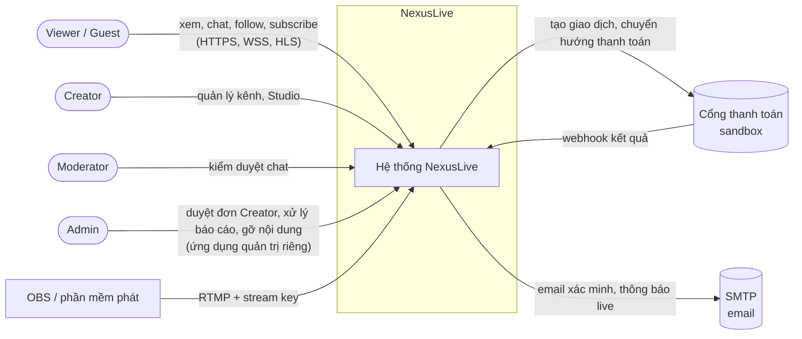
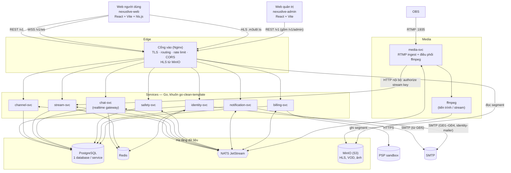
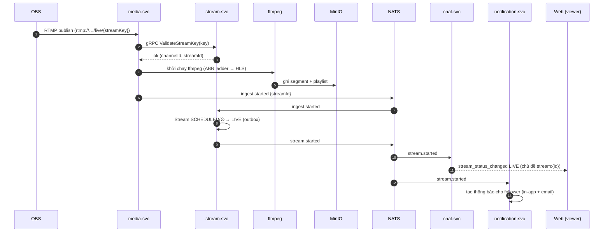
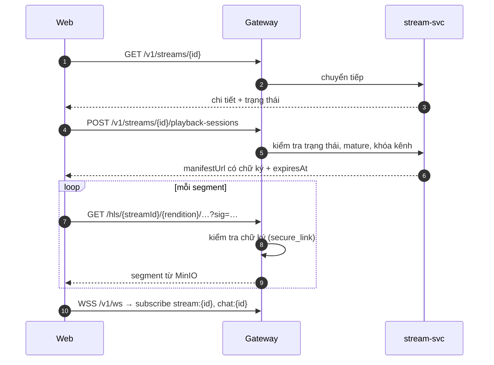
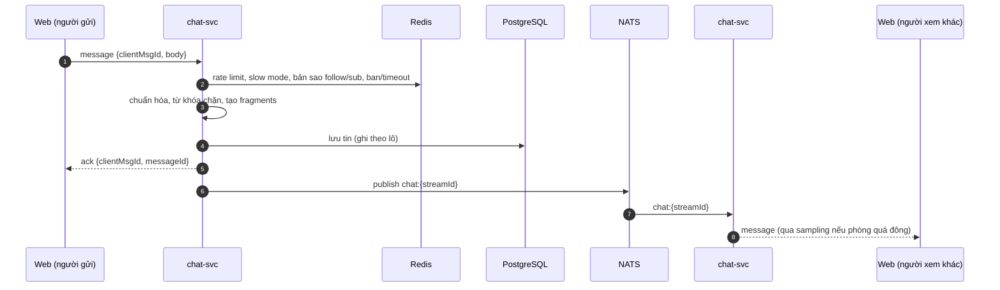
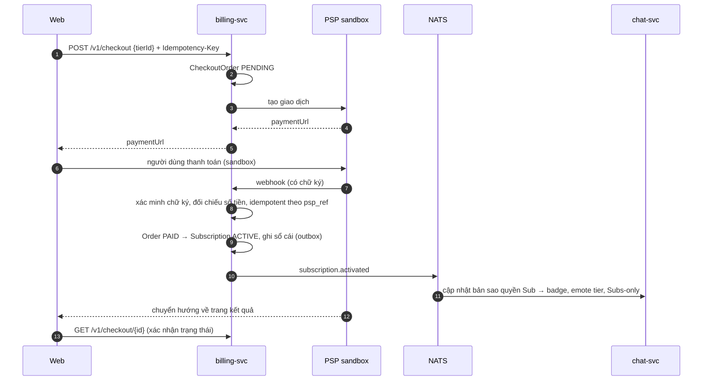

# NexusLive — Kiến trúc hệ thống

| | |
| --- | --- |
| **Phiên bản** | 1.1 (Draft) |
| **Cập nhật** | 2026-10-13 |
| **Quyết định nền** | [decisions.md](decisions.md) — ADR-001 → ADR-013 |
| **Dữ liệu** | [data-model.md](data-model.md) |

> Tài liệu ở mức kiến trúc. Chi tiết hợp đồng API, mã lỗi, sự kiện được chốt trong spec `NXL-00`;
> chi tiết media pipeline (RTMP, ffmpeg, HLS) đã chốt ở ADR-012 và spec `NXL-G1`.
> Những chỗ còn chờ làm rõ được đánh dấu **[CHỜ LÀM RÕ]**.

## 1. Động lực kiến trúc

| # | Động lực | Hệ quả thiết kế |
| --- | --- | --- |
| K1 | Video là trung tâm, phải chạy được với OBS thật | Media server riêng, tách khỏi logic nghiệp vụ; ffmpeg chạy theo tiến trình riêng từng stream |
| K2 | Chat realtime tải cao (tiêu chí S3, S4) | Gateway WebSocket co giãn ngang, fan-out qua message broker, trạng thái nóng trong Redis |
| K3 | Thanh toán thật (sandbox) phải đúng tuyệt đối | Service billing riêng, idempotency, transactional outbox, xác minh chữ ký webhook |
| K4 | Một service lỗi không kéo sập toàn hệ thống (S7) | Giao tiếp bất đồng bộ là mặc định; lời gọi đồng bộ có timeout và đường lui |
| K5 | 1 người, ~4,5 tháng | Ít service, chung một khuôn code, monorepo, một lệnh `docker compose up` chạy cả hệ thống |
| K6 | Kiến trúc phải là nội dung bảo vệ được trong đồ án | Ranh giới service theo domain rõ ràng, tài liệu ADR, sơ đồ C4 |

## 2. Bối cảnh hệ thống (C4 — Context)



## 3. Thành phần (C4 — Container)



| Container | Công nghệ | Vai trò |
| --- | --- | --- |
| Web người dùng (`nexuslive-web`) | React 19, Vite, TypeScript, TanStack Query, hls.js | Giao diện Guest, Viewer, Creator Studio; không chứa màn quản trị |
| Web quản trị (`nexuslive-admin`) — GĐ1 | React 19, Vite, TypeScript, TanStack Query (cùng stack web người dùng) | Màn Admin: duyệt đơn Creator (GĐ1); report, khóa tài khoản/kênh, gỡ stream, audit (GĐ5). Deploy riêng (`admin.<domain>`) — ADR-013 |
| Cổng vào (Nginx) | Nginx | Điểm vào duy nhất cho trình duyệt: TLS, định tuyến theo tiền tố đường dẫn, rate limit, CORS (origin web + admin), header bảo mật, nâng cấp WebSocket, phục vụ HLS từ MinIO (URL có chữ ký 📋 GĐ5/GĐ7) |
| 7 business service | Go, Fiber (REST), HTTP nội bộ (gRPC khi có toolchain proto), khuôn go-clean-template | Logic nghiệp vụ theo domain (§4) |
| media-svc | Go + ffmpeg | Nhận RTMP, hỏi stream-svc xác thực key, khởi chạy/giám sát ffmpeg, báo sự kiện ingest |
| PostgreSQL | PostgreSQL 16 | Dữ liệu bền của từng service; mỗi service một database riêng trong cùng instance |
| Redis | Redis 7 | Rate limit, presence, viewer count, cache quyền chat, phiên |
| NATS JetStream | NATS | Sự kiện miền giữa các service; fan-out chat giữa các instance chat-svc |
| MinIO | S3-compatible | Segment HLS, playlist, VOD, thumbnail, avatar/banner, emote |

**Cổng dev** (chi tiết: `../api/README.md` §1):

| Container | Cổng | Trạng thái |
| --- | --- | --- |
| Cổng vào Nginx | 8080 | GĐ0 ✅ |
| identity-svc | 8090 | ✅ |
| media-svc | 1935 (RTMP), 8091 | ✅ |
| stream-svc | 8092 (công khai), 8093 (nội bộ) | ✅ |
| channel-svc | 8094 | GĐ1 |
| chat-svc | 8095 | 📋 GĐ3 |
| Web người dùng (Vite dev) | 5173 | ✅ |
| Web quản trị (Vite dev) | 5174 | GĐ1 |

## 4. Danh mục service

Mỗi service **sở hữu dữ liệu của mình**; service khác chỉ đọc qua API/gRPC hoặc giữ bản sao cục bộ
dựng từ sự kiện. Không service nào đọc database của service khác.

| Service | Trách nhiệm | Dữ liệu sở hữu | Cổng giao tiếp | Phát sự kiện | Nghe sự kiện | Có từ |
| --- | --- | --- | --- | --- | --- | --- |
| **identity-svc** | Đăng ký, đăng nhập, xác minh email, phiên, JWT, hồ sơ tài khoản, vai trò toàn cục (admin), đăng ký Creator, block giữa người dùng | User, Credential, Session, CreatorApplication, UserBlock | REST, JWKS, CLI `identity promote-admin` | `user.registered`, `auth.email_requested`, `user.email_verified`, `user.profile_updated`, `creator.application_submitted`, `creator.approved`, `creator.rejected`; 📋 `user.locked` | `channel.created` (bản sao `user_channels`), `auth.email_requested` (consumer `identity-mailer` gửi SMTP tới GĐ5); 📋 `safety.user_actioned` | GĐ1 |
| **channel-svc** | Kênh, Creator Profile, Follow, Schedule + Reminder, Category, khám phá và tìm kiếm | Channel, Follow, Schedule, Reminder, Category, bảng đọc tìm kiếm | REST (cổng 8094) | `channel.created` (GĐ1); 📋 `channel.updated`, `follow.created`, `follow.deleted`, `schedule.created`, `schedule.cancelled`, `reminder.due` | `creator.approved` (tạo kênh), `stream.started`/`stream.ended` (`is_live`) — GĐ1; 📋 `user.profile_updated` | **GĐ1 tối thiểu** (tạo kênh, `GET /v1/channels/{handle}`) · GĐ4 đầy đủ |
| **stream-svc** | Stream key, vòng đời Stream (state machine NXL-A §7A), playback session, VOD, tiến độ xem, viewer count | StreamKey, Stream, StreamSettings, Vod, WatchProgress, PlaybackSession (📋), bản sao `creator_channels` | REST, HTTP nội bộ (authorize) | `stream.scheduled`, `stream.started`, `stream.interrupted`, `stream.resumed`, `stream.ended`, `vod.ready`, `stream.viewers` | `ingest.*`, `vod.processed`, `channel.created` (GĐ1); 📋 `safety.stream_takedown`, `schedule.*` | GĐ0 (PoC L1–L4) |
| **media-svc** | RTMP ingest, điều phối ffmpeg, ghi HLS + VOD, sinh thumbnail, đo sức khỏe ingest | Không có dữ liệu nghiệp vụ (chỉ trạng thái tiến trình) | RTMP, HTTP nội bộ (client), HTTP health/metrics | `ingest.started`, `ingest.stopped`, `ingest.health`, `vod.processed` | `stream.ended` (kick + chốt VOD) | GĐ0 (PoC L1–L4) |
| **chat-svc** | **Realtime gateway** (một kết nối WebSocket cho mọi chủ đề), phòng chat, tin nhắn, emote, chế độ chat, hành động mod trong chat, từ khóa chặn | ChatRoom, ChatMessage, ChatSettings, Emote, ModAction, BlockedTerm, ChannelRole (Mod/VIP) | WebSocket, REST | `chat.message_sent`, `chat.mention`, `chat.mod_action` | `stream.*`, `follow.*`, `subscription.*`, `notification.created`, `user.locked` | GĐ3 |
| **safety-svc** | Report, xử lý của Admin (khóa tài khoản/kênh, gỡ stream), audit log nền tảng | Report, AdminAction, AuditLog | REST | `safety.stream_takedown`, `safety.user_actioned`, `safety.report_resolved` | `chat.mod_action` (để audit) | GĐ5 |
| **notification-svc** | Tạo thông báo, notification center, gửi email, cài đặt nhận thông báo | Notification, NotificationSetting, EmailOutbox | REST | `notification.created` | `stream.started`, `reminder.due`, `chat.mention`, `safety.report_resolved`, `subscription.*` | GĐ5 |
| **billing-svc** | Tier subscription, Checkout, giao dịch với PSP, webhook, trạng thái Subscription, sổ cái số dư Creator, yêu cầu rút tiền | SubscriptionTier, Subscription, CheckoutOrder, Transaction, LedgerEntry, PayoutRequest | REST, webhook | `subscription.activated`, `subscription.renewed`, `subscription.expired`, `subscription.cancelled` | `creator.approved` (tạo tier mặc định) | GĐ6 |

**Nguyên tắc ranh giới**

- Phân quyền **theo kênh** (Mod, VIP) thuộc chat-svc vì chỉ có ý nghĩa trong chat và Studio cộng đồng;
  vai trò **toàn cục** (admin) thuộc identity-svc và nằm trong JWT.
- "Đã follow từ bao lâu" và "đang là Subscriber tier mấy" là dữ liệu của channel-svc và billing-svc;
  chat-svc giữ **bản sao trong Redis** dựng từ sự kiện để kiểm tra Followers-only/Subs-only mà không
  gọi đồng bộ cho mỗi tin nhắn.
- Mọi chuyển trạng thái Stream đi qua stream-svc. media-svc chỉ báo sự kiện ingest, không tự đổi trạng thái.

## 5. Giao tiếp

### 5.1 Ba kiểu giao tiếp

| Kiểu | Dùng khi | Công nghệ | Quy tắc |
| --- | --- | --- | --- |
| **Client → service** | Trình duyệt gọi nghiệp vụ | REST/JSON qua Gateway, tiền tố `/v1` | Envelope, mã lỗi, phân trang theo NXL-00 |
| **Service → service đồng bộ** | Cần câu trả lời ngay để quyết định (xác thực stream key, kiểm tra kênh tồn tại) | gRPC nội bộ | Timeout ≤ 300ms, không gọi chuỗi quá 1 bước, có đường lui khi lỗi |
| **Service → service bất đồng bộ** | Thông báo một việc đã xảy ra | NATS JetStream | Sự kiện bất biến, có `eventId` để chống xử lý trùng, phát qua transactional outbox |

Mặc định là **bất đồng bộ**. Một lời gọi gRPC mới phải nêu lý do trong TSD.

### 5.2 Định dạng sự kiện

- Subject: `nxl.<domain>.<event>.v<n>` — ví dụ `nxl.stream.started.v1`.
- Metadata đi trong **header NATS**, body chỉ là payload của sự kiện (quyết định 13/10/2026, GĐ0 Q3):
  `Nats-Msg-Id` = `eventId` (UUID, JetStream dùng để chống publish trùng); `type` = subject bỏ tiền tố `nxl.`;
  `Nxl-Occurred-At`, `Nxl-Producer`, `traceparent` thêm vào `pkg/eventbus` từ GĐ1. Lý do: `Nats-Msg-Id` vốn là
  header, và outbox + consumer đã chạy theo cách này từ L2. Định dạng chính thức: NXL-00 §11.
- Bên phát ghi sự kiện vào bảng **outbox** trong cùng transaction với thay đổi dữ liệu; một worker
  đẩy outbox lên NATS. Bên nghe lưu `eventId` đã xử lý (bảng `processed_events`) để idempotent.
- Bắt buộc dùng outbox cho billing-svc và stream-svc; các service khác dùng khi sự kiện ảnh hưởng dữ liệu.

### 5.3 Realtime gateway

chat-svc giữ **một** endpoint WebSocket `/v1/ws` cho trình duyệt. Client đăng ký theo chủ đề:

| Chủ đề | Nội dung | Nguồn |
| --- | --- | --- |
| `chat:{streamId}` | Tin nhắn, system message, delete, pin, mode_change… (NXL-B) | chat-svc |
| `stream:{streamId}` | `stream_status_changed`, `viewer_count`, `vod_ready` (NXL-A) | stream-svc qua NATS |
| `user:{userId}` | Thông báo mới, kết quả subscription | notification-svc, billing-svc qua NATS |
| `sidebar:{userId}` | Kênh đang theo dõi vừa live/offline | channel-svc qua NATS |

Cách này gộp kênh `stream:{id}` của NXL-A và `/v1/chat/ws` của NXL-B vào một kết nối; NXL-A/B sẽ
được cập nhật theo NXL-00 ở đợt đồng bộ.

Co giãn ngang: mỗi instance chat-svc subscribe các subject NATS của những phòng có client đang kết
nối tới nó; tin nhắn gửi vào instance A được publish lên NATS và instance B đẩy cho client của mình.

## 6. Các luồng chính

### 6.1 Creator Go Live



Mất tín hiệu: media-svc phát `ingest.stopped` → stream-svc chuyển `LIVE → INTERRUPTED` và hẹn giờ
`INGEST_GRACE_PERIOD`; có `ingest.started` lại trong hạn → `LIVE`, hết hạn → `ENDED` (`endReason = ingest_timeout`).

### 6.2 Xem stream



### 6.3 Gửi tin nhắn chat



### 6.4 Subscription qua cổng thanh toán sandbox



Trang kết quả **không** tin vào tham số chuyển hướng của PSP; trạng thái chỉ lấy từ billing-svc sau webhook.

## 7. Media pipeline (tổng quan)

Đã chốt ở ADR-012 (DL-13) và đặc tả ở NXL-G1; bảng dưới là thiết kế ban đầu, các dòng ghi **Hiện thực** là
chỗ khác:

| Bước | Thiết kế dự kiến |
| --- | --- |
| Ingest | RTMP cổng 1935, URL `rtmp://<host>/live/{streamKey}`; một stream key chỉ có một phiên publish tại một thời điểm |
| Xác thực | media-svc gọi stream-svc trước khi nhận dữ liệu; key sai → đóng kết nối. **Hiện thực:** HTTP nội bộ `POST /internal/v1/ingest/authorize`, timeout 2s |
| Transcode | Mỗi stream một tiến trình ffmpeg, ABR ladder: 720p30 (~2,5 Mbps), 480p30 (~1,2 Mbps), 360p30 (~0,7 Mbps) + audio AAC. **Hiện thực:** không giữ "source" |
| Đóng gói | HLS, segment 2s, playlist kiểu `EVENT` (chỉ thêm, không xóa segment), master playlist liệt kê các rendition |
| Tua lại khi live (DVR) | Playlist `EVENT` chứa mọi segment từ đầu buổi phát, nên người xem tua lại được trong toàn bộ buổi phát khi đang live (DL-10); player giữ điểm live mặc định và có nút "Về trực tiếp" |
| Nối lại sau rớt mạng | ffmpeg mới đánh số segment tiếp từ segment cuối, dùng `append_list` và chèn `#EXT-X-DISCONTINUITY` — không ghi đè phần đã phát |
| Lưu trữ | **Hiện thực:** ghi đĩa tạm rồi uploader đẩy lên MinIO (`nxl-media/streams/{streamId}/…`) |
| Phát | Nginx `/hls/*` → MinIO. URL có chữ ký 📋 GĐ5/GĐ7 |
| VOD | Cùng bộ file với live: khi kết thúc, playlist có thêm `#EXT-X-ENDLIST` (media-svc tự thêm nếu ffmpeg thoát bất thường); xóa sau 14 ngày (cấu hình) |
| Thumbnail | ffmpeg trích ảnh mỗi 30s cho thẻ stream |
| Sức khỏe | Đọc tiến độ ffmpeg (fps, bitrate, frame rơi) → `ingest.health` → Stream Manager |
| Độ trễ | Mục tiêu đồ án ≤ 6s (S2). **Số đo:** phía server < 0,6s khi máy theo kịp; ước tính glass-to-glass 4,5–6s (ADR-012) |
| Tài nguyên | Giới hạn số stream đồng thời theo CPU (`MEDIA_MAX_CONCURRENT_STREAMS`, mặc định 2; ~0,7 core / luồng 720p), từ chối publish khi vượt |

Các điểm từng để ngỏ đã trả lời ở ADR-012: thư viện `yutopp/go-rtmp`; ghi đĩa rồi upload MinIO; không SRT/WHIP;
chỉ CPU (x264 `veryfast`); số luồng chọn bằng `make nxl-bench` trên máy demo.

## 8. Dữ liệu

- **Database-per-service:** mỗi service một database PostgreSQL riêng (`identity`, `channel`, `stream`,
  `chat`, `safety`, `notification`, `billing`) trong cùng một instance khi dev/demo. Migration theo
  golang-migrate trong thư mục của từng service.
- **Tham chiếu chéo service chỉ bằng ID** (UUID); không có foreign key xuyên database.
- **Redis:** khóa có tiền tố theo service (`chat:`, `stream:`, `idn:`); không service nào đọc khóa của service khác.
- **MinIO buckets:** `hls-live`, `vod`, `thumbnails`, `media-public` (avatar, banner, emote).
- **ChatMessage** tăng nhanh nhất: bảng phân vùng theo ngày, giữ 30 ngày (cấu hình, PRD Q10 của NXL-B).

Chi tiết entity: [data-model.md](data-model.md).

## 9. Bảo mật

| Chủ đề | Thiết kế |
| --- | --- |
| Xác thực | identity-svc phát **access token JWT** (EdDSA, 15 phút) + **refresh token** xoay vòng (30 ngày, lưu băm). Các service tự xác minh JWT bằng khóa công khai lấy từ JWKS, không gọi identity-svc mỗi request |
| Guest | Không có token; Gateway cho phép các endpoint đọc công khai. WebSocket nhận kết nối Guest ở chế độ chỉ đọc |
| Phân quyền | Kiểm tra ở service sở hữu tài nguyên, không bao giờ chỉ ở frontend (PRD §8.3). Vai trò toàn cục trong JWT; vai trò theo kênh tra trong chat-svc |
| Stream key | Sinh ngẫu nhiên ≥ 32 byte, chỉ lưu bản băm; hiển thị một lần, có thể reset |
| Media | URL HLS có chữ ký và hạn dùng (Nginx `secure_link`); playback session cấp lại khi gần hết hạn |
| Thanh toán | Xác minh chữ ký webhook, so khớp số tiền và mã đơn, idempotency theo `psp_ref`; không lưu dữ liệu thẻ |
| Chat | Nội dung chỉ là văn bản + fragments do server tạo; không render HTML (chống XSS) |
| Biên | Rate limit theo IP ở cổng vào (GĐ1; theo user để sau); giới hạn kích thước body; CORS chỉ cho origin của web người dùng và `nexuslive-admin` (`/v1/admin/*` chỉ origin admin); header bảo mật (NXL-00 §9) |
| CSRF | Cookie refresh SameSite=Strict + header bắt buộc `X-NXL-Client: web\|admin` ở refresh/logout |
| Bí mật | Biến môi trường, không commit; `.env.example` liệt kê đầy đủ |
| Audit | Hành động mod, admin, thanh toán và thay đổi thông tin nhạy cảm ghi vào audit log (PRD NFR-BE-07) |

## 10. Độ tin cậy và xử lý lỗi

| Tình huống | Hành vi mong đợi |
| --- | --- |
| notification-svc dừng | Xem và chat vẫn chạy; sự kiện nằm chờ trong JetStream, xử lý khi service lên lại |
| chat-svc một instance chết | Client tự kết nối lại (backoff + jitter) và `resume` theo `lastMessageId` |
| media-svc mất ingest | Stream `INTERRUPTED` trong thời gian chờ, player hiển thị "Streamer sẽ quay lại ngay" |
| billing-svc nhận webhook trùng | Bỏ qua theo `psp_ref`, trả 200 cho PSP |
| PSP không gửi webhook | Job đối soát định kỳ hỏi trạng thái đơn `PENDING` quá hạn |
| NATS tạm mất | Outbox giữ sự kiện trong PostgreSQL, worker đẩy lại khi NATS lên |

## 11. Quan sát (Observability)

- **Tracing:** OpenTelemetry (go-clean-template đã có decorator tracing) — trace xuyên Gateway → service → NATS bằng header truyền ngữ cảnh.
- **Log:** JSON có `traceId`, `userId` (nếu có), không ghi token/mật khẩu.
- **Metrics:** Prometheus — số kết nối WS, tin nhắn/giây, độ trễ gửi→nhận, số stream đang transcode, CPU ffmpeg, độ dài hàng đợi outbox, tỷ lệ lỗi API. Grafana cho buổi demo.
- **Sự kiện sản phẩm (I4, rút gọn):** `stream_view_start`, `stream_view_heartbeat`, `chat_sent`, `follow`, `subscribe_complete`, `checkout_failed` — ghi log có cấu trúc, không có dashboard KPI.

## 12. Triển khai

| Môi trường | Cách chạy |
| --- | --- |
| Dev | `docker compose up` toàn bộ: Nginx, các service đã có, PostgreSQL, Redis, NATS, MinIO, Mailpit, Prometheus, Grafana. Hai web chạy `pnpm dev` (5173, 5174), Vite proxy `/v1` → cổng vào |
| Demo | Một VPS (≥ 4 vCPU, 8 GB RAM cho 2–3 stream transcode đồng thời), cùng file compose, TLS bằng Let's Encrypt |
| CI | GitHub Actions: lint, test, build image từng service khi thư mục của service đó thay đổi |

## 13. Cấu trúc mã nguồn

Backend là monorepo, mỗi service là một module Go theo khuôn go-clean-template (ADR-002).
Frontend gồm hai project riêng đặt cạnh repo backend trong thư mục DATN: `nexuslive-web` (người dùng) và
`nexuslive-admin` (quản trị, ADR-013). Cấu trúc backend:

```
nexuslive-be/
├── services/
│   ├── identity/       ← cmd/, config/, internal/{entity,usecase,repo,controller}, migrations/
│   ├── channel/
│   ├── stream/
│   ├── media/
│   ├── chat/
│   ├── safety/
│   ├── notification/
│   └── billing/
├── pkg/                ← dùng chung: logger, jwt verify, nats + outbox, postgres, tracing, httpserver, grpcserver
├── deploy/             ← nginx/, prometheus/, grafana/, postgres/ (docker-compose.yml ở thư mục gốc)
├── docs/               ← tài liệu này
└── go.work
```

Repo khởi đầu từ khuôn `go-clean-template` (một service). GĐ0 đã chuyển thành monorepo `nexuslive-be`
(module `github.com/minhnn/nexuslive-be`), gỡ app mẫu và cập nhật `AGENTS.md` cho nhiều service.
Hợp đồng gRPC nội bộ (`proto/`) sẽ thêm khi có lời gọi gRPC đầu tiên; hiện các service gọi nhau qua HTTP nội bộ.

## 14. Chỉ tiêu phi chức năng cho đồ án

| Chỉ tiêu | PRD | Đồ án | Ghi chú |
| --- | --- | --- | --- |
| Độ trễ video glass-to-glass P95 | < 1,5s | ≤ 6s | ADR-004 |
| Chat: tải trên một phòng | 100.000 tin/phút | ≥ 10.000 tin/phút, ≥ 1.000 kết nối | Đo bằng k6 |
| Chat: gửi → nhận P95 | < 500ms | < 500ms | Giữ nguyên |
| API đọc / ghi P95 | < 200 / 400ms | < 200 / 400ms | Ở tải demo |
| Khả dụng | 99,9% | Không đo | Thay bằng tiêu chí S7 |
| Stream transcode đồng thời | Theo CCU | 2–3 trên VPS demo | Giới hạn bởi CPU |
| Trình duyệt | 2 bản mới nhất của Chrome, Edge, Firefox, Safari | Chrome, Edge, Firefox bản mới nhất | Safari kiểm tra nếu có thiết bị |

## 15. Rủi ro kiến trúc

| Rủi ro | Mức | Giảm thiểu |
| --- | --- | --- |
| Microservices quá nặng cho 1 người | Cao | Thêm service theo giai đoạn, không dựng cả 8 từ đầu; chung `pkg/`; một file compose; khuôn code giống nhau (ADR-001) |
| ffmpeg tốn CPU, không đủ cho nhiều stream | Cao | Giới hạn stream đồng thời; ladder 3 mức; PoC đo CPU ngay GĐ0 |
| Đồng bộ dữ liệu bằng sự kiện bị lệch (follow/sub trong chat) | Trung bình | Outbox + idempotent consumer; API đối chiếu lại khi user join phòng |
| Độ trễ HLS cao hơn mong đợi | Trung bình | Segment 2s, `hls_list_size` nhỏ, đo ngay ở PoC |
| Cổng thanh toán sandbox khó tích hợp | Trung bình | Bọc PSP sau interface `PaymentProvider`; có provider giả lập cho test |

## 16. Lịch sử

| Phiên bản | Ngày | Thay đổi |
| --- | --- | --- |
| 1.1 | 2026-10-13 | GĐ1: thêm container web quản trị `nexuslive-admin` (ADR-013), bảng cổng dev; channel-svc có từ GĐ1 (cổng 8094); identity gửi email qua `identity-mailer`; cổng vào có rate limit, CORS, CSRF header; §7 trỏ ADR-012/NXL-G1 và ghi phần hiện thực; authorize là HTTP nội bộ |
| 1.0 | 2026-10-10 | Bản đầu (§5.2 sửa 13/10 theo errata E-11) |
