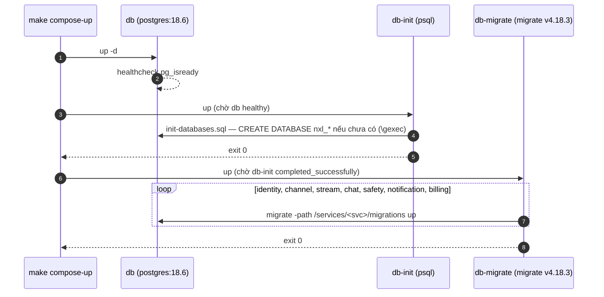

# TSD — Migration và database NexusLive trên Docker

| | |
| --- | --- |
| **Working Plan** | `../working/2026-10-10-nexuslive-db-migrations.md` |
| **Nguồn schema** | ERD v1.0 — `DATN/docs/ba/analysis/erd/` |
| **Trạng thái** | Đã triển khai (xem Completed Plan) |

## 1. Mục tiêu

Dựng 7 database PostgreSQL 18 theo database-per-service (ADR-005), tạo và migrate tự động khi chạy
`make compose-up`, chạy được trên volume `db_data` đã có dữ liệu.

## 2. Phạm vi

7 database `nxl_*`, 14 cặp migration up/down, 2 service compose một lần (`db-init`, `db-migrate`, profile `nxl`),
4 target Makefile. Không có code Go.

## 3. Luồng

- **Given** volume rỗng hoặc đã có dữ liệu, **When** `make compose-up`, **Then** 7 database tồn tại và ở version `20261010000002`.
- **Given** đã migrate, **When** chạy lại, **Then** `db-init` không tạo gì, `db-migrate` báo `no change` cho cả 7.
- **Given** `make nxl-migrate-down SVC=chat`, **Then** `nxl_chat` về rỗng; các database khác không đổi.

## 4. Chi tiết kỹ thuật

| Chủ đề | Quyết định |
| --- | --- |
| Khóa chính | `uuid DEFAULT uuidv7()` (có sẵn trong PostgreSQL 18) |
| Enum/trạng thái | `varchar` + `CHECK (... IN (...))` — đổi giá trị bằng migration mới, không dùng `CREATE TYPE` để tránh khó sửa |
| Extension | `citext` (identity, channel, notification), `unaccent` (channel) |
| Tìm không dấu | Hàm `immutable_unaccent()` bọc `unaccent` với dictionary cố định; `search_documents.title_unaccent` và `tsv` là **generated column** (ERD ghi là cột thường — app không phải tự ghi) |
| Phân vùng | `chat_messages` `PARTITION BY RANGE (created_at)` + phân vùng `DEFAULT`; PK (`id`, `created_at`) |
| Chỉ thêm | Trigger chặn UPDATE/DELETE trên `audit_logs`, `transactions`, `ledger_entries` |
| Database `db` của template | Không đổi |
| Profile compose `nxl` | Để `docker-compose-integration-test.yml` (dùng `--abort-on-container-exit`) không bị dừng bởi container chạy một lần |

### Ràng buộc nghiệp vụ được giữ ở database

| Database | Ràng buộc | Quy tắc nguồn |
| --- | --- | --- |
| identity | Mỗi user một đơn Creator `PENDING`; đơn đã duyệt phải có người duyệt | FR-AU-06 |
| identity | Không tự chặn chính mình | FR-MD-05 |
| channel | `handle` 3–25 ký tự `[A-Za-z0-9_]`, duy nhất không phân biệt hoa thường | FR-PF-01 |
| stream | Mỗi kênh tối đa một stream `LIVE`/`INTERRUPTED`; một stream key chưa thu hồi | NXL-A §7A |
| stream | `ENDED` ⇔ có `end_reason` và `ended_at`; `INTERRUPTED` phải có `interrupted_at` | NXL-A §7A |
| stream | Playback session gắn đúng một trong stream/VOD; Guest phải có `anon_id` | NXL-A §13 |
| chat | `slow_sec`, `followers_min` chỉ nhận giá trị NXL-B API 04 | NXL-B BR09, BR10 |
| chat | `TIMEOUT` phải có người bị xử lý và hạn; emote GLOBAL không có kênh và không khóa tier | NXL-B BR17, FR-MD-01 |
| safety | `RESOLVED`/`DISMISSED` ⇔ có `resolved_at` | FR-MD-10 |
| billing | Một subscription còn hiệu lực mỗi cặp user–kênh; `Idempotency-Key` duy nhất; (`psp_ref`, `type`) duy nhất | FR-MN-01, NFR-BE-04 |
| billing | Mỗi bút toán gắn đúng một giao dịch hoặc một yêu cầu rút tiền; tiền > 0 | Kiến trúc §6.4 |

### Ràng buộc **không** giữ được ở database (chat-svc phải tự đảm bảo)

- Mỗi phòng tối đa một tin ghim, và chống gửi trùng theo `client_msg_id`: unique index trên bảng phân vùng bắt buộc chứa `created_at`, nên không diễn đạt được. chat-svc kiểm bằng Redis và trong transaction khi ghim.

## 5. Xử lý lỗi và rollback

| Tình huống | Hành vi |
| --- | --- |
| `db` chưa sẵn sàng | `db-init` chờ healthcheck (tối đa ~60s) |
| Một migration lỗi | `db-migrate` dừng ở service đó (`set -e`), database đó bị đánh dấu `dirty` ở version lỗi; sửa file rồi `migrate force <version-1>` hoặc `make nxl-migrate-down SVC=<svc>` |
| Muốn làm lại một database | `make nxl-migrate-down SVC=<svc>` rồi `make nxl-migrate-up` |
| Bỏ hẳn NexusLive DB | `DROP DATABASE nxl_<svc>` — database `db` không bị ảnh hưởng |

## 6. Ước lượng

0,5 ngày viết SQL + 0,5 ngày cấu hình và kiểm tra.

## 7. Document control

| Phiên bản | Ngày | Thay đổi |
| --- | --- | --- |
| 1.0 | 2026-10-10 | Bản đầu, viết cùng lúc triển khai theo yêu cầu "thực hiện kế hoạch" |
