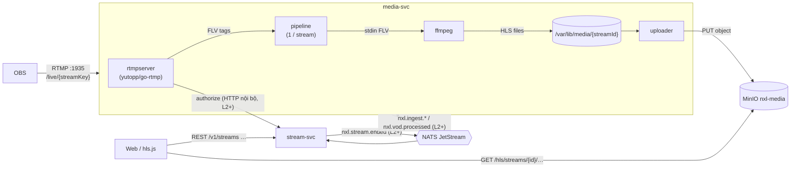
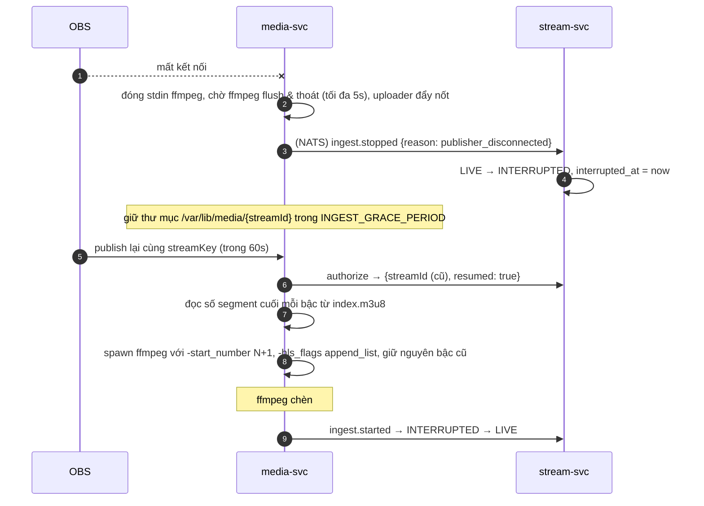

# TSD — Core livestream: OBS → RTMP → ffmpeg (ABR) → MinIO → HLS (+ DVR, VOD)

| | |
| --- | --- |
| **Working Plan** | `../working/2026-10-11-core-livestream-rtmp-hls.md` (v2) |
| **Trạng thái** | v1.4 — L1, L2, L3, L4 đã hiện thực (§7A.10 ghi phần khác bản duyệt) |
| **Quyết định đầu vào** | RTMP bằng thư viện Go; dependency do Claude chọn (§9); làm từng giai đoạn L1 → L4, dừng kiểm tra sau mỗi giai đoạn; DVR khi live (DL-10) |
| **Tham chiếu** | NXL-A §7A (+ errata E-10), Kiến trúc §5–§7, ADR-004, ERD `stream`, UC-A01–A13, UC-G01–G05, G13, G14 |

## 1. Mục tiêu

Creator phát từ OBS qua RTMP; hệ thống transcode ABR bằng ffmpeg, lưu HLS vào MinIO; người xem xem live (có tua lại),
đổi chất lượng, và xem lại VOD sau khi kết thúc — độ trễ live mục tiêu ≤ 6s (tiêu chí S2).

## 2. Phạm vi theo giai đoạn

| GĐ | Thành phần | Có trong GĐ này | Chưa có (để GĐ sau) |
| --- | --- | --- | --- |
| **L1** | media-svc, MinIO, trang thử | RTMP server, key **tĩnh** trong env, ffmpeg ABR, uploader, thumbnail, tự thêm ENDLIST, nối lại theo `streamKey` (giữ thư mục 60s), trang HTML thử + hls.js | stream-svc, NATS, web thật |
| **L2** | stream-svc, NATS | Stream key (DB), `authorize`, state machine, sự kiện ingest/stream qua NATS + outbox, job hết thời gian chờ, kết thúc từ API, VOD row | Web |
| **L3** | nexuslive-web | Studio, trang xem (ABR, DVR, trạng thái), danh sách đang phát | — |
| **L4** | Cả hệ | Trang VOD, giới hạn luồng, kick khi Creator kết thúc, dọn tạm, đo đạc, (tùy chọn) URL có chữ ký | — |

## 3. Thành phần và giao tiếp



## 4. Luồng chính

### 4.1 Publish (từ L2; ở L1 bước authorize là so khớp key tĩnh)

```mermaid
sequenceDiagram
    autonumber
    participant O as OBS
    participant R as media-svc rtmpserver
    participant S as stream-svc
    participant F as ffmpeg
    participant U as uploader
    participant B as MinIO
    participant N as NATS
    O->>R: TCP + handshake, connect(app=live)
    O->>R: publish(name = streamKey)
    R->>S: POST /internal/v1/ingest/authorize {streamKey, clientIp}
    alt key sai / đã thu hồi / kênh đang phát / vượt giới hạn luồng
        S-->>R: 403 INVALID_STREAM_KEY / 409 ALREADY_LIVE / 429 CAPACITY
        R-->>O: onStatus NetStream.Publish.BadName → đóng kết nối
    else hợp lệ
        S-->>R: {streamId, channelId, resumed}
        R->>R: chờ onMetaData (width, height, codec) tối đa 3s
        R->>F: spawn ffmpeg (lệnh §5.3), stdin = FLV
        R->>N: nxl.ingest.started.v1 {streamId, renditions}
        loop mỗi gói audio/video
            O->>R: FLV tag
            R->>F: ghi tag vào stdin
            F->>F: tạo seg_NNNNN.ts.tmp → đổi tên .ts; cập nhật index.m3u8.tmp → index.m3u8
            U->>B: PUT segment (immutable)
            U->>B: PUT playlist (khi mọi segment nó trỏ tới đã lên)
        end
        N->>S: ingest.started → stream LIVE → nxl.stream.started.v1
    end
```

### 4.2 OBS rớt mạng và nối lại (DVR / VOD không mất đoạn nào)



- Quá `INGEST_GRACE_PERIOD` (60s): stream-svc chuyển **ENDED** (`ingest_timeout`), phát `nxl.stream.ended.v1`; media-svc nhận, hoàn tất VOD (§4.3).

### 4.3 Kết thúc và VOD

1. Nguồn kết thúc: Creator bấm Kết thúc (stream-svc → `stream.ended` → media-svc **kick** OBS), hoặc hết thời gian chờ.
2. media-svc đóng stdin → ffmpeg ghi `#EXT-X-ENDLIST` vào mỗi `index.m3u8` và thoát.
3. Nếu ffmpeg thoát mã ≠ 0 hoặc bị kill: media-svc **tự thêm** `#EXT-X-ENDLIST` vào playlist còn thiếu.
4. Uploader đẩy playlist cuối với `Cache-Control: max-age=3600`, xóa thư mục tạm.
5. Phát `nxl.vod.processed.v1 {streamId, durationSec, playlistPath}` → stream-svc tạo `vods` **READY**, `expires_at = +14 ngày`.

### 4.4 Người xem: live, DVR, kết thúc

- **Given** stream LIVE, **When** mở `/live/{id}`, **Then** hls.js tải `master.m3u8`, bắt đầu ở điểm live (`liveSyncDurationCount = 2`).
- **Given** đang live, **When** kéo thanh thời gian về phút 3, **Then** phát từ phút 3 (playlist EVENT có mọi segment); nhãn `-mm:ss`, badge LIVE xám, nút **Về trực tiếp** → `hls.liveSyncPosition`.
- **Given** đang xem lùi, **When** stream ENDED, **Then** player phát tiếp tới hết; khi `ended` → màn "Buổi phát đã kết thúc" + **Xem lại** (`/vod/{vodId}`, cùng file).
- **Given** INTERRUPTED và đang ở điểm live, **Then** overlay "Streamer sẽ quay lại ngay"; ở phía sau thì vẫn xem tiếp.

## 5. Chi tiết kỹ thuật — media-svc

### 5.1 Cấu trúc mã (`services/media`)

```
cmd/media/main.go
config/config.go
internal/
  entity/        stream session, rendition, ladder, errors
  rtmpserver/    go-rtmp handler: connect/publish/metadata/audio/video/close
  pipeline/      1 pipeline / stream: ffmpeg process, FLV writer, progress parser, lifecycle
  ladder/        chọn bậc theo nguồn (thuần, có test)
  ffmpegcmd/     dựng tham số ffmpeg (thuần, có test)
  hlsfs/         đọc số segment cuối, thêm ENDLIST (thuần, có test)
  uploader/      quét thư mục, thứ tự segment → playlist, retry, Cache-Control
  storage/       interface ObjectStore + minio impl + fake cho test
  authz/         interface Authorizer: static (L1), http stream-svc (L2)
  events/        interface Publisher: noop (L1), NATS (L2)
  app/           wiring, graceful shutdown (kick mọi luồng, đóng ffmpeg, flush upload)
```

### 5.2 RTMP → ffmpeg

- Handler của `yutopp/go-rtmp` nhận `OnPublish` (lấy `PublishingName` = stream key, bỏ query string), `OnSetDataFrame` (onMetaData), `OnAudio`, `OnVideo`, `OnClose`.
- **(v1.1)** Thân message RTMP chính là thân tag FLV, nên media-svc tự ghi header 11 byte + `PreviousTagSize` (`pipeline/flv.go`) thay vì giải mã rồi mã hóa lại bằng `go-flv`; `go-flv` chỉ dùng để đọc `onMetaData`.
- Tag được ghi vào `stdin` của ffmpeg (`-f flv -i pipe:0`). Ghi chặn (blocking) có chủ đích: ffmpeg chậm thì RTMP đọc chậm theo, OBS thấy và báo frame rơi — không đệm vô hạn trong RAM.
- Chỉ nhận **H.264 + AAC** (FLV codec id 7 và sound format 10); khác → từ chối với log `UNSUPPORTED_CODEC` (giả định G2).
- Không có audio sau 3s kể từ video đầu tiên → ffmpeg chạy nhánh chỉ có video (`-an` cho mọi bậc).
- `onMetaData` thiếu kích thước → mặc định coi nguồn 1080p (ffmpeg vẫn scale đúng; chỉ ảnh hưởng chọn bậc).

### 5.3 Bậc chất lượng và lệnh ffmpeg

| Bậc | Điều kiện có | Video | maxrate / bufsize | Audio |
| --- | --- | --- | --- | --- |
| 720p | nguồn ≥ 720 | 1280×720 (giữ tỉ lệ, `scale=-2:720`) | 2 500k / 2 675k / 3 750k | AAC 128k |
| 480p | nguồn ≥ 480 | `scale=-2:480` | 1 200k / 1 284k / 1 800k | AAC 128k |
| 360p | luôn có | `scale=-2:360` (nguồn < 360 → giữ nguồn) | 700k / 749k / 1 050k | AAC 96k |

```
ffmpeg -hide_banner -loglevel warning -nostats -progress pipe:2
  -f flv -i pipe:0
  -filter_complex "[0:v]fps=30,split=3[s0][s1][s2];[s0]scale=-2:720[v0];[s1]scale=-2:480[v1];[s2]scale=-2:360[v2];[0:v]fps=1/30,scale=320:-2[th]"
  -map [v0] -map 0:a -map [v1] -map 0:a -map [v2] -map 0:a
  -c:v libx264 -preset veryfast -tune zerolatency -profile:v main -pix_fmt yuv420p
  -g 60 -keyint_min 60 -sc_threshold 0 -force_key_frames "expr:gte(t,n_forced*2)"
  -b:v:0 2500k -maxrate:v:0 2675k -bufsize:v:0 3750k   (… tương tự cho 1, 2)
  -c:a aac -ar 48000 -ac 2 -b:a:0 128k -b:a:1 128k -b:a:2 96k
  -f hls -hls_time 2 -hls_playlist_type event -hls_flags independent_segments+temp_file[+append_list]
  -start_number <N>  -hls_segment_type mpegts
  -hls_segment_filename "%v/seg_%05d.ts" -master_pl_name master.m3u8
  -var_stream_map "v:0,a:0,name:720p v:1,a:1,name:480p v:2,a:2,name:360p" "%v/index.m3u8"
  -map [th] -update 1 -q:v 5 thumb.jpg
```

- Số bậc thực tế do `ladder` quyết định; `ffmpegcmd` dựng chuỗi `split`, `-map`, `var_stream_map` tương ứng.
- `-progress pipe:2` cho `frame, fps, bitrate, drop_frames, speed` → `ingest.health` mỗi 5s; `speed < 0.9` liên tục 15s → log cảnh báo "CPU không theo kịp".

### 5.4 Uploader

- Quét thư mục stream mỗi 250ms (không dùng fsnotify để chạy giống nhau trên Docker Desktop Windows).
- `*.ts` hoàn chỉnh (không còn `.tmp`) chưa upload → PUT (song song tối đa 4), đánh dấu đã lên.
- `index.m3u8` đổi nội dung (so sánh mtime + size) → parse danh sách segment; **chỉ PUT khi mọi segment trong đó đã lên**; nếu chưa, đợi vòng sau.
- `master.m3u8` → PUT một lần khi xuất hiện (và lại sau khi nối lại).
- `thumb.jpg` → PUT tối đa mỗi 30s.
- **(v1.1)** Khi OBS rớt, ffmpeg đóng playlist bằng `#EXT-X-ENDLIST`. Trong thời gian chờ nối lại, uploader đẩy playlist **đã bỏ ENDLIST** (cache ngắn), để người xem vẫn thấy luồng đang live. Chỉ lần `Flush` cuối (hết grace / tắt service) mới đẩy bản có ENDLIST với `max-age=3600` — kể cả `master.m3u8` (so sánh nội dung + Cache-Control, không chỉ nội dung).
- Lỗi: thử lại 3 lần (200ms, 800ms, 2s); vẫn lỗi → `uploadErrors++` trong health, segment đó thử lại ở vòng sau.

| Object | Content-Type | Cache-Control |
| --- | --- | --- |
| `*.ts` | `video/mp2t` | `public, max-age=31536000, immutable` |
| `index.m3u8` (live) | `application/vnd.apple.mpegurl` | `no-cache, max-age=1` |
| `index.m3u8` (có ENDLIST), `master.m3u8` | như trên | `public, max-age=3600` |
| `thumb.jpg` | `image/jpeg` | `public, max-age=30` |

### 5.5 Nối lại

- ~~`start_number = max + 1`~~ **(sửa ở v1.1, đã kiểm chứng với ffmpeg 6.1):** khi có `append_list`, ffmpeg tự đánh số tiếp sau các segment đã có trong playlist **và** ghi `start_number` thành `#EXT-X-MEDIA-SEQUENCE`. Vì vậy lần nối lại phải truyền lại **đúng `start_number` ban đầu (1)**: số file tiếp tục `max + 1`, `MEDIA-SEQUENCE` không đổi (người xem đang DVR không bị lệch). Truyền `max + 1` làm số file nhảy (`seg_00011` → `seg_00023`) và đổi `MEDIA-SEQUENCE` thành 12 — sai với playlist EVENT.
- `hlsfs.LastSegmentNumber` chỉ còn dùng để ghi log điểm nối.
- Trước khi chạy lại ffmpeg, bỏ `#EXT-X-ENDLIST` mà lần dừng trước đã ghi (`hlsfs.StripEndList`).
- Bậc giữ như lần đầu (lưu trong `stream session`), không tính lại từ nguồn mới.
- L1: khóa nối lại là `streamKey`, thư mục giữ 60s rồi chốt VOD. L2+: khóa là `streamId` do stream-svc trả (`resumed = true`).

### 5.6 Cấu hình (env)

| Biến | Mặc định | Ý nghĩa |
| --- | --- | --- |
| `MEDIA_RTMP_ADDR` | `:1935` | Cổng RTMP |
| `MEDIA_HTTP_PORT` | `8091` | `/healthz`, `/metrics` |
| `MEDIA_WORK_DIR` | `/var/lib/media` | Thư mục tạm |
| `MEDIA_MAX_CONCURRENT_STREAMS` | `2` | Giới hạn luồng transcode |
| `MEDIA_FFMPEG_PATH` | `ffmpeg` | |
| `MEDIA_GRACE_PERIOD` | `60s` | Giữ thư mục chờ nối lại (L1) |
| `MEDIA_STATIC_STREAM_KEY` | — | Chỉ L1: key cho phép phát |
| `MEDIA_S3_ENDPOINT` / `_ACCESS_KEY` / `_SECRET_KEY` / `_BUCKET` / `_USE_SSL` | `minio:9000` / … / `nxl-media` / `false` | MinIO |
| `MEDIA_PUBLIC_HLS_BASE` | `/hls` | Tiền tố URL người xem dùng |
| `MEDIA_STREAM_SVC_URL`, `MEDIA_INTERNAL_SECRET` | — | L2 |
| `NATS_URL` | — | L2 |

## 6. Chi tiết kỹ thuật — stream-svc (L2)

### 6.1 Dữ liệu (ERD `stream`, đã migrate)

- `stream_keys`: `key_hash = SHA-256(key)`; key 32 byte ngẫu nhiên, base64url, tiền tố `live_` để dễ nhận biết; một key chưa thu hồi mỗi kênh.
- `streams`: theo NXL-A §7A; `channel_id = user_id` (giả định G1 của plan).
- `vods`: tạo khi `vod.processed`.
- Cài đặt buổi phát kế tiếp (tiêu đề, tags, mature): **bảng mới `stream_settings(channel_id PK, title, tags, language, is_mature, updated_at)`** — migration `20261011000001_create_stream_settings` (ERD cập nhật v1.1).

### 6.2 State machine (không thêm trạng thái ngoài NXL-A §7A)

| Từ | Sự kiện | Sang | Hành động |
| --- | --- | --- | --- |
| — | `authorize` ok, kênh không có stream LIVE/INTERRUPTED | (tạo `streams` status **LIVE**, `started_at = now`) | trả `resumed=false` |
| INTERRUPTED (còn hạn) | `authorize` ok | giữ nguyên tới khi `ingest.started` | trả `resumed=true`, cùng `streamId` |
| LIVE | `authorize` ok | — | 409 `ALREADY_LIVE` |
| LIVE | `ingest.stopped` | INTERRUPTED | `interrupted_at = now` |
| INTERRUPTED | `ingest.started` | LIVE | `interrupted_at = null` |
| INTERRUPTED | job: `now - interrupted_at > 60s` | ENDED | `end_reason = ingest_timeout`, `stream.ended` |
| LIVE / INTERRUPTED | `POST /v1/studio/stream/end` | ENDED | `end_reason = creator`, `stream.ended` |

- `authorize` tạo stream trực tiếp ở LIVE (không có `SCHEDULED` ở task này) để OBS bắt đầu ngay; nếu ffmpeg không khởi động được, media-svc phát `ingest.stopped{transcoder_failed}` → INTERRUPTED → hết hạn thì ENDED.
- Mọi chuyển trạng thái dùng `UPDATE … WHERE id = $1 AND status = <từ>` để chống chạy đua (job hết hạn và nối lại xảy ra cùng lúc).
- Sự kiện ra ghi qua **outbox** (`pkg/outbox`: worker quét `outbox` chưa publish mỗi 200ms → JetStream, có `Nats-Msg-Id = eventId` để chống trùng).
- Sự kiện vào: consumer bền (`durable`) trên stream `NXL`, ghi `processed_events` trong cùng transaction với chuyển trạng thái.

### 6.3 API

**Công khai** (JWT EdDSA, xác minh bằng JWKS của identity-svc; `GET /v1/streams*` không cần đăng nhập):

```http
POST /v1/studio/stream-key            → 201 {"data":{"streamKey":"live_…","rtmpUrl":"rtmp://localhost:1935/live"}}
GET  /v1/studio/stream-key            → 200 {"data":{"hasKey":true,"rtmpUrl":"…","createdAt":"…"}}
GET  /v1/studio/stream                → 200 {"data":{"settings":{…},"current":{"streamId","status","startedAt","health":{…}}|null}}
PUT  /v1/studio/stream                {"title","tags":[],"isMature"} → 200
POST /v1/studio/stream/end            → 204 | 409 NOT_LIVE
GET  /v1/streams?status=live&cursor=&limit=24
GET  /v1/streams/{streamId}           → {"id","channelId","title","status","startedAt","endedAt","endReason",
                                         "manifestUrl":"/hls/streams/{id}/master.m3u8","thumbnailUrl","vodId"}
GET  /v1/vods/{vodId}                 → {"id","streamId","title","durationSec","manifestUrl","status","expiresAt"}
```

- `health` lấy từ `ingest.health` mới nhất (giữ trong bộ nhớ của stream-svc, không ghi DB).

**Nội bộ** (cổng 8093, header `X-Internal-Secret`):

```http
POST /internal/v1/ingest/authorize {"streamKey","clientIp"}
  200 {"streamId","channelId","resumed"} | 403 INVALID_STREAM_KEY | 409 ALREADY_LIVE | 429 CAPACITY
```

### 6.4 Chi tiết hiện thực L2 (v1.2)

- **Hạ tầng sự kiện dùng chung:**
  - `pkg/eventbus`: một JetStream stream `NXL`, subject `nxl.<type>`, giữ 7 ngày, chống trùng 2 phút theo `Nats-Msg-Id`. Consumer bền, ack thủ công, `MaxDeliver` 20, lỗi thì nak 2s; payload hỏng → `Term` (không gửi lại mãi).
  - `pkg/events`: hợp đồng payload của mọi sự kiện.
  - `pkg/outbox`: worker quét `outbox` mỗi 200ms với `FOR UPDATE SKIP LOCKED`, dừng ở sự kiện lỗi đầu tiên để giữ thứ tự, `Nats-Msg-Id = outbox.id`. identity-svc cũng dùng worker này (`user.registered.v1`).
  - Compose bật JetStream cho `nats` (`-js`).
- **media-svc không có DB** nên publish thẳng lên JetStream (id mới mỗi sự kiện), không qua outbox. Mất `ingest.stopped` được bù bằng timeout của stream-svc.
- **Định danh sự kiện = header `Nats-Msg-Id`.** stream-svc ghi `processed_events` trong cùng transaction với chuyển trạng thái.
- **media-svc ở chế độ có stream-svc:**
  - Kiểm tra giới hạn luồng **trước** khi gọi `authorize`, để không tạo dòng `streams` cho luồng không chạy được.
  - Nhận `stream.ended` → kick OBS và chốt VOD ngay, không chờ grace.
  - `MEDIA_GRACE_PERIOD` mặc định 90s, chỉ là lưới an toàn khi mất sự kiện.
  - stream-svc báo `resumed` cho một stream mà tiến trình không còn giữ (media khởi động lại) → đánh số segment từ `unix time` để không ghi đè object cũ. Đây là Known Debt: bản VOD phần trước bị tách khỏi playlist mới.
- **`ingest.health`** mỗi 5s. `bitrateKbps` là bitrate **nhận vào** (byte RTMP/giây), không phải bitrate đầu ra. fps/speed lấy từ `-progress` của ffmpeg, bằng 0 trong vài giây đầu.
- **`vod.processed` tới khi stream còn LIVE/INTERRUPTED** (media tắt trước): stream-svc chuyển ENDED (`ingest_timeout`) rồi tạo VOD trong cùng transaction.
- **Xác thực:**
  - stream-svc lấy khóa từ JWKS của identity-svc (`pkg/jwt.JWKSVerifier`): cache theo `kid`; gặp `kid` lạ thì tải lại, tối đa 10 giây một lần (identity dev sinh khóa mới mỗi lần khởi động).
  - Endpoint nội bộ dùng `NXL_INTERNAL_SECRET`, có mặc định riêng cho dev.
- **Mã lỗi `CAPACITY`** do media-svc tự trả (stream-svc không biết tải transcode); stream-svc chỉ trả `INVALID_STREAM_KEY` / `ALREADY_LIVE`.
- **`thumbnail_url` của `vods` lưu object key** (`streams/{id}/thumb.jpg`); API ghép `STREAM_HLS_BASE` khi trả về.

## 7. Chi tiết kỹ thuật — Web (L3)

> v1.3 đã duyệt; hiện thực 2026-10-12 (v1.4, xem §7A.10). L2 đã được bạn kiểm tra thủ công. L3 và L4 làm liền nhau, dừng kiểm tra **sau mỗi giai đoạn** như trước.

### 7.1 Phạm vi L3

| Trong phạm vi | Ngoài phạm vi (giai đoạn sau) |
| --- | --- |
| Trang chủ: lưới "Đang phát" | Sidebar kênh đang theo dõi, Browse/Category, Search (GĐ4) |
| Trang xem live `/live/:streamId`: player tự viết + đủ trạng thái + DVR | Chat, viewer count realtime (GĐ3) — chừa cột phải |
| Studio `/studio/stream`: key, cài đặt, trạng thái + health, preview, Kết thúc, hướng dẫn OBS | Category, lịch phát, Dashboard (GĐ4) |
| Mature gate (UC-A05) bản rút gọn: xác nhận một lần, nhớ trong trình duyệt | Ghi nhớ theo tài khoản + age gate ở playback session (GĐ5) |

Trang VOD làm ở L4 (§7A).

### 7.2 Cấu trúc mã (`nexuslive-web/src`)

```
features/
  streams/                 dữ liệu stream-svc
    api/streams-api.ts     listLive, getStream, getVod (gọi apiRequest)
    api/studio-api.ts      getKeyInfo, createKey, getStudio, updateSettings, endStream
    hooks/                 useLiveStreams, useStream (poll), useVod, useStudio*, mutations
    types.ts               Stream, Vod, Studio, Health… (khớp Swagger stream-svc)
  player/
    components/hls-player.tsx      <video> + vòng đời hls.js (hook useHls)
    components/player-controls.tsx play, âm lượng, thanh thời gian, chất lượng, theater, fullscreen
    components/seek-bar.tsx        thanh thời gian live (DVR) / VOD
    components/quality-menu.tsx    Auto · 720p / chọn bậc
    components/player-overlay.tsx  Buffering, Reconnecting, Interrupted, Ended, Error, Mature
    hooks/use-hls.ts               tạo/hủy Hls, map sự kiện → store, retry
    hooks/use-player-shortcuts.ts  phím tắt (UC-A08)
    stores/player-store.ts         Zustand: trạng thái phát (một store cho mỗi player, tạo bằng factory)
    lib/live-edge.ts               behindLive, nhãn "-mm:ss", ngưỡng "đang ở live"
  watch/
    live-page.tsx          /live/:streamId
  studio/
    stream-page.tsx        /studio/stream
    components/            key-card, settings-form, status-panel, obs-guide, end-stream-dialog
  home/
    live-grid.tsx          lưới trang chủ
components/ui/             thêm: dialog, badge, card, skeleton, copy-field (Tailwind, không thêm thư viện UI)
```

### 7.3 Proxy dev và cấu hình

Chưa có API Gateway (GĐ7) nên Vite proxy định tuyến theo tiền tố, web chỉ gọi một origin `localhost:5173`:

| Tiền tố | Đích | Biến |
| --- | --- | --- |
| `/v1/auth` | `http://localhost:8090` | `VITE_DEV_IDENTITY_URL` |
| `/v1/studio`, `/v1/streams`, `/v1/vods` | `http://localhost:8092` | `VITE_DEV_STREAM_URL` |
| `/hls` | `http://localhost:9000/nxl-media` (bỏ tiền tố `/hls`) | `VITE_DEV_HLS_URL` |

- `VITE_DEV_API_PROXY` hiện tại bị thay bằng ba biến trên. `/v1` còn lại vẫn trỏ identity để không phá route cũ.
- Đường dẫn `manifestUrl` / `thumbnailUrl` do stream-svc trả (`/hls/...`) dùng nguyên, không ghép host.

### 7.4 Player

**hls.js 1.7.3** (đã duyệt ở §9). Safari/iOS: dùng HLS gốc của `<video>` khi `Hls.isSupported()` sai — chỉ có Auto, không có menu bậc.

Cấu hình:

```ts
new Hls({
  liveSyncDurationCount: 2,        // ~4s sau live edge (segment 2s)
  // không đặt liveMaxLatencyDuration: để người xem tua lùi không bị kéo về live (DVR)
  backBufferLength: 90,
  manifestLoadingMaxRetry: 6, levelLoadingMaxRetry: 6, fragLoadingMaxRetry: 6,
  capLevelToPlayerSize: true,      // không tải 720p cho khung 360px
})
```

**Trạng thái hiển thị (NXL-A §9B)** — gộp từ trạng thái API và trạng thái hls.js:

| Hiển thị | Điều kiện | Giao diện |
| --- | --- | --- |
| Đang tải | Chưa có `MANIFEST_PARSED` | Skeleton 16:9 |
| Live | API `LIVE`, đang phát | Badge **LIVE** đỏ khi `behindLive ≤ 6s`, xám + nhãn `-mm:ss` khi lùi hơn |
| Buffering | `waiting` của `<video>` > 500ms | Spinner trên video |
| Reconnecting | hls.js lỗi fatal mạng; thử lại 1s, 2s, 4s | Lớp phủ "Đang kết nối lại…" |
| Error | Thử 3 lần vẫn lỗi, hoặc lỗi media không hồi phục | "Không phát được" + nút **Thử lại** |
| Interrupted | API `INTERRUPTED` **và** đang ở live edge | "Streamer sẽ quay lại ngay"; người xem đang lùi vẫn xem tiếp |
| Ended | API `ENDED` và `<video>` phát hết (`ended`), hoặc mở trang khi đã ENDED | "Buổi phát đã kết thúc" + **Xem lại** (khi có `vodId`) hoặc "Bản xem lại đang được xử lý" (poll tới khi có) |
| Không tìm thấy | API 404 | Trang 404 |
| Mature | `isMature` và chưa xác nhận | Lớp phủ xác nhận 18+, chưa tải manifest cho tới khi bấm đồng ý |

- Poll `GET /v1/streams/{id}`: mỗi 5s khi LIVE/INTERRUPTED; dừng khi ENDED và đã có `vodId`.
- Realtime qua WebSocket thay cho poll ở GĐ3.

**DVR (UC-A13, UC-A04):**

- Thanh thời gian trải từ đầu buổi phát (`seekable.start(0)`) tới `hls.liveSyncPosition`. Không kéo được quá live edge.
- `behindLive = liveSyncPosition − currentTime`. Hiện nhãn `-mm:ss` và nút **Về trực tiếp** khi `behindLive > 6s` (3 segment).
- Về trực tiếp: `video.currentTime = hls.liveSyncPosition`.
- Tạm dừng khi live được phép; phát lại thì tiếp từ chỗ dừng.
- Phím `←` / `→`: lùi/tới 10s (không quá live edge).

**Chất lượng (UC-A02):**

- Mặc định Auto (`currentLevel = -1`), nhãn "Auto · 720p" theo `LEVEL_SWITCHED`.
- Chọn bậc cố định → `hls.currentLevel = i`. Lựa chọn nhớ trong `localStorage` (khóa `nxl.player.quality`).

**Điều khiển và phím tắt (UC-A03, UC-A08):**

- Play/Pause, âm lượng + tắt tiếng (nhớ trong `localStorage`), Theater (thu gọn cột phải), Fullscreen (Fullscreen API trên khung player).
- Phím tắt khi focus không ở ô nhập:

| Phím | Việc |
| --- | --- |
| Space / K | Phát / dừng |
| M | Tắt / bật tiếng |
| F | Fullscreen |
| T | Theater |
| ← / → | Lùi / tới 10s |
| ↑ / ↓ | Âm lượng ±10% |
| Esc | Thoát fullscreen / theater |

  `C` (chat) và `P` (PiP) chờ GĐ3 / sau đồ án.
- Autoplay: thử phát có tiếng; trình duyệt chặn → phát tắt tiếng + nút "Bật tiếng".

**Lỗi hls.js:**

- `NETWORK_ERROR` fatal → `hls.startLoad()` theo backoff 1s, 2s, 4s.
- `MEDIA_ERROR` fatal → `recoverMediaError()` một lần, rồi `swapAudioCodec()`, rồi chuyển Error.
- `manifestLoadError` 404 khi vừa Go Live: playlist chưa lên MinIO; giữ trạng thái "Đang tải" và thử lại tối đa 20s.

### 7.5 Trang xem `/live/:streamId`

- **Bố cục desktop:** player 16:9 + dải thông tin (tiêu đề, tag, thời gian đã phát, nút Chia sẻ = sao chép link) + cột phải 340px "Chat sẽ có ở GĐ3".
- **Mobile:** xếp dọc.
- Theater: ẩn cột phải, player rộng toàn khung.
- Không cần đăng nhập (Guest xem được).

### 7.6 Studio `/studio/stream` (UC-G01–G05, RequireAuth)

| Khối | Hành vi |
| --- | --- |
| Stream key | `GET /stream-key`: chưa có → nút **Tạo key**. Có → "Đã tạo lúc …" + **Tạo lại** (dialog xác nhận: "OBS đang dùng key cũ sẽ bị ngắt khi phát lần sau"). Sau `POST`: key hiện **một lần** trong ô ẩn (Hiện/Ẩn, Sao chép) + cảnh báo "Lưu lại ngay, sẽ không hiển thị lại" |
| Server URL | `rtmpUrl` + nút Sao chép |
| Cài đặt buổi phát | Form react-hook-form + zod: tiêu đề 1–140 ký tự, tag (chip, ≤ 10, mỗi tag ≤ 25), mature; `PUT /studio/stream`; áp ngay cho buổi đang phát |
| Trạng thái | Poll `GET /studio/stream` 3s: Offline / LIVE / INTERRUPTED (đếm ngược 60s) |
| Health | Bitrate vào, fps, frame rơi, speed, lỗi upload. Cảnh báo vàng khi `speed < 0.9`, frame rơi tăng, hoặc `uploadErrors > 0`; health cũ hơn 20s → "Không có dữ liệu" |
| Preview | Player tắt tiếng của chính stream (cùng component) |
| Kết thúc | Nút đỏ + dialog xác nhận → `POST /studio/stream/end`; 409 `NOT_LIVE` → làm mới trạng thái |
| Hướng dẫn OBS | Custom server, key, Output: x264/NVENC, CBR ≤ 6000 kbps, keyframe 2s, 30 fps, AAC; nhắc tắt "Tự kết nối lại" khi muốn dừng hẳn (xem §7A.4) |

User menu thêm mục **Studio**. Trang chủ thay placeholder bằng lưới "Đang phát" (thumbnail 16:9 `thumbnailUrl` + `?t=` theo phút để tránh cache, tiêu đề, thời gian, badge LIVE/"Tạm gián đoạn"); trống → "Chưa có ai phát".

### 7.7 Kiểm thử L3

| Loại | Nội dung |
| --- | --- |
| Tĩnh | `pnpm typecheck`, `pnpm lint`, `pnpm build` |
| Unit (Vitest — dependency mới, cần duyệt) | `live-edge` (ngưỡng, nhãn), map trạng thái API + hls.js → trạng thái hiển thị, schema form Studio |
| E2E (Playwright — dependency mới, cần duyệt) | Chạy trên stack thật trong môi trường của Claude (identity + stream + media + NATS + PG + S3 giả, ffmpeg giả lập OBS): Studio tạo key → phát → trang chủ có thẻ → trang xem có đủ bậc, đổi bậc, tua lùi / Về trực tiếp, rớt → Interrupted → nối lại, Kết thúc → Ended. **Giới hạn:** Chromium của Playwright không giải mã H.264, nên phần "hình chạy được" kiểm bằng sự kiện hls.js (manifest, level, fragment) chứ không bằng khung hình |
| Thủ công (bạn) | Chrome thật + OBS thật. Nếu bạn mở app desktop, Claude có thể tự mở `localhost:5173` trong trình duyệt tích hợp trên máy bạn để kiểm tra phát H.264 thật |

---

## 7A. Chi tiết kỹ thuật — VOD và ổn định (L4)

> v1.3 — **chờ duyệt**.

### 7A.1 Trang VOD `/vod/:vodId` (UC-A06, UC-A07 rút gọn)

- `GET /v1/vods/{id}` → player chế độ VOD: thanh thời gian thường, hiện tổng thời lượng, không badge LIVE.
- Thông tin: tiêu đề, ngày phát, thời lượng, "Hết hạn sau N ngày".
- **Tiếp tục xem:** lưu vị trí mỗi 10s và khi rời trang vào `localStorage` (`nxl.vod.<id>`), hỏi "Xem tiếp từ mm:ss?" khi mở lại. Đây là bản tạm; API `PUT /v1/vods/{id}/progress` (UC-A07 theo tài khoản) làm ở GĐ4.
- Từ trang live Ended → **Xem lại** dẫn sang trang này; đang xem lùi lúc stream kết thúc thì phát tiếp tới hết rồi mới chuyển màn Ended (§7.4).
- 404 / hết hạn → "Bản xem lại không còn".

### 7A.2 media-svc: khôi phục sau khi khởi động lại

Giải Known Debt của L2 (TSD §6.4):

1. Trước khi mở cổng RTMP, quét `MEDIA_WORK_DIR`: mỗi thư mục `{uuid}` còn sót (media bị kill/crash) được chốt như hết grace:
   - `EnsureEndList`, upload nốt (Flush) rồi xóa thư mục;
   - phát `ingest.stopped{reason: "recovered"}` và `vod.processed`.
2. stream-svc nhận `vod.processed` cho stream còn LIVE/INTERRUPTED → ENDED (`ingest_timeout`) + tạo VOD (đã có ở L2).
3. OBS kết nối lại sau đó sẽ tạo **buổi phát mới**. Không còn trường hợp "resume stream mà process không biết", nên bỏ nhánh đánh số theo unix time.
4. Thư mục không chứa playlist hợp lệ (crash ngay khi bắt đầu) → xóa, không phát sự kiện.
5. Upload lỗi khi chốt → giữ thư mục, lần khởi động sau thử lại (đã có cơ chế giữ thư mục ở L1).

### 7A.3 Giới hạn luồng đồng thời

- Đã có ở L1/L2 (`MEDIA_MAX_CONCURRENT_STREAMS`, kiểm tra trước authorize). L4 bổ sung:
  - test tự động 2 kênh khi giới hạn 1;
  - log và health báo số lần từ chối do quá tải.
- Không thêm thông báo riêng trên Studio khi bị từ chối do quá tải: OBS đã báo lỗi kết nối. Hướng dẫn OBS ghi rõ nguyên nhân có thể gặp.

### 7A.4 Kết thúc chủ động không bị OBS tự nối lại (vấn đề mới phát hiện)

- **Vấn đề:** OBS mặc định bật *Auto-reconnect*. Creator bấm Kết thúc trên Studio → media-svc ngắt OBS → vài giây sau OBS tự kết nối lại bằng cùng key → stream-svc tạo **buổi phát mới**.
- **Giải pháp:** sau khi kết thúc với `end_reason = creator`, stream-svc từ chối `authorize` của kênh đó trong `STREAM_END_COOLDOWN` (mặc định 30s):
  - trả `409 RECENTLY_ENDED`;
  - media-svc trả OBS `Publish failed` như các lỗi khác;
  - OBS thử lại vài lần rồi dừng.
- Kết thúc do hết grace (`ingest_timeout`) không áp cooldown.
- Studio hiện "Đã kết thúc — tắt Stream trong OBS. Có thể phát lại sau 30s."
- **Không cần migration:** dùng `ended_at` của stream ENDED gần nhất của kênh.

### 7A.5 VOD hết hạn

- Job hết hạn của stream-svc (đang chạy mỗi 5s cho INTERRUPTED) thêm bước: `UPDATE vods SET status = 'EXPIRED' WHERE status = 'READY' AND expires_at <= now()`, chạy mỗi 10 phút.
- Object trên MinIO do lifecycle 14 ngày tự xóa (L1).

### 7A.6 Quan sát (Prometheus)

- `GET /metrics` trên media-svc (:8091) và stream-svc (cổng công khai), dùng `github.com/prometheus/client_golang` (đã có trong module gốc; với media/stream là dependency mới, cần duyệt).

| Metric | Loại | Service |
| --- | --- | --- |
| `media_active_streams` | gauge | media |
| `media_ffmpeg_speed{stream}` | gauge | media |
| `media_dropped_frames_total` | counter | media |
| `media_upload_seconds` | histogram | media |
| `media_upload_errors_total` | counter | media |
| `media_publish_rejected_total{reason}` | counter | media |
| `stream_live_streams` | gauge | stream |
| `stream_transitions_total{to}` | counter | stream |
| `stream_authorize_total{result}` | counter | stream |

- Chưa dựng Prometheus/Grafana (GĐ7); endpoint dùng ngay được để đo ở L4.

### 7A.7 Đo đạc và hành trình

- Script `scripts/measure-latency.md`: cách đo glass-to-glass bằng đồng hồ trong khung hình OBS + chụp màn hình; script ghi CPU `docker stats --no-stream media` mỗi 5s ra CSV.
- Kết quả điền vào `DATN/docs/report/measurements/2026-10-L1-media.md` (đổi tên thành `2026-10-livestream.md`).
- **Hành trình M2 (roadmap):** Creator tạo key → phát → Viewer xem trên trang chủ → tua lùi → Creator kết thúc → Viewer bấm Xem lại → VOD phát từ đầu tới hết.

### 7A.8 Không làm ở L4 (đề xuất dời)

| Mục | Đề xuất | Lý do |
| --- | --- | --- |
| URL HLS có chữ ký / playback session | Dời sang GĐ5 (cùng age gate) hoặc GĐ7 (cùng API Gateway + Nginx `secure_link`) | Cần Gateway/Nginx để ký và kiểm tra; làm riêng bây giờ sẽ phải làm lại |
| User MinIO riêng chỉ-ghi cho media-svc | Làm ở L4 nếu bạn muốn (nhỏ: `minio-init` tạo user + policy) | An toàn hơn nhưng chỉ ảnh hưởng dev |

### 7A.9 Kiểm thử L4

| Loại | Nội dung |
| --- | --- |
| Go unit | Recovery quét thư mục (playlist hợp lệ / rỗng / upload lỗi); cooldown authorize; VOD expiry |
| Go tích hợp | PG thật: cooldown sau `creator`, không cooldown sau `ingest_timeout`; media kill -9 khi đang phát → khởi động lại → VOD READY + stream ENDED |
| E2E (Playwright) | Kết thúc → Xem lại → VOD phát từ đầu tới `ended`; mở lại VOD → hỏi xem tiếp; giới hạn 1 luồng → kênh thứ hai bị từ chối |
| Thủ công (bạn) | OBS bật auto-reconnect: bấm Kết thúc → không tạo buổi phát mới; đo độ trễ/CPU |

### 7A.10 Hiện thực (v1.4)

| Mục | Như đã làm |
| --- | --- |
| Cooldown (7A.4) | `STREAM_END_COOLDOWN` (mặc định 30s, `0` = tắt). Use case kiểm tra trước khi gọi `Authorize` của repo bằng `EndedByCreatorSince` (stream ENDED gần nhất của kênh có `end_reason = creator` và `ended_at` trong cửa sổ). Lỗi `ErrRecentlyEnded` → `409 RECENTLY_ENDED`; media-svc phân biệt với `ALREADY_LIVE` qua mã lỗi trong body. Không migration |
| VOD hết hạn (7A.5) | Job riêng `STREAM_VOD_EXPIRY_TICK` (mặc định 10m), tách khỏi job 5s của INTERRUPTED |
| Khôi phục media (7A.2) | `session.Manager.Recover` chạy đồng bộ trước khi mở RTMP: thư mục tên UUID có `master.m3u8` + ít nhất một `*/index.m3u8` có segment → `EnsureEndList`, upload (tối đa 2 phút), xóa thư mục, phát `ingest.stopped{reason: "recovered"}` + `vod.processed`. Không có playlist → xóa. Upload lỗi → giữ thư mục, không phát sự kiện. `Uploader.Flush` dừng ngay khi context hết hạn |
| Nhánh đánh số theo unix time | **Giữ lại** làm lưới an toàn: nếu OBS nối lại trước khi stream-svc kịp xử lý `vod.processed` của lần khôi phục, stream-svc vẫn trả `resumed=true` cho một stream process mới không biết; đánh số từ 1 khi đó sẽ ghi đè object của VOD |
| Giới hạn luồng (7A.3) | `/healthz` của media-svc thêm `rejectedPublishes` theo lý do (`capacity`, `invalid_key`, `already_live`, `recently_ended`, `error`); cùng số liệu ở metric `media_publish_rejected_total{reason}` |
| Metrics (7A.6) | Registry riêng mỗi service (không dùng registry toàn cục). stream-svc: `GET :8092/metrics`; media-svc: `GET :8091/metrics`. Thêm Go/process collector. `stream_transitions_total{to}` chỉ đếm chuyển trạng thái thật (INTERRUPTED đọc lại trạng thái sau update có điều kiện). `media_upload_seconds` / `media_upload_errors_total` đo ở lớp `ObjectStore` (mỗi lần thử). `media_dropped_frames_total{stream}` là bộ đếm của lần publish hiện tại, về 0 khi nối lại |
| Trang VOD (7A.1) | `/vod/:vodId`: hỏi "Xem tiếp từ mm:ss?" trước khi tạo player; lưu mỗi 10s, khi rời trang (`pagehide`) và khi rời route; xem tới 10s cuối thì xóa vị trí; hết video → "Bạn đã xem hết" + "Xem lại từ đầu"; 404 → "Bản xem lại không còn". Chuỗi giao diện trong namespace i18n `vod` (vi/en) |
| Đo đạc (7A.7) | Hướng dẫn `scripts/measure-latency.md` |
| 7A.8 | Không làm (URL có chữ ký dời GĐ5/GĐ7; user MinIO chỉ-ghi chưa làm) |

---

## 8. Xử lý lỗi

| Tình huống | Hành vi |
| --- | --- |
| Key sai / thu hồi | OBS nhận `BadName`, kết nối đóng; log có IP, không log key |
| Vượt `MEDIA_MAX_CONCURRENT_STREAMS` | Từ chối như trên, mã `CAPACITY` |
| Codec không hỗ trợ | Từ chối sau tag video đầu tiên |
| ffmpeg thoát giữa chừng | `ingest.stopped{transcoder_failed}`, đóng RTMP (OBS tự nối lại → nối tiếp segment) |
| MinIO tạm lỗi | Retry; segment nằm trên đĩa tới khi lên được; health báo `uploadErrors` |
| media-svc tắt (SIGTERM) | Kick mọi luồng, đóng stdin, chờ ffmpeg ≤ 5s, flush upload ≤ 10s, thêm ENDLIST |
| stream-svc không gọi được (L2) | `authorize` timeout 2s → từ chối publish (an toàn hơn cho phép) |
| Viewer: 404 playlist khi vừa Go Live | hls.js retry theo `manifestLoadingMaxRetry`; web chỉ hiện player khi status LIVE |

## 9. Dependency (quyết định của Claude theo mục 2)

| Repo | Gói | Phiên bản | Vì sao chọn |
| --- | --- | --- | --- |
| BE | `github.com/yutopp/go-rtmp` + `github.com/yutopp/go-flv` | v0.0.7 / v0.3.1 | Thuần Go, có ví dụ server nhận publish từ OBS và ghi FLV — đúng mô hình "chuyển FLV vào ffmpeg"; không cần demux/remux. **Rủi ro:** ít cập nhật từ 2024, chỉ RTMP cổ điển (không HEVC/AV1 "enhanced RTMP") — chấp nhận vì yêu cầu H.264 (G2). **Phương án lùi:** `github.com/bluenviron/gortmplib` (dùng trong MediaMTX, đang được bảo trì) nếu go-rtmp lỗi với OBS ở GĐ-L1 |
| BE | `github.com/minio/minio-go/v7` | v7.0.100 | Client S3 chính thức của MinIO, gọn hơn AWS SDK v2; dùng được với S3 thật sau này |
| BE | `github.com/nats-io/nats.go` | có sẵn trong `go.mod` (v1.54) | JetStream cho sự kiện (L2) |
| FE | `hls.js` | 1.7.3 | Thư viện HLS phổ biến nhất, có ABR, live sync, DVR |

## 10. Bảo mật

- Stream key chỉ hiện một lần, lưu băm; so khớp qua tra cứu theo hash (không so chuỗi thô).
- Endpoint nội bộ chỉ mở trong mạng Docker, kèm shared secret; không qua Gateway.
- Đường dẫn file lấy từ `streamId` (UUID) do server sinh — không bao giờ ghép từ tên publish của OBS.
- MinIO: user riêng cho media-svc chỉ có quyền ghi bucket `nxl-media`; người xem chỉ đọc `streams/*` (L1–L3), L4 chuyển sang URL có chữ ký.
- Giới hạn kích thước tag RTMP và timeout handshake 10s để chống kết nối treo.

## 11. Quan sát

- Log có cấu trúc kèm `streamId`; metric Prometheus: `media_active_streams`, `media_ffmpeg_speed`, `media_dropped_frames_total`, `media_upload_seconds`, `media_upload_errors_total`.

## 12. Kiểm thử

| GĐ | Tự động (Claude chạy) | Thủ công (bạn chạy) |
| --- | --- | --- |
| L1 | Unit: `ladder`, `ffmpegcmd`, `hlsfs`, `uploader` (thứ tự, retry) với `ObjectStore` giả. Tích hợp: ffmpeg 6.1 giả lập OBS (`-re -f lavfi testsrc2 + sine → rtmp://…`) → media-svc → S3 giả (hoặc MinIO nếu chạy được) → kiểm playlist 3 bậc, ngắt/nối lại có `DISCONTINUITY`, ENDLIST; Chromium + hls.js phát được | OBS thật → trang thử; đo độ trễ và CPU 1–2 luồng, ghi `DATN/docs/report/measurements/` |
| L2 | Unit state machine (mọi dòng §6.2, chạy đua job hết hạn vs nối lại), stream key; tích hợp PostgreSQL 18 + NATS | OBS: key sai bị từ chối; rớt mạng < 60s / > 60s |
| L3 | `pnpm build`, `oxlint`, Playwright: Studio, phát live, đổi bậc, DVR tua lại / Về trực tiếp, Ended → Xem lại | Trải nghiệm trên máy thật |
| L4 | Giới hạn luồng, kick khi kết thúc, VOD phát từ đầu tới ENDLIST | Hành trình Creator + Viewer trọn vẹn (M2) |

## 13. Ước lượng

L1: 3–4 ngày · L2: 3–4 ngày · L3: 3 ngày · L4: 2 ngày — khớp tuần 1–2 (PoC) và GĐ2 tuần 6–8 của roadmap; nếu L1–L2 xong sớm, L3–L4 có thể kéo lên trước GĐ1 còn lại (xác minh email), bạn quyết khi tới điểm dừng.

## 14. Việc kéo theo cho tài liệu

- ERD `stream` thêm bảng `stream_settings` (v1.1) khi làm L2.
- Spec NXL-G1 viết từ TSD này sau L2; NXL-A v1.1 áp dụng errata E-10.
- Kiến trúc §6.1: ghi chú `authorize` là HTTP nội bộ (thay gRPC) cho tới khi có toolchain proto.

## 15. Document control

| Phiên bản | Ngày | Thay đổi |
| --- | --- | --- |
| 1.0 | 2026-10-11 | Bản đầu — chờ duyệt trước GĐ-L1 |
| 1.4 | 2026-10-12 | L4 hiện thực xong; thêm §7A.10 (cấu hình cooldown và job VOD, khôi phục media, metrics, giữ nhánh đánh số an toàn) |
| 1.3 | 2026-10-12 | Chi tiết L3 (§7: web, player, DVR, Studio) và L4 (§7A: trang VOD, khôi phục media-svc, cooldown sau khi kết thúc, VOD hết hạn, metrics, đo đạc) — chờ duyệt |
| 1.2 | 2026-10-11 | Thêm §6.4: chi tiết hiện thực GĐ-L2 (eventbus, outbox, JWKS, chế độ media-svc) |
| 1.1 | 2026-10-11 | Sau GĐ-L1: sửa `start_number` khi nối lại (§5.5), ẩn ENDLIST trong lúc INTERRUPTED (§5.4), ghi FLV trực tiếp (§5.2); media-svc vào `go.work`, Dockerfile các service copy cả `services/` |
