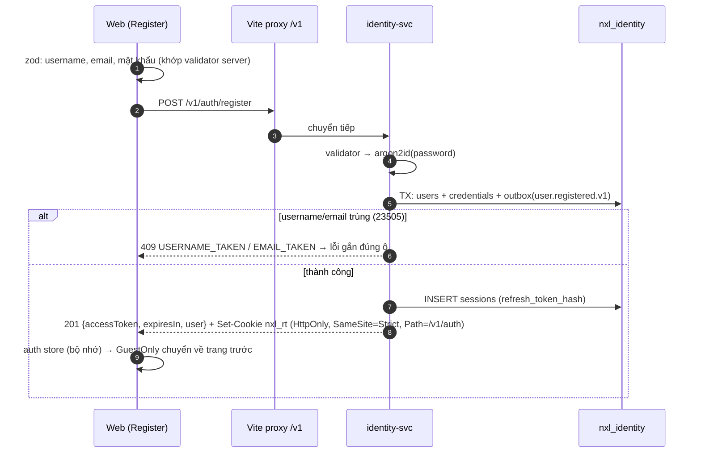
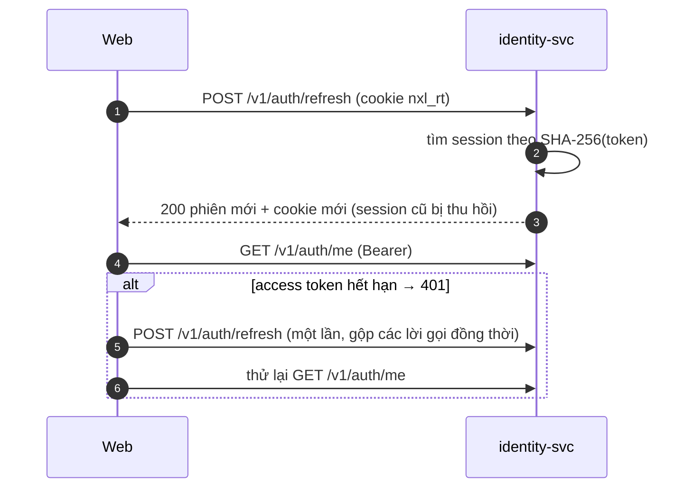

# TSD — Đăng ký / đăng nhập: identity-svc + giao diện web

| | |
| --- | --- |
| **Working Plan** | `../working/2026-10-11-identity-auth-login-register.md` |
| **Quyết định** | `services/identity` (ADR-002); FE thêm react-router, react-hook-form, zod, @hookform/resolvers; cho đăng nhập trước khi xác minh email |
| **Trạng thái** | Đã triển khai (xem Completed Plan) |

## 1. Mục tiêu

Đăng ký, đăng nhập, giữ phiên, đăng xuất từ web; API dùng chung chuẩn JWT EdDSA để các service sau xác minh cục bộ (ADR-008).

## 2. Phạm vi

identity-svc (`services/identity`), `pkg/jwt` (thêm EdDSA), compose service `identity`, nexuslive-web (router, trang Login/Register/Account, lớp API).

## 3. Luồng

### 3.1 Đăng ký

### 3.2 Tải lại trang và gọi API cần đăng nhập

### 3.3 Phát hiện dùng lại refresh token

- **Given** token A đã được xoay thành B, **When** ai đó gửi lại A, **Then** mọi session của user bị thu hồi (kể cả B) và trả 401 `SESSION_EXPIRED`.
- Hai lần refresh đồng thời bằng cùng một token: `UPDATE … WHERE revoked_at IS NULL` chỉ cho một bên thắng; bên thua bị xử lý như dùng lại.

## 4. Chi tiết kỹ thuật

| Chủ đề | Quyết định |
| --- | --- |
| Access token | JWT EdDSA, 15 phút, claims `sub`, `role`, `sid`, `iss`, `iat`, `exp`, header `kid`; chỉ chấp nhận `alg=EdDSA` (chặn `none`, HS256) |
| Khóa ký | `IDENTITY_JWT_PRIVATE_KEY` (seed Ed25519 base64). Dev không đặt → sinh ngẫu nhiên mỗi lần khởi động; ngoài dev bắt buộc |
| JWKS | `GET /v1/auth/.well-known/jwks.json` (OKP/Ed25519) để service khác xác minh (`jwt.NewEdDSAVerifier`) |
| Refresh token | 32 byte ngẫu nhiên, base64url; DB lưu SHA-256 hex; 30 ngày; xoay mỗi lần dùng |
| Mật khẩu | argon2id `m=19456 KiB, t=2, p=1` (OWASP), chuỗi PHC trong `credentials` |
| Chống dò tài khoản | Sai login và sai mật khẩu cùng `INVALID_CREDENTIALS`; login không tồn tại vẫn chạy argon2 trên hash giả; `ACCOUNT_LOCKED` chỉ trả khi mật khẩu đúng |
| Envelope | `{data}` / `{error:{code,message,details?}}`, mã `UPPER_SNAKE_CASE` |
| FE lưu token | Access token trong Zustand (bộ nhớ); không dùng `localStorage`; refresh token chỉ ở cookie HttpOnly |
| FE gọi API | `fetch` same-origin qua Vite proxy; 401 → refresh một lần (promise dùng chung) → thử lại |
| Guard | `RequireAuth` lưu `from`; `GuestOnly` chuyển về `from` khi đã đăng nhập (chỉ đường dẫn nội bộ) |

## 5. Xử lý lỗi

| Mã | HTTP | Web hiển thị |
| --- | --- | --- |
| `VALIDATION_FAILED` | 400 | Lỗi theo ô (`details` theo tên trường) |
| `USERNAME_TAKEN` / `EMAIL_TAKEN` | 409 | Lỗi dưới ô tương ứng, focus vào ô |
| `INVALID_CREDENTIALS` | 401 | Banner "Email/tên người dùng hoặc mật khẩu không đúng." |
| `ACCOUNT_LOCKED` | 403 | Banner |
| `SESSION_EXPIRED` | 401 | Xóa phiên, về trạng thái khách; cookie bị xóa |
| `UNAUTHORIZED` | 401 | Thử refresh một lần |
| `INTERNAL_ERROR` | 500 | Banner chung; server log lỗi gốc |
| `NETWORK_ERROR` | — | Banner "Không kết nối được máy chủ…" |

## 6. Tham chiếu

ERD `identity`; use case UC-D01/D03/D06; ADR-002, ADR-008; errata E-02, E-03.

## 7. Document control

| Phiên bản | Ngày | Thay đổi |
| --- | --- | --- |
| 1.0 | 2026-10-11 | Bản đầu, viết cùng lúc triển khai theo lựa chọn "Duyệt, làm luôn TSD + code" |
