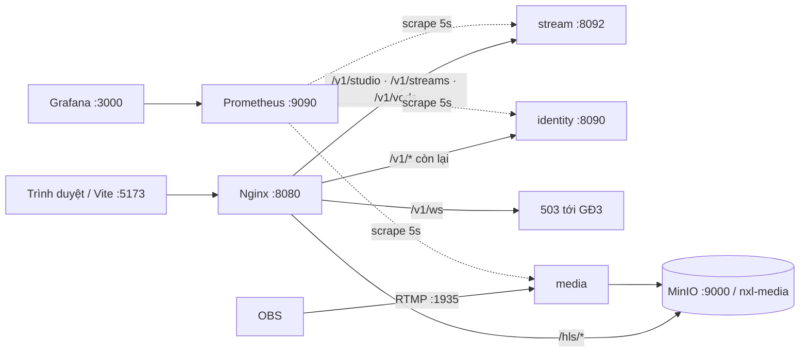

# TSD — GĐ0 hạ tầng: nexuslive-be, compose, Nginx, quan sát, lint/CI

| Phiên bản | Trạng thái | Ngày | Working Plan |
| --- | --- | --- | --- |
| 1.1 | Đã triển khai (WP1–WP3) | 2026-10-13 | `docs/plans/working/2026-10-13-gd00-foundation.md` (WP1–WP3) |

Quyết định đã chốt (Working Plan §10, 13/10):

| Câu hỏi | Quyết định |
| --- | --- |
| Q1 | Gỡ app mẫu. Đổi tên repo thành **nexuslive-be**, module `github.com/minhnn/nexuslive-be`, thư mục `DATN/nexuslive-be`, gỡ remote `evrone` |
| Q2 | Compose giữ ở gốc, cấu hình hạ tầng vào `deploy/` |
| Q3 | Metadata sự kiện giữ trong NATS header |
| Q4 | Duyệt thêm Redis, Mailpit, Prometheus, Grafana |
| Q5 | Spec tham chiếu tài liệu trong `docs/` của repo |
| Q6 | Nginx GĐ0 chỉ định tuyến |

## 1. Mục tiêu

Sau TSD này, một máy mới clone repo:

- chạy được toàn bộ stack bằng một lệnh;
- dùng web qua **một cổng vào** (Nginx);
- xem số liệu trên Grafana;
- CI kiểm tra lint + test cho mọi module Go và cho web.

Hành vi nghiệp vụ của identity, stream, media **không đổi**.

## 2. Phạm vi

**Trong phạm vi:**

- Đổi tên module và thư mục.
- Gỡ app mẫu.
- Compose mới (Redis, Mailpit, Prometheus, Grafana, Nginx).
- `/metrics` cho identity, kèm số liệu HTTP chung cho identity và stream.
- Make target `nxl-*` mới.
- Dọn lint của service.
- CI backend + web.
- Tài liệu: `AGENTS.md`, `README.md`, `docs/api/README.md`, kiến trúc.

**Ngoài phạm vi:**

- Rate limit, CORS (GĐ1).
- `secure_link` (GĐ5).
- SMTP trong identity (GĐ1).
- Exporter NATS/Postgres.
- TLS.

## 3. Kịch bản

### S1 — Dựng toàn bộ stack qua cổng vào

- **Given** máy mới clone, Docker đang chạy,
- **When** chạy `make nxl-up-all`,
- **Then** mọi container healthy hoặc completed, và tại `http://localhost:8080`:
  - đăng nhập được (`/v1/auth/*`);
  - Studio tạo key được (`/v1/studio/*`);
  - danh sách live tải được (`/v1/streams`);
  - HLS tải được qua `/hls/streams/{id}/master.m3u8`.



### S2 — Đường nội bộ không lộ ra ngoài

- **Given** stack đang chạy,
- **When** gọi qua Nginx `GET /internal/v1/...`, `GET /metrics` hoặc `GET /healthz`,
- **Then** nhận `404 {"error":{"code":"NOT_FOUND","message":"not found"}}`.

### S3 — Service phía sau chết

- **Given** container stream bị dừng,
- **When** gọi `GET /v1/streams` qua Nginx,
- **Then** nhận `503 {"error":{"code":"SERVICE_UNAVAILABLE","message":"service unavailable"}}` sau tối đa 5s. Nginx và các route khác vẫn chạy.

### S4 — Số liệu trên Grafana

- **Given** profile `obs` đang chạy,
- **When** phát ffmpeg giả lập (`make nxl-media-publish`),
- **Then** trong ≤ 15s, dashboard "NexusLive — Livestream" hiện:
  - `stream_live_streams = 1`;
  - `media_active_streams = 1`;
  - tốc độ ffmpeg;
  - P95 HTTP của identity/stream.

### S5 — Mailpit nhận thư

- **When** gửi một thư SMTP tới `localhost:1025`,
- **Then** thư hiện ở `http://localhost:8025`.

GĐ1 sẽ dùng Mailpit cho xác minh email.

### S6 — CI

- **Given** một PR sửa `services/stream`,
- **Then** workflow chạy cho từng module:
  - lint;
  - test (`-race`; repo test có Postgres);
  - `docker build` 3 service;
  - yamllint, hadolint, dotenv-linter.

Job nào lỗi thì PR đỏ.

## 4. Hợp đồng và thay đổi cấu trúc

### 4.1 Đổi tên

| Trước | Sau |
| --- | --- |
| `module github.com/minhnn/nexuslive-be` | `module github.com/minhnn/nexuslive-be` |
| `.../go-clean-template/services/<svc>` | `.../nexuslive-be/services/<svc>` |
| Thư mục `DATN/go-clean-template` | `DATN/nexuslive-be`. Làm ở **bước cuối**, ông chủ đóng IDE/terminal đang mở thư mục |
| `git remote origin` → evrone | Gỡ; ông chủ tự thêm remote mới |
| Chữ "go-clean-template" trong tài liệu (`DATN/docs`, `nexuslive-web`, project docs) | "nexuslive-be". Câu nói về nguồn gốc khuôn (ADR-002) giữ nguyên |

`.golangci.yml` không dùng `prefix(module)` trong `gci`, nên không cần sửa.

### 4.2 Gỡ app mẫu

**Xóa:**

- `cmd/app`, `internal/`, `config/`, `migrations/` (gốc);
- `integration-test/`, `docker-compose-integration-test.yml`, `Dockerfile` (gốc);
- `pkg/rabbitmq`, `pkg/nats` (chỉ app mẫu dùng);
- `docs/docs.go`, `docs/swagger.{json,yaml}`, `docs/proto/`, `docs/img/`;
- `nginx/` (chuyển sang `deploy/nginx/`);
- compose service `app`, `rabbitmq`, volume `rabbitmq_data`;
- biến app mẫu trong `.env.example`: `APP_*`, `HTTP_*`, `PG_URL`, `PG_POOL_MAX`, `GRPC_PORT`, `RMQ_*`, `NATS_RPC_SERVER`, `METRICS_ENABLED`, `SWAGGER_ENABLED`, `TRACING_*`, `JWT_*`.

**Giữ:**

- `pkg/`: eventbus, events, grpcserver, httpserver, jwt, logger, outbox, postgres, tracing, cùng `httpmetrics` mới;
- `docs/{api,architecture,plans,product}`;
- `deploy/`.

**Sau khi xóa:**

- chạy `go mod tidy` ở gốc;
- `go build ./...` và `go vet ./...` cho mọi module trong `go.work`;
- `go.work` giữ nguyên danh sách (gốc + identity, media, stream).

### 4.3 `pkg/httpmetrics` (mới)

```go
// Package httpmetrics records request counts and latency for a Fiber app.
package httpmetrics

// New registers http_requests_total{method,route,status} and
// http_request_duration_seconds{method,route} (histogram) on reg and returns the middleware.
// route is the matched Fiber route pattern (e.g. /v1/streams/:id), never the raw path.
func New(reg prometheus.Registerer) fiber.Handler
```

| Service | Thay đổi |
| --- | --- |
| identity | Registry riêng, Go/process collector, middleware ở trên, `GET /metrics` (không qua Nginx) |
| stream | Gắn middleware vào registry đang có. Metric cũ giữ nguyên tên |

Nhãn `route` dùng mẫu route, nên số nhãn có giới hạn. Request không khớp route nào ghi `route="unmatched"`.

### 4.4 Compose

| Service | Image | Profile | Cổng host | Ghi chú |
| --- | --- | --- | --- | --- |
| db, nats, minio, minio-init | như cũ | (mặc định) | như cũ | `minio-init` tạo thêm bucket `nxl-media` |
| redis | `redis:7.4.x-alpine` | (mặc định) | 6379 | `healthcheck: redis-cli ping`, không lưu xuống đĩa |
| mailpit | `axllent/mailpit:v1.x` | (mặc định) | 1025, 8025 | |
| db-init, db-migrate, identity, stream, media, pgadmin | như cũ | `nxl` | như cũ | Giữ tên profile `nxl` (Makefile và tài liệu đang dùng) |
| nginx | `nginx:1.31.3-alpine` | `nxl` | `${NXL_EDGE_PORT:-8080}:80` | Cổng 8080 được giải phóng khi gỡ app mẫu; tránh cổng 80 trên Windows |
| prometheus | `prom/prometheus:v3.x` | `obs` | 9090 | `deploy/prometheus/prometheus.yml`, lưu 2 ngày |
| grafana | `grafana/grafana:12.x` | `obs` | 3000 | Cho xem ẩn danh (Viewer), admin `admin`/`admin`; provisioning trong `deploy/grafana/` |
| jaeger | như cũ | `obs` | như cũ | Chuyển từ mặc định sang `obs` |

Tag image được ghim chính xác (patch) khi cài, sau khi kiểm tra tag tồn tại.

Prometheus scrape mỗi 5s:

| Job | Đích |
| --- | --- |
| `identity` | `identity:8090/metrics` |
| `stream` | `stream:8092/metrics` |
| `media` | `media:8091/metrics` |
| `prometheus` | chính nó |

Dashboard `deploy/grafana/dashboards/livestream.json`:

- Stream đang phát, Session media, Publish bị từ chối/phút (theo lý do);
- Chuyển trạng thái/phút (theo `to`), Authorize (theo `result`);
- Tốc độ ffmpeg, Frame rơi/phút, Lỗi upload, Thời gian upload P95;
- HTTP req/s và P95 theo service/route;
- CPU và RAM từng tiến trình Go.

### 4.5 Nginx — `deploy/nginx/nginx.conf`

| Location | Upstream | Ghi chú |
| --- | --- | --- |
| `/v1/studio`, `/v1/streams`, `/v1/vods` | `stream:8092` | |
| `/v1/ws` | — | `503` JSON (chỗ để sẵn cho GĐ3, có header `Upgrade`) |
| `/v1/` | `identity:8090` | Còn lại của `/v1` |
| `/hls/` | `minio:9000/nxl-media/` | Chỉ `GET`/`HEAD`; `Cache-Control: no-cache` cho `.m3u8` |
| `= /healthz` | Nginx tự trả `200 ok` | Sức khỏe của chính cổng vào |
| `/internal/`, `/metrics`, `/swagger` | — | `404` JSON (Swagger vẫn mở ở cổng riêng của từng service) |
| `/` | — | `404` JSON |

Cấu hình chung:

- `client_max_body_size 1m`;
- `proxy_connect_timeout 2s`, `proxy_read_timeout 30s`;
- gửi kèm header `X-Forwarded-For`, `X-Forwarded-Proto`, `X-Request-Id` (dùng `$request_id` nếu client không gửi);
- access log dạng JSON;
- `resolver 127.0.0.11 valid=10s` + upstream qua biến, để Nginx vẫn khởi động khi một service chưa lên (S3);
- lỗi `502`/`504` từ service đổi thành `503` theo envelope NXL-00.

### 4.6 Web (`nexuslive-web`)

- `VITE_DEV_GATEWAY_URL` (tùy chọn). Khi có, mọi `/v1` và `/hls` proxy tới cổng vào; khi không có, giữ proxy theo tiền tố như hiện nay.
- Sửa chú thích "Chưa có API Gateway (GĐ7)" → GĐ0/GĐ1.

### 4.7 Makefile

| Target | Lệnh |
| --- | --- |
| `nxl-infra-up` | `db nats minio minio-init redis mailpit` |
| `nxl-obs-up` | `--profile obs up -d` |
| `nxl-up-all` | `--profile nxl --profile obs up --build -d` |
| `nxl-down` | `--profile nxl --profile obs down --remove-orphans` |
| `nxl-lint` | Với mỗi module `. services/identity services/stream services/media`: `go tool golangci-lint run ./...` |
| `nxl-test` | Với cùng danh sách: `go test -race -covermode atomic ./...` |
| `nxl-build` | `docker compose --profile nxl build` |

- `linter-golangci` và `test` thành alias của `nxl-lint` và `nxl-test`, để lệnh quen tay vẫn chạy.
- `pre-commit` = `format nxl-lint nxl-test`.
- **Xóa:** `compose-up*`, `compose-down`, `swag-v1`, `proto-v1`, `run`, `integration-test`, `mock`, `migrate-create`, `migrate-up`, `docker-rm-volume`.
- **Giữ:** các `nxl-*` hiện có.
- Đường dẫn module là `services/<svc>` cố định (chỉ 3 module); module mới thì thêm vào danh sách.

### 4.8 CI — `.github/workflows/ci.yml`

Kích hoạt: `pull_request` và `push` lên `main`.

| Job | Ma trận | Bước |
| --- | --- | --- |
| `lint` | `module: [., services/identity, services/stream, services/media]` | `golangci-lint-action@v9`, `version: v2.13.2`, `working-directory: ${{ matrix.module }}` |
| `test` | như trên | `go test -race ./...`. Service container `postgres:18.6-alpine`; tạo DB `nxl_stream`, chạy migrate, đặt `NXL_TEST_PG_URL_STREAM` |
| `docker` | `svc: [identity, stream, media]` | `docker build -f services/$svc/Dockerfile .` (không push) |
| `yamllint`, `hadolint`, `dotenv-linter` | — | Giữ như cũ |

Bỏ `check-dependencies` (nancy, không chặn PR) và `integration-tests` (app mẫu).

Web — `nexuslive-web/.github/workflows/ci.yml`:

- Node 22, pnpm;
- `pnpm install --frozen-lockfile`, `lint`, `typecheck`, `test`, `build`.

Thư mục web chưa là repo git, nên workflow chỉ có hiệu lực sau khi ông chủ `git init` và đẩy lên.

### 4.9 Dọn lint service

- Mục tiêu: `nxl-lint` = 0 lỗi (stream 32, media 76).
- Thứ tự: `misspell`, `gci`/format → `errcheck`, `err113` → `mnd` (đặt hằng số có tên) → `wsl_v5` → `gocyclo`/`funlen` (tách hàm, không đổi logic).
- Chỉ dùng `//nolint:<linter> // lý do` khi tách hàm làm code khó đọc hơn.

## 5. Ánh xạ lỗi tại cổng vào

| Tình huống | HTTP | Body |
| --- | --- | --- |
| Route không tồn tại / đường nội bộ | 404 | `{"error":{"code":"NOT_FOUND","message":"not found"}}` |
| Service không phản hồi (502/504) | 503 | `{"error":{"code":"SERVICE_UNAVAILABLE","message":"service unavailable"}}` |
| Body > 1 MB | 413 | `{"error":{"code":"PAYLOAD_TOO_LARGE","message":"payload too large"}}` |
| `/v1/ws` | 503 | `{"error":{"code":"SERVICE_UNAVAILABLE","message":"realtime gateway is not available yet"}}` |

Lỗi do service trả về (4xx/5xx có body) được chuyển nguyên, không đổi.

## 6. Cấu hình

| Biến | Nơi dùng | Mặc định | Bắt buộc |
| --- | --- | --- | --- |
| `NXL_EDGE_PORT` | compose (Nginx) | `8080` | Không |
| `VITE_DEV_GATEWAY_URL` | `nexuslive-web` | (trống) | Không |

Không có biến bắt buộc mới. `.env.example` bỏ các biến của app mẫu (§4.2).

## 7. Thứ tự triển khai

Mỗi bước là một commit và phải xanh trước khi sang bước sau.

1. Gỡ app mẫu + `go mod tidy` → build/vet/test mọi module.
2. Đổi module path → build/test lại; tìm lại không còn `evrone`.
3. `pkg/httpmetrics` + `/metrics` identity + middleware stream (có unit test).
4. Compose + `deploy/{nginx,prometheus,grafana}` + Makefile + `.env.example`.
5. Dọn lint stream → media; `nxl-lint` = 0.
6. CI backend + web.
7. Tài liệu: `AGENTS.md` (cấu trúc nhiều service, lệnh `nxl-*`), `README.md` (thay README app mẫu), `docs/api/README.md` (cột cổng vào), kiến trúc §12–13.
8. Đổi tên trong `DATN/docs`, `nexuslive-web`, project docs.
9. Đổi tên thư mục và gỡ remote, sau khi ông chủ xác nhận đã đóng IDE.

## 8. Kế hoạch kiểm thử

| Kiểm tra | Cách |
| --- | --- |
| Build, unit test | `make nxl-test` (stream repo test với PG18 cục bộ) |
| Lint | `make nxl-lint` = 0 |
| S1, S3 | Môi trường của Claude: chạy identity/stream/media + nginx với cùng `nginx.conf` (upstream trỏ host cục bộ), chạy lại E2E Playwright với `VITE_DEV_GATEWAY_URL` |
| S2, S5 | `curl` qua Nginx; gửi SMTP thử tới Mailpit |
| S4 | Prometheus thật scrape 3 service, kiểm tra truy vấn trong dashboard trả dữ liệu; JSON dashboard được kiểm cú pháp |
| Compose | `docker compose config` hợp lệ cho mọi tổ hợp profile. Môi trường của Claude không có Docker: ông chủ chạy `make nxl-up-all` trên máy (checklist ở Completed Plan) |
| CI | Kiểm cú pháp workflow (`actionlint` nếu cài được); chạy thật khi có PR |
| Hồi quy | E2E livestream (trực tiếp và qua cổng vào); kịch bản crash/khôi phục media; cooldown |

## 9. Rủi ro và rollback

| Rủi ro | Giảm thiểu / rollback |
| --- | --- |
| Đổi tên thư mục khi IDE đang mở làm Windows khóa file | Làm cuối cùng, sau khi ông chủ xác nhận; lỗi thì giữ tên cũ, mọi thứ khác vẫn chạy |
| `go tool golangci-lint` không chạy được từ thư mục service | Dùng `-C` hoặc `go tool -modfile`; nếu vẫn không được, Makefile chạy binary từ `make bin-deps` |
| Dọn lint làm đổi hành vi media | Commit theo từng loại lỗi; chạy unit + kịch bản ffmpeg giả lập sau mỗi commit; revert từng commit nếu cần |
| Nginx giữ IP cũ khi container khởi động lại | `resolver 127.0.0.11 valid=10s` + upstream qua biến |
| Volume `rabbitmq_data` mồ côi trên máy ông chủ | Ghi lệnh `docker volume rm` trong Completed Plan |

## 10. Ghi chú khi triển khai (as-shipped, v1.1)

| Mục TSD | Thực tế | Lý do |
| --- | --- | --- |
| §4.4 `minio-init` tạo bucket `nxl-media` | Gỡ hẳn `minio-init` (nó chỉ tạo bucket `uploads` của app mẫu) | media-svc đã tự tạo bucket `nxl-media` + policy đọc công khai `streams/` + lifecycle khi khởi động (`MEDIA_S3_ENSURE_BUCKET`) |
| §4.4 Tag image | `redis:7.4.5-alpine`, `axllent/mailpit:v1.27.0`, `prom/prometheus:v3.5.0`, `grafana/grafana:12.1.0` | Mailpit và Prometheus đã kiểm tra tồn tại; Redis và Grafana chưa kiểm được vì môi trường của Claude không truy cập Docker Hub. Nếu `docker compose pull` báo không có tag, đổi sang bản patch gần nhất |
| §4.5 Nginx | Thêm `403 FORBIDDEN` dạng JSON (method khác `GET`/`HEAD` trên `/hls`) | Giữ mọi lỗi của cổng vào cùng một envelope |
| §4.7 `nxl-lint` / `nxl-test` | Dùng `go -C <module>` sinh một dòng lệnh cho mỗi module (không vòng lặp shell); thêm `NXL_TEST_FLAGS` (mặc định `-race`) | Chạy được cả khi `make` dùng `cmd.exe` trên Windows; `-race` cần gcc |
| §4.7 `deps` | Chỉ `go mod tidy` + `verify` ở module gốc | Trong service, `go mod tidy` không thấy `pkg/` (chỉ có qua `go.work`) và sẽ đi tìm `github.com/minhnn/nexuslive-be` trên mạng |
| §4.2 `go mod tidy` | **Chưa chạy** ở môi trường của Claude (proxy chặn tải module). `go.mod` gốc còn các require của app mẫu (RabbitMQ, googletrans, otelfiber…) — vô hại khi build | Ông chủ chạy `make deps` một lần trên máy |
| §4.9 Dọn lint | 0 lỗi ở cả 4 module. Tắt `gocritic.hugeParam` và `rangeValCopy` trong `.golangci.yml` | Entity/DTO truyền theo giá trị có chủ đích (bản chụp bất biến giữa các tầng, qua mock sinh tự động); đổi sang con trỏ phải sửa contract + mock mà không lợi gì |
| §4.9 | Hàm wiring `Run` của identity/stream/media có `//nolint:funlen,gocyclo,...` kèm lý do | Chuỗi khởi động tuyến tính, mỗi lỗi khởi động một nhánh `Fatal` |
| — | `pkg/httpmetrics` test không dùng `prometheus/testutil` | `testutil` kéo thêm module `kylelemons/godebug` (dependency mới); đọc registry bằng `Gather()` là đủ |

| Version | Date | Change |
| --- | --- | --- |
| 1.0 | 2026-10-13 | Bản đầu |
| 1.1 | 2026-10-13 | Ghi chú as-shipped (§10) |
