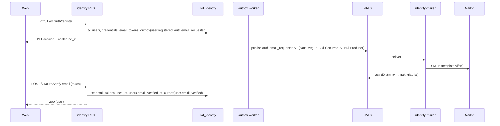
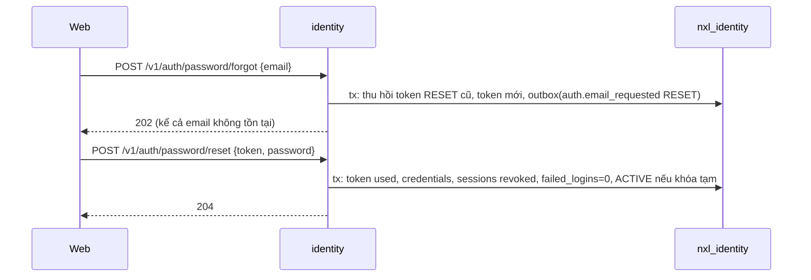
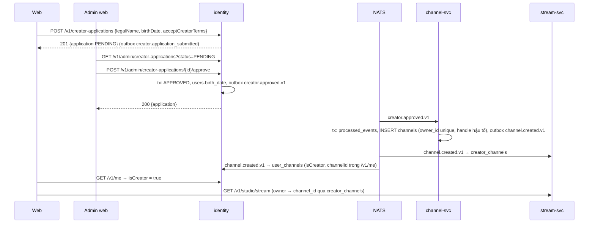

# TSD — GĐ1: Identity, Creator, kênh tối thiểu, Web shell, Web quản trị

| Phiên bản | Trạng thái | Ngày | Working Plan |
| --- | --- | --- | --- |
| 1.1 | Đã triển khai | 2026-10-13 | `docs/plans/working/2026-10-13-gd01-identity-web-shell.md` (v1.1) |

Quyết định đã chốt (Working Plan §10 — ông chủ duyệt plan 13/10 và yêu cầu làm luôn, câu hỏi lấy theo đề xuất):

| Câu hỏi | Quyết định |
| --- | --- |
| G1-Q1 | Bắt đầu ngay |
| G1-Q2 | Refresh/logout: cookie `SameSite=Strict` + header bắt buộc `X-NXL-Client: web\|admin` |
| G1-Q3 | Seed dev `admin@nexuslive.dev` (ADMIN) + `creator@nexuslive.dev` (đã duyệt) khi `NXL_ENV=dev` |
| G1-Q4 | Chưa có frame pen.dev cho Auth/Settings/Admin → làm theo token Obsidian Pulse hiện có |
| G1-Q5 | `nexuslive-admin` chép UI từ web, ghi nguồn; xem lại package chung ở GĐ5 |
| G1-Q6 | `nexuslive-admin` có khung i18n, GĐ1 dịch vi + en cho chuỗi đã có (rẻ hơn để trống) |

Hợp đồng chính thức: NXL-00 v1.1 (envelope, mã lỗi, sự kiện), NXL-D v1.1 §13. TSD này chốt các chỗ NXL-D để mở.

## 1. Mục tiêu

M1: đăng ký → email xác minh (Mailpit) → nộp đơn Creator → Admin duyệt trên `nexuslive-admin` → channel-svc tạo
kênh → Studio mở → phát → trang xem hiện tên kênh. Guest dùng modal đăng nhập có `pendingAction`.

## 2. Phạm vi

Như Working Plan §1. Thêm quyết định kỹ thuật:

- **Gửi email bằng consumer trong identity**: identity ghi `auth.email_requested.v1` (có token gốc) vào outbox
  cùng transaction; một consumer durable `identity-mailer` của chính identity đọc sự kiện và gửi SMTP. Lỗi SMTP →
  nak, JetStream giao lại (E-D07). GĐ5 chuyển consumer này sang notification-svc mà không đổi hợp đồng.
- **Không có goroutine gửi email trong request.**

## 3. Kịch bản

### S1 — Đăng ký và xác minh email

- Given Guest, When `POST /v1/auth/register` có `acceptTerms: true`, Then `201` + phiên, outbox có
  `user.registered.v1` và `auth.email_requested.v1 (VERIFY)`; ≤ 10 s email tới Mailpit có link
  `{IDENTITY_WEB_BASE_URL}/verify-email?token=…`.
- When `POST /v1/auth/verify-email {token}`, Then `200 {user}` (emailVerified = true), token đánh dấu đã dùng,
  outbox `user.email_verified.v1`. Token sai/hết hạn/đã dùng → `400 TOKEN_INVALID`.



### S2 — Quên / đặt lại mật khẩu

- `POST /v1/auth/password/forgot {email}` luôn `202`. Có tài khoản → token RESET (30 phút) + email.
- `POST /v1/auth/password/reset {token, password}` → `204`, đổi hash, xóa **mọi** phiên (xóa thay vì đánh dấu thu hồi, để thiết bị cũ refresh chỉ nhận `SESSION_EXPIRED` chứ không kích hoạt phát hiện dùng lại), xóa khóa tạm.



### S3 — Khóa tạm khi sai mật khẩu

- Sai lần thứ `IDENTITY_LOGIN_MAX_FAILURES` (10) trong 15 phút → `status = LOCKED`, `locked_until = now + 15m`,
  trả `403 ACCOUNT_LOCKED`, `details.lockedUntil` (RFC 3339), log `audit=account_locked`.
- Đang khóa tạm → mọi lần đăng nhập trả `403 ACCOUNT_LOCKED` (kể cả sai mật khẩu, không tăng bộ đếm).
  Khóa vĩnh viễn (Admin, `locked_until IS NULL`) giữ quy tắc cũ: chỉ lộ sau khi mật khẩu đúng.
- Đúng mật khẩu → bộ đếm về 0; khóa tạm đã hết → `ACTIVE`.

### S4 — Đơn Creator → kênh → Studio



- Chưa có kênh → mọi `/v1/studio/*` trả `403 NOT_CREATOR`.
- `creator.approved.v1` giao lặp → không tạo kênh thứ hai (owner_id UNIQUE + processed_events).
- channel-svc chết lúc duyệt → sự kiện nằm trong JetStream, kênh được tạo khi service lên lại.

### S5 — Guest modal (web)

Guest bấm hành động bị chặn → lưu `pendingAction {type, params, returnTo}` (sessionStorage) → modal đăng nhập /
đăng ký → thành công → chạy action đúng một lần → xóa. `returnTo` chỉ nhận đường dẫn nội bộ bắt đầu bằng `/`
(không `//`).

### S6 — CSRF và Admin

- `POST /v1/auth/refresh`, `/v1/auth/logout` thiếu header `X-NXL-Client` (giá trị `web` hoặc `admin`) →
  `403 FORBIDDEN`, `details.header = "REQUIRED"`.
- `/v1/admin/**` cần claim `role = ADMIN` → không thì `403 FORBIDDEN`. Vai trò trong token cập nhật ở lần refresh
  kế tiếp (sau `promote-admin`).

## 4. Hợp đồng

### 4.1 REST identity-svc (mới / đổi)

`User` (mọi chỗ trả user — register, login, refresh, `/auth/me`, `/me`):

```json
{
  "id": "uuid", "username": "minhnn", "displayName": "Minh", "email": "a@b.c",
  "emailVerified": false, "globalRole": "USER", "birthDate": "2000-01-31" , "locale": "vi",
  "timezone": "Asia/Ho_Chi_Minh", "isCreator": false, "channelId": null, "createdAt": "RFC3339"
}
```

`birthDate` null khi chưa có. `channelId` null khi chưa là Creator.

| Method | Path | Auth | Request | Response | Lỗi |
| --- | --- | --- | --- | --- | --- |
| POST | `/v1/auth/register` | — | `{username, displayName?, email, password, acceptTerms}` | `201 {accessToken, expiresIn, user}` | `VALIDATION_FAILED` (`acceptTerms: REQUIRED`), `USERNAME_TAKEN` / `EMAIL_TAKEN` (`details.<field> = TAKEN`) |
| POST | `/v1/auth/login` | — | `{login, password}` | như trên | `INVALID_CREDENTIALS`, `ACCOUNT_LOCKED` (`details.lockedUntil` nếu khóa tạm) |
| POST | `/v1/auth/refresh` | cookie + `X-NXL-Client` | — | như trên | `SESSION_EXPIRED`, `FORBIDDEN` (thiếu header) |
| POST | `/v1/auth/logout` | cookie + `X-NXL-Client` | — | `204` | `FORBIDDEN` |
| POST | `/v1/auth/verify-email` | — | `{token}` | `200 {user}` | `TOKEN_INVALID` |
| POST | `/v1/auth/verify-email/resend` | B | — | `202` | `CONFLICT` (đã xác minh), `RATE_LIMITED` (`details.retryAfterSec` + `Retry-After`) |
| POST | `/v1/auth/password/forgot` | — | `{email}` | `202` | `VALIDATION_FAILED` |
| POST | `/v1/auth/password/reset` | — | `{token, password}` | `204` | `TOKEN_INVALID`, `VALIDATION_FAILED` |
| GET | `/v1/me` | B | — | `200 {user, roles, isCreator, channelId, unreadNotifications, preferences}` | `UNAUTHORIZED` |
| PATCH | `/v1/me` | B | `{displayName?, birthDate?, locale?, timezone?, preferences?: {sidebarCollapsed?, matureVisible?}}` | như `GET /v1/me` | `VALIDATION_FAILED` |
| POST | `/v1/me/password` | B | `{currentPassword, newPassword}` | `200 {accessToken, expiresIn, user}` + cookie mới | `WRONG_PASSWORD`, `VALIDATION_FAILED` |
| POST | `/v1/creator-applications` | B | `{legalName, birthDate, note?, acceptCreatorTerms}` | `201 {…Application}` | `EMAIL_NOT_VERIFIED`, `APPLICATION_PENDING`, `ALREADY_CREATOR`, `UNDERAGE`, `VALIDATION_FAILED` |
| GET | `/v1/creator-applications/me` | B | — | `200 Application \| null` (mới nhất) | — |
| DELETE | `/v1/creator-applications/{id}` | B | — | `204` | `NOT_FOUND`, `INVALID_STATE` |
| GET | `/v1/admin/creator-applications?status=&cursor=&limit=` | A | `status` ∈ `PENDING` (mặc định), `APPROVED`, `REJECTED`, `CANCELLED`, `ALL`; `limit` 1–50 (20) | `200 {items: AdminApplication[], nextCursor}` — cũ nhất trước | `FORBIDDEN`, `VALIDATION_FAILED` |
| GET | `/v1/admin/creator-applications/{id}` | A | — | `200 AdminApplication` | `NOT_FOUND` |
| POST | `/v1/admin/creator-applications/{id}/approve` | A | — | `200 AdminApplication` | `INVALID_STATE`, `FORBIDDEN` (tự duyệt đơn mình) |
| POST | `/v1/admin/creator-applications/{id}/reject` | A | `{reason}` 10–500 ký tự | `200 AdminApplication` | `INVALID_STATE`, `VALIDATION_FAILED` |

`GET /v1/me`:

```json
{ "data": {
  "user": { "…User": "" },
  "roles": ["VIEWER", "CREATOR", "ADMIN"],
  "isCreator": true, "channelId": "uuid",
  "unreadNotifications": 0,
  "preferences": { "sidebarCollapsed": false, "matureVisible": false }
} }
```

`roles` luôn có `VIEWER`; thêm `CREATOR` khi có kênh, `ADMIN` khi `globalRole = ADMIN`.

`Application`: `{id, status, legalName, birthDate, note, rejectReason, createdAt, reviewedAt}`.
`AdminApplication` = `Application` + `age` (số tuổi hôm nay) + `user {id, username, displayName, email,
emailVerified, createdAt}`.

Kiểm tra dữ liệu: `legalName` 2–100 ký tự; `birthDate` `YYYY-MM-DD`, không ở tương lai; `note` ≤ 500;
`acceptCreatorTerms` phải `true`; tuổi < `IDENTITY_CREATOR_MIN_AGE` (18) → `422 UNDERAGE`.
`PATCH /v1/me`: `displayName` 1–50, `locale` ∈ `vi`, `en`; `timezone` là tên IANA hợp lệ; `birthDate` chỉ đặt
được khi đang trống.

### 4.2 REST channel-svc (mới, cổng 8094)

| Method | Path | Response | Lỗi |
| --- | --- | --- | --- |
| GET | `/v1/channels/{handle}` | `200 {id, handle, displayName, bio, avatarUrl, isLive, currentStreamId, createdAt}` | `NOT_FOUND` |

### 4.3 REST stream-svc (đổi)

- `/v1/studio/*` → `403 NOT_CREATOR` khi người gọi chưa có kênh.
- `Stream` (danh sách live, chi tiết) và `VOD` thêm `channel: {id, handle, displayName, avatarUrl} | null`
  (null với dữ liệu cũ trước GĐ1). Giữ `channelId` (không xóa trường).
- `GET /v1/studio/stream` thêm `channel` của Creator.

### 4.4 Sự kiện (`pkg/events`)

| Type | Payload |
| --- | --- |
| `auth.email_requested.v1` | `userId, email, purpose (VERIFY\|RESET), token, locale, username` |
| `user.email_verified.v1` | `userId` |
| `user.profile_updated.v1` | `userId, displayName` |
| `creator.application_submitted.v1` | `applicationId, userId` |
| `creator.approved.v1` | `applicationId, userId, username, displayName` |
| `creator.rejected.v1` | `applicationId, userId, reason` |
| `channel.created.v1` | `channelId, ownerId, handle, displayName` |

Header mới trên mọi sự kiện: `Nxl-Occurred-At` (outbox: `created_at` của dòng; publish trực tiếp: lúc publish),
`Nxl-Producer` (tên service). `eventbus.Event` thêm `OccurredAt`, `Producer`.

Consumer mới: `identity-svc` (`channel.created.v1`), `identity-mailer` (`auth.email_requested.v1`),
`channel-svc` (`creator.approved.v1`, `stream.started.v1`, `stream.ended.v1`); `stream-svc` thêm
`channel.created.v1`.

### 4.5 SQL

identity `20261014000001_gd01_account.up.sql`:

```sql
ALTER TABLE users
    ADD COLUMN failed_logins        smallint    NOT NULL DEFAULT 0,
    ADD COLUMN last_failed_login_at timestamptz,
    ADD COLUMN preferences          jsonb       NOT NULL DEFAULT '{}'::jsonb;

ALTER TABLE email_tokens ADD COLUMN created_at timestamptz NOT NULL DEFAULT now();
CREATE INDEX email_tokens_user_purpose_idx ON email_tokens (user_id, purpose, created_at DESC);

ALTER TABLE creator_applications DROP CONSTRAINT creator_applications_status_check;
ALTER TABLE creator_applications ADD CONSTRAINT creator_applications_status_check
    CHECK (status IN ('PENDING', 'APPROVED', 'REJECTED', 'CANCELLED'));
ALTER TABLE creator_applications DROP CONSTRAINT creator_applications_check;
ALTER TABLE creator_applications ADD CONSTRAINT creator_applications_reviewed_check
    CHECK (status IN ('PENDING', 'CANCELLED') OR (reviewed_by IS NOT NULL AND reviewed_at IS NOT NULL));
ALTER TABLE creator_applications ADD COLUMN updated_at timestamptz NOT NULL DEFAULT now();

-- Copy of channel-svc's channels, kept by channel.created.v1 (identity never calls channel-svc).
CREATE TABLE user_channels (
    user_id      uuid        PRIMARY KEY REFERENCES users (id) ON DELETE CASCADE,
    channel_id   uuid        NOT NULL UNIQUE,
    handle       citext      NOT NULL,
    display_name varchar(50) NOT NULL,
    created_at   timestamptz NOT NULL DEFAULT now()
);
```

`down` đảo ngược (đơn `CANCELLED` bị xóa trước khi khôi phục CHECK cũ).

stream `20261014000001_create_creator_channels.up.sql`:

```sql
CREATE TABLE creator_channels (
    owner_id     uuid        PRIMARY KEY,
    channel_id   uuid        NOT NULL UNIQUE,
    handle       varchar(25) NOT NULL,
    display_name varchar(50) NOT NULL,
    avatar_url   text,
    updated_at   timestamptz NOT NULL DEFAULT now()
);
```

channel: dùng bảng `channels`, `outbox`, `processed_events` đã có — không migration mới.

### 4.6 Go — hợp đồng chính

identity `usecase`:

```go
Auth interface { // thêm
    VerifyEmail(ctx, token string) (entity.User, error)
    ResendVerification(ctx, userID string) error            // *entity.RetryError khi quá nhanh
    ForgotPassword(ctx, email string) error
    ResetPassword(ctx, token, password string) error
    ChangePassword(ctx, ChangePasswordInput) (AuthResult, error)
    Profile(ctx, userID string) (Profile, error)
    UpdateProfile(ctx, userID string, in ProfileUpdate) (Profile, error)
}
Creator interface {
    Submit(ctx, SubmitInput) (entity.Application, error)
    Mine(ctx, userID string) (*entity.Application, error)
    Cancel(ctx, userID, id string) error
    List(ctx, status, cursor string, limit int) (ApplicationPage, error)
    Get(ctx, id string) (entity.Application, error)
    Approve(ctx, adminID, id string) (entity.Application, error)
    Reject(ctx, adminID, id, reason string) (entity.Application, error)
}
```

stream `usecase.Studio` thêm `Channel(ctx, ownerID string) (entity.Channel, error)` (`entity.ErrNotCreator`);
`Catalog` điền `entity.Stream.Channel` bằng một truy vấn theo lô `repo.ChannelRepo.ChannelsByID`.

## 5. Chi tiết kỹ thuật

- **Token email:** 32 byte ngẫu nhiên, base64url; lưu SHA-256. Cấp mới → token chưa dùng cùng mục đích bị đánh
  dấu `used_at` (BR-D06). Gửi lại: ≥ 60 s từ token gần nhất và ≤ 5 token/giờ, nếu không → `RATE_LIMITED` với
  số giây còn lại. Quên mật khẩu áp cùng giới hạn nhưng vẫn trả `202` (không tạo token).
- **Email:** `net/smtp` không TLS khi `IDENTITY_SMTP_ADDR` trỏ Mailpit; template `html/template` + `text/template`
  nhúng bằng `embed`, chọn theo `locale` của user. `IDENTITY_SMTP_ADDR` trống → consumer chỉ log (không token).
- **Seed dev** (`NXL_ENV=dev`, `IDENTITY_DEV_SEED=true`): tạo nếu chưa có `admin` / `admin@nexuslive.dev`
  (ADMIN, đã xác minh) và `creator` / `creator@nexuslive.dev` (đã xác minh, đơn `APPROVED` do admin duyệt +
  `creator.approved.v1`) với mật khẩu `IDENTITY_DEV_SEED_PASSWORD`. Không chạy ngoài dev.
- **CLI:** `identity promote-admin <email>` (cùng image, cùng biến môi trường DB). In kết quả, mã thoát 1 nếu
  không thấy user.
- **Audit:** `l.Info("audit=<event> userID=… …")` cho `password_changed`, `password_reset`, `account_locked`,
  `refresh_reuse`, `creator_approved`, `creator_rejected`, `admin_promoted`.
- **Cổng vào:** cấu hình qua template (`deploy/nginx/templates/*.conf.template`, envsubst của image nginx):
  `NXL_WEB_ORIGIN`, `NXL_ADMIN_ORIGIN`, `NXL_EDGE_AUTH_RATE` (`10r/m`), `NXL_EDGE_WRITE_RATE` (`60r/m`),
  `NXL_EDGE_READ_RATE` (`600r/m`). `429` có body `RATE_LIMITED` + `Retry-After: 60`.
- **Web**: refresh/logout gửi `X-NXL-Client: web`; admin gửi `admin`.

## 6. Xử lý lỗi

| Trường hợp | Sentinel | HTTP | Mã | Consumer |
| --- | --- | --- | --- | --- |
| Token email sai/hết hạn/dùng rồi | `ErrTokenInvalid` | 400 | `TOKEN_INVALID` | — |
| Đã xác minh mà gửi lại | `ErrAlreadyVerified` | 409 | `CONFLICT` | — |
| Gửi lại quá nhanh | `*RetryError` (Is `ErrRateLimited`) | 429 | `RATE_LIMITED` | — |
| Khóa tạm | `*LockedError` (Is `ErrAccountLocked`) | 403 | `ACCOUNT_LOCKED` | — |
| Sai mật khẩu hiện tại | `ErrWrongPassword` | 400 | `WRONG_PASSWORD` | — |
| Chưa xác minh khi nộp đơn | `ErrEmailNotVerified` | 403 | `EMAIL_NOT_VERIFIED` | — |
| Đơn đang chờ | `ErrApplicationPending` | 409 | `APPLICATION_PENDING` | — |
| Đã là Creator | `ErrAlreadyCreator` | 409 | `ALREADY_CREATOR` | — |
| Chưa đủ tuổi | `ErrUnderage` | 422 | `UNDERAGE` | — |
| Chuyển trạng thái đơn sai | `ErrInvalidState` | 409 | `INVALID_STATE` | — |
| Không thấy đơn | `ErrApplicationNotFound` | 404 | `NOT_FOUND` | — |
| Admin tự duyệt | `ErrSelfReview` | 403 | `FORBIDDEN` | — |
| Studio khi chưa có kênh | `ErrNotCreator` | 403 | `NOT_CREATOR` | — |
| Payload sự kiện hỏng | — | — | — | `ErrSkip` (ack + log) |
| DB/SMTP tạm lỗi | — | 500 | `INTERNAL_ERROR` | nak, giao lại |

## 7. Tương thích và rollback

- `/v1/auth/me` giữ nguyên (thêm trường). `channelId` trong Stream/VOD giữ nguyên.
- Đăng ký thiếu `acceptTerms` → `400` (thay đổi phá vỡ có chủ đích; web cùng thay đổi).
- Refresh/logout thiếu header → `403`. Web và admin gửi header từ cùng lần thay đổi; Swagger UI không gọi được
  refresh (ghi trong mô tả).
- `NOT_CREATOR`: tài khoản dev cũ phải đi qua đơn Creator hoặc dùng `creator@nexuslive.dev`. E2E livestream dùng
  tài khoản seed.
- Rollback: migration down theo thứ tự stream → identity; xóa container `channel`; Nginx trả về file GĐ0.

## 8. Ước lượng

| Gói | Ngày công |
| --- | --- |
| WP1 + WP2 identity | 4 |
| WP3 channel + WP4 stream | 2 |
| WP5 Nginx | 0,5 |
| WP6 web | 4 |
| WP6b admin | 2 |
| WP7 tài liệu | 1,5 |
| WP8 E2E + hồi quy | 1,5 |

## 9. Tham chiếu

NXL-00 v1.1 §5, §7, §11; NXL-D v1.1 §3–§7, §13; NXL-C BR27–BR36, API 06; Working Plan GĐ1 v1.1.

## 10. Document control

| Phiên bản | Ngày | Thay đổi |
| --- | --- | --- |
| 1.0 | 2026-10-13 | Bản đầu, cùng lúc bắt đầu triển khai (ông chủ yêu cầu làm luôn) |
| 1.1 | 2026-10-13 | Đồng bộ với bản đã giao: đổi/đặt lại mật khẩu xóa phiên cũ; `retryAfterSec` dạng chuỗi; tuổi theo ngày `Asia/Ho_Chi_Minh`; `verify-email` trong vùng rate limit auth; Studio tra kênh ở middleware (Completed Plan §2) |
