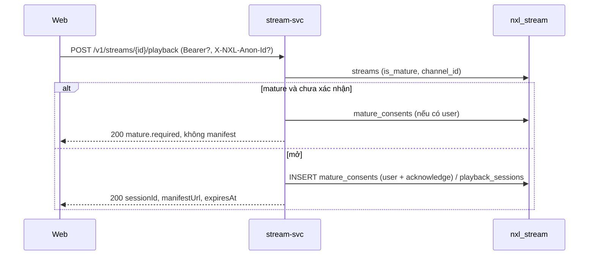

# TSD — GĐ2: Đóng Streaming core (phần backend: playback session, tiến độ xem)

| Phiên bản | Trạng thái | Ngày | Working Plan |
| --- | --- | --- | --- |
| 1.1 | Đã triển khai backend (WP1, WP2) và web (WP3–WP5) | 2026-10-14 | `docs/plans/working/2026-10-14-gd02-streaming-close.md` |

Quyết định (ông chủ duyệt 14/10, lấy theo đề xuất): G2-Q1 làm playback session ngay, chưa chữ ký · G2-Q2 dùng frame
pen.dev/Stitch + `DESIGN.md` · G2-Q3 chat giữ chỗ, khối khác ẩn · G2-Q4 gộp tiến độ local lên tài khoản, giữ vị trí xa hơn.

## 1. Mục tiêu

- Người xem mở stream/VOD qua **phiên xem**; nội dung 18+ chỉ trả `manifestUrl` sau khi xác nhận tuổi; tài khoản
  đã xác nhận với một kênh thì không bị hỏi lại.
- Tiến độ xem VOD lưu **theo tài khoản**; có danh sách "Tiếp tục xem".

## 2. Phạm vi

Trong: stream-svc (entity, repo, use case `playback`, REST), Nginx (route + CORS header), Swagger.
Web (repo `nexuslive-web`): player mở qua phiên xem, gộp tiến độ localStorage khi đăng nhập (làm cùng R2/R3).
Ngoài: chữ ký URL (GĐ5), `matureVisible`
phía server (thuộc identity; web tự gửi `acknowledgeMature` khi người dùng bật).

## 3. Kịch bản

### S1 — Mở stream 18+

- Given stream `isMature`, Guest, When `POST /v1/streams/{id}/playback` (header `X-NXL-Anon-Id` tùy chọn),
  Then `200 {sessionId: null, manifestUrl: null, expiresAt: null, anonId, mature: {required: true, acknowledged: false}}`.
- When gửi lại `{acknowledgeMature: true}`, Then có `sessionId`, `manifestUrl`, `expiresAt` (4 giờ), ghi
  `playback_sessions` (`anon_id`, `mature_acknowledged = true`).
- Given tài khoản đã xác nhận một lần với kênh, When mở lại (kể cả VOD của kênh), Then mở luôn (đọc
  `mature_consents`).

### S2 — Tiến độ VOD

- `PUT /v1/me/watch-progress/{vodId} {positionSec, keepFurther?}` → `204`. `positionSec` 0…thời lượng + 5 s,
  sai → `400 VALIDATION_FAILED` (`positionSec: REQUIRED|RANGE`); VOD không còn → `404`.
- `keepFurther: true` giữ vị trí đã lưu nếu xa hơn (web dùng khi gộp localStorage lúc đăng nhập).
- `GET /v1/vods/{id}` có token → thêm `viewer: {positionSec | null}`.
- `GET /v1/me/continue-watching?limit=` (1–50, mặc định 12) → VOD READY chưa hết hạn, đã xem ≥ 5 s và chưa tới
  10 s cuối, mới nhất trước, kèm `channel`.

## 4. Hợp đồng

| Method | Path | Auth | Body / header | Response | Lỗi |
| --- | --- | --- | --- | --- | --- |
| POST | `/v1/streams/{id}/playback` | — / B | `{acknowledgeMature?}`, `X-NXL-Anon-Id?` (uuid) | `200 Playback` | `NOT_FOUND`, `VALIDATION_FAILED` (`anonId: INVALID`), `UNAUTHORIZED` (token gửi kèm nhưng sai) |
| POST | `/v1/vods/{id}/playback` | — / B | như trên | `200 Playback` | như trên |
| GET | `/v1/vods/{id}` | — / B | — | `200 VOD` (+ `viewer` khi có token) | `NOT_FOUND`, `UNAUTHORIZED` |
| PUT | `/v1/me/watch-progress/{vodId}` | B | `{positionSec, keepFurther?}` | `204` | `VALIDATION_FAILED`, `NOT_FOUND`, `UNAUTHORIZED` |
| GET | `/v1/me/continue-watching` | B | `?limit=` | `200 {items: [{vod, positionSec, updatedAt}]}` | `UNAUTHORIZED` |

`Playback = {sessionId, manifestUrl, expiresAt, anonId?, mature: {required, acknowledged}}`; ba trường đầu `null`
khi cổng 18+ đóng; `anonId` chỉ có với Guest (lấy từ header hoặc sinh mới).

Go: `usecase.Viewer` (`Open`, `SaveProgress`, `Progress`, `ContinueWatching`, `PurgeSessions`), gói
`usecase/playback`; `repo.ViewerRepo` (giao diện mới, không đổi giao diện cũ). `v1.NewRoutes` nhận thêm `Viewer`
và `v1.Auth{Required, Optional}`; middleware mới `OptionalAuth`.

SQL: dùng bảng có sẵn `playback_sessions`, `watch_progress`, `mature_consents` — **không migration**. Phiên hết
hạn quá 24 giờ bị xóa trong job hết hạn VOD.

Nginx: `/v1/me/(watch-progress|continue-watching)` → stream-svc (đặt trước `/v1/`); CORS cho phép header
`X-NXL-Anon-Id`.

## 5. Chi tiết

- `manifestUrl` dựng ở một hàm duy nhất (`manifestURL`) để GĐ5 gắn `secure_link`.
- **Giới hạn đã biết:** đường dẫn HLS hiện vẫn đoán được (`/hls/streams/{id}/master.m3u8`) và `GET /v1/streams/{id}`
  vẫn trả `manifestUrl` để web cũ chạy — cổng 18+ phía server chỉ thành chặn thật khi có chữ ký (GĐ5). Web chuyển
  sang phiên xem cùng R3.
- VOD lấy cờ 18+ của buổi phát gốc.

## 6. Lỗi

| Trường hợp | Sentinel | HTTP | Mã |
| --- | --- | --- | --- |
| Stream/VOD không có, VOD hết hạn | `ErrNotFound` | 404 | `NOT_FOUND` |
| Vị trí âm / quá thời lượng | `ErrInvalidPosition` | 400 | `VALIDATION_FAILED` |
| Header anon sai | — | 400 | `VALIDATION_FAILED` |

## 7. Tương thích

Chỉ thêm: endpoint mới, trường `viewer` (chỉ khi có token), route Nginx mới. Không đổi hợp đồng cũ.

## 8. Kiểm thử đã chạy

Unit (use case + REST), repo test PG (`TestViewer`), lint 0, Swagger; chạy thật qua cổng vào với ffmpeg (18+ Guest/
tài khoản, nhớ xác nhận, VOD, tiến độ, continue-watching, preflight CORS); E2E web hồi quy 6/6.

## 9. Document control

| Phiên bản | Ngày | Thay đổi |
| --- | --- | --- |
| 1.0 | 2026-10-14 | Bản đầu, cùng lúc triển khai backend |
| 1.1 | 2026-10-14 | Web đã chuyển sang phiên xem; hợp đồng không đổi |
