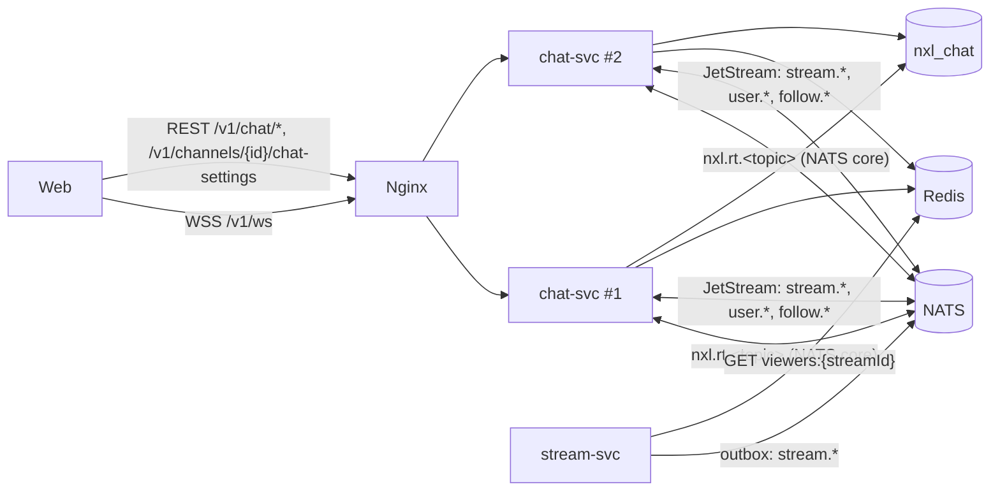
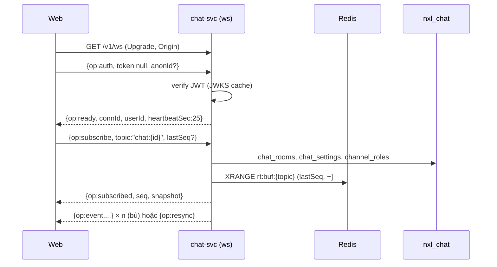
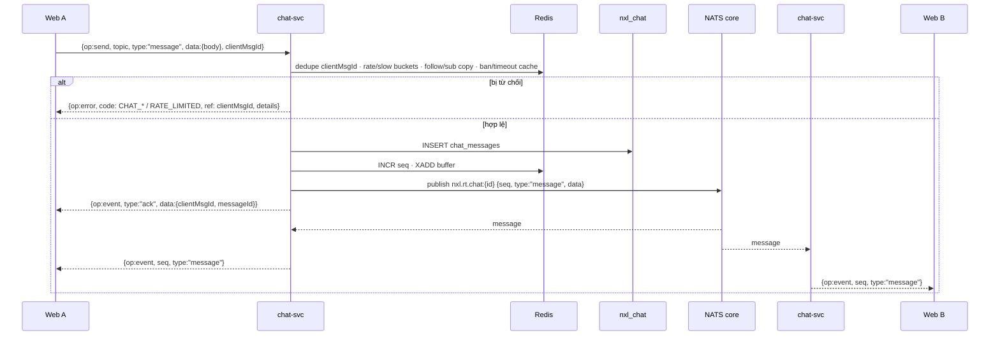

# TSD — GĐ3: Chat realtime, realtime gateway, viewer count

| Phiên bản | Trạng thái | Ngày | Working Plan |
| --- | --- | --- | --- |
| 1.0 | Draft — chờ duyệt | 2026-10-14 | `docs/plans/working/2026-10-14-gd03-chat-realtime.md` (Approved 14/10) |

Quyết định đã chốt (14/10): G3-Q1 thêm `gofiber/contrib/websocket`, `redis/go-redis/v9`, `@tanstack/react-virtual`,
k6 (chạy tay) · G3-Q2 compose chạy 2 instance chat-svc · G3-Q3 giá trị NXL-B theo đề xuất (§9) · G3-Q4 chưa có
frame chat GĐ3 → cột chat frame gốc + brief `DATN/docs/design/2026-10-14-design-brief-gd03.md` · G3-Q5 viết NXL-F,
NXL-E trong GĐ3 · **G3-Q6 một người xem mở nhiều tab = 1 view** (tài khoản theo `userId`, Guest theo `anonId`).

## 1. Mục tiêu

- Một kết nối WebSocket `/v1/ws` (chat-svc) cho mọi chủ đề realtime; chat B1–B4 theo NXL-B v1.1 (trừ phần thuộc
  NXL-F/GĐ5); trạng thái stream và **số người xem thật** đẩy qua `stream:{streamId}`.
- Chịu được tắt một instance: client nối lại, resume theo `seq`, không mất tin.

## 2. Phạm vi

Trong: service `chat` (mới), `pkg/redis` (mới), 3 sự kiện stream mới trong `pkg/events`, stream-svc (outbox + đọc
viewer count + cột `peak_viewers`), Nginx, compose, Prometheus/Grafana, web (`nexuslive-web`: realtime client,
chat panel, viewer count), k6.

Ngoài: thao tác Mod (xóa/timeout/ban/ghim/từ khóa chặn/auto-mod), emote kênh/tier, Follow/Sub thật, nguồn cho
`user:` (chỉ khung), `sidebar:`, Chat Replay.

## 3. Kiến trúc



- **Fan-out:** instance nhận `send` → kiểm tra → lưu PG → cấp `seq` (Redis `INCR rt:seq:{topic}`) → ghi bộ đệm
  resume (Redis Stream `rt:buf:{topic}`, `MAXLEN ~200`, TTL 5 phút) → publish `nxl.rt.{topic}` (NATS core) → mọi
  instance có người nghe chủ đề đó gửi `event` xuống socket. Instance gửi không tự gửi trực tiếp: nó cũng nhận qua
  NATS (một đường duy nhất, thứ tự theo `seq`).
- **Subscription NATS theo chủ đề:** instance chỉ subscribe `nxl.rt.{topic}` khi có ≥ 1 socket nghe; hủy khi 0.
- **Sự kiện miền** (JetStream, durable `chat`): mỗi sự kiện chỉ một instance xử lý (queue consumer), rồi phát lại
  vào chủ đề realtime qua cùng đường fan-out.

## 4. Kịch bản

### S1 — Kết nối, xác thực, subscribe

- Given Guest, When mở `/v1/ws` và gửi `{"op":"auth","token":null,"anonId":"<uuid>"}`, Then `ready` với
  `userId: null`; `send` sau đó → `error UNAUTHORIZED`.
- Given không gửi `auth` trong 5 s, Then đóng `4008`. Token sai/hết hạn → đóng `4001`.
- When `subscribe chat:{streamId}` (`lastSeq` tùy chọn), Then `subscribed {seq, snapshot: {room, me, viewerCount?}}`;
  `lastSeq` còn trong bộ đệm → phát lại các `event` thiếu; không còn → `resync`.



### S2 — Gửi tin



### S3 — Đổi chế độ chat

- Given chủ kênh hoặc Moderator (`channel_roles`), When `PUT /v1/channels/{channelId}/chat-settings
  {slowSec, followersMin, subsOnly}`, Then `200` + event `mode_change` trên mọi `chat:{streamId}` đang mở của kênh
  + tin hệ thống. Người khác → `403 FORBIDDEN`.

### S4 — Vòng đời stream, viewer count

- `stream.started.v1` → `chat_rooms` `OPEN` (upsert). `stream.status_changed.v1` → event `status_changed` trên
  `stream:{id}`. `stream.updated.v1` → `title_changed`. `stream.ended.v1` → phòng `READ_ONLY` + `room_state` trên
  `chat:{id}` + `status_changed` trên `stream:{id}`. `stream.vod_ready.v1` → `vod_ready`.
- **Viewer count (G3-Q6):** khóa người xem `viewerKey = "u:" + userId` hoặc `"a:" + anonId` (Guest không gửi
  `anonId` → `"c:" + connId`). Mỗi instance, mỗi 10 s, với mỗi stream có người nghe: `ZADD viewers:z:{streamId}
  <now> <viewerKey>` cho các viewerKey đang có ít nhất một socket nghe `stream:{id}` hoặc `chat:{id}`. Một instance
  giữ khóa `viewers:leader` (`SET NX PX 15000`) thì: `ZREMRANGEBYSCORE … (now-25s)`, `ZCARD` → `SET viewers:{streamId}`
  (TTL 30 s) → publish `viewer_count {count}` khi đổi. Nhiều tab / nhiều instance của cùng người = 1 phần tử ZSET.
- `GET /v1/streams`, `GET /v1/streams/{id}` (stream-svc) đọc `viewers:{streamId}` → `viewerCount` (thiếu → `null`).
  Đỉnh `viewers:peak:{streamId}` cập nhật mỗi lần tính; khi `stream.ended` chat-svc phát `stream.peak_viewers.v1`
  để stream-svc ghi `streams.peak_viewers` (§5.3).

### S5 — Tắt một instance

- SIGTERM → ngừng nhận kết nối mới, đóng mọi socket mã `1012`, thoát trong ≤ 10 s. Client reconnect (jitter) →
  Nginx chuyển sang instance còn sống → `auth` + `subscribe lastSeq` → bù từ bộ đệm Redis.

## 5. Hợp đồng

### 5.1 WebSocket

Theo NXL-00 §10.2, bổ sung:

| Khung | Thêm so với NXL-00 |
| --- | --- |
| C→S `auth` | `anonId?` (uuid, Guest) — dùng cho viewer count; sai định dạng → bỏ qua |
| S→C `subscribed` `chat:{id}` | `snapshot = {room: {status, mode: {slowSec, followersMin, subsOnly}}, me: {role, badges, color, canSend, reason?, retryAfterSec?}}` |
| S→C `subscribed` `stream:{id}` | `snapshot = {status, viewerCount}` |
| S→C `event` trên `chat:` | `message`, `ack`, `system`, `mode_change`, `room_state`, `sampling` (NXL-B §13) |
| S→C `event` trên `stream:` | `status_changed {status, endReason?}`, `viewer_count {count}`, `title_changed {title, tags}`, `vod_ready {vodId}` |

`message.data = {id, streamId, user: {id, username, displayName, color, badges[]}, body, fragments[], type,
createdAt}`; `fragments[] = {type: "text"|"emote"|"mention", text, emote?: {id, code, imageUrl}, userId?}`.

### 5.2 REST (chat-svc, qua cổng vào)

| Method | Path | Auth | Request | Response | Lỗi |
| --- | --- | --- | --- | --- | --- |
| GET | `/v1/chat/rooms/{streamId}/messages` | — | `?before=<messageId>&limit=1..100` (mặc định 50) | `200 {items: Message[], nextCursor}` (mới nhất trước) | `NOT_FOUND`, `VALIDATION_FAILED` |
| GET | `/v1/chat/emotes` | — | `?channelId=` (bỏ qua ở GĐ3) | `200 {items: [{id, code, imageUrl, animated, scope}]}` | — |
| GET | `/v1/channels/{channelId}/chat-settings` | — | — | `200 {slowSec, followersMin, subsOnly, updatedAt}` | `NOT_FOUND` |
| PUT | `/v1/channels/{channelId}/chat-settings` | B (chủ kênh / Mod / Admin) | `{slowSec ∈ {0,2,5,10,30,60,120}, followersMin ∈ null|{0,10,30,60,1440,10080,43200,129600}, subsOnly}` | `200` như GET | `VALIDATION_FAILED` (`ENUM`), `FORBIDDEN`, `UNAUTHORIZED` |

stream-svc: `viewerCount: number | null` thêm vào `Stream` response (chỉ thêm, `omitempty` không dùng — luôn có
trường).

### 5.3 Sự kiện mới (`pkg/events`, NXL-00 §11.1)

| Type | Nguồn → nghe | Payload | Khi |
| --- | --- | --- | --- |
| `stream.status_changed.v1` | stream → chat | `streamId, channelId, status (LIVE|INTERRUPTED), occurredAt` | `LIVE→INTERRUPTED`, `INTERRUPTED→LIVE` (cùng transaction với đổi trạng thái) |
| `stream.updated.v1` | stream → chat | `streamId, channelId, title, tags[]` | Sửa cài đặt khi đang live |
| `stream.vod_ready.v1` | stream → chat | `streamId, channelId, vodId` | VOD chuyển `READY` |
| `stream.peak_viewers.v1` | chat → stream | `streamId, peakViewers` | Sau `stream.ended.v1` (ghi `streams.peak_viewers`) |

Đã có, nay chat nghe thêm: `stream.started.v1`, `stream.ended.v1`, `user.registered.v1`, `user.profile_updated.v1`,
`user.email_verified.v1`. Chuẩn bị (chưa có nguồn): `follow.created.v1`, `follow.deleted.v1`.

### 5.4 Go (chat-svc)

```go
// usecase/contracts.go
type Gateway interface { // realtime topics
    Authorize(ctx context.Context, token *string) (entity.Principal, error)
    Subscribe(ctx context.Context, p entity.Principal, topic entity.Topic, lastSeq *int64) (entity.Subscription, error)
}
type Chat interface {
    Send(ctx context.Context, p entity.Principal, streamID string, in entity.SendInput) (entity.Message, error)
    History(ctx context.Context, streamID string, before *string, limit int) ([]entity.Message, *string, error)
    Settings(ctx context.Context, channelID string) (entity.ChatSettings, error)
    UpdateSettings(ctx context.Context, p entity.Principal, channelID string, s entity.ChatSettings) (entity.ChatSettings, error)
    Emotes(ctx context.Context) ([]entity.Emote, error)
}
type Rooms interface { // event consumers
    StreamStarted(ctx context.Context, e events.StreamStarted) error
    StreamEnded(ctx context.Context, e events.StreamEnded) error
    Relay(ctx context.Context, topic entity.Topic, typ string, data any) error
}
type Viewers interface { Tick(ctx context.Context) error }

// repo/contracts.go
type RoomRepo, MessageRepo, SettingsRepo, RoleRepo, ModActionRepo (read-only), EmoteRepo, UserRepo (PG)
type RealtimeStore interface { NextSeq; Append; Since; Dedupe; Allow (token bucket); Slow; Presence; ViewerCount } // Redis
type Broker interface { Publish(topic, frame); Subscribe(topic, fn) (unsubscribe) } // NATS core
```

Controller `ws`: một goroutine đọc + một goroutine ghi cho mỗi socket, hàng đợi gửi có giới hạn
(`CHAT_WS_SEND_QUEUE` 256); đầy → đóng `4029` (client chậm). Mọi goroutine dừng theo context của kết nối.

### 5.5 SQL

Migration mới (không sửa migration cũ):

- `nxl_chat` `20261014000001_chat_users`: `users (id uuid PK, username varchar(25) UNIQUE, display_name, email_verified
  bool, created_at, updated_at)` — bản sao từ sự kiện identity.
- `nxl_chat` `20261014000002_seed_global_emotes`: ~12 dòng `emotes` `GLOBAL` (`image_url` `/emotes/<code>.webp`).
  Down: xóa đúng các mã đã seed.
- `nxl_stream` `20261014000001_streams_peak_viewers`: `ALTER TABLE streams ADD COLUMN peak_viewers integer`.
- Partition `chat_messages`: job trong chat-svc tạo `chat_messages_YYYYMMDD` trước 3 ngày, `DETACH`+`DROP`
  partition cũ hơn `CHAT_RETENTION` (30 ngày). Partition `DEFAULT` giữ nguyên.

### 5.6 Redis

| Khóa | Kiểu | TTL | Dùng |
| --- | --- | --- | --- |
| `rt:seq:{topic}` | int | 24 h sau lần cuối | `seq` |
| `rt:buf:{topic}` | Stream (MAXLEN ~200) | 5 phút | Resume |
| `chat:dedupe:{userId}:{clientMsgId}` | string | 10 phút | Trùng `clientMsgId` (trả lại ack cũ) |
| `chat:last:{userId}:{streamId}` | hash(body) | `DUPLICATE_WINDOW` 30 s | `CHAT_DUPLICATE` |
| `chat:rate:{userId}` · `chat:rate:ip:{ip}` | token bucket (Lua) | 30 s | `RATE_LIMITED` |
| `chat:slow:{streamId}:{userId}` | string | `slowSec` | `CHAT_SLOW_MODE` + `retryAfterSec` |
| `follow:{channelId}` · `sub:{channelId}` | hash userId → time / tier | — | Bản sao follow/sub |
| `viewers:z:{streamId}` · `viewers:{streamId}` · `viewers:peak:{streamId}` | ZSET / int / int | 30 s / 30 s / 24 h | Viewer count |
| `viewers:leader` | string | 15 s | Một instance tính số |
| `ws:conn:{userId}` | ZSET connId | 90 s | `WS_MAX_CONN_PER_USER` |

## 6. Lỗi

| Trường hợp | Sentinel | WS / HTTP | Mã |
| --- | --- | --- | --- |
| Chưa đăng nhập mà gửi / sửa chế độ | `ErrUnauthenticated` | error / 401 | `UNAUTHORIZED` |
| Không phải chủ kênh / Mod / Admin | `ErrForbidden` | error / 403 | `FORBIDDEN` |
| Stream / phòng không có | `ErrNotFound` | error / 404 | `NOT_FOUND` |
| Phòng chưa mở / đã đóng | `ErrRoomClosed` | error | `CHAT_CLOSED` |
| Phòng chỉ đọc, kill switch | `ErrRoomReadOnly` / `ErrChatDisabled` | error / 503 | `CHAT_READ_ONLY` / `CHAT_DISABLED` |
| Rỗng / quá dài / quá dòng | `ErrInvalidBody` | error / 400 | `VALIDATION_FAILED` (`body: REQUIRED|LENGTH`) |
| Trùng nội dung | `ErrDuplicate` | error | `CHAT_DUPLICATE` |
| Quá tốc độ | `ErrRateLimited` | error / 429 | `RATE_LIMITED` (`retryAfterSec`) |
| Slow / Followers / Subs | `ErrSlowMode` / `ErrFollowersOnly` / `ErrSubsOnly` | error | `CHAT_SLOW_MODE` / `CHAT_FOLLOWERS_ONLY` / `CHAT_SUBS_ONLY` |
| Bị timeout / ban | `ErrTimedOut` / `ErrBanned` | error | `CHAT_TIMED_OUT` / `CHAT_BANNED` |
| Email chưa xác minh (khi bật cờ) | `ErrEmailNotVerified` | error | `EMAIL_NOT_VERIFIED` |
| Redis / PG / NATS lỗi | — | error / 500 | `INTERNAL_ERROR` |

Consumer sự kiện: payload sai → `eventbus.ErrSkip`; idempotent theo event id (`stream.started` upsert,
`stream.ended` chỉ đổi khi chưa `READ_ONLY`).

## 7. Cấu hình (`.env.example`, compose)

`CHAT_HTTP_PORT` 8095 · `NXL_PG_URL_CHAT` · `CHAT_REDIS_ADDR` · `CHAT_NATS_URL` · `CHAT_JWKS_URL` ·
`CHAT_WS_AUTH_TIMEOUT` 5s · `CHAT_WS_HEARTBEAT` 25s · `CHAT_WS_IDLE_TIMEOUT` 60s · `CHAT_WS_MAX_SUBSCRIPTIONS` 20 ·
`CHAT_WS_MAX_CONN_PER_USER` 5 · `CHAT_WS_RESUME_BUFFER` 200 · `CHAT_WS_RESUME_TTL` 5m · `CHAT_WS_SEND_QUEUE` 256 ·
`CHAT_ALLOWED_ORIGINS` · `CHAT_RATE_LIMIT` 20 · `CHAT_RATE_WINDOW` 30s · `CHAT_DUPLICATE_WINDOW` 30s ·
`CHAT_MAX_LINES` 3 · `CHAT_HISTORY_ON_JOIN` 50 · `CHAT_SAMPLING_THRESHOLD` 30 · `CHAT_SAMPLING_CAP` 15 ·
`CHAT_RETENTION` 720h · `CHAT_DISABLED` false · `CHAT_REQUIRE_VERIFIED_EMAIL` false · `CHAT_VIEWER_INTERVAL` 10s ·
`STREAM_REDIS_ADDR` (stream-svc, chỉ đọc viewer count; trống → `viewerCount: null`).

## 8. Tương thích và rollback

- Chỉ thêm: endpoint, sự kiện, trường `viewerCount`, cột `peak_viewers` (nullable). Web cũ chạy được vì polling
  trạng thái vẫn còn.
- Rollback: tắt chat-svc (web hiện "Chat tạm thời không khả dụng", trang xem vẫn chạy); `CHAT_DISABLED=true` chuyển
  mọi phòng chỉ đọc. Migration có `down`.

## 9. Giá trị NXL-B đã chốt (G3-Q3)

Q2 chat không mở khi `SCHEDULED` · Q3 VIP miễn Slow · Q4 link không bấm được · Q5 sampling 30 / 15 tin/s ·
Q6 DOM 150, lịch sử 50, resume gap 200, buffer cuộn 500 · Q7 trùng 30 s, 20 tin / 30 s, ack timeout 5 s ·
Q10 giữ 30 ngày, không Chat Replay · Q14 tối đa 3 dòng. Ghi vào NXL-B v1.2.

## 10. Kiểm thử

Unit (use case: gửi, chế độ, miễn trừ, chống trùng, rate, viewer key; frame codec), controller WS (httptest +
client WS), repo test PG (`nxl_chat`), Redis test với Redis thật nếu có `NXL_TEST_REDIS_ADDR` (skip nếu không);
E2E Playwright 2 context; script tắt instance; k6 `deploy/k6/chat.js`.

## 11. Ước lượng

WP1 3 ngày · WP2 3 ngày · WP3 2 ngày · WP4 1,5 ngày · WP5 4 ngày · WP6 1,5 ngày · WP7 2 ngày · WP8 1 ngày ≈ 18 ngày
công (lịch GĐ3: 15 ngày, có ~7 tuần dư từ GĐ1–GĐ2).

## 12. Document control

| Phiên bản | Ngày | Thay đổi |
| --- | --- | --- |
| 1.0 | 2026-10-14 | Bản đầu sau khi duyệt Working Plan (G3-Q1…Q6) |
