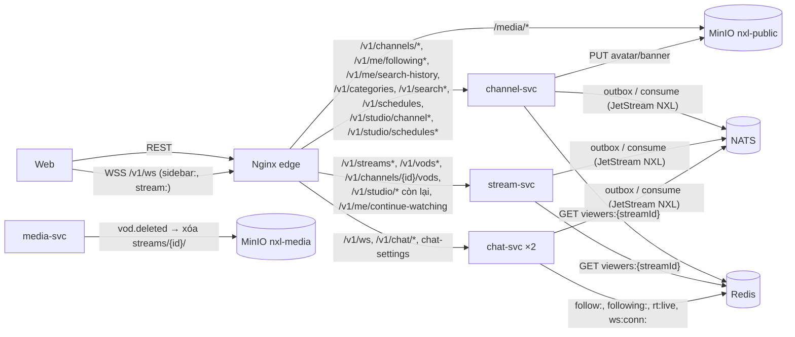
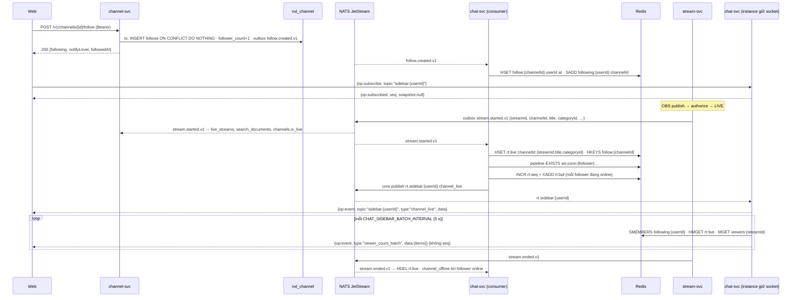
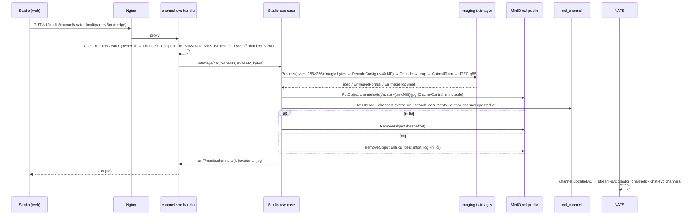
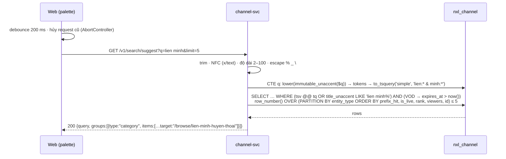
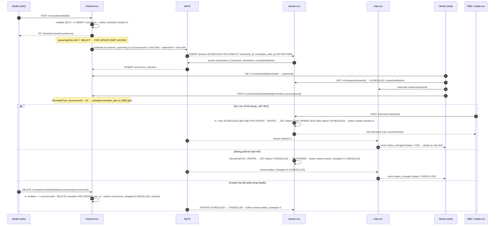
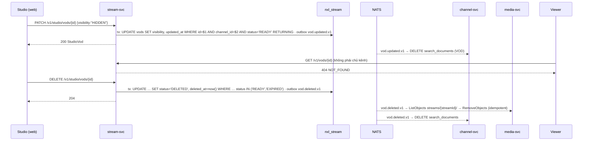

# TSD — GĐ4: Kênh & Khám phá (follow, hồ sơ kênh, danh mục, tìm kiếm, lịch phát, Studio)

| Phiên bản | Trạng thái | Ngày | Working Plan |
| --- | --- | --- | --- |
| 1.1 | Đã triển khai (đồng bộ theo hiện thực, §16) | 2026-10-14 | `docs/plans/working/2026-10-14-gd04-channel-discovery.md` (Approved 14/10) |

Quyết định đã chốt (14/10): **G4-Q1** thêm `golang.org/x/image` (đọc WebP, resize), xuất JPEG, resize ngay trong request,
bucket `nxl-public` đọc công khai qua Nginx `/media/` · **G4-Q2** chỉ PostgreSQL FTS + `unaccent` + tiền tố, không
`pg_trgm`, không nhóm Tag · **G4-Q3** Trang chủ gọi API theo từng khối (không có `GET /v1/home`) · **G4-Q4** Hero = live
nhiều người xem nhất (hòa → mới nhất), Trending = sort theo người xem, Danh mục phổ biến = tổng người xem live (hòa →
thứ tự seed), 18+ ẩn khỏi Hero và gợi ý, vẫn hiện ở danh mục / tìm kiếm với nhãn 18+ · **G4-Q5** lịch một lần + lặp hằng
tuần (`FREQ=WEEKLY;BYDAY=…`), chấp nhận đề xuất NXL-G2 ST-Q1…Q5, Q8, tự hủy sau 60 phút (trả lời NXL-A Q10) · **G4-Q6**
đổi handle 30 ngày / lần, handle cũ không chuyển hướng · **G4-Q7** sidebar realtime do chat-svc đẩy từ bản sao follow ·
**G4-Q8** lịch sử tìm kiếm lưu server cho tài khoản (≤ 10), Guest dùng localStorage · **G4-Q10** dựng theo frame có sẵn +
brief design GĐ4. (G4-Q9 — SePay — thuộc NXL-H, không nằm trong TSD này.)

## 1. Mục tiêu

- Người xem: follow kênh + chuông 3 mức, sidebar "Kênh đang theo dõi" cập nhật realtime (≤ 5 s), trang **Đang theo
  dõi**, hồ sơ Creator 4 tab, Browse theo danh mục, tìm kiếm có / không dấu (Ctrl+K + trang kết quả), đặt nhắc cho buổi
  "Sắp diễn ra".
- Creator: chọn danh mục khi phát, sửa hồ sơ (ảnh đại diện, ảnh bìa, bio, liên kết, handle), quản lý VOD (đổi tên / ẩn /
  xóa), tạo lịch phát (buổi `SCHEDULED` gắn vào Go Live cùng `streamId`), Dashboard tối thiểu.
- Followers-only của chat (GĐ3) chạy bằng follow thật; mọi thay đổi hợp đồng là **chỉ thêm**.

## 2. Phạm vi

**Trong:** channel-svc (auth JWKS, MinIO `nxl-public`, Redis chỉ đọc, ~30 endpoint, 3 job, migration mới, outbox
`follow.*`, `channel.updated`, `schedule.*`), stream-svc (`stream_settings.category_id`, lọc / sắp xếp danh sách, gợi ý,
VOD công khai theo danh mục, `SCHEDULED`/`CANCELLED`, Dashboard, Studio VOD, ẩn VOD trên mọi đường công khai, consumer
`channel.updated` + `schedule.*`, job hủy lịch trễ), chat-svc (chủ đề `sidebar:{userId}`, bản sao `following:{userId}`,
trạng thái `CANCELLED` trên `stream:`), media-svc (consumer `vod.deleted.v1`), `pkg/events` (payload mới / thêm trường),
Nginx, compose, `.env.example`, web (`nexuslive-web`, cùng basename).

**Ngoài:** gửi thông báo nhắc lịch / kênh live / lịch đổi (notification-svc, GĐ5 — GĐ4 chỉ phát sự kiện), follow danh mục
(NXL-C Q7), Clips, doanh thu Dashboard (GĐ6), khóa kênh (`CHANNEL_SUSPENDED` chỉ có nhánh đọc sẵn từ GĐ1), lượt xem VOD
(ST-Q9, GĐ7), `GET /v1/home`, `GET /v1/search/trending`, `GET /v1/channels/recommended` (§13), đồng bộ
`user.profile_updated.v1` vào kênh (tên kênh độc lập với tên tài khoản), identity nghe `channel.updated.v1`.

## 3. Kiến trúc



- **channel-svc** sở hữu kênh, follow, danh mục, lịch phát, reminder, bảng tìm kiếm. Nó giữ bản sao `live_streams`
  (từ `stream.started/updated/ended`) để biết kênh nào đang phát, danh mục nào có người xem; số người xem đọc thẳng
  `viewers:{streamId}` (Redis, do chat-svc ghi) như stream-svc đã làm ở GĐ3.
- **stream-svc** vẫn là nguồn danh sách stream / VOD (lọc theo danh mục bằng `category_id` của stream). Web ghép tên /
  slug danh mục từ `GET /v1/categories` (danh sách nhỏ, cố định — giả định của Working Plan).
- **chat-svc** đẩy `sidebar:{userId}` từ bản sao follow trong Redis (G4-Q7); không có kết nối realtime nào tới
  channel-svc.

### 3.1 Trang chủ — mỗi khối một lời gọi (G4-Q3)

| Khối (NXL-C BR02) | Lời gọi | Service | Luật |
| --- | --- | --- | --- |
| Hero | `GET /v1/streams/recommended?limit=1` | stream | Chỉ `LIVE` (không `INTERRUPTED` — BR03, BR40), không mature; `viewerCount` giảm dần, hòa → `startedAt` mới hơn, rồi `id` |
| Tiếp tục xem | `GET /v1/me/continue-watching` | stream | Đã có; nay loại VOD `HIDDEN` / `DELETED` |
| Kênh theo dõi đang live | `GET /v1/me/following?status=live&limit=12` | channel | Chỉ khi đăng nhập |
| Live đề xuất | `GET /v1/streams/recommended?limit=13` | stream | Như Hero; web bỏ stream đang làm Hero |
| Danh mục phổ biến | `GET /v1/categories?sort=viewers` (web lấy 10 đầu) | channel | Tổng người xem live, hòa → `position` (thứ tự seed) |
| Video đề xuất | `GET /v1/vods/recommended?limit=12` | stream | VOD `READY` + `PUBLIC` còn hạn, không mature, mới nhất |
| Creator CTA | `GET /v1/me` (`isCreator`) | identity | Không đổi |

Mỗi khối có trạng thái tải / lỗi riêng (NXL-C E01). Sidebar Guest ("Kênh đề xuất", BR31) dùng
`GET /v1/streams/recommended?limit=10`.

### 3.2 Định tuyến Nginx (thứ tự location regex quyết định)

Nginx chọn location regex **đầu tiên** khớp theo thứ tự trong file, nên các dòng mới phải nằm đúng chỗ dưới đây (✚ = mới):

| # | Location | Đích | Ghi chú |
| --- | --- | --- | --- |
| 1 | `~ ^/v1/chat/` | chat | Có sẵn |
| 2 | `~ ^/v1/channels/[^/]+/chat-settings$` | chat | Có sẵn |
| 3 ✚ | `~ ^/v1/channels/[^/]+/vods$` | stream | Trước dòng 4 |
| 4 | `~ ^/v1/channels(/|$)` | channel | Có sẵn: hồ sơ, follow, lịch kênh |
| 5 ✚ | `~ ^/v1/me/(following|search-history)(/|$)` | channel | Phần còn lại của `/v1/me` vẫn về identity |
| 6 | `~ ^/v1/me/(watch-progress|continue-watching)(/|$)` | stream | Có sẵn |
| 7 ✚ | `~ ^/v1/studio/channel/(avatar|banner)$` | channel | `client_max_body_size 6m` (multipart 5 MB + phần đầu); service tự giới hạn 2 MB / 5 MB |
| 8 ✚ | `~ ^/v1/studio/(channel|schedules)(/|$)` | channel | **Trước** dòng 10 |
| 9 ✚ | `~ ^/v1/(categories|search|schedules)(/|$)` | channel | `search` gồm `/v1/search/suggest` |
| 10 | `~ ^/v1/(studio|streams|vods)(/|$)` | stream | Có sẵn: Stream Manager, dashboard, Studio VOD |
| 11 | `/v1/` (prefix) | identity | Có sẵn |
| 12 ✚ | `/media/` (prefix) | MinIO `/nxl-public/` | Như `/hls/`: chỉ `GET`/`HEAD`, `rewrite ^/media/(.*)$ /nxl-public/$1 break`, ẩn header CORS / cookie của MinIO, `Cache-Control: public, max-age=86400`, không rate limit |

Mọi dòng ✚ kèm `limit_req nxl_read` + `nxl_write` như các route API khác. Kiểm định tuyến bằng bảng `curl` từng tiền
tố (§10) như GĐ1/GĐ3.

## 4. Kịch bản

### S1 — Follow, chuông, sidebar realtime

- Given đã đăng nhập, When `POST /v1/channels/{id}/follow`, Then `200 {following: true, notifyLevel: "ALL", followedAt}`;
  follow lặp → `200` cùng dữ liệu, không phát sự kiện lần hai. Kênh của mình → `422 CANNOT_FOLLOW_SELF`; kênh không có →
  `404`; kênh `SUSPENDED` → `403 CHANNEL_SUSPENDED`.
- When `PUT … {notifyLevel: "LIVE_ONLY"}` Then `200`; chưa follow → `404 NOT_FOUND`. `DELETE` luôn `204`.
- Given người xem đang mở web (có `ws:conn:{userId}`) và đã subscribe `sidebar:{userId}`, When kênh đã follow Go Live,
  Then ≤ 5 s nhận `channel_live`; mỗi 5 s nhận `viewer_count_batch`; khi kết thúc nhận `channel_offline`.
- Given vừa follow, When chủ kênh bật Followers-only 10 phút và người xem gửi tin, Then `CHAT_FOLLOWERS_ONLY`
  (`details.followedMin = 0`) — không còn cần `chat dev-grant`.



### S2 — Hồ sơ kênh và tab

- Given `/minhnn`, When `GET /v1/channels/minhnn` (token tùy chọn), Then `ChannelProfile` (§5.1) với `currentStream`
  khi live, `viewer` khi có token (`null` khi Guest). Handle sai định dạng / không có → `404`.
- Tab Video: `GET /v1/channels/{id}/vods` (stream-svc, VOD `READY` + `PUBLIC` còn hạn, mới nhất). Tab Lịch:
  `GET /v1/channels/{id}/schedule` (mặc định `[now, now + SCHEDULE_WINDOW_DAYS]`), mỗi lần phát có `streamId` khi
  stream-svc đã tạo dòng `SCHEDULED` (≤ 24 h trước) → link `/live/{streamId}` (màn "Sắp diễn ra").

### S3 — Sửa hồ sơ, ảnh đại diện / ảnh bìa, handle

- Given Creator, When `PATCH /v1/studio/channel {bio, socialLinks}` Then `200 StudioChannel` + `channel.updated.v1`
  (khi tên / handle / avatar đổi). Bio > 300 → `400 details.bio = LENGTH`; > 5 liên kết → `socialLinks = MAX`; liên kết
  không `https://` → `socialLinks = FORMAT`; loại lạ → `socialLinks = ENUM`.
- **Handle:** `^[a-z0-9_]{3,25}$` (chữ thường, BR-D14); trùng từ khóa dành riêng (§6.6) → `400 details.handle =
  INVALID`; trùng kênh khác → `409 HANDLE_TAKEN`; đổi lần hai trong `HANDLE_CHANGE_INTERVAL` → `409 CONFLICT`,
  `details.nextChangeAt`. Đổi thành công: handle cũ trả `404` ngay (không chuyển hướng) và kênh khác có thể lấy.
- **Ảnh:** `PUT /v1/studio/channel/avatar` (multipart `file`) ≤ 2 MB → JPEG 256×256 (cắt vuông giữa); `…/banner` ≤ 5 MB
  → JPEG 1600×500 (cắt giữa theo 16:5). Quá giới hạn → `413 PAYLOAD_TOO_LARGE`; thiếu `file` → `file = REQUIRED`; magic
  bytes không phải JPEG / PNG / WebP hoặc decode lỗi → `file = FORMAT`; ảnh nhỏ hơn 128×128 (avatar) / 800×250 (banner) →
  `file = MIN`. Ảnh mới hiện ở header, sidebar, trang xem ≤ 10 s (AC-D21).



### S4 — Danh mục và Browse

- `GET /v1/categories?group=GAMES&sort=viewers` → ~24 danh mục seed (5 nhóm), `viewerCount` = tổng `viewers:{streamId}`
  của stream live thuộc danh mục (`null` khi Redis không cấu hình / lỗi). `GET /v1/categories/{slug}` → một danh mục;
  slug lạ → `404`.
- Browse "Kênh live": `GET /v1/streams?category=<id>[,<id>…]&language=vi&tags=fps&sort=viewers|newest|trending&cursor=`.
  Web chọn pill nhóm → gửi mọi `id` của nhóm (lấy từ `/v1/categories`). Trang `/browse/:slug` → tab Live như trên với một
  `id`, tab Video `GET /v1/vods?category=<id>`.
- Stream Manager: `PUT /v1/studio/stream` thêm `categoryId` (UUID hoặc `null`); áp vào stream đang phát (outbox
  `stream.updated.v1` có `categoryId`).

### S5 — Tìm kiếm (Ctrl+K, trang kết quả, lịch sử)

- Given Guest gõ "lien minh", When `GET /v1/search/suggest?q=lien%20minh` (debounce 200 ms ở web), Then ≤ 300 ms nhận nhóm
  `category` có "Liên Minh Huyền Thoại" (và `esports-lmht`), nhóm chỉ xuất hiện khi có kết quả, thứ tự nhóm Kênh → Live →
  Danh mục → Video.
- `q` sau khi cắt khoảng trắng < 2 hoặc > 100 ký tự → `400 details.q = LENGTH`; `types` lạ → `types = ENUM`.
- Trang kết quả `GET /v1/search?q=&type=channel|stream|category|vod&cursor=` (cursor keyset theo bộ điểm, §6.2).
- Đã đăng nhập: chọn một kết quả → web `POST /v1/me/search-history {query}` (trùng không phân biệt hoa thường → đưa lên
  đầu); giữ tối đa 10; `DELETE /{id}` / `DELETE` tất cả.



### S6 — Lịch phát → "Sắp diễn ra" → Go Live gắn lịch → hủy

- Given Creator (múi giờ `Asia/Ho_Chi_Minh`), When `POST /v1/studio/schedules {title, startAt: "…T20:00:00+07:00",
  durationMin: 120, rrule: "FREQ=WEEKLY;BYDAY=MO,WE", timezone}`, Then `201 Schedule` với `nextOccurrences` (≤ 5).
- Job channel-svc (1 phút) phát `schedule.occurrence_upcoming.v1` cho mỗi lần phát trong 24 h tới → stream-svc tạo dòng
  `SCHEDULED` (idempotent theo `(schedule_id, scheduled_start_at)`) + `stream.scheduled.v1` → channel-svc lưu `streamId`.
- Người xem mở `/live/{streamId}` → `GET /v1/streams/{id}` (`status: SCHEDULED`, `scheduledStartAt`, `scheduleId`) +
  subscribe `stream:{id}`; "Đặt nhắc" → `POST /v1/schedules/{scheduleId}/reminders {occurrenceAt}`.
- Creator Go Live lúc 19:50 (trong `[start − 30', start + 60']`) → authorize chuyển **đúng dòng đó** `SCHEDULED → LIVE`
  (cùng `streamId`), chép `stream_settings` (ST-Q8), phát `stream.started.v1` → chat-svc đẩy `status_changed LIVE` → trang
  tự chuyển ≤ 5 s (NXL-A AF04). Hai dòng cùng trong khoảng → chọn `scheduled_start_at` gần `now` nhất (AF-G2-09). Ngoài
  khoảng → stream mới như NXL-G1, dòng `SCHEDULED` vẫn chờ.
- Không phát tới 21:00 → job stream-svc chuyển `CANCELLED` + `stream.status_changed.v1 {status: CANCELLED}` → trang hiện
  "Buổi phát đã bị hủy". Creator hủy lần phát trong Studio → `schedule.occurrence_changed.v1 (CANCELLED)` → như trên.



### S7 — Ẩn / xóa VOD

- Given VOD `READY` + `PUBLIC`, When chủ kênh `PATCH /v1/studio/vods/{id} {visibility: "HIDDEN"}`, Then `200 StudioVod`;
  ≤ 5 s sau VOD không còn ở tab Video, `/v1/vods`, gợi ý, tìm kiếm, Tiếp tục xem, `vodId` của stream; người khác
  `GET /v1/vods/{id}` / `POST …/playback` → `404`; chủ kênh vẫn `200` (`visibility: HIDDEN`).
- VOD `EXPIRED` → `PATCH` trả `409 INVALID_STATE`; `DELETE` được. VOD kênh khác / đã xóa → `404`.
- `DELETE` → `204`, `status = DELETED` + `vod.deleted.v1` → media-svc xóa prefix `streams/{streamId}/` (≤ 1 phút).



### S8 — Dashboard

- `GET /v1/studio/dashboard?range=7d` (stream-svc) và `GET /v1/studio/channel/stats?range=7d` (channel-svc) gọi song song;
  một service lỗi chỉ làm khối của nó báo lỗi (AC-G2-06). Đếm trực tiếp trên bảng, không có bảng tổng hợp (BR-G2-03).

## 5. Hợp đồng

### 5.1 Kiểu dùng chung (JSON, camelCase, trường không có giá trị trả `null`)

| Kiểu | Trường |
| --- | --- |
| `ChannelCard` | `id, handle, displayName, avatarUrl, verified` |
| `CategoryRef` (channel-svc) | `id, slug, name` |
| `Category` | `id, slug, name, group (GAMES\|ESPORTS\|MUSIC\|IRL\|CREATIVE), posterUrl, tags[], position, viewerCount \| null` |
| `LiveStreamRef` (channel-svc) | `id, title, category: CategoryRef \| null, viewerCount \| null, isMature, startedAt` |
| `ChannelProfile` | `id, handle, displayName, bio, avatarUrl, bannerUrl, socialLinks: [{type, url}], verified, matureDefault, status, followerCount, isLive, currentStreamId, currentStream: LiveStreamRef \| null, lastLiveAt, createdAt, viewer: {following, notifyLevel \| null, isOwner} \| null` (GĐ1 giữ nguyên các trường cũ) |
| `StudioChannel` | `ChannelProfile` bỏ `viewer` + `handleChangedAt \| null, nextHandleChangeAt \| null` |
| `FollowState` | `following, notifyLevel (ALL\|LIVE_ONLY\|OFF), followedAt` |
| `FollowedChannel` | `channel: ChannelCard, isLive, currentStream: LiveStreamRef \| null, lastLiveAt, notifyLevel, followedAt` |
| `Occurrence` | `scheduleId, occurrenceAt, title, category: CategoryRef \| null, durationMin, streamId \| null, reminded: boolean \| null` (`null` khi Guest) |
| `Schedule` | `id, title, category: CategoryRef \| null, startAt, durationMin, rrule \| null, timezone, status (ACTIVE\|CANCELLED), parentId, nextOccurrences: [{occurrenceAt, reminderCount, streamId \| null}] (≤ 5), createdAt, updatedAt` (NXL-G2 §13.2; `rruleText` do web dựng theo i18n) |
| `Reminder` | `scheduleId, occurrenceAt, createdAt` |
| `SearchItem` | `type (channel\|stream\|category\|vod), id, title, subtitle, imageUrl, viewerCount \| null, isLive, isMature, target` |
| `socialLinks[].type` | `YOUTUBE, X, FACEBOOK, TIKTOK, DISCORD, WEBSITE`; `url` `https://…` ≤ 300 ký tự |

`target`: kênh `/{handle}`, stream `/live/{streamId}`, danh mục `/browse/{slug}`, VOD `/vod/{id}`.

stream-svc thêm vào DTO có sẵn (chỉ thêm, luôn có mặt):

| DTO | Trường mới |
| --- | --- |
| `Stream` | `category: {id} \| null` (web ghép `slug`, `name`), `scheduleId \| null`, `scheduledStartAt \| null`; `status` có thể là `SCHEDULED`, `CANCELLED` ở `GET /v1/streams/{id}`; `vodId = null` khi VOD `HIDDEN` và người gọi không phải chủ kênh |
| `VOD` | `category: {id} \| null`, `isMature`, `visibility` |
| `Settings` (`GET/PUT /v1/studio/stream`) | `categoryId \| null` |
| `StudioVod` | `id, streamId, title, durationSec, thumbnailUrl, manifestUrl, status (READY\|EXPIRED), visibility, category: {id} \| null, createdAt, expiresAt` |
| `Dashboard` | `current: {streamId, title, status, startedAt, viewerCount \| null} \| null`, `recentStreams[] (≤ 5): {streamId, title, startedAt, endedAt, durationSec, endReason, peakViewers \| null, vodId \| null, vodVisibility \| null}`, `stats: {range, streamCount, liveSeconds, vodReadyPublic, vodReadyHidden}` |

### 5.2 REST — channel-svc

Auth: `—` không cần · `O` token tùy chọn · `B` Bearer · `C` Bearer của Creator (kênh tra theo `owner_id = sub`, không có →
`403 NOT_CREATOR`). Phân trang theo NXL-00 §6 (`limit` mặc định 24, tối đa 50).

| Method | Path | Auth | Request | Response | Lỗi |
| --- | --- | --- | --- | --- | --- |
| GET | `/v1/channels/{handle}` | O | — | `200 ChannelProfile` | `NOT_FOUND`, `CHANNEL_SUSPENDED` |
| POST | `/v1/channels/{id}/follow` | B | — | `200 FollowState` (đã follow → `200` như cũ) | `CANNOT_FOLLOW_SELF`, `CHANNEL_SUSPENDED`, `NOT_FOUND`, `UNAUTHORIZED` |
| PUT | `/v1/channels/{id}/follow` | B | `{notifyLevel}` | `200 FollowState` | `VALIDATION_FAILED` (`notifyLevel = ENUM`), `NOT_FOUND` (chưa follow / không có kênh) |
| DELETE | `/v1/channels/{id}/follow` | B | — | `204` | `UNAUTHORIZED` |
| GET | `/v1/channels/{id}/schedule?from=&to=` | O | RFC 3339; mặc định `[now, now+14d]`; `to − from` ≤ 31 ngày, `to` ≤ now + `SCHEDULE_HORIZON_DAYS` | `200 {items: Occurrence[], nextCursor: null}` (tăng dần) | `VALIDATION_FAILED` (`from`/`to` = `FORMAT`/`MAX`), `NOT_FOUND` |
| GET | `/v1/me/following?status=live\|offline\|all&cursor=&limit=` | B | mặc định `all` | `200 {items: FollowedChannel[], nextCursor}` | `VALIDATION_FAILED` (`status = ENUM`, `cursor = INVALID`) |
| GET | `/v1/me/following/sidebar?limit=` | B | 1–50, mặc định `SIDEBAR_FOLLOWED_MAX` (10) | `200 {live: FollowedChannel[], offline: FollowedChannel[], totalFollowing}` | `UNAUTHORIZED` |
| GET | `/v1/categories?group=&sort=position\|viewers` | — | mặc định `position` | `200 {items: Category[], nextCursor: null}` | `VALIDATION_FAILED` (`group`/`sort` = `ENUM`) |
| GET | `/v1/categories/{slug}` | — | — | `200 Category` | `NOT_FOUND` |
| GET | `/v1/search/suggest?q=&types=&limit=` | — | `types` ⊆ `channel,stream,category,vod` (mặc định cả 4), `limit` 1–10 (5) | `200 {query, groups: [{type, items: SearchItem[]}]}` | `VALIDATION_FAILED` (`q = LENGTH`, `types = ENUM`) |
| GET | `/v1/search?q=&type=&cursor=&limit=` | — | `type` bắt buộc | `200 {items: SearchItem[], nextCursor}` | `VALIDATION_FAILED` (`q`, `type = REQUIRED\|ENUM`, `cursor = INVALID`) |
| GET | `/v1/me/search-history` | B | — | `200 {items: [{id, query, createdAt}], nextCursor: null}` (mới nhất trước, ≤ 10) | `UNAUTHORIZED` |
| POST | `/v1/me/search-history` | B | `{query}` 2–100 ký tự | `201 {id, query, createdAt}` (trùng → cùng `id`, `createdAt` mới) | `VALIDATION_FAILED` (`query = LENGTH`) |
| DELETE | `/v1/me/search-history/{id}` · `/v1/me/search-history` | B | — | `204` | — |
| POST | `/v1/schedules/{id}/reminders` | B | `{occurrenceAt}` | `201 Reminder` (đã có → `200`) | `VALIDATION_FAILED` (`occurrenceAt = REQUIRED\|FORMAT`), `NOT_FOUND` (lịch không có / không phải một lần phát), `INVALID_STATE` (đã qua / lịch `CANCELLED`) |
| DELETE | `/v1/schedules/{id}/reminders?occurrenceAt=` | B | — | `204` | `VALIDATION_FAILED` |
| GET | `/v1/studio/channel` | C | — | `200 StudioChannel` | `NOT_CREATOR` |
| PATCH | `/v1/studio/channel` | C | `{displayName?, bio? \| null, socialLinks?, matureDefault?, handle?}` (≥ 1 trường) | `200 StudioChannel` | `VALIDATION_FAILED` (`body = REQUIRED`, `displayName = LENGTH`, `bio = LENGTH`, `socialLinks = MAX\|FORMAT\|ENUM`, `handle = FORMAT\|INVALID`), `HANDLE_TAKEN`, `CONFLICT` (`details.nextChangeAt`), `NOT_CREATOR` |
| PUT | `/v1/studio/channel/avatar` · `/v1/studio/channel/banner` | C | `multipart/form-data`, part `file` | `200 {url}` | `PAYLOAD_TOO_LARGE`, `VALIDATION_FAILED` (`file = REQUIRED\|FORMAT\|MIN`), `NOT_CREATOR` |
| GET | `/v1/studio/channel/stats?range=7d\|28d` | C | mặc định `7d` | `200 {range, followerCount, newFollowers, upcoming: {scheduleId, occurrenceAt, title, reminderCount} \| null}` | `VALIDATION_FAILED` (`range = ENUM`), `NOT_CREATOR` |
| GET | `/v1/studio/schedules?status=ACTIVE\|CANCELLED` | C | mặc định `ACTIVE` | `200 {items: Schedule[], nextCursor: null}` | `VALIDATION_FAILED`, `NOT_CREATOR` |
| POST | `/v1/studio/schedules` | C | `{title, categoryId?, startAt, durationMin, rrule?, timezone?}` | `201 Schedule` | `VALIDATION_FAILED` (`title = LENGTH`, `startAt = FORMAT\|MIN\|MAX`, `durationMin = MIN\|MAX`, `rrule = FORMAT`, `timezone = FORMAT`, `categoryId = INVALID`), `CONFLICT` (`details.limit = 20`), `NOT_CREATOR` |
| PUT | `/v1/studio/schedules/{id}` | C | như POST | `200 Schedule` | như POST, `NOT_FOUND`, `INVALID_STATE` (`CANCELLED`) |
| DELETE | `/v1/studio/schedules/{id}` | C | — | `204` | `NOT_FOUND`, `INVALID_STATE` |
| PUT | `/v1/studio/schedules/{id}/occurrences/{occurrenceAt}` | C | `{startAt}` | `200 {schedule: Schedule}` (lịch một lần mới, `parentId = id`) | `VALIDATION_FAILED`, `NOT_FOUND`, `INVALID_STATE` (lần phát đã qua / đang live) |
| DELETE | `/v1/studio/schedules/{id}/occurrences/{occurrenceAt}` | C | — | `204` | `NOT_FOUND`, `INVALID_STATE` |

Ghi chú: `{occurrenceAt}` trên path là RFC 3339 UTC đã URL-encode; ID sai định dạng → `404` (NXL-00 §3.3).
`FollowedChannel` của `/following?status=live` sắp theo `viewerCount` giảm dần (tính trong bộ nhớ, `nextCursor: null`,
tối đa 200 kênh); `offline` / `all` dùng keyset `(is_live DESC, last_live_at DESC NULLS LAST, channel_id)`. Sidebar: tất cả
kênh live (≤ `limit`), phần còn lại lấp bằng offline.

### 5.3 REST — stream-svc

| Method | Path | Auth | Request | Response | Lỗi |
| --- | --- | --- | --- | --- | --- |
| GET | `/v1/streams?status=live&category=&language=&tags=&sort=&cursor=&limit=` | — | `category` = 1–30 UUID cách nhau dấu phẩy; `language` `^[a-z]{2}$`; `tags` ≤ 5 (khớp **tất cả**, `@>`); `sort` ∈ `viewers` (mặc định), `newest`, `trending` (= `viewers`, G4-Q4) | `200 {items: Stream[], nextCursor}` — `LIVE` + `INTERRUPTED`, gồm mature (`isMature`) | `VALIDATION_FAILED` (`category = INVALID`, `language = FORMAT`, `tags = TAG_COUNT`, `sort = ENUM`, `cursor = INVALID`) |
| GET | `/v1/streams/recommended?limit=` | — | 1–24 (12) | `200 {items: Stream[], nextCursor: null}` (luật Hero, §3.1) | `VALIDATION_FAILED` |
| GET | `/v1/streams/{id}` | O (mới) | — | `200 Stream` (gồm `SCHEDULED`, `CANCELLED`) | `NOT_FOUND` |
| GET | `/v1/vods?category=&cursor=&limit=` | — | như trên | `200 {items: VOD[], nextCursor}` (`READY` + `PUBLIC` + chưa hết hạn, mới nhất, keyset `(created_at, id)`) | `VALIDATION_FAILED` |
| GET | `/v1/vods/recommended?limit=` | — | 1–24 (12) | `200 {items: VOD[], nextCursor: null}` (thêm điều kiện không mature) | `VALIDATION_FAILED` |
| GET | `/v1/channels/{id}/vods?cursor=&limit=` | — | — | `200 {items: VOD[], nextCursor}` | `NOT_FOUND` (kênh lạ với `creator_channels`), `VALIDATION_FAILED` |
| GET | `/v1/vods/{id}` · POST `/v1/vods/{id}/playback` | O | — | Như cũ; VOD `HIDDEN` chỉ chủ kênh thấy | `NOT_FOUND` |
| GET | `/v1/me/continue-watching` | B | — | Như cũ, loại VOD `HIDDEN` | — |
| GET / PUT | `/v1/studio/stream` | C | `PUT` thêm `categoryId: uuid \| null` (vắng = `null`, đúng ngữ nghĩa PUT) | `Settings` có `categoryId` | `VALIDATION_FAILED` (`categoryId = INVALID`) |
| GET | `/v1/studio/dashboard?range=7d\|28d` | C | — | `200 Dashboard` | `VALIDATION_FAILED` (`range = ENUM`), `NOT_CREATOR` |
| GET | `/v1/studio/vods?visibility=&status=&cursor=&limit=` | C | `visibility` ∈ `PUBLIC, HIDDEN`; `status` ∈ `READY, EXPIRED` | `200 {items: StudioVod[], nextCursor}` (keyset `created_at DESC, id`) | `VALIDATION_FAILED`, `NOT_CREATOR` |
| PATCH | `/v1/studio/vods/{id}` | C | `{title?, visibility?}` (≥ 1; `title` 1–140 sau trim) | `200 StudioVod` | `VALIDATION_FAILED` (`body = REQUIRED`, `title = LENGTH`, `visibility = ENUM`), `NOT_FOUND`, `INVALID_STATE` |
| DELETE | `/v1/studio/vods/{id}` | C | — | `204` | `NOT_FOUND` (kể cả đã xóa — E-G2-03; web coi `404` khi xóa là xong) |

Sắp xếp `viewers` không thể làm keyset trong SQL (số người xem ở Redis): stream-svc đọc mọi stream on air khớp bộ lọc
(tối đa 500 — số stream đồng thời thực tế ≤ `MEDIA_MAX_CONCURRENT_STREAMS`), lấy số người xem một lần `MGET`, sắp
`(viewers DESC, startedAt DESC, id DESC)` trong bộ nhớ; cursor = base64url `{v, s, id}` của phần tử cuối, trang sau lấy các
phần tử đứng sau bộ đó. Số người xem đổi giữa hai trang có thể làm trùng / sót một thẻ — web đã loại trùng (NXL-C BR20).
`sort=newest` giữ keyset SQL `(started_at DESC, id DESC)` hiện có.

### 5.4 WebSocket — `sidebar:{userId}` (chat-svc)

| Mục | Quy định |
| --- | --- |
| Subscribe | Chỉ chính user (`p.UserID == id`); Guest → `error UNAUTHORIZED`, người khác → `error FORBIDDEN` (như `user:`) |
| `snapshot` | `null` (web lấy trạng thái đầu bằng `GET /v1/me/following/sidebar`; `resync` → tải lại REST) |
| `channel_live` (có `seq`) | `{channelId, stream: {id, title, categoryId \| null, viewerCount: null}}` |
| `channel_offline` (có `seq`) | `{channelId, streamId, lastLiveAt}` |
| `viewer_count_batch` (không `seq`, chỉ gửi trực tiếp từ instance giữ socket, như `sampling`) | `{items: [{channelId, streamId, count}]}` — chỉ các kênh đang theo dõi đang live; bỏ qua khi rỗng |

`stream:{streamId}` thêm: `status_changed {status: "CANCELLED"}` và `status_changed {status: "SCHEDULED", scheduledStartAt}`
(lần phát bị dời); `subscribed.snapshot.status` có thể là `SCHEDULED` / `CANCELLED` khi chat-svc đã biết (khóa
`stream:status:{id}`), không biết → `null` (web dùng REST).

### 5.5 Sự kiện (`pkg/events`, NXL-00 §11.1)

Mọi thay đổi trên sự kiện có sẵn là **thêm trường** (giữ `v1`); consumer cũ bỏ qua trường lạ. Sự kiện phát qua outbox
cùng transaction với thay đổi.

| Type | Nguồn → nghe | Payload (✚ = trường / sự kiện mới) | Khi |
| --- | --- | --- | --- |
| `follow.created.v1` | channel → chat (GĐ5: notification) | `userId, channelId, createdAt, notifyLevel ✚` | Follow mới (không phát khi follow lặp) |
| `follow.updated.v1` ✚ | channel → (GĐ5: notification) | `userId, channelId, notifyLevel, updatedAt` | `notifyLevel` đổi thật |
| `follow.deleted.v1` | channel → chat | `userId, channelId` | Có dòng bị xóa |
| `channel.updated.v1` ✚ | channel → stream (`creator_channels`), chat (`channels`) | `channelId, ownerId, handle, displayName, avatarUrl \| null` | Đổi tên hiển thị / handle / avatar |
| `schedule.created.v1` ✚ | channel → (GĐ5: notification, mức `ALL` — NE-Q3) | `scheduleId, channelId, title, startAt` | Tạo lịch (không phát cho lịch một lần sinh ra khi dời) |
| `schedule.updated.v1` ✚ | channel → stream | `scheduleId, channelId, title, categoryId \| null, durationMin` | Sửa chuỗi chỉ đổi tiêu đề / danh mục / thời lượng |
| `schedule.occurrence_upcoming.v1` ✚ | channel → stream | `scheduleId, channelId, occurrenceAt, title, categoryId \| null, durationMin` | Job, lần phát ≤ `SCHEDULE_UPCOMING_LEAD` |
| `schedule.occurrence_changed.v1` ✚ | channel → stream, (GĐ5: notification) | `scheduleId, channelId, title, occurrenceAt, newScheduleId \| null ✚, newOccurrenceAt \| null, reason (CANCELLED\|MOVED\|SERIES_CHANGED), userIds[]` | Hủy / dời một lần, hủy lịch, đổi giờ / quy tắc (§6.4) |
| `schedule.reminder_due.v1` ✚ | channel → (GĐ5: notification) | `scheduleId, channelId ✚, title ✚, occurrenceAt, userIds[]` (≤ 500 / sự kiện) | Job, `occurrenceAt − REMINDER_LEAD` |
| `stream.started.v1` | stream → channel, chat | `streamId, channelId, title, categoryId ✚, tags ✚, language ✚, isMature ✚, startedAt ✚, scheduleId ✚ \| null` | Như cũ, gồm nhánh gắn lịch |
| `stream.updated.v1` | stream → channel, chat | `streamId, channelId, title, tags, categoryId ✚, language ✚, isMature ✚` | Sửa cài đặt khi đang phát |
| `stream.status_changed.v1` | stream → chat | `streamId, channelId, status (LIVE\|INTERRUPTED\|CANCELLED ✚\|SCHEDULED ✚), occurredAt, scheduledStartAt ✚ \| null` | Thêm: `SCHEDULED → CANCELLED`; dời lần phát (`SCHEDULED`, giờ mới) |
| `stream.scheduled.v1` ✚ | stream → channel | `streamId, channelId, scheduleId, scheduledStartAt` | Tạo dòng `SCHEDULED`, hoặc dòng đó đổi lịch / giờ khi dời |
| `stream.vod_ready.v1` | stream → chat, channel ✚ | `streamId, channelId, vodId, title ✚, thumbnailUrl ✚, durationSec ✚, categoryId ✚, isMature ✚, expiresAt ✚` | VOD `READY` |
| `vod.updated.v1` ✚ | stream → channel | `vodId, streamId, channelId, title, visibility, status, thumbnailUrl, durationSec, categoryId \| null, isMature, expiresAt` | Đổi tên / ẩn / hiện |
| `vod.deleted.v1` ✚ | stream → media, channel | `vodId, streamId, channelId` | Xóa mềm |

Durable consumer: channel-svc (`channel-svc`) thêm `stream.updated`, `stream.scheduled`, `stream.vod_ready`, `vod.updated`,
`vod.deleted`; stream-svc thêm `channel.updated`, `schedule.updated`, `schedule.occurrence_upcoming`,
`schedule.occurrence_changed`; chat-svc thêm `channel.updated` (upsert `channels(channel_id, owner_id)`; không nghe
`follow.updated` vì chuông không ảnh hưởng chat); media-svc thêm `vod.deleted`. VOD vào bảng tìm kiếm từ
`stream.vod_ready.v1` (có `vodId`) chứ không từ `vod.processed.v1` (chỉ có `streamId`, đi media → stream).

```go
// pkg/events — new types and payloads (additions to existing structs are tagged the same way).
const (
    TypeFollowUpdated              = "follow.updated.v1"
    TypeChannelUpdated             = "channel.updated.v1"
    TypeScheduleCreated            = "schedule.created.v1"
    TypeScheduleUpdated            = "schedule.updated.v1"
    TypeScheduleOccurrenceUpcoming = "schedule.occurrence_upcoming.v1"
    TypeScheduleOccurrenceChanged  = "schedule.occurrence_changed.v1"
    TypeScheduleReminderDue        = "schedule.reminder_due.v1"
    TypeStreamScheduled            = "stream.scheduled.v1"
    TypeVODUpdated                 = "vod.updated.v1"
    TypeVODDeleted                 = "vod.deleted.v1"

    NotifyAll, NotifyLiveOnly, NotifyOff = "ALL", "LIVE_ONLY", "OFF"
    StreamStatusScheduled, StreamStatusCancelled = "SCHEDULED", "CANCELLED"
    OccurrenceCancelled, OccurrenceMoved, OccurrenceSeriesChanged = "CANCELLED", "MOVED", "SERIES_CHANGED"
)

type FollowCreated struct { UserID, ChannelID string; CreatedAt time.Time; NotifyLevel string `json:"notifyLevel"` }
type FollowUpdated struct { UserID, ChannelID, NotifyLevel string; UpdatedAt time.Time }
type ChannelUpdated struct { ChannelID, OwnerID, Handle, DisplayName string; AvatarURL *string }
type ScheduleCreated struct { ScheduleID, ChannelID, Title string; StartAt time.Time }
type ScheduleUpdated struct { ScheduleID, ChannelID, Title string; CategoryID *string; DurationMin int }
type ScheduleOccurrenceUpcoming struct {
    ScheduleID, ChannelID, Title string; OccurrenceAt time.Time; CategoryID *string; DurationMin int
}
type ScheduleOccurrenceChanged struct {
    ScheduleID, ChannelID, Title string; OccurrenceAt time.Time
    NewScheduleID *string; NewOccurrenceAt *time.Time; Reason string; UserIDs []string
}
type ScheduleReminderDue struct { ScheduleID, ChannelID, Title string; OccurrenceAt time.Time; UserIDs []string }
type StreamScheduled struct { StreamID, ChannelID, ScheduleID string; ScheduledStartAt time.Time }
type VODUpdated struct {
    VODID, StreamID, ChannelID, Title, Visibility, Status, ThumbnailURL string
    DurationSec int; CategoryID *string; IsMature bool; ExpiresAt time.Time
}
type VODDeleted struct { VODID, StreamID, ChannelID string }
// StreamStarted += CategoryID *string, Tags []string, Language string, IsMature bool, StartedAt time.Time, ScheduleID *string
// StreamUpdated += CategoryID *string, Language string, IsMature bool
// StreamStatusChanged += ScheduledStartAt *time.Time
// StreamVODReady += Title, ThumbnailURL string, DurationSec int, CategoryID *string, IsMature bool, ExpiresAt time.Time
```

(JSON tag camelCase theo tên trường như các payload hiện có; khối trên viết gọn.)

### 5.6 Go — channel-svc

```go
// internal/entity (new): NotifyLevel, Follow, Profile, ProfilePatch, SocialLink, ImageKind/ImageSpec,
// Category, CategoryGroup, LiveStream, Schedule (+ Occurrences), ScheduleInput, Reminder,
// SearchDoc, SearchGroup, ChannelStats, StatsRange; sentinels:
var (
    ErrCannotFollowSelf = errors.New("cannot follow own channel")  // 422 CANNOT_FOLLOW_SELF
    ErrNotFollowing     = errors.New("not following")              // 404 NOT_FOUND
    ErrNotCreator       = errors.New("caller has no channel")      // 403 NOT_CREATOR
    ErrHandleTaken      = errors.New("handle taken")               // 409 HANDLE_TAKEN
    ErrHandleTooSoon    = errors.New("handle changed recently")    // 409 CONFLICT + nextChangeAt
    ErrImageTooLarge    = errors.New("image too large")            // 413 PAYLOAD_TOO_LARGE
    ErrImageFormat      = errors.New("unsupported image")          // 400 file=FORMAT
    ErrImageTooSmall    = errors.New("image too small")            // 400 file=MIN
    ErrScheduleLimit    = errors.New("too many active schedules")  // 409 CONFLICT + limit
    ErrInvalidState     = errors.New("invalid state")              // 409 INVALID_STATE
    ErrBadCursor        = errors.New("bad cursor")                 // 400 cursor=INVALID
    // existing: ErrNotFound, ErrSuspended; field errors use a Validation{details} error like chat-svc.
)

// internal/usecase/contracts.go
type (
    Directory interface { // existing ByHandle kept for compatibility
        Profile(ctx context.Context, handle, viewerID string) (entity.Profile, error) // viewerID "" = guest
        ChannelSchedule(ctx context.Context, channelID, viewerID string, from, to time.Time) ([]entity.OccurrenceView, error)
    }
    Follows interface {
        Follow(ctx context.Context, userID, channelID string) (entity.Follow, error)
        SetNotifyLevel(ctx context.Context, userID, channelID string, l entity.NotifyLevel) (entity.Follow, error)
        Unfollow(ctx context.Context, userID, channelID string) error
        Following(ctx context.Context, userID string, f entity.FollowingFilter, cursor string, limit int) (FollowingPage, error)
        Sidebar(ctx context.Context, userID string, limit int) (entity.Sidebar, error)
    }
    Studio interface {
        Channel(ctx context.Context, ownerID string) (entity.StudioChannel, error)
        UpdateProfile(ctx context.Context, ownerID string, p entity.ProfilePatch) (entity.StudioChannel, error)
        SetImage(ctx context.Context, ownerID string, kind entity.ImageKind, data []byte) (url string, err error)
        Stats(ctx context.Context, ownerID string, r entity.StatsRange) (entity.ChannelStats, error)
    }
    Catalog interface {
        Categories(ctx context.Context, group *entity.CategoryGroup, sort entity.CategorySort) ([]entity.Category, error)
        Category(ctx context.Context, slug string) (entity.Category, error)
    }
    Search interface {
        Suggest(ctx context.Context, q string, types []entity.DocType, limit int) ([]entity.SearchGroup, error)
        Search(ctx context.Context, q string, t entity.DocType, cursor string, limit int) (SearchPage, error)
        History(ctx context.Context, userID string) ([]entity.SearchQuery, error)
        Remember(ctx context.Context, userID, query string) (entity.SearchQuery, error)
        Forget(ctx context.Context, userID string, id *string) error // nil = all
    }
    Schedules interface {
        List(ctx context.Context, ownerID string, s entity.ScheduleStatus) ([]entity.ScheduleView, error)
        Create(ctx context.Context, ownerID string, in entity.ScheduleInput) (entity.ScheduleView, error)
        Update(ctx context.Context, ownerID, id string, in entity.ScheduleInput) (entity.ScheduleView, error)
        Cancel(ctx context.Context, ownerID, id string) error
        MoveOccurrence(ctx context.Context, ownerID, id string, at, newStart time.Time) (entity.ScheduleView, error)
        CancelOccurrence(ctx context.Context, ownerID, id string, at time.Time) error
    }
    Reminders interface {
        Remind(ctx context.Context, userID, scheduleID string, at time.Time) (r entity.Reminder, created bool, err error)
        Unremind(ctx context.Context, userID, scheduleID string, at time.Time) error
    }
    Sync interface { // existing CreatorApproved, StreamStarted, StreamEnded (+ payload struct instead of ids)
        StreamStarted(ctx context.Context, eventID string, s entity.LiveStream) error // signature change, one caller
        StreamUpdated(ctx context.Context, eventID string, s entity.LiveStream) error
        StreamScheduled(ctx context.Context, eventID string, e events.StreamScheduled) error
        VODReady(ctx context.Context, eventID string, v entity.VODDoc) error
        VODUpdated(ctx context.Context, eventID string, v entity.VODDoc) error
        VODDeleted(ctx context.Context, eventID, vodID string) error
    }
    Jobs interface {
        AnnounceUpcoming(ctx context.Context) (int, error)   // §6.4
        DueReminders(ctx context.Context) (int, error)
        RefreshSearchViewers(ctx context.Context) error
        EnsureCategoryCovers(ctx context.Context) error      // startup, §6.7
    }
)

// internal/repo/contracts.go (mockgen as today)
type (
    ChannelRepo interface { // + existing
        ByOwner(ctx context.Context, ownerID string) (entity.Channel, error)
        ByID(ctx context.Context, id string) (entity.Channel, error)
        // UpdateProfile applies p in one tx: channels row, CHANNEL/STREAM/VOD search docs, outbox channel.updated
        // when name/handle/avatar changed. ErrHandleTaken on the citext unique violation.
        UpdateProfile(ctx context.Context, channelID string, p entity.ProfilePatch, now time.Time) (entity.Channel, error)
        SetLive(ctx context.Context, eventID string, s entity.LiveStream) error     // + live_streams, docs
        SetOffline(ctx context.Context, eventID, channelID, streamID string) error  // + last_live_at, docs
        UpdateLive(ctx context.Context, eventID string, s entity.LiveStream) error
    }
    FollowRepo interface {
        Follow(ctx context.Context, userID, channelID string) (f entity.Follow, created bool, err error)
        SetNotifyLevel(ctx context.Context, userID, channelID string, l entity.NotifyLevel) (entity.Follow, error)
        Unfollow(ctx context.Context, userID, channelID string) error
        Get(ctx context.Context, userID, channelID string) (*entity.Follow, error)
        ListByUser(ctx context.Context, userID string, f entity.FollowingFilter, after *FollowCursor, limit int) ([]entity.FollowedChannel, error)
        CountByUser(ctx context.Context, userID string) (int, error)
        NewFollowers(ctx context.Context, channelID string, since time.Time) (int, error)
    }
    CategoryRepo interface {
        List(ctx context.Context, group *entity.CategoryGroup) ([]entity.Category, error) // by position
        BySlug(ctx context.Context, slug string) (entity.Category, error)
        ByIDs(ctx context.Context, ids []string) (map[string]entity.Category, error)
        LiveStreamIDsByCategory(ctx context.Context) (map[string][]string, error)
    }
    SearchRepo interface {
        Suggest(ctx context.Context, q string, types []entity.DocType, limit int) ([]entity.SearchDoc, error)
        Search(ctx context.Context, q string, t entity.DocType, after *SearchCursor, limit int) ([]entity.SearchDoc, error)
        UpsertVOD(ctx context.Context, eventID string, v entity.VODDoc) error
        DeleteVOD(ctx context.Context, eventID, vodID string) error
        SetViewers(ctx context.Context, byType map[entity.DocType]map[string]int) error
        History(ctx context.Context, userID string, max int) ([]entity.SearchQuery, error)
        Remember(ctx context.Context, userID, query string, max int) (entity.SearchQuery, error) // upsert + trim
        Forget(ctx context.Context, userID string, id *string) error
    }
    ScheduleRepo interface {
        CountActive(ctx context.Context, channelID string, now time.Time) (int, error)
        Create(ctx context.Context, s entity.Schedule) (entity.Schedule, error)            // + outbox schedule.created
        Update(ctx context.Context, s entity.Schedule, change entity.SeriesChange) error   // + outbox §6.4
        Cancel(ctx context.Context, s entity.Schedule, announced []time.Time) error
        MoveOccurrence(ctx context.Context, s entity.Schedule, at time.Time, moved entity.Schedule) (entity.Schedule, error)
        CancelOccurrence(ctx context.Context, s entity.Schedule, at time.Time) error
        Get(ctx context.Context, channelID, id string) (entity.Schedule, error)
        GetPublic(ctx context.Context, id string) (entity.Schedule, error)
        ListByChannel(ctx context.Context, channelID string, s entity.ScheduleStatus) ([]entity.Schedule, error)
        OccurrenceStreams(ctx context.Context, scheduleIDs []string) (map[entity.OccurrenceKey]string, error)
        ReminderCounts(ctx context.Context, scheduleIDs []string, from time.Time) (map[entity.OccurrenceKey]int, error)
        UpsertOccurrenceStream(ctx context.Context, eventID string, e events.StreamScheduled) error
        // AnnounceDue locks due schedules (SKIP LOCKED), calls fn per schedule inside the tx, writes the outbox
        // rows fn returns and moves the watermark.
        AnnounceDue(ctx context.Context, until time.Time, batch int, fn func(entity.Schedule) []events.ScheduleOccurrenceUpcoming) (int, error)
    }
    ReminderRepo interface {
        Add(ctx context.Context, r entity.Reminder) (entity.Reminder, bool, error)
        Remove(ctx context.Context, userID, scheduleID string, at time.Time) error
        Reminded(ctx context.Context, userID string, keys []entity.OccurrenceKey) (map[entity.OccurrenceKey]bool, error)
        // MarkDue sets notified_at on due reminders (SKIP LOCKED) and writes reminder_due outbox rows in the same tx.
        MarkDue(ctx context.Context, lead time.Duration, batch int) (int, error)
    }
    ViewerCountRepo interface { ViewerCounts(ctx context.Context, streamIDs []string) (map[string]int, error) } // Redis, read only
    ObjectStore interface {
        Put(ctx context.Context, key string, body []byte, contentType, cacheControl string) error
        Remove(ctx context.Context, key string) error
        Exists(ctx context.Context, key string) (bool, error)
    }
)

// internal/imaging (no domain knowledge; golang.org/x/image/webp + draw.CatmullRom, image/jpeg q85)
type Processor interface { Process(data []byte, spec entity.ImageSpec) ([]byte, error) }
```

Controller `restapi/middleware`: `Auth` / `OptionalAuth` chép từ stream-svc (`pkg/jwt.JWKSVerifier`, `CHANNEL_JWKS_URL`),
`requireCreator` gắn `entity.Channel` của người gọi vào `ctx.Locals`. Fiber `BodyLimit` của channel-svc = 6 MiB (mặc định
4 MiB sẽ cắt ảnh bìa). Đăng ký route tĩnh trước route tham số (`/search/suggest`, `/me/following/sidebar`).

### 5.7 Go — stream-svc

```go
// entity: StatusScheduled, StatusCancelled; Settings.CategoryID *string; Stream.CategoryID, ScheduleID *string,
// ScheduledStartAt *time.Time; VOD.Visibility, CategoryID, IsMature, UpdatedAt; Dashboard; VODPatch;
// ErrInvalidState (409 INVALID_STATE).

// usecase/contracts.go — new methods only, existing signatures kept.
type (
    Studio interface { // + existing
        Dashboard(ctx context.Context, channelID string, r entity.Range) (entity.Dashboard, error)
        VODs(ctx context.Context, channelID string, f StudioVODFilter, cursor string, limit int) (VODPage, error)
        UpdateVOD(ctx context.Context, channelID, vodID string, p entity.VODPatch) (entity.VOD, error)
        DeleteVOD(ctx context.Context, channelID, vodID string) error
    }
    Catalog interface { // + existing (ListLive stays as List with the default filter)
        List(ctx context.Context, f StreamFilter, cursor string, limit int) (Page, error)
        Recommended(ctx context.Context, limit int) ([]entity.Stream, error)
        GetFor(ctx context.Context, streamID, viewerID string) (entity.Stream, error)  // hides vodId of HIDDEN VODs
        GetVODFor(ctx context.Context, vodID, viewerID string) (entity.VOD, error)    // ErrNotFound when HIDDEN and not owner
        VODs(ctx context.Context, f VODFilter, cursor string, limit int) (VODPage, error)
        RecommendedVODs(ctx context.Context, limit int) ([]entity.VOD, error)
        ChannelVODs(ctx context.Context, channelID, cursor string, limit int) (VODPage, error)
    }
    Schedules interface { // event consumers + job
        OccurrenceUpcoming(ctx context.Context, eventID string, e events.ScheduleOccurrenceUpcoming) error
        OccurrenceChanged(ctx context.Context, eventID string, e events.ScheduleOccurrenceChanged) error
        ScheduleUpdated(ctx context.Context, eventID string, e events.ScheduleUpdated) error
        CancelLate(ctx context.Context) (int, error)
    }
    ChannelSync interface { // + existing ChannelCreated
        ChannelUpdated(ctx context.Context, eventID string, c entity.Channel) error
    }
    StreamFilter struct { CategoryIDs []string; Language string; Tags []string; Sort StreamSort }
    VODFilter struct { CategoryIDs []string }
    StudioVODFilter struct { Visibility *string; Status *string }
)

// repo/contracts.go
type (
    StreamRepo interface { // + existing; Authorize signature changes (only caller: Ingest.Authorize)
        Authorize(ctx context.Context, channelID string, p AuthorizeParams) (entity.Grant, error)
        ListOnAirAll(ctx context.Context, f StreamFilter, max int) ([]entity.Stream, error)
        ListOnAirFiltered(ctx context.Context, f StreamFilter, after *Cursor, limit int) ([]entity.Stream, error)
        CreateScheduled(ctx context.Context, eventID string, e events.ScheduleOccurrenceUpcoming) error
        ChangeScheduled(ctx context.Context, eventID string, e events.ScheduleOccurrenceChanged) error
        RetitleScheduled(ctx context.Context, eventID string, e events.ScheduleUpdated) error
        CancelLateScheduled(ctx context.Context, late time.Duration, batch int) (int, error)
        DashboardStats(ctx context.Context, channelID string, since time.Time) (entity.DashboardStats, error)
        RecentEnded(ctx context.Context, channelID string, n int) ([]entity.RecentStream, error)
    }
    VODRepo interface {
        ListPublic(ctx context.Context, f VODFilter, safeOnly bool, after *VODCursor, limit int) ([]entity.VOD, error)
        ListByChannel(ctx context.Context, channelID string, public bool, f StudioVODFilter, after *VODCursor, limit int) ([]entity.VOD, error)
        Update(ctx context.Context, channelID, vodID string, p entity.VODPatch) (entity.VOD, error) // + outbox vod.updated
        Delete(ctx context.Context, channelID, vodID string) error                                   // + outbox vod.deleted
    }
    AuthorizeParams struct { Grace, EarlyStart, LateGrace time.Duration }
)
```

Authorize (nhánh mới, trong transaction hiện có, sau `onAirGrant` và sau kiểm cooldown ở use case):

```sql
SELECT id FROM streams
WHERE channel_id = $1 AND status = 'SCHEDULED'
  AND scheduled_start_at BETWEEN now() - make_interval(secs => $2) AND now() + make_interval(secs => $3) -- late, early
ORDER BY abs(extract(epoch FROM scheduled_start_at - now())), id
LIMIT 1 FOR UPDATE SKIP LOCKED;

UPDATE streams SET status = 'LIVE', started_at = now(), title = $2, tags = $3, language = $4, is_mature = $5,
       category_id = COALESCE($6, category_id)          -- settings win; schedule's category is the fallback
WHERE id = $1 AND status = 'SCHEDULED';                  -- 0 rows → fall through to INSERT as today
```

`ErrAlreadyLive` / unique index `streams_one_on_air_idx` giữ nguyên ý nghĩa. `OnVODProcessed` chép `category_id`,
`is_mature` của stream sang `vods` và thêm trường mới vào `stream.vod_ready.v1`.

### 5.8 Go — chat-svc, media-svc

- chat-svc: `entity.TopicSidebar = "sidebar"` (`ParseTopic` nhận thêm); `Gateway.Join` kiểm quyền như `user:`.
  `Grants.Follow/Unfollow` ghi thêm `following:{userId}`. `Rooms.StreamStarted/StreamEnded` ghi `rt:live` rồi gọi
  `Sidebar.Announce(ctx, channelID, typ, data)`: `HKEYS follow:{channelId}` → `EXISTS ws:conn:{u}` (pipeline) → `relay`
  tới `sidebar:{u}` cho người đang online. `Rooms.StreamStatusChanged` nhận thêm `SCHEDULED`, `CANCELLED` (ghi
  `stream:status:{id}`, relay `status_changed`). Ticker `SidebarBatch` mỗi `CHAT_SIDEBAR_BATCH_INTERVAL` trên mỗi instance
  cho socket cục bộ đang nghe `sidebar:`; dừng theo context shutdown.
- media-svc: `storage.ObjectStore` thêm `RemovePrefix(ctx, prefix string) (int, error)` (`ListObjects` recursive +
  `RemoveObjects`); handler `vod.deleted.v1` → `RemovePrefix("streams/{streamId}/")`; lỗi → nak (JetStream giao lại),
  không có object → ack. Metric `media_vod_objects_deleted_total`.

### 5.9 SQL (migration mới — không sửa migration đã chạy)

**`nxl_channel` `20261015000001_gd4_channel.up.sql`**

```sql
ALTER TABLE channels
    ADD COLUMN follower_count    integer     NOT NULL DEFAULT 0 CHECK (follower_count >= 0),
    ADD COLUMN last_live_at      timestamptz,
    ADD COLUMN handle_changed_at timestamptz;
UPDATE channels SET social_links = '[]'::jsonb WHERE social_links = '{}'::jsonb;
ALTER TABLE channels ALTER COLUMN social_links SET DEFAULT '[]'::jsonb;
ALTER TABLE channels ADD CONSTRAINT channels_social_links_array CHECK (jsonb_typeof(social_links) = 'array');
UPDATE channels c SET follower_count = (SELECT count(*) FROM follows f WHERE f.channel_id = c.id);

ALTER TABLE follows ADD COLUMN updated_at timestamptz NOT NULL DEFAULT now();
CREATE INDEX follows_user_idx ON follows (user_id, created_at DESC);

ALTER TABLE categories
    ADD COLUMN position smallint NOT NULL DEFAULT 0,
    ADD COLUMN tags     text[]   NOT NULL DEFAULT '{}';

ALTER TABLE schedules
    ADD COLUMN timezone                varchar(64)   NOT NULL DEFAULT 'Asia/Ho_Chi_Minh',
    ADD COLUMN exdates                 timestamptz[] NOT NULL DEFAULT '{}',
    ADD COLUMN parent_id               uuid          REFERENCES schedules (id) ON DELETE SET NULL,
    -- NULL = open-ended weekly series; used by SCHEDULE_MAX_ACTIVE (a past one-off no longer counts).
    ADD COLUMN last_occurrence_at      timestamptz,
    -- Occurrences up to this instant were announced (schedule.occurrence_upcoming).
    ADD COLUMN upcoming_notified_until timestamptz,
    ADD COLUMN updated_at              timestamptz   NOT NULL DEFAULT now();
ALTER TABLE schedules ADD CONSTRAINT schedules_duration_range CHECK (duration_min BETWEEN 15 AND 720);
CREATE INDEX schedules_upcoming_idx ON schedules (upcoming_notified_until NULLS FIRST) WHERE status = 'ACTIVE';

ALTER TABLE reminders ADD COLUMN created_at timestamptz NOT NULL DEFAULT now();
CREATE INDEX reminders_occurrence_idx ON reminders (schedule_id, occurrence_at);

-- Copy of stream-svc's on-air streams (stream.started / updated / ended). category_id has no foreign key:
-- stream-svc does not know categories and may hold an id that does not exist here.
CREATE TABLE live_streams (
    stream_id   uuid         PRIMARY KEY,
    channel_id  uuid         NOT NULL UNIQUE REFERENCES channels (id) ON DELETE CASCADE,
    title       varchar(140) NOT NULL,
    category_id uuid,
    tags        text[]       NOT NULL DEFAULT '{}',
    language    varchar(10)  NOT NULL DEFAULT 'vi',
    is_mature   boolean      NOT NULL DEFAULT false,
    started_at  timestamptz  NOT NULL
);
CREATE INDEX live_streams_category_idx ON live_streams (category_id);

-- stream.scheduled: which SCHEDULED stream represents an occurrence (link to the Upcoming page).
CREATE TABLE occurrence_streams (
    schedule_id   uuid        NOT NULL REFERENCES schedules (id) ON DELETE CASCADE,
    occurrence_at timestamptz NOT NULL,
    stream_id     uuid        NOT NULL UNIQUE,
    PRIMARY KEY (schedule_id, occurrence_at)
);

DROP INDEX search_documents_tsv_idx;
ALTER TABLE search_documents DROP COLUMN tsv;
ALTER TABLE search_documents
    ADD COLUMN channel_id  uuid,
    ADD COLUMN category_id uuid,
    ADD COLUMN subtitle    text,
    ADD COLUMN image_url   text,
    ADD COLUMN target      text    NOT NULL DEFAULT '',
    ADD COLUMN keywords    text    NOT NULL DEFAULT '',
    ADD COLUMN is_mature   boolean NOT NULL DEFAULT false,
    ADD COLUMN expires_at  timestamptz,
    ADD COLUMN tsv tsvector NOT NULL
        GENERATED ALWAYS AS (to_tsvector('simple', lower(immutable_unaccent(title || ' ' || keywords)))) STORED;
CREATE INDEX search_documents_tsv_idx ON search_documents USING gin (tsv);
CREATE INDEX search_documents_channel_idx ON search_documents (channel_id) WHERE channel_id IS NOT NULL;

INSERT INTO search_documents (entity_type, entity_id, title, keywords, channel_id, subtitle, image_url, target, is_live)
SELECT 'CHANNEL', id, display_name, handle::text, id, '@' || handle, avatar_url, '/' || handle, is_live
FROM channels WHERE status = 'ACTIVE'
ON CONFLICT (entity_type, entity_id) DO NOTHING;

CREATE UNIQUE INDEX search_history_user_query_idx ON search_history (user_id, lower(query));
```

**`…000001_gd4_channel.down.sql`**

```sql
DROP INDEX IF EXISTS search_history_user_query_idx;
DELETE FROM search_documents WHERE entity_type = 'CHANNEL';
DROP INDEX IF EXISTS search_documents_channel_idx;
DROP INDEX IF EXISTS search_documents_tsv_idx;
ALTER TABLE search_documents DROP COLUMN tsv, DROP COLUMN expires_at, DROP COLUMN is_mature, DROP COLUMN keywords,
    DROP COLUMN target, DROP COLUMN image_url, DROP COLUMN subtitle, DROP COLUMN category_id, DROP COLUMN channel_id;
ALTER TABLE search_documents ADD COLUMN tsv tsvector NOT NULL
    GENERATED ALWAYS AS (to_tsvector('simple', lower(immutable_unaccent(title)))) STORED;
CREATE INDEX search_documents_tsv_idx ON search_documents USING gin (tsv);
DROP TABLE IF EXISTS occurrence_streams;
DROP TABLE IF EXISTS live_streams;
DROP INDEX IF EXISTS reminders_occurrence_idx;
ALTER TABLE reminders DROP COLUMN created_at;
DROP INDEX IF EXISTS schedules_upcoming_idx;
ALTER TABLE schedules DROP CONSTRAINT schedules_duration_range, DROP COLUMN updated_at, DROP COLUMN upcoming_notified_until,
    DROP COLUMN last_occurrence_at, DROP COLUMN parent_id, DROP COLUMN exdates, DROP COLUMN timezone;
ALTER TABLE categories DROP COLUMN tags, DROP COLUMN position;
DROP INDEX IF EXISTS follows_user_idx;
ALTER TABLE follows DROP COLUMN updated_at;
ALTER TABLE channels DROP CONSTRAINT channels_social_links_array;
ALTER TABLE channels ALTER COLUMN social_links SET DEFAULT '{}'::jsonb;
UPDATE channels SET social_links = '{}'::jsonb WHERE social_links = '[]'::jsonb;
ALTER TABLE channels DROP COLUMN handle_changed_at, DROP COLUMN last_live_at, DROP COLUMN follower_count;
```

(Down xóa cả STREAM / VOD docs không? Không cần: bảng chỉ mất cột; dòng `CHANNEL` xóa vì do migration này sinh ra.
Trước down, dừng channel-svc.)

**`nxl_channel` `20261015000002_seed_categories.up.sql`** — 24 danh mục (G4-Q4 thứ tự seed = `position`), ảnh
`/media/categories/<slug>.jpg` (§6.7), và tài liệu tìm kiếm `CATEGORY` cùng migration.

```sql
INSERT INTO categories (slug, name, group_code, position, tags, poster_url) VALUES
    ('lien-minh-huyen-thoai', 'Liên Minh Huyền Thoại', 'GAMES',     1, '{MOBA,PC}',               '/media/categories/lien-minh-huyen-thoai.jpg'),
    ('valorant',              'Valorant',              'GAMES',     2, '{FPS,"Chiến thuật"}',     '/media/categories/valorant.jpg'),
    ('lien-quan-mobile',      'Liên Quân Mobile',      'GAMES',     3, '{MOBA,Mobile}',           '/media/categories/lien-quan-mobile.jpg'),
    ('counter-strike-2',      'Counter-Strike 2',      'GAMES',     4, '{FPS,PC}',                '/media/categories/counter-strike-2.jpg'),
    ('fc-online',             'FC Online',             'GAMES',     5, '{"Bóng đá","Thể thao"}',  '/media/categories/fc-online.jpg'),
    ('minecraft',             'Minecraft',             'GAMES',     6, '{Sandbox,"Sinh tồn"}',    '/media/categories/minecraft.jpg'),
    ('dota-2',                'Dota 2',                'GAMES',     7, '{MOBA,PC}',               '/media/categories/dota-2.jpg'),
    ('grand-theft-auto-v',    'Grand Theft Auto V',    'GAMES',     8, '{"Thế giới mở",RP}',      '/media/categories/grand-theft-auto-v.jpg'),
    ('pubg-battlegrounds',    'PUBG: Battlegrounds',   'GAMES',     9, '{"Battle Royale",FPS}',   '/media/categories/pubg-battlegrounds.jpg'),
    ('esports-lmht',          'Esports Liên Minh',     'ESPORTS',  10, '{"Giải đấu",MOBA}',         '/media/categories/esports-lmht.jpg'),
    ('esports-valorant',      'Esports Valorant',      'ESPORTS',  11, '{"Giải đấu",FPS}',          '/media/categories/esports-valorant.jpg'),
    ('esports-mobile',        'Esports Mobile',        'ESPORTS',  12, '{"Giải đấu",Mobile}',       '/media/categories/esports-mobile.jpg'),
    ('esports-cs',            'Esports Counter-Strike','ESPORTS',  13, '{"Giải đấu",FPS}',          '/media/categories/esports-cs.jpg'),
    ('am-nhac',               'Âm nhạc',               'MUSIC',    14, '{Live,"Biểu diễn"}',      '/media/categories/am-nhac.jpg'),
    ('acoustic',              'Acoustic & Hát live',   'MUSIC',    15, '{Acoustic,"Hát"}',        '/media/categories/acoustic.jpg'),
    ('dj-edm',                'DJ & EDM',              'MUSIC',    16, '{DJ,EDM}',                '/media/categories/dj-edm.jpg'),
    ('san-xuat-am-nhac',      'Sản xuất âm nhạc',      'MUSIC',    17, '{Producer,Beat}',         '/media/categories/san-xuat-am-nhac.jpg'),
    ('tro-chuyen',            'Trò chuyện',            'IRL',      18, '{"Tâm sự",IRL}',          '/media/categories/tro-chuyen.jpg'),
    ('du-lich',               'Du lịch & Ngoài trời',  'IRL',      19, '{"Du lịch",IRL}',         '/media/categories/du-lich.jpg'),
    ('am-thuc',               'Ẩm thực',               'IRL',      20, '{"Nấu ăn",Mukbang}',      '/media/categories/am-thuc.jpg'),
    ('the-thao',              'Thể thao & Fitness',    'IRL',      21, '{Gym,"Thể thao"}',        '/media/categories/the-thao.jpg'),
    ('ve-minh-hoa',           'Vẽ & Minh họa',         'CREATIVE', 22, '{"Vẽ",Art}',              '/media/categories/ve-minh-hoa.jpg'),
    ('lap-trinh',             'Lập trình & Công nghệ', 'CREATIVE', 23, '{Code,Tech}',             '/media/categories/lap-trinh.jpg'),
    ('thu-cong',              'Thủ công & DIY',        'CREATIVE', 24, '{DIY,Handmade}',          '/media/categories/thu-cong.jpg')
ON CONFLICT (slug) DO NOTHING;

INSERT INTO search_documents (entity_type, entity_id, title, keywords, category_id, image_url, target)
SELECT 'CATEGORY', id, name, slug || ' ' || array_to_string(tags, ' '), id, poster_url, '/browse/' || slug
FROM categories
ON CONFLICT (entity_type, entity_id) DO NOTHING;
```

Down: `DELETE FROM search_documents WHERE entity_type = 'CATEGORY' AND entity_id IN (SELECT id FROM categories WHERE slug
IN (…24 slug…)); DELETE FROM categories WHERE slug IN (…24 slug…);` (schedules giữ `category_id = NULL` nhờ
`ON DELETE SET NULL`).

**`nxl_stream` `20261015000001_gd4_stream.up.sql`**

```sql
ALTER TABLE stream_settings ADD COLUMN category_id uuid;

ALTER TABLE streams ADD CONSTRAINT streams_scheduled_fields
    CHECK (status <> 'SCHEDULED' OR (schedule_id IS NOT NULL AND scheduled_start_at IS NOT NULL));
-- BR-G2-16: one row per occurrence, so a redelivered occurrence_upcoming is a no-op.
CREATE UNIQUE INDEX streams_schedule_occurrence_idx ON streams (schedule_id, scheduled_start_at) WHERE schedule_id IS NOT NULL;
CREATE INDEX streams_scheduled_idx ON streams (channel_id, scheduled_start_at) WHERE status = 'SCHEDULED';
CREATE INDEX streams_scheduled_due_idx ON streams (scheduled_start_at) WHERE status = 'SCHEDULED';
CREATE INDEX streams_on_air_category_idx ON streams (category_id) WHERE status IN ('LIVE', 'INTERRUPTED');
CREATE INDEX streams_channel_started_idx ON streams (channel_id, started_at DESC) WHERE status = 'ENDED';

ALTER TABLE vods
    ADD COLUMN category_id uuid,
    ADD COLUMN is_mature   boolean     NOT NULL DEFAULT false,
    ADD COLUMN updated_at  timestamptz NOT NULL DEFAULT now(),
    ADD COLUMN deleted_at  timestamptz;
UPDATE vods v SET category_id = s.category_id, is_mature = s.is_mature FROM streams s WHERE s.id = v.stream_id;
ALTER TABLE vods ADD CONSTRAINT vods_deleted_at CHECK ((status = 'DELETED') = (deleted_at IS NOT NULL));
CREATE INDEX vods_public_idx ON vods (created_at DESC, id DESC) WHERE status = 'READY' AND visibility = 'PUBLIC';
CREATE INDEX vods_public_category_idx ON vods (category_id, created_at DESC, id DESC) WHERE status = 'READY' AND visibility = 'PUBLIC';
CREATE INDEX vods_studio_idx ON vods (channel_id, created_at DESC, id DESC) WHERE status IN ('READY', 'EXPIRED');
```

Down: drop các index / constraint trên theo thứ tự ngược, `ALTER TABLE vods DROP COLUMN deleted_at, updated_at,
is_mature, category_id`, `ALTER TABLE stream_settings DROP COLUMN category_id`. Trước down: không còn dòng `vods.status =
'DELETED'` là hợp lệ với cả hai phía (constraint cũ không ràng buộc `deleted_at`).

chat-svc, media-svc: không có migration (chat chỉ thêm khóa Redis).

### 5.10 Redis

| Khóa | Kiểu | Ghi / đọc | Dùng |
| --- | --- | --- | --- |
| `following:{userId}` ✚ | SET channelId | chat ghi (follow.*, dev-grant) | `viewer_count_batch` |
| `rt:live` ✚ | HASH channelId → JSON `{streamId, title, categoryId, startedAt}` | chat ghi (started / ended / updated) | `channel_live`, batch |
| `follow:{channelId}` | HASH | chat (có sẵn) | Followers-only, danh sách người nhận `channel_live` |
| `ws:conn:{userId}` | ZSET | chat (có sẵn) | Lọc follower đang online trước khi fan-out |
| `viewers:{streamId}` | int | chat ghi; stream-svc **và channel-svc** ✚ đọc | `viewerCount`, sắp xếp, danh mục phổ biến |
| `stream:status:{id}` | string | chat (có sẵn), thêm giá trị `SCHEDULED` / `CANCELLED` | snapshot `stream:` |

## 6. Chi tiết kỹ thuật

### 6.1 Follow và bản sao

- Một transaction: `SELECT … FROM channels WHERE id = $1 FOR SHARE` (không có → `ErrNotFound`, `SUSPENDED` →
  `ErrSuspended`, `owner_id = userID` → `ErrCannotFollowSelf`) → `INSERT … ON CONFLICT DO NOTHING RETURNING` → nếu chèn:
  `follower_count + 1` + outbox `follow.created.v1`. `DELETE … RETURNING` → nếu xóa: `follower_count − 1` + outbox. `PUT`
  chỉ phát `follow.updated.v1` khi giá trị đổi.
- Thứ tự sự kiện cùng cặp (user, channel) do outbox giữ (relay đẩy theo `created_at`); chat consumer dùng HSET/HDEL nên
  follow → unfollow → follow lặp nhanh vẫn hội tụ.

### 6.2 Tìm kiếm

- Tài liệu (`search_documents`, một dòng / thực thể, channel-svc là chủ):

| `entity_type` | Nguồn | `title` | `keywords` | `subtitle` / `image_url` | Ghi chú |
| --- | --- | --- | --- | --- | --- |
| `CHANNEL` | ghi trực tiếp khi tạo / sửa kênh | `display_name` | handle | `@handle` / avatar | `is_live`, `viewers` từ stream hiện tại |
| `STREAM` | `stream.started/updated` (xóa khi `ended`) | tiêu đề | tags, tên + handle kênh, tên danh mục | tên kênh / avatar kênh | `is_mature` |
| `CATEGORY` | seed | tên | slug, tags | — / poster | `viewers` = tổng |
| `VOD` | `stream.vod_ready`, `vod.updated` (`HIDDEN` → xóa, `PUBLIC` → upsert), `vod.deleted` | tiêu đề | tên kênh, tên danh mục | tên kênh / thumbnail | `expires_at` lọc lúc truy vấn |

- Chuẩn hóa: Go cắt khoảng trắng, chuẩn NFC (`golang.org/x/text/unicode/norm`, đã dùng ở chat-svc), độ dài theo rune
  2–100; PostgreSQL `lower(immutable_unaccent(…))` cả hai phía (đ → d có trong `unaccent.rules`). tsquery dựng **trong
  SQL** từ các token tách bằng `regexp_split_to_array(…, '[^[:alnum:]_]+')` nối `:* &` → không có ký tự cú pháp tsquery
  nào lọt vào; chuỗi `LIKE` escape `%`, `_`, `\` ở Go (`ESCAPE '\'`).
- Điều kiện: `tsv @@ tq OR title_unaccent LIKE q || '%'`; thứ tự `prefix_hit DESC, is_live DESC, rank DESC, viewers DESC,
  id` (`rank = round(ts_rank(tsv, tq) * 1e6)::int`). Suggest: `row_number() OVER (PARTITION BY entity_type …) ≤ limit`.
  Trang kết quả: keyset trên bộ `(prefix_hit, is_live, rank, viewers, id)`, cursor base64url.
- `viewers` / `is_live` cập nhật bởi `RefreshSearchViewers` (30 s); kênh `SUSPENDED` không có tài liệu (GĐ5 xóa khi khóa).
- Lịch sử: `INSERT … ON CONFLICT (user_id, lower(query)) DO UPDATE SET created_at = now(), query = EXCLUDED.query`, rồi
  xóa các dòng ngoài 10 mới nhất trong cùng transaction.

### 6.3 Lịch phát — kiểm tra và tính lần phát

- `title` 1–140; `startAt` RFC 3339, `> now` (`MIN`), `≤ now + SCHEDULE_HORIZON_DAYS` (`MAX`); `durationMin` 15–720;
  `timezone` qua `time.LoadLocation` (mặc định `CHANNEL_DEFAULT_TIMEZONE`; binary nhúng `time/tzdata`); `categoryId` phải có
  trong `categories` (`INVALID`).
- `rrule` (G4-Q5, parser tự viết, không thêm thư viện): `FREQ=WEEKLY;BYDAY=<MO..SU>[,…]` + tùy chọn **một** trong
  `COUNT=1..100` / `UNTIL=<YYYYMMDDTHHMMSSZ>` (`UNTIL` ≤ horizon). Sai / ngoài tập (DAILY, INTERVAL, BYSETPOS…) → `FORMAT`.
  "Hằng ngày" trên UI = `BYDAY` đủ 7 ngày. `BYDAY` phải chứa thứ của `startAt` theo `timezone`.
- `Schedule.Occurrences(from, to, max)`: lấy giờ địa phương (giờ:phút:giây) của `startAt` trong `timezone`, duyệt từng ngày
  từ ngày của `startAt` (tính `COUNT` từ đầu chuỗi), ngày thuộc `BYDAY` → `time.Date(y, m, d, hh, mm, ss, 0, loc).UTC()`;
  bỏ `exdates`; dừng ở `UNTIL` / `COUNT` / `to` / `max`. Một lần: `[startAt]`. `last_occurrence_at` tính khi ghi (lần cuối
  theo `COUNT` / `UNTIL`, `NULL` khi vô hạn).
- `SCHEDULE_MAX_ACTIVE`: đếm `status = 'ACTIVE' AND (last_occurrence_at IS NULL OR last_occurrence_at > now())` trong
  transaction tạo (khóa dòng kênh `FOR UPDATE` để hai request song song không cùng vượt).
- Lịch chồng giờ không chặn (BR-G2-12).

### 6.4 Đổi / hủy lịch và sự kiện

| Thao tác | DB (một transaction) | Sự kiện |
| --- | --- | --- |
| Tạo | `INSERT schedules` | `schedule.created.v1` |
| Sửa chỉ tiêu đề / danh mục / thời lượng | `UPDATE` | `schedule.updated.v1` (stream đổi tiêu đề / danh mục các dòng `SCHEDULED` của lịch) |
| Sửa giờ / `rrule` / `timezone` | `UPDATE`, `upcoming_notified_until = NULL`; xóa reminder của lần phát tương lai | `occurrence_changed (SERIES_CHANGED)` cho mỗi lần phát tương lai đã thông báo (≤ watermark cũ) hoặc có reminder, kèm `userIds` |
| Hủy một lần | `exdates += at`; xóa reminder lần đó | `occurrence_changed (CANCELLED)` |
| Dời một lần | `exdates += at`; `INSERT` lịch một lần (`parent_id`, cùng tiêu đề / danh mục / thời lượng / múi giờ); `UPDATE reminders SET schedule_id = new, occurrence_at = newStart` | `occurrence_changed (MOVED, newScheduleId, newOccurrenceAt)` |
| Hủy cả lịch | `status = 'CANCELLED'`; xóa reminder tương lai | `occurrence_changed (CANCELLED)` cho mỗi lần phát tương lai đã thông báo hoặc có reminder |

Lần phát đã qua (`at ≤ now`) hoặc đang có stream `LIVE` của lịch đó (`occurrence_streams` + `live_streams`) →
`INVALID_STATE`. `at` không phải lần phát của lịch → `NOT_FOUND`.

stream-svc nhận `occurrence_changed`: `CANCELLED` / `SERIES_CHANGED` → `UPDATE streams SET status = 'CANCELLED' WHERE
schedule_id = $1 AND scheduled_start_at = $2 AND status = 'SCHEDULED'` + `stream.status_changed.v1 (CANCELLED)`; `MOVED` →
`UPDATE … SET schedule_id = newScheduleId, scheduled_start_at = newOccurrenceAt WHERE … AND status = 'SCHEDULED'` +
`stream.scheduled.v1` + `stream.status_changed.v1 (SCHEDULED, scheduledStartAt)` (giữ `streamId`; khi job sau đó phát
`occurrence_upcoming` cho lịch mới, unique index làm nó thành no-op). Không có dòng → không làm gì (ack).

### 6.5 Job

| Service | Job | Nhịp | Việc | Đồng thời / idempotent |
| --- | --- | --- | --- | --- |
| channel | `AnnounceUpcoming` | `CHANNEL_SCHEDULE_TICK` (1 phút) | `SELECT … FROM schedules WHERE status='ACTIVE' AND (upcoming_notified_until IS NULL OR upcoming_notified_until < now()+lead) AND (last_occurrence_at IS NULL OR last_occurrence_at > now()) ORDER BY id LIMIT 100 FOR UPDATE SKIP LOCKED`; mỗi lịch: lần phát trong `(max(watermark, now), now+lead]` → outbox `occurrence_upcoming`; `upcoming_notified_until = now+lead` | Nhiều instance an toàn (SKIP LOCKED); phát lặp bị stream-svc chặn bằng unique index |
| channel | `DueReminders` | 1 phút | `UPDATE reminders SET notified_at = now() WHERE (user_id, schedule_id, occurrence_at) IN (SELECT … WHERE notified_at IS NULL AND occurrence_at <= now()+REMINDER_LEAD AND occurrence_at > now()-5m LIMIT 1000 FOR UPDATE SKIP LOCKED) RETURNING …` → gom theo lần phát, outbox `reminder_due` (≤ 500 `userIds` / sự kiện) | `notified_at` cùng transaction với outbox |
| channel | `RefreshSearchViewers` | `CHANNEL_SEARCH_VIEWER_TICK` (30 s) | `MGET viewers:{id}` cho `live_streams` → `UPDATE search_documents … FROM unnest(...)` cho STREAM, CHANNEL, CATEGORY | Ghi đè, không cần khóa |
| channel | `EnsureCategoryCovers` | khi khởi động | §6.7 | `StatObject` trước khi ghi |
| stream | `CancelLate` | `STREAM_SCHEDULE_TICK` (1 phút) | `UPDATE streams SET status='CANCELLED' WHERE id IN (SELECT id … WHERE status='SCHEDULED' AND scheduled_start_at < now()-late LIMIT 100 FOR UPDATE SKIP LOCKED) RETURNING id, channel_id` + outbox `stream.status_changed.v1 (CANCELLED)` | Điều kiện trạng thái |
| chat | `SidebarBatch` | `CHAT_SIDEBAR_BATCH_INTERVAL` (5 s) | Mỗi instance, socket cục bộ nghe `sidebar:` | Chỉ bộ nhớ + Redis đọc |

Mọi job chạy trong goroutine khởi tạo ở `app.go`, dừng theo context shutdown; lỗi một vòng → log + metric, vòng sau
chạy lại.

### 6.6 Hồ sơ kênh, handle

- Từ khóa dành riêng (hằng trong `entity`): `login, register, settings, studio, admin, live, vod, browse, search,
  following, creator, c, media, hls, emotes, api, v1, ws, help, about, terms, privacy, notifications, messages, home,
  categories, schedule, explore, nexuslive` (so khớp chữ thường). Web giữ route `/c/:handle` cho mọi handle (WP3).
- Đổi handle: kiểm `handle_changed_at + HANDLE_CHANGE_INTERVAL > now` → `ErrHandleTooSoon` (`nextChangeAt`); handle mới =
  handle cũ (không phân biệt hoa thường) → không tính là đổi. Thành công: `handle_changed_at = now`, cập nhật `keywords`,
  `target`, `subtitle` của tài liệu `CHANNEL`, `subtitle` của STREAM / VOD cùng kênh, outbox `channel.updated.v1`.
- `matureDefault` chỉ lưu; Stream Manager (web) điền sẵn `isMature` từ giá trị này khi kênh chưa từng lưu cài đặt.
- `viewer.isOwner` để web ẩn nút Follow trên kênh của mình.

### 6.7 Ảnh và bucket `nxl-public`

- Khởi động (khi `CHANNEL_S3_ENSURE_BUCKET=true`): tạo bucket nếu thiếu, đặt policy `s3:GetObject` ẩn danh cho
  `nxl-public/*`. `EnsureCategoryCovers`: với mỗi danh mục chưa có `categories/<slug>.jpg`, sinh ảnh 600×800 (gradient
  hai màu lấy từ hash của slug, màu nền theo nhóm) bằng `image/draw` + `image/jpeg` rồi tải lên — ảnh tạm, thay bằng ảnh
  thật bằng `mc cp` khi có design, không cần đổi code.
- Upload: handler đọc part `file` qua `io.LimitReader(max+1)` (vượt → `413`), `http.DetectContentType` + kiểm chữ ký
  (`FF D8 FF`, `89 50 4E 47 0D 0A 1A 0A`, `RIFF….WEBP`), `image.DecodeConfig` từ chối > 40 MP trước khi decode (chống bomb),
  decode, cắt giữa theo tỉ lệ đích, `draw.CatmullRom.Scale`, JPEG q85 (EXIF bị bỏ tự nhiên). Khóa
  `channels/{channelId}/{avatar|banner}-{unixMilli}.jpg`, `Cache-Control: public, max-age=31536000, immutable`; URL lưu
  là đường dẫn qua cổng `/media/channels/…`.
- Thứ tự để không có trạng thái trỏ tới ảnh không tồn tại: tải ảnh mới → transaction DB → xóa ảnh cũ (best effort).

### 6.8 VOD ẩn trên đường công khai (BR-G2-07)

| Đường | Điều kiện thêm |
| --- | --- |
| `GET /v1/vods/{id}`, `POST /v1/vods/{id}/playback` | `visibility = 'PUBLIC'` **hoặc** người gọi là chủ kênh (`creator_channels.owner_id = sub`) |
| `GET /v1/streams/{id}` · danh sách stream | `vodId` chỉ khi VOD `READY` và (`PUBLIC` hoặc chủ kênh) |
| `GET /v1/vods`, `/v1/vods/recommended`, `/v1/channels/{id}/vods` | `status = 'READY' AND visibility = 'PUBLIC' AND expires_at > now()` |
| `GET /v1/me/continue-watching` | thêm `visibility = 'PUBLIC'` |
| Tìm kiếm | tài liệu VOD bị xóa khi `HIDDEN` / `DELETED` |

## 7. Lỗi

| Trường hợp | Sentinel | HTTP | Mã |
| --- | --- | --- | --- |
| Thiếu / sai token ở route `B`/`C` | middleware | 401 | `UNAUTHORIZED` |
| Không có kênh khi gọi `/v1/studio/*` (channel, stream) | `ErrNotCreator` | 403 | `NOT_CREATOR` |
| Kênh / lịch / VOD / danh mục không có, của kênh khác, ID sai định dạng | `ErrNotFound` | 404 | `NOT_FOUND` |
| Chưa follow mà `PUT` chuông | `ErrNotFollowing` | 404 | `NOT_FOUND` |
| Follow kênh của mình | `ErrCannotFollowSelf` | 422 | `CANNOT_FOLLOW_SELF` |
| Kênh bị khóa (đọc hồ sơ, follow) | `ErrSuspended` | 403 | `CHANNEL_SUSPENDED` |
| Handle trùng | `ErrHandleTaken` | 409 | `HANDLE_TAKEN` (`details.handle = TAKEN`) |
| Đổi handle trong 30 ngày | `ErrHandleTooSoon` | 409 | `CONFLICT` (`details.nextChangeAt`) |
| Quá 20 lịch | `ErrScheduleLimit` | 409 | `CONFLICT` (`details.limit = "20"`) |
| Ảnh quá lớn | `ErrImageTooLarge` (service) / edge | 413 | `PAYLOAD_TOO_LARGE` |
| Ảnh sai định dạng / quá nhỏ | `ErrImageFormat` / `ErrImageTooSmall` | 400 | `VALIDATION_FAILED` (`file = FORMAT` / `MIN`) |
| Đặt nhắc lần đã qua / lịch hủy; sửa lịch đã hủy; hủy / dời lần đã qua hoặc đang live; sửa VOD `EXPIRED` | `ErrInvalidState` | 409 | `INVALID_STATE` |
| Tham số / body sai, cursor hỏng | `Validation` / `ErrBadCursor` | 400 | `VALIDATION_FAILED` (`details` theo §5.2–5.3) |
| Vượt rate limit cổng vào | edge | 429 | `RATE_LIMITED` |
| PG / MinIO / NATS lỗi | — | 500 | `INTERNAL_ERROR` |
| Redis lỗi khi đọc số người xem | — | (không lỗi) | `viewerCount: null`, sắp `viewers` coi như 0 |

Consumer: payload sai / id không phải UUID / trạng thái không cho phép (ví dụ `status_changed` lạ) → `eventbus.ErrSkip`;
lỗi tạm thời → nak. Idempotent theo event id (`processed_events` ở channel, stream) hoặc điều kiện trạng thái / unique
index. **Không cần mã lỗi mới cho NXL-00 v1.4**: chỉ đổi 📋 → ✅ cho `HANDLE_TAKEN`, `CANNOT_FOLLOW_SELF`, ghi
`PAYLOAD_TOO_LARGE` có thể đến từ service (upload), và thêm khóa `details` mới `nextChangeAt`.

## 8. Cấu hình (`config.go`, `.env.example`, compose)

| Biến | Mặc định | Service | Ghi chú |
| --- | --- | --- | --- |
| `CHANNEL_JWKS_URL` | `http://localhost:8090/v1/auth/.well-known/jwks.json` | channel | + `IDENTITY_JWT_ISSUER` (dùng chung) |
| `CHANNEL_REDIS_ADDR` | trống | channel | Trống → `viewerCount: null` |
| `CHANNEL_S3_ENDPOINT` · `CHANNEL_S3_ACCESS_KEY` · `CHANNEL_S3_SECRET_KEY` · `CHANNEL_S3_USE_SSL` | `minio:9000` · **required** · **required** · `false` | channel | Compose: `minioadmin` / `minioadmin123` như media-svc |
| `CHANNEL_PUBLIC_BUCKET` · `CHANNEL_S3_ENSURE_BUCKET` · `CHANNEL_MEDIA_BASE` | `nxl-public` · `true` · `/media` | channel | |
| `CHANNEL_AVATAR_MAX_BYTES` · `CHANNEL_BANNER_MAX_BYTES` | 2097152 · 5242880 | channel | `AVATAR_MAX_BYTES`, `BANNER_MAX_BYTES` |
| `CHANNEL_HANDLE_CHANGE_INTERVAL` | `720h` | channel | `HANDLE_CHANGE_INTERVAL` |
| `CHANNEL_DEFAULT_TIMEZONE` | `Asia/Ho_Chi_Minh` | channel | |
| `CHANNEL_SCHEDULE_TICK` · `CHANNEL_SCHEDULE_UPCOMING_LEAD` | `1m` · `24h` | channel | `SCHEDULE_UPCOMING_LEAD` |
| `CHANNEL_SCHEDULE_MAX_ACTIVE` · `CHANNEL_SCHEDULE_HORIZON` · `CHANNEL_SCHEDULE_WINDOW` | 20 · `2160h` · `336h` | channel | `SCHEDULE_MAX_ACTIVE`, `SCHEDULE_HORIZON_DAYS`, `SCHEDULE_WINDOW_DAYS` |
| `CHANNEL_REMINDER_LEAD` | `10m` | channel | `REMINDER_LEAD` |
| `CHANNEL_SEARCH_VIEWER_TICK` | `30s` | channel | |
| `STREAM_SCHEDULE_EARLY_START` · `STREAM_SCHEDULE_LATE_GRACE` · `STREAM_SCHEDULE_TICK` | `30m` · `60m` · `1m` | stream | |
| `CHAT_SIDEBAR_BATCH_INTERVAL` | `5s` | chat | `RT_BATCH_MS` |

Hằng trong code (ghi vào NXL-00 §12): `SIDEBAR_FOLLOWED_MAX` 10, `SEARCH_GROUP_MAX` 5, `SEARCH_MIN_LENGTH` 2,
`SEARCH_MAX_LENGTH` 100, `SEARCH_HISTORY_MAX` 10, `BIO_MAX` 300, `SOCIAL_LINKS_MAX` 5, `IMAGE_MAX_PIXELS` 40 MP, ảnh
256² / 1600×500, kích thước tối thiểu 128² / 800×250.

Thư viện: **mới** `golang.org/x/image` (G4-Q1). channel module thêm phụ thuộc trực tiếp đã có trong workspace:
`minio-go/v7` (media), `redis/go-redis/v9` (`pkg/redis`), `golang.org/x/text` (chat). Sau khi thêm: `make deps`,
`make deps-audit`.

## 9. Tương thích và rollback

- **Chỉ thêm:** endpoint, trường DTO (`category`, `scheduleId`, `scheduledStartAt`, `categoryId`, `visibility`…), trường
  payload, sự kiện mới, cột nullable / có mặc định. `GET /v1/streams?status=live` không tham số trả như cũ (mặc định
  `sort=viewers` thay `newest` — thứ tự đổi nhưng hợp đồng không hứa thứ tự; web GĐ1–GĐ3 chỉ hiển thị).
- **Hành vi đổi có chủ đích:** VOD ẩn biến khỏi đường công khai; `PUT /v1/studio/stream` vắng `categoryId` = bỏ danh mục
  (web cũ chưa từng đặt); `/v1/me/following*`, `/v1/studio/channel*`, `/v1/studio/schedules*` đổi đích Nginx (trước đó
  404 ở identity / stream).
- **Thứ tự triển khai:** migration channel → stream; `pkg/events`; channel-svc (consumer chịu được payload cũ thiếu trường
  — `categoryId` rỗng) → stream-svc → chat-svc → media-svc → Nginx → web. Chat cũ gặp `status_changed CANCELLED` → `ErrSkip`
  (ack, vô hại).
- **Rollback:** Nginx về bản cũ (các route mới 404, phần GĐ1–GĐ3 nguyên vẹn); image service cũ đọc được bảng sau migration
  (chỉ thêm cột); `down` chạy được khi cần (§5.9, dừng service trước). Ảnh trong `nxl-public` để lại không ảnh hưởng.
  Job lịch phát tắt được bằng `CHANNEL_SCHEDULE_TICK=0` (không chạy) nếu sai giờ hàng loạt.

## 10. Kiểm thử

- **Unit (table-driven, `t.Parallel()`):** entity — `Schedule.Occurrences` (một lần, BYDAY nhiều ngày, COUNT, UNTIL,
  exdates, múi giờ `Asia/Tokyo` ↔ `Asia/Ho_Chi_Minh` theo AC-D19, ranh giới nửa đêm UTC, DST `America/New_York`), parser
  rrule (tập hợp lệ / ngoài tập), handle + từ khóa dành riêng, social links, chuẩn hóa query; use case — follow (self,
  suspended, lặp, chuông), handle 30 ngày, giới hạn 20 lịch, dời / hủy (sự kiện + userIds), reminder (qua, hủy), dashboard
  range, authorize gắn lịch (trong / ngoài khoảng, hai dòng, cooldown), `CancelLate`; imaging — JPEG / PNG / WebP thật, đuôi
  giả, file cắt cụt, ảnh nhỏ, ảnh 50 MP; chat — `ParseTopic sidebar:`, quyền subscribe, fan-out chỉ người online.
- **Repo test PG** (`NXL_TEST_PG_URL_CHANNEL`, `_STREAM`): migration `up → down → up`; tìm kiếm có / không dấu ("lien
  minh", "Liên Minh", "LIÊN MINH", NFD), tiền tố "val", ký tự `% _ \ & | ! :`; keyset following / search / VOD; SKIP LOCKED
  hai job song song; unique `(schedule_id, scheduled_start_at)`.
- **Redis** (`NXL_TEST_REDIS_ADDR`): `following:`, `rt:live`, batch.
- **Controller:** mỗi route §5.2–5.3 (200 / 4xx / envelope), multipart, `BodyLimit`.
- **Định tuyến edge:** bảng `curl -s -o /dev/null -w '%{http_code} %{header}'` cho 12 tiền tố §3.2 (đúng service qua
  header / thân lỗi), upload 1 MB / 5,5 MB / 7 MB.
- **E2E (web, Playwright):** Discovery và Creator (Working Plan §2 WP10, §11); hồi quy M1–M3 (đăng ký → Studio key →
  publish → xem → kết thúc → VOD; chat 2 context; Followers-only không dùng `dev-grant`).
- **Hostile:** §8 Working Plan (follow chính mình / kênh không có, ảnh giả đuôi / quá lớn, handle trùng / cấm / lần hai,
  lịch 21 / quá 90 ngày, nhắc lịch đã hủy, VOD ẩn qua URL, token sai, JWKS / Redis / MinIO / NATS tắt).

## 11. Ước lượng

| Gói | Backend | Web | Tổng |
| --- | --- | --- | --- |
| WP1 nền channel-svc (auth, MinIO, Redis, events, Nginx, compose) | 2 | — | 2 |
| WP2 follow, sidebar (channel + chat) | 2 | 1,5 | 3,5 |
| WP3 hồ sơ, sửa kênh, ảnh, handle | 1,5 | 1,5 | 3 |
| WP4 danh mục, Browse, lọc stream | 1,5 | 1 | 2,5 |
| WP5 tìm kiếm + lịch sử | 2 | 1,5 | 3,5 |
| WP6 trang chủ đầy đủ | 0,5 | 1 | 1,5 |
| WP7 lịch phát, `SCHEDULED`, nhắc | 3 | 1,5 | 4,5 |
| WP8 Studio (dashboard, VOD, khung) + media consumer | 1,5 | 1,5 | 3 |
| WP9–WP10 tài liệu, E2E, Completed Plan | 1 | 1 | 2 |
| **Tổng** | **15** | **10,5** | **≈ 25,5 ngày công** |

Lịch GĐ4 là 2 tuần (10 ngày), nhưng dự án đang sớm ~9 tuần (GĐ3) nên đủ chỗ; nếu trễ, WP7 tách sang đầu GĐ5 (Working
Plan §7) mà không ảnh hưởng hợp đồng của các gói khác.

## 12. Errata cần ghi

| # | Nơi | Hiện ghi | Chốt theo TSD |
| --- | --- | --- | --- |
| 1 | Brief giao TSD, Working Plan WP2 | `notifyLevel` `NONE` | `OFF` (NXL-D BR-D19, NXL-E, CHECK của `follows`, README) |
| 2 | NXL-D §13.2, README §7.2 | `GET /v1/me/following?live=` | `?status=live\|offline\|all` (tên của NXL-C API 05; thêm `all` cho tab "Tất cả") |
| 3 | NXL-C API 05 | `/following/sidebar` | Giữ; thêm `limit` 1–50 |
| 4 | NXL-C API 01, README §7.2 | `GET /v1/home`, tiền tố `/v1/home` | Bỏ (G4-Q3), bảng §3.1 |
| 5 | NXL-C API 02 | `group=`, `category={slug}`, `sort=trending` | stream-svc: `category=<id,…>` (web đổi slug / nhóm → id), `trending` = `viewers`; không có `group` |
| 6 | NXL-C API 03 | `GET /v1/categories/{slug}/videos`, `sort=trending`, cursor | `GET /v1/vods?category=<id>` (stream-svc); `/v1/categories` không phân trang (`nextCursor: null`), `sort=position\|viewers` |
| 7 | NXL-C API 04, BR23, §8.5 | nhóm `tag`, `types=…tag`, `GET /v1/search/trending` | Không có nhóm Tag (G4-Q2); trending chưa làm — palette hiện Gần đây + 5 danh mục phổ biến; thêm `GET /v1/search` (trang kết quả) |
| 8 | NXL-C API 05, BR31 | `GET /v1/channels/recommended` (GĐ4) | Không làm; sidebar Guest dùng `GET /v1/streams/recommended?limit=10` |
| 9 | NXL-C §8.1 | `category.name, slug` trên Stream Card từ API | stream-svc trả `category: {id}`; web ghép từ `/v1/categories` |
| 10 | NXL-C BR06 | Tiếp tục xem 5 %–95 %, ≥ 15 s | Giữ luật GĐ2 (Working Plan §9) |
| 11 | README §8 | `reminder.due.v1`, `schedule.*` chung chung | `schedule.reminder_due.v1` và bảng §5.5 |
| 12 | NXL-00 §10.3 | `sidebar:{userId}` nguồn channel-svc | chat-svc từ bản sao follow (G4-Q7); thêm sự kiện §5.4 |
| 13 | NXL-00 §11.1 | `channel.updated.v1` → stream, identity, "search"; payload không có `ownerId` | → stream, chat (identity không cần: `user_channels` chỉ giữ id); thêm `ownerId`; bảng tìm kiếm do channel-svc tự ghi |
| 14 | NXL-00 §11.1, NXL-G2 §13.4 | Payload `vod.updated.v1` 4 trường; `occurrence_changed` không có lịch mới; `reminder_due` không có kênh | Payload đầy đủ §5.5 (`newScheduleId`, `channelId`, `title`…); thêm `stream.scheduled.v1`; `stream.status_changed.v1` thêm `SCHEDULED`/`CANCELLED`; `stream.started/updated/vod_ready.v1` thêm trường |
| 15 | NXL-00 §11.1 | `vod.processed` là nguồn bảng tìm kiếm (ngầm) | VOD vào tìm kiếm từ `stream.vod_ready.v1` |
| 16 | NXL-G2 BR-G2-11, §3.4 bước 2, AC-G2-12 | rrule DAILY / WEEKLY, `INTERVAL` 1–4, "mỗi N tuần" | Chỉ `FREQ=WEEKLY;BYDAY` + `COUNT`/`UNTIL` (G4-Q5); "hằng ngày" = 7 `BYDAY` |
| 17 | NXL-G2 §7.4 | `upcoming_notified_until`… | Thêm `last_occurrence_at`; bảng mới `occurrence_streams`; `vods.category_id`, `is_mature` |
| 18 | NXL-G2 §8 | `rruleText` từ server | Web dựng (i18n) |
| 19 | NXL-A §7A, Q10, §7C | Không có hạn tự hủy; không có `HIDDEN → AVAILABLE` | `SCHEDULE_LATE_GRACE` 60 phút; thêm transition hiện lại (ST-Q4) |
| 20 | NXL-D §13.2 | `GET /v1/channels/{id}/vods` "channel-svc chỉ chuyển handle → id" | stream-svc phục vụ trực tiếp theo `id` (web có `id` từ hồ sơ); Nginx route riêng |
| 21 | NXL-D §13.2 | Thiếu `GET /v1/studio/channel`, `viewer.isOwner`, `lastLiveAt`; lỗi đổi handle sớm | Thêm; đổi sớm → `409 CONFLICT` + `nextChangeAt`; handle dành riêng → `VALIDATION_FAILED handle = INVALID` |
| 22 | ERD-channel / migration GĐ0 | `social_links` mặc định `{}` (object); `handle` CHECK cho chữ hoa | Mảng `[]` (migration §5.9); handle mới chỉ chữ thường (kiểm ở entity) |
| 23 | NXL-00 §12 | `SCHEDULE_MAX_ACTIVE`, `SCHEDULE_HORIZON_DAYS`, `BIO_MAX`, `AVATAR/BANNER_MAX_BYTES`, `HANDLE_CHANGE_INTERVAL`, `SCHEDULE_WINDOW_DAYS` không có biến môi trường | Biến §8 |
| 24 | NXL-00 §5.1 | `PAYLOAD_TOO_LARGE` chỉ "(edge)" | Cả channel-svc (upload) |
| 25 | NXL-C §18 | Q1, Q2, Q5, Q8, Q10, Q13, Q14, Q15, Q16 Open | Đóng theo G4-Q2…Q4, Q8 và TSD này (NXL-C v1.2) |

## 13. Quyết định trong TSD chưa có trong Working Plan

1. `notifyLevel` dùng `OFF` (không phải `NONE`) — theo spec và CHECK đã có.
2. `GET /v1/streams/recommended`, `GET /v1/vods`, `GET /v1/vods/recommended` (stream-svc) phục vụ Hero / Live đề xuất / Video
   đề xuất / tab Video của danh mục; lọc danh mục bằng danh sách `id`.
3. channel-svc đọc Redis (chỉ `viewers:{streamId}`) và giữ bản sao `live_streams` để tính danh mục phổ biến, kênh theo dõi
   đang live, xếp hạng tìm kiếm.
4. Sự kiện mới `stream.scheduled.v1` (để hồ sơ / Studio có `streamId` của buổi "Sắp diễn ra"); `newScheduleId` trong
   `occurrence_changed`; `stream.status_changed.v1` thêm `SCHEDULED`/`CANCELLED`; phát `schedule.created.v1` (NE-Q3).
5. `GET /v1/studio/channel` cho form sửa hồ sơ; `viewer.isOwner` trên hồ sơ.
6. Ảnh bìa danh mục sinh tự động lúc khởi động (gradient), không commit file nhị phân, không thêm image Docker.
7. `rrule` cho phép thêm `COUNT`/`UNTIL` (UI "kết thúc lặp" của NXL-G2), không cho `INTERVAL`/`DAILY`.
8. Sắp xếp theo người xem làm trong bộ nhớ (snapshot + cursor bộ giá trị); chấp nhận trùng / sót khi số đổi.
9. Không thêm mã lỗi mới; đổi handle sớm = `CONFLICT` + `nextChangeAt`.
10. chat-svc không nghe `follow.updated.v1`; nghe `channel.updated.v1` chỉ để upsert chủ kênh.

## 14. Tham chiếu

Working Plan GĐ4; NXL-C v1.1 (§6, §8, §13); NXL-D v1.2 (§3.6–3.8, §6, §13.2); NXL-G2 v1.0 (§3.2–3.5, §6, §7, §13); NXL-A
v1.1 (§7A, AF04, §9C); NXL-00 v1.3 (§3, §5, §6, §10, §11, §12); NXL-E (NE-Q2, NE-Q3); TSD GĐ3; `docs/api/README.md`;
`deploy/nginx/nginx.conf`; migration `services/channel/migrations/20261010000001_init_channel.up.sql`,
`services/stream/migrations/*`.

## 16. Hiện thực khác bản 1.0

| Mục | Đã làm |
| --- | --- |
| Index lần phát theo lịch | Unique `(schedule_id, scheduled_start_at)` bỏ qua dòng `CANCELLED` (cho tạo lại sau khi hủy) |
| `categoryId` ở Stream Manager | stream-svc chỉ kiểm định dạng UUID (không có bản sao danh mục); channel-svc kiểm đầy đủ ở lịch phát |
| Repo | `Create` nhận giới hạn lịch đang hoạt động; `Update` nhận cờ đổi giờ; follow dùng `GetFollow`, `ListFollowed` |
| Ảnh | > 40 MP → `413 PAYLOAD_TOO_LARGE`; upload multipart trường `file`, trả `{url}` dưới `/media/...`; giới hạn thân request 6 MB ở Nginx |
| Lịch lặp | `UNTIL` quá chân trời 90 ngày → `rrule = FORMAT`; `startAt` của lịch hằng tuần phải rơi vào một ngày trong `BYDAY`; lần phát một-lần đã dời không tính vào giới hạn 20 |
| Tìm kiếm | `GET /v1/search` bắt buộc `type`; cursor sắp giảm dần trên mọi khóa |
| Sidebar | `GET /v1/me/following/sidebar` → `{live[], offline[], totalFollowing}`; chủ đề `sidebar:` chỉ nhận userId của chính mình; `channel_live {channelId, stream{id, title, categoryId, viewerCount}}`; `viewer_count_batch` không có `seq`; chỉ người theo dõi đang online nhận |
| Stream | `peakViewers` không bao giờ null; `stream:` phát `status_changed` với `SCHEDULED`/`CANCELLED` kèm `scheduledStartAt`; `thumbnailUrl` trong `vod_ready`/`vod.updated` là URL `/hls/...` |
| Web | Handle trùng route của ứng dụng (vd. seed `creator`) mở qua `/c/{handle}` |
| Sửa ngoài phạm vi | `httpserver` có tùy chọn `BodyLimit`; quy tắc misspell cho `CANCELLED` dùng chung |

## 15. Document control

| Phiên bản | Ngày | Thay đổi |
| --- | --- | --- |
| 1.0 | 2026-10-14 | Bản đầu sau khi duyệt Working Plan (G4-Q1…Q8, Q10) |
| 1.1 | 2026-10-15 | Đồng bộ theo hiện thực (§16) |
