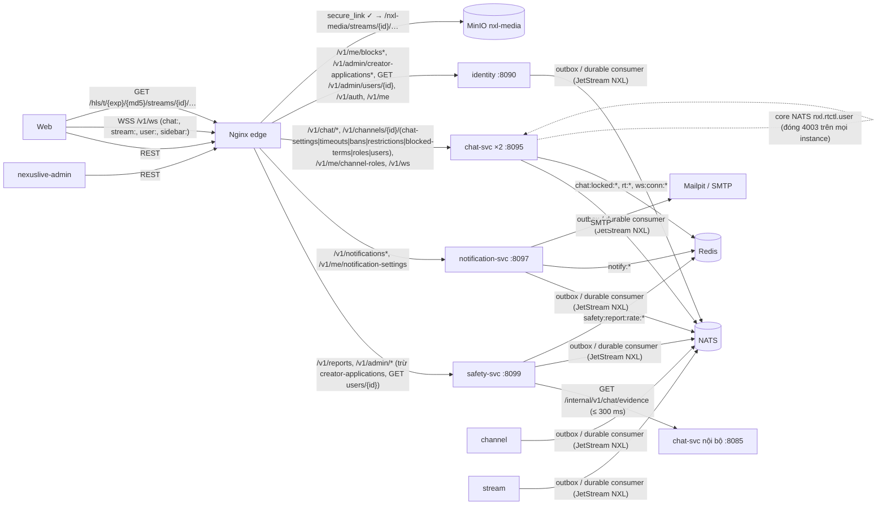
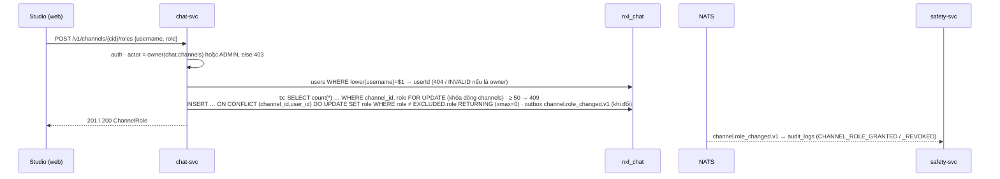
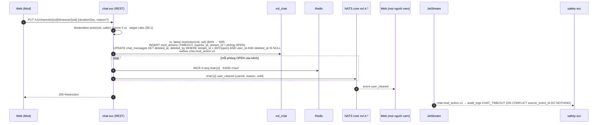
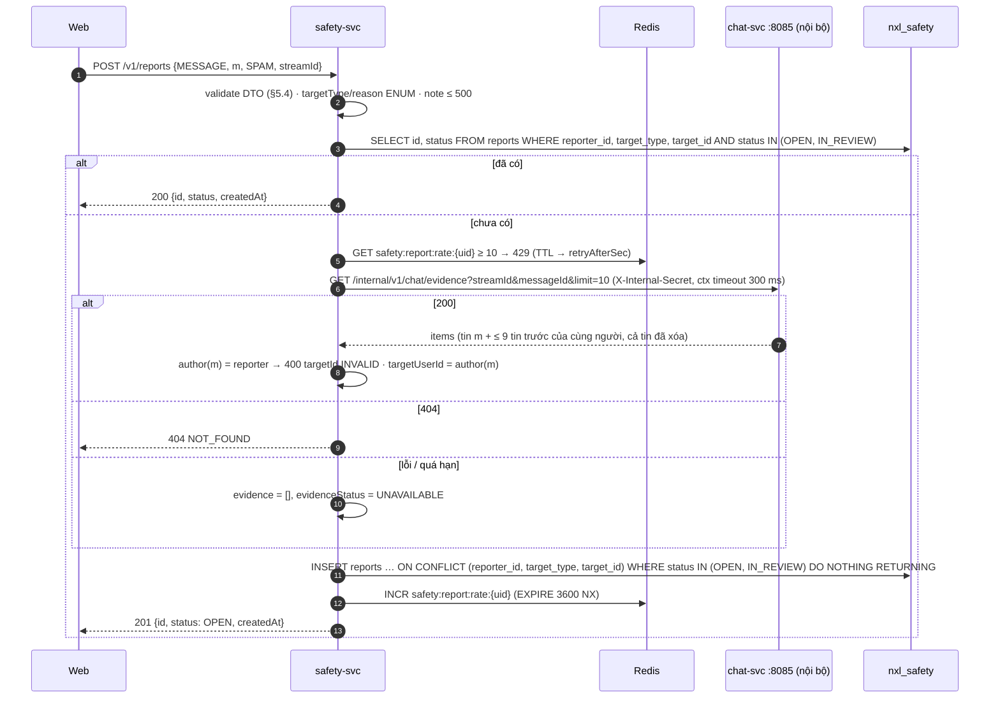
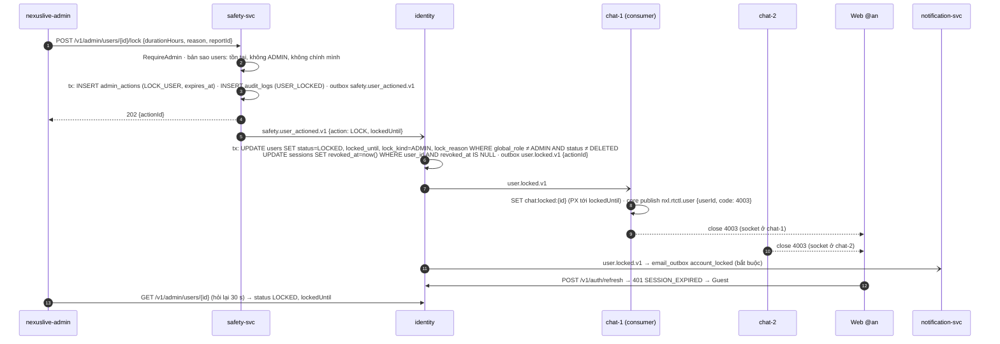
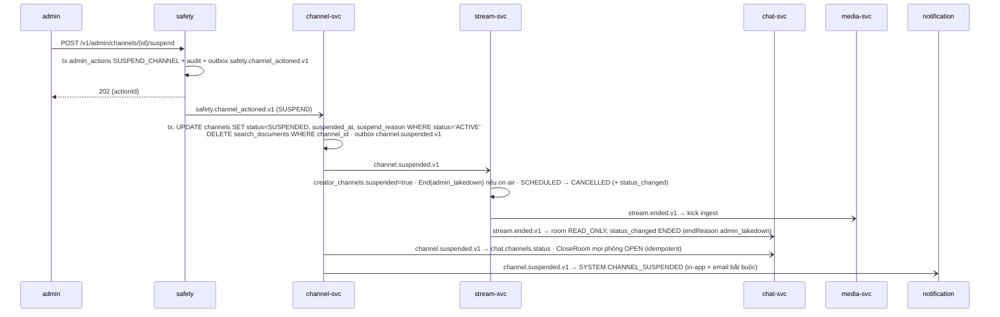
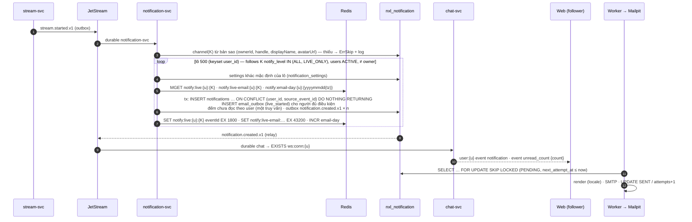
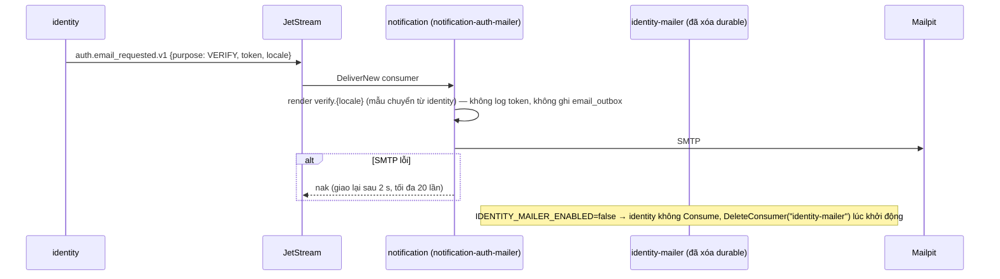
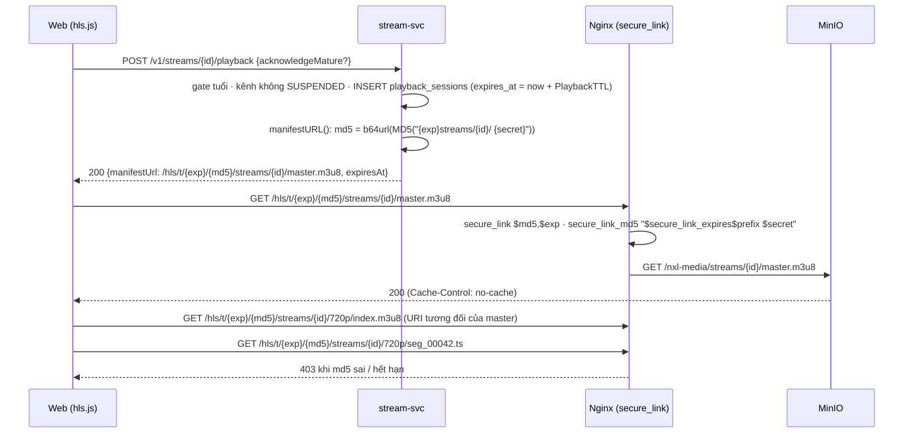

# TSD — GĐ5: An toàn & Thông báo (kiểm duyệt, báo cáo, Admin, thông báo, URL HLS có chữ ký, mốc M4)

| Phiên bản | Trạng thái | Ngày | Working Plan |
| --- | --- | --- | --- |
| 1.1 | Đã triển khai — đồng bộ theo hiện thực (§16) | 2026-10-16 | `docs/plans/working/2026-10-15-gd05-safety-notifications.md` (Approved 15/10) |

Quyết định đã chốt (15/10, chủ đồ án duyệt theo đề xuất): **G5-Q1** tách hai service mới — safety-svc cổng **8099**,
notification-svc cổng **8097** · **G5-Q2** API vai trò Mod / VIP + Studio → Cộng đồng ngay GĐ5 (`dev-grant` chỉ còn cho dữ
liệu demo) · **G5-Q3** URL HLS có chữ ký (`secure_link`) làm ở GĐ5 · **G5-Q4** chấp nhận toàn bộ đề xuất NF-Q1…Q14 của
NXL-F (Mod được ban; chủ kênh gỡ vai trò Mod trước khi xử lý Mod; khớp trọn từ bỏ dấu; bằng chứng qua API nội bộ, lỗi →
`UNAVAILABLE`; gỡ stream luôn xóa VOD; khóa kênh không thời hạn; Mod không xem nội dung gốc đã xóa; report STREAM / CHANNEL
không chụp chat; Admin hỏi lại 30 s; thời hạn khóa cố định; không thêm mã lỗi — `FORBIDDEN` + `details.target = PROTECTED`)
· **G5-Q5** chấp nhận NE-Q1…Q10 của NXL-E (số chưa đọc từ notification-svc; chuông `ALL` nhận lịch mới; không thông báo VOD
mới; chỉ email địa chỉ đã xác minh; chuyển mailer trong một lần khởi động lại; `purpose = SECURITY_LOCK`; `user.*` thêm
`locale` / `timezone`; toast live ≤ 1 / 10 s) · **G5-Q6** trang Admin "Buổi phát" dùng `GET /v1/streams` (đang live) + nút gỡ,
không có lịch sử buổi phát · **G5-Q7** giữ Mailpit cho dev / demo, SMTP thật qua biến môi trường · **G5-Q8** brief design
`../docs/design/2026-10-15-design-brief-gd05.md` đã có (dựng theo token + spec trong lúc chờ frame).

Mọi thay đổi trên hợp đồng đã có là **chỉ thêm** (endpoint, trường DTO, trường payload, giá trị enum), trừ hai hành vi đổi có
chủ đích ghi ở §9: `manifestUrl` công khai thành chuỗi rỗng khi bật chữ ký, và route `/v1/admin/*` tách sang safety-svc.

## 1. Mục tiêu

- **Moderator (M4):** Creator gán Mod → Mod xóa tin, timeout, ban, ghim, thêm từ khóa chặn / bật chặn link → người bị
  hạn chế thấy đúng trạng thái ≤ 1 s; người xem báo cáo một tin (kèm ≤ 10 tin gần nhất làm bằng chứng) → Admin xử lý trong
  `nexuslive-admin` (khóa tài khoản / khóa kênh / gỡ buổi phát) → người bị khóa bị ngắt WebSocket `4003` → người báo cáo
  nhận kết quả.
- **Thông báo (M4):** follow → Creator Go Live → chuông + toast ≤ 5 s và email ở Mailpit; nhắc lịch, lịch đổi / hủy,
  @mention, follower mới, kết quả đơn Creator / báo cáo, khóa kênh / gỡ buổi phát; trung tâm thông báo, cài đặt theo loại ×
  kênh nhận, hủy nhận từ email.
- **Độ bền (S7, AC-E14):** tắt notification-svc hoặc safety-svc → xem, chat, hành động mod vẫn chạy; bật lại → thông báo /
  audit tồn đọng tới đủ, không trùng.
- **Cổng 18+ thật:** playlist và segment HLS chỉ tải được bằng URL có chữ ký gắn với phiên xem (`secure_link`); người chưa
  qua cổng tuổi không có URL hợp lệ.
- **Email xác thực** chuyển từ `identity-mailer` sang notification-svc mà không mất luồng M1.

## 2. Phạm vi

**Trong:**

- **safety-svc (mới, 8099):** report, hàng đợi Admin, hành động Admin (`202 {actionId}`, thi hành bất đồng bộ qua sự kiện),
  audit log chỉ ghi thêm từ `audit.recorded.v1` + sự kiện miền của chat, bản sao `users` / `channels` / `streams`, tra cứu
  Admin tối thiểu (§5.4).
- **notification-svc (mới, 8097):** bản sao `users` / `channels` / `follows` / `user_blocks`, consumer các nguồn NXL-E §7.3,
  fan-out lô 500, cooldown / gộp / trần email (Redis), trung tâm thông báo, cài đặt, email outbox + worker, hủy nhận (HMAC),
  consumer `notification-auth-mailer` (email xác thực).
- **chat-svc:** hành động mod + 5 sự kiện realtime + snapshot mới, auto-mod (từ khóa, link), API vai trò, thẻ người dùng,
  danh sách hạn chế, `chat.mention.v1`, API nội bộ bằng chứng (cổng nội bộ mới), consumer `user.locked/unlocked`
  (`4003`), `channel.suspended/restored` (phòng chỉ đọc), chuyển tiếp `notification.*` lên `user:{userId}`; phát
  `chat.mod_action`, `chat.settings_changed`, `channel.role_changed`, `audit.recorded`.
- **identity:** Block API, `GET /v1/admin/users/{id}`, consumer `safety.user_actioned` (khóa / mở + thu hồi phiên +
  `user.locked/unlocked`), `users.lock_kind`, `user.*` thêm `locale` / `timezone`, `audit.recorded.v1`,
  `purpose = SECURITY_LOCK`, cờ `IDENTITY_MAILER_ENABLED`, API nội bộ snapshot người dùng (backfill).
- **channel-svc:** consumer `safety.channel_actioned` (`SUSPENDED` / `ACTIVE`), `channel.suspended/restored`, chặn ghi
  Studio, ẩn khỏi tìm kiếm, bỏ lịch / nhắc của kênh bị khóa, API nội bộ snapshot kênh + follow (backfill).
- **stream-svc:** consumer `safety.stream_takedown` (`admin_takedown`, VOD → `DELETED` kể cả VOD tới sau),
  `channel.suspended/restored` (kết thúc buổi phát, chặn authorize / Studio ghi / phiên xem, hủy `SCHEDULED`), ký URL HLS
  (`manifestURL()`), API nội bộ snapshot stream (backfill).
- **`pkg/events`** (~20 loại mới, trường thêm), **`pkg/eventbus`** (tùy chọn `DeliverNew`, `DeleteConsumer`), Nginx (route
  mới + `secure_link`), compose (2 service, cổng nội bộ, biến mới), Prometheus, CI, `go.work`, Makefile, `.env.example`.
- Web (`nexuslive-web`) và `nexuslive-admin` — cùng basename; TSD này là hợp đồng (WP7, WP8 của Working Plan).

**Ngoài:** auto-mod "giữ chờ duyệt" (`CHAT_HELD_FOR_REVIEW`), push / quiet hours / digest (NE-Q11), báo cáo VOD theo mốc thời
gian, Admin xem chat cũ ngoài bằng chứng, appeal, thông báo cho Admin, đánh dấu "chưa đọc" thủ công, Whispers, lịch sử
buổi phát trong admin (G5-Q6), `POST /v1/playback-sessions/{id}/renew` (§6.9 — mở lại phiên thay cho gia hạn), thanh toán
(GĐ6), xóa gói `identity/internal/mailer` (để GĐ7 sau khi chuyển giao ổn định — đường rollback).

## 3. Kiến trúc



| Service | Cổng công khai | Cổng nội bộ (chỉ trong mạng Docker, cổng vào trả 404 cho `/internal`) | Database | Durable consumer |
| --- | --- | --- | --- | --- |
| safety-svc ✚ | 8099 | — | `nxl_safety` | `safety-svc` (DeliverAll) |
| notification-svc ✚ | 8097 | — | `nxl_notification` | `notification-replica` (DeliverAll), `notification-svc` (**DeliverNew**), `notification-auth-mailer` (**DeliverNew**) |
| chat-svc | 8095 (×2) | **8085** ✚ (`CHAT_INTERNAL_PORT`, alias DNS `chat` cho cả hai instance) | `nxl_chat` | `chat` |
| identity | 8090 | **8089** ✚ (`IDENTITY_INTERNAL_PORT`) | `nxl_identity` | `identity-svc`, `identity-mailer` (tắt khi chuyển giao) |
| channel-svc | 8094 | **8088** ✚ (`CHANNEL_INTERNAL_PORT`) | `nxl_channel` | `channel-svc` |
| stream-svc | 8092 | 8093 (có sẵn) | `nxl_stream` | `stream-svc` |

- **safety-svc** sở hữu `reports`, `admin_actions`, `audit_logs`. Nó **không** sửa trạng thái người dùng / kênh / stream: ghi
  hành động + audit + outbox `safety.*` trong một transaction, trả `202 {actionId}`; service sở hữu thi hành rồi phát
  `user.locked`, `channel.suspended`, `stream.ended`… (NXL-F BR-F24). Trạng thái hiện hành trong admin đọc từ identity
  (`GET /v1/admin/users/{id}`) và từ bản sao của safety (kênh, stream — cập nhật bằng chính các sự kiện đó, ≤ 2 s).
- **notification-svc** không gọi đồng bộ service nào khi xử lý sự kiện (BR-E05): mọi dữ liệu người nhận lấy từ bản sao. Hai
  consumer tách nhau: `notification-replica` (DeliverAll — dựng bản sao từ đầu stream) và `notification-svc` (DeliverNew —
  nguồn thông báo; không gửi bù thông báo của 7 ngày lịch sử khi service chạy lần đầu).
- **chat-svc** là realtime gateway duy nhất (ADR-006): nhận `notification.*` qua JetStream và phát lên `user:{userId}`; nhận
  `user.locked` và báo mọi instance đóng socket qua core NATS `nxl.rtctl.user`.

### 3.1 Định tuyến Nginx (thứ tự location regex quyết định)

Nginx chọn location regex **đầu tiên** khớp theo thứ tự trong file. Bảng là thứ tự cuối cùng của file (✚ = mới, ✎ = sửa):

| # | Location | Đích | Ghi chú |
| --- | --- | --- | --- |
| 1 | `~ ^/v1/auth/(login\|register\|…)$` | identity | Có sẵn (zone `nxl_auth`) |
| 2 | `= /v1/ws` | chat | Có sẵn |
| 3 | `~ ^/v1/chat/` | chat | Có sẵn — thêm route xóa tin, ghim (`/v1/chat/rooms/{id}/…`) không cần dòng mới |
| 4 ✎ | `~ ^/v1/channels/[^/]+/(chat-settings\|timeouts\|bans\|restrictions\|blocked-terms\|roles\|users)(/\|$)` | chat | Thay dòng `chat-settings$` cũ; **trước** dòng 6 |
| 5 | `~ ^/v1/channels/[^/]+/vods$` | stream | Có sẵn |
| 6 | `~ ^/v1/channels(/\|$)` | channel | Có sẵn |
| 7 ✚ | `= /v1/me/channel-roles` | chat | Exact match — Nginx xét exact trước mọi regex |
| 8 ✚ | `= /v1/me/notification-settings` | notification | Exact |
| 9 | `~ ^/v1/me/(following\|search-history)(/\|$)` | channel | Có sẵn |
| 10 | `~ ^/v1/me/(watch-progress\|continue-watching)(/\|$)` | stream | Có sẵn |
| 11 ✚ | `~ ^/v1/notifications(/\|$)` | notification | Gồm `/unsubscribe` (không token) |
| 12 ✚ | `= /v1/reports` | safety | Exact |
| 13 ✚ | `~ ^/v1/admin/(creator-applications(/\|$)\|users/[^/]+$)` | identity | Đơn Creator + chi tiết người dùng `GET /v1/admin/users/{id}`; `…/users/{id}/lock` không khớp `[^/]+$` |
| 14 ✚ | `~ ^/v1/admin(/\|$)` | safety | Phần còn lại của `/v1/admin` (report, lock/unlock, kênh, stream, audit, tra cứu) |
| 15–19 | `/v1/studio/channel/(avatar\|banner)`, `/v1/studio/(channel\|schedules)`, `/v1/(categories\|search\|schedules)`, `/v1/(studio\|streams\|vods)` | channel / stream | Có sẵn, giữ thứ tự GĐ4 |
| 20 | `/v1/` (prefix) | identity | Có sẵn: gồm **`/v1/me/blocks*`** (không cần dòng mới), `/v1/me`, `/v1/auth/*` |
| 21 ✚ | `^~ /hls/t/` (prefix, chặn regex) + location regex lồng bên trong | MinIO `/nxl-media/` | URL có chữ ký (§6.9). `^~` bắt buộc: không có nó, regex lồng `\.m3u8$` của `/hls/` sẽ thắng |
| 22 ✎ | `/hls/` (prefix) | MinIO | `.jpg` (thumbnail) công khai như cũ; `.m3u8` / `.ts` chỉ qua khi `$nxl_hls_allow_unsigned = 1` (giai đoạn chuyển, §9.3), ngược lại `403` |
| 23 | `/media/`, `/emotes/`, `/` (404) | — | Có sẵn |

- Mọi dòng ✚ dưới `/v1/` kèm `limit_req nxl_read` + `nxl_write` như các route API khác. `/v1/notifications/unsubscribe`
  dùng chung nhóm Ghi. `/hls/t/` không rate limit (player tải liên tục).
- `$nxl_admin_path` (CORS chỉ từ `NXL_ADMIN_ORIGIN`) đã bao mọi `^/v1/admin` — không đổi, áp cho cả hai đích identity / safety.
- Biến mới trong template `nxl-edge.conf.template` (envsubst chỉ thay `NXL_*`): `map $request_method $nxl_hls_secret { default
  "${NXL_HLS_SECRET}"; }`, `map $request_method $nxl_hls_allow_unsigned { default "${NXL_HLS_ALLOW_UNSIGNED}"; }`. `nginx.conf`
  thêm `set $safety http://safety:8099; set $notification http://notification:8097;` (resolve theo request như các service khác).
- Kiểm định tuyến bằng bảng `curl` từng tiền tố (§10) như GĐ3 / GĐ4.

### 3.2 Consumer bền mới / mở rộng

| Service | Durable | Policy | Loại sự kiện |
| --- | --- | --- | --- |
| safety | `safety-svc` ✚ | DeliverAll | `user.registered`, `user.profile_updated`, `user.locked`, `user.unlocked`, `channel.created`, `channel.updated`, `channel.suspended`, `channel.restored`, `stream.scheduled`, `stream.started`, `stream.status_changed`, `stream.ended`, `stream.vod_ready`, `vod.deleted`, `chat.mod_action`, `chat.settings_changed`, `channel.role_changed`, `audit.recorded` |
| notification | `notification-replica` ✚ | DeliverAll | `user.registered`, `user.profile_updated`, `user.email_verified`, `user.locked`, `user.unlocked`, `user.blocked`, `user.unblocked`, `channel.created`, `channel.updated`, `channel.suspended`, `channel.restored`, `follow.created`, `follow.updated`, `follow.deleted` |
| notification | `notification-svc` ✚ | **DeliverNew** | `stream.started`, `schedule.reminder_due`, `schedule.created`, `schedule.occurrence_changed`, `chat.mention`, `follow.created`, `creator.approved`, `creator.rejected`, `safety.report_resolved`, `user.locked`, `channel.suspended`, `channel.restored`, `safety.stream_takedown` |
| notification | `notification-auth-mailer` ✚ | **DeliverNew** | `auth.email_requested` |
| chat | `chat` ✎ | (có sẵn) | + `user.locked`, `user.unlocked`, `channel.suspended`, `channel.restored`, `notification.created`, `notification.unread_changed` |
| identity | `identity-svc` ✎ | (có sẵn) | + `safety.user_actioned` |
| identity | `identity-mailer` ✎ | DeliverNew khi tạo lại | Không đổi loại; **xóa durable** khi `IDENTITY_MAILER_ENABLED=false` (§9.2) |
| channel | `channel-svc` ✎ | (có sẵn) | + `safety.channel_actioned` |
| stream | `stream-svc` ✎ | (có sẵn) | + `safety.stream_takedown`, `channel.suspended`, `channel.restored` |

Thêm loại vào durable có sẵn = đổi `FilterSubjects` qua `CreateOrUpdateConsumer` (cho phép); loại mới chỉ được giao từ vị trí
hiện tại của consumer — đúng ý vì các loại đó chưa từng được phát.

## 4. Kịch bản

### S1 — Gán Moderator / VIP (Studio → Cộng đồng)

- Given Creator K (chủ kênh `cid`), When `POST /v1/channels/{cid}/roles {username: "an", role: "MODERATOR"}`, Then `201
  ChannelRole`; ≤ `ROLE_CACHE_TTL` (5 s) sau, @an có badge Mod, miễn slow / followers / subs và thấy menu mod (snapshot
  `me.role = MODERATOR`, `me.canModerate = true` khi subscribe lại hoặc ở tin kế tiếp). Gán lại cùng vai trò → `200` (không
  phát sự kiện); đổi `MODERATOR → VIP` → `200` + `channel.role_changed.v1`.
- Username không có trong bản sao `chat.users` → `404`; là chủ kênh → `400 details.username = INVALID`; vượt 50 người / vai
  trò → `409 CONFLICT details.limit = "50"`; Mod (không phải chủ kênh) gọi → `403 FORBIDDEN`; Admin → được.
- `DELETE /v1/channels/{cid}/roles/{userId}` → `204` (không có vai trò → `204`, không phát sự kiện).
- @an mở menu avatar → "Kênh tôi kiểm duyệt" → `GET /v1/me/channel-roles` → `[{channel {id, handle, displayName, avatarUrl,
  isLive}, role}]`.



### S2 — Xóa tin, timeout, ban, ghim

- Given A là Mod của kênh K, phòng `chat:{s}` đang `OPEN`, When `DELETE /v1/chat/rooms/{s}/messages/{m}`, Then `204`; mọi client
  nhận `delete {messageId}` < 500 ms; nếu `m` đang ghim → thêm `unpin {}`; lịch sử trả `deleted: true, body: "", fragments: []`;
  safety có dòng audit `CHAT_DELETE` kèm nội dung gốc (`metadata.messageBody`). Xóa lại → `204` (không ghi `mod_actions`).
- When `PUT /v1/channels/{K}/timeouts/{B} {durationSec: 60}` Then `200 Restriction`; mọi phòng `OPEN` của K nhận `user_cleared
  {userId: B, reason: "timeout", until}`; tin cũ của B bị xóa mềm; B gửi → `CHAT_TIMED_OUT` (`details.until`); hết hạn → gửi được
  mà không tải lại (client tự mở theo `until`). Timeout người đang bị ban → `409 INVALID_STATE`.
- `PUT …/bans/{B}` → `user_cleared {reason: "ban", until: null}`; B vẫn đọc; ở buổi phát sau vẫn `CHAT_BANNED` (phạm vi kênh).
- `DELETE …/timeouts/{B}` / `DELETE …/bans/{B}` → `204` + `user_restored {userId}` (không bị hạn chế → `204`, không sự kiện).
- `PUT /v1/chat/rooms/{s}/pin {messageId}` → `200 {message}` + `pin {message}`; ghim tin khác → tin cũ tự bỏ ghim, một sự kiện
  `pin`. Người vào sau thấy `snapshot.room.pinned`. Tin `SYSTEM` / đã xóa → `409 INVALID_STATE`; phòng `READ_ONLY` →
  `409 CHAT_READ_ONLY` (xóa tin vẫn được ở `READ_ONLY`).
- Hostile: A timeout Mod khác / chủ kênh → `403 FORBIDDEN details.target = PROTECTED`; người thường gọi → `403 FORBIDDEN`; A
  timeout chính mình → `400 details.userId = INVALID`.



### S3 — Auto-mod: từ khóa chặn, chặn link

- Given kênh K có từ khóa "spam" (Mod thêm qua `POST /v1/channels/{K}/blocked-terms {term: "Spam"}` → `201 {id, term: "Spam",
  …}`) và `blockLinks = true`, When Viewer gửi "SPẢM nè" hoặc "xem tại abc.xyz", Then WS `error {code: CHAT_CONTENT_BLOCKED,
  ref: clientMsgId, details: {reason: TERM | LINK}}`; tin không lưu, không fan-out, có tính vào rate limit, không tính slow mode.
  Mod / chủ kênh / Admin gửi cùng nội dung → được; VIP gửi link → được, gửi "spam" → bị chặn.
- Thêm "SPAM" lần nữa → `200` bản cũ (trùng sau chuẩn hóa); từ thứ 101 → `409 CONFLICT details.limit = "100"`; "a" → `400
  details.term = LENGTH`. Thay đổi có hiệu lực ≤ `AUTOMOD_CACHE_TTL` (5 s).

### S4 — Người xem báo cáo một tin (bằng chứng)

- Given @an đã chat 15 tin trong phòng `s`, When Viewer V `POST /v1/reports {targetType: MESSAGE, targetId: m, reason: SPAM,
  streamId: s}`, Then `201 {id, status: OPEN, createdAt}`; Admin thấy report kèm `evidence` = tin `m` + ≤ 9 tin trước đó của @an,
  `evidenceStatus = CAPTURED`. Báo lại `m` khi report cũ còn `OPEN` / `IN_REVIEW` → `200` cùng `id` (không tính giới hạn).
- Report thứ 11 trong giờ → `429 RATE_LIMITED details.retryAfterSec`. chat-svc dừng / quá 300 ms → `201`,
  `evidenceStatus = UNAVAILABLE` (AF-F10). Tin của chính V → `400 details.targetId = INVALID`; tin không có → `404`.



### S5 — Admin xử lý report và khóa tài khoản → `4003`

- Given report `OPEN`, When Admin `POST /v1/admin/reports/{id}/claim` Then `200 AdminReport (IN_REVIEW, assignedTo)`; Admin khác
  claim lại → đổi `assignedTo` (cho phép nhận lại).
- When `POST /v1/admin/users/{an}/lock {durationHours: 168, reason, reportId}` Then `202 {actionId}`; ≤ 2 s: identity đặt `LOCKED`,
  `lock_kind = ADMIN`, `locked_until = now + 7d`, thu hồi mọi refresh token; mọi socket của @an (cả hai instance chat) đóng
  `4003`; @an đăng nhập → `403 ACCOUNT_LOCKED details.lockedUntil`; `auth` WS với access token còn hạn → đóng `4003`; @an nhận
  email `account_locked`.
- Then `POST /v1/admin/reports/{id}/resolve {status: RESOLVED, note, applyToSameTarget: true}` → `200 {report, closedCount}`;
  mỗi report được đóng phát `safety.report_resolved.v1` → người báo nhận `REPORT_RESULT` ("đã được xử lý"). Resolve lại →
  `409 INVALID_STATE`.
- Hostile: khóa Admin khác → `403 FORBIDDEN`; khóa chính mình → `400 details.userId = INVALID`; lý do 5 ký tự → `400
  details.reason = LENGTH`; khóa người đang khóa → `202` + `locked_until` mới (`user.locked.v1` phát lại); mở khóa người không
  khóa → `202`, không sự kiện.



### S6 — Khóa / mở kênh

- Given kênh K đang phát, When `POST /v1/admin/channels/{K}/suspend {reason}` Then `202`; ≤ 2 s: channel-svc `SUSPENDED` +
  `channel.suspended.v1`; stream-svc kết thúc buổi phát (`admin_takedown`), hủy các dòng `SCHEDULED`; chat chuyển phòng `OPEN` →
  `READ_ONLY` (`room_state`); trang xem hiện "Buổi phát đã bị gỡ…"; hồ sơ K → `403 CHANNEL_SUSPENDED`; Creator Go Live → media
  từ chối (log `suspended`); Studio ghi → `403 CHANNEL_SUSPENDED`; chủ kênh nhận `SYSTEM` (`CHANNEL_SUSPENDED`) + email.
- `…/restore {reason}` → `channel.restored.v1`; kênh hiện lại ở tìm kiếm; Go Live được.



### S7 — Gỡ buổi phát

- Given S đang `LIVE`, When `POST /v1/admin/streams/{S}/takedown {reason}` Then `202`; ≤ 3 s người xem nhận `status_changed
  {status: ENDED, endReason: admin_takedown}` → màn "Buổi phát đã bị gỡ do vi phạm quy định" (không nút VOD); VOD tới sau
  qua `vod.processed.v1` được tạo ở `DELETED` + `vod.deleted.v1` → media xóa `streams/S/` ≤ 1 phút; chủ kênh nhận `SYSTEM`
  (`STREAM_TAKEDOWN`) + email; kênh **không** bị khóa.
- S đã `ENDED`, VOD `READY` → VOD `DELETED`, `GET /v1/vods/{id}` → `404`, stream giữ `endReason` cũ (AF-F15). S `SCHEDULED`,
  `CANCELLED`, hoặc `ENDED` không còn VOD → `409 INVALID_STATE` (safety kiểm trên bản sao `streams`).

### S8 — Kênh theo dõi Go Live → chuông, toast, email

- Given V follow K (chuông `ALL`, email đã xác minh), web V đang mở, When K Go Live, Then ≤ 3 s (P95): `user:{V}` nhận
  `notification` (type `CREATOR_LIVE`) **và** `unread_count {count}`; toast "K đang phát — {tiêu đề}" (≤ 1 / 10 s, không hiện nếu
  V đang ở `/live/{streamId}`); Mailpit có email `live_started`. K kết thúc rồi Go Live lại trong 30 phút → không thông báo, không
  email (cooldown); sau 30 phút nhưng trong 12 giờ → in-app có, email không.
- V chuông `OFF` → không gì; V tắt email `CREATOR_LIVE` → chỉ in-app; V chưa xác minh email → chỉ in-app.



### S9 — @mention, gộp, chặn

- Given B gửi 3 tin "@an …" trong 2 phút ở buổi `s`, Then @an có **một** `MENTION` với `groupCount = 3`, `lastSender = B`, cập
  nhật lên đầu và chưa đọc lại (mỗi lần gộp phát lại `notification.created.v1` cùng `notificationId`). @an đã chặn B → không có
  thông báo. Tin nhắc > 5 người → chỉ 5 người đầu (theo thứ tự xuất hiện) trong `chat.mention.v1`.

### S10 — Trung tâm thông báo, đọc, nhiều tab

- `GET /v1/notifications/unread-count` khi khởi động phiên; popover `GET /v1/notifications?limit=20`; bấm mục → `POST
  /v1/notifications/{id}/read` (`204`) → `notification.unread_changed.v1` → tab khác nhận `unread_count` ≤ 1 s. `POST
  /read-all {before}` chỉ đọc thông báo có `updated_at ≤ before`. Thông báo người khác → `404`. WS mất → web hỏi lại
  `unread-count` mỗi 60 s.

### S11 — Cài đặt, hủy nhận email

- `PUT /v1/me/notification-settings {items: [{type: CREATOR_LIVE, email: false}]}` → `200` bảng đầy đủ; tắt `SYSTEM` →
  `400 details.SYSTEM = INVALID`; bật email `NEW_FOLLOWER` → `400 details.NEW_FOLLOWER = INVALID`.
- Email `live_started` có liên kết `{WEB_BASE_URL}/notifications/unsubscribe?token=…` → trang web `POST
  /v1/notifications/unsubscribe {token}` → `200 {type: CREATOR_LIVE}`; token sửa một ký tự → `400 TOKEN_INVALID`.

### S12 — Chuyển email xác thực sang notification-svc

- Given đã chuyển giao (`IDENTITY_MAILER_ENABLED=false`, `NOTIFICATION_AUTH_MAILER_ENABLED=true`), When đăng ký tài khoản mới,
  Then Mailpit có đúng **một** email xác minh (gửi bởi notification-svc, cùng mẫu / liên kết như GĐ1); quên mật khẩu như cũ;
  đăng nhập sai 10 lần → email `security_lock`. Thứ tự triển khai: §9.2.



### S13 — Phát HLS có chữ ký

- Given stream `s` `LIVE`, When web `POST /v1/streams/{s}/playback`, Then `200 {sessionId, manifestUrl:
  "/hls/t/1760572800/Q2x…Aw/streams/{s}/master.m3u8", expiresAt}`; hls.js tải master, rồi `720p/index.m3u8` và
  `720p/seg_00042.ts` theo **đường dẫn tương đối** → cùng tiền tố `/hls/t/{exp}/{md5}/streams/{s}/` → mọi request qua.
- Sửa một ký tự của `md5`, đổi `streams/{s}` sang stream khác, hoặc `expires` đã qua → `403` (JSON `FORBIDDEN` của edge). Gọi
  `/hls/streams/{s}/master.m3u8` (không chữ ký) khi `NXL_HLS_ALLOW_UNSIGNED=0` → `403`; `/hls/streams/{s}/thumb.jpg` → `200`.
- Stream mature, người xem chưa xác nhận → `200 {mature: {required: true, acknowledged: false}, manifestUrl: null}` (như GĐ2):
  không có URL hợp lệ nào. Kênh bị khóa → `403 CHANNEL_SUSPENDED`.
- Phiên hết hạn khi đang xem (> 4 h) → playlist kế tiếp `403` → web gọi lại `POST …/playback` và `hls.loadSource(url mới)`.



### S14 — Block người dùng

- `PUT /v1/me/blocks/{an}` → `204` + `user.blocked.v1`; web tải `GET /v1/me/blocks?fields=ids` khi khởi động phiên và lọc tin
  của @an ở mọi phòng (kể cả tin đã có trong DOM); @an không biết; notification bỏ `MENTION` từ @an. Chặn chính mình → `400
  details.userId = INVALID`; người không có → `404`; người thứ 1001 → `409 CONFLICT details.limit = "1000"`; chặn lại → `204`
  (không sự kiện). Mute chỉ phía client (`sessionStorage`), không có API.

### S15 — notification-svc dừng (AC-E14)

- Given notification-svc dừng, When K Go Live, người xem xem + chat + Mod ban, Then mọi thứ chạy (notification không nằm trên
  đường đồng bộ nào; chuông giữ số cũ, `GET /v1/notifications*` → `503` của edge). Bật lại → durable `notification-svc` giao
  `stream.started.v1` tồn đọng → thông báo + email tới đủ, unique `(user_id, source_event_id)` chặn trùng khi giao lại.
- Tương tự safety-svc dừng (AC-F28): Mod ban vẫn có hiệu lực; khi safety chạy lại, audit `CHAT_BAN` tới qua outbox.

## 5. Hợp đồng

### 5.1 Kiểu dùng chung (JSON camelCase, trường không có giá trị trả `null`)

| Kiểu | Trường |
| --- | --- |
| `UserRef` | `id, username, displayName, avatarUrl` — `avatarUrl` luôn `null` ở GĐ5 (identity chưa có ảnh đại diện người dùng; errata 9) |
| `Restriction` | `user: UserRef, type (BAN\|TIMEOUT), until \| null, actor: {id, username}, reason \| null, createdAt` |
| `UserCard` | `user: UserRef + createdAt, badges[], role (OWNER\|MODERATOR\|VIP\|null), followedAt \| null, restriction: {type, until} \| null` (`restriction` chỉ trả cho người có quyền mod, người khác luôn `null`) |
| `BlockedTerm` | `id, term` (chuỗi người nhập, đã cắt khoảng trắng), `createdBy: {id, username}, createdAt` |
| `ChannelRole` | `user: UserRef, role (MODERATOR\|VIP), grantedBy: {id, username}, createdAt` |
| `ModChannel` | `channel: {id, handle, displayName, avatarUrl, isLive}, role (MODERATOR\|VIP)` |
| `ChatMessage` (có sẵn, NXL-B §13) | thêm `pinned: boolean`; tin đã xóa: `deleted: true, body: "", fragments: []` |
| `Notification` | `id, type, payload, link \| null, groupCount, read, createdAt, updatedAt` (payload theo NXL-E §7.4) |
| `NotificationSetting` | `type, inApp, email, inAppLocked, emailLocked, emailAvailable` |
| `Block` | `user: UserRef, createdAt` |
| `AdminReport` | `id, targetType, target: {id, label, link \| null, userId \| null}, reason, reporter: {id, username}, status, assignedTo: {id, username} \| null, sameTargetCount, createdAt` |
| `AdminReportDetail` | `AdminReport` + `note, streamId, evidence[]: {messageId, userId, body, fragments, createdAt, deleted}, evidenceStatus (CAPTURED\|NONE\|UNAVAILABLE), resolvedBy \| null, resolvedAt \| null, resolutionNote \| null, relatedReports[]: AdminReport (≤ 20, cùng đối tượng), actions[]: AdminAction (≤ 20, cùng đối tượng / người của đối tượng)` |
| `AdminAction` | `id, type (LOCK_USER\|UNLOCK_USER\|SUSPEND_CHANNEL\|RESTORE_CHANNEL\|TAKEDOWN_STREAM), targetType, targetId, reason, expiresAt \| null, admin: {id, username}, reportId \| null, createdAt` |
| `AuditEntry` | `id, actor: {id, username} \| null, actorRole, action, resourceType, resourceId \| null, reason \| null, sourceService, metadata, createdAt` |
| `AdminUserRow` (safety) | `id, username, displayName, globalRole, status (ACTIVE\|LOCKED\|DELETED), lockedUntil \| null, openReports` |
| `AdminUser` (identity) | `id, username, displayName, email, emailVerified, globalRole, status, lockedUntil \| null, lockKind (FAILED_LOGIN\|ADMIN) \| null, lockReason \| null, channelId \| null, createdAt` |
| `AdminChannel` (safety) | `id, handle, displayName, avatarUrl, owner: {id, username}, status (ACTIVE\|SUSPENDED), suspendedAt \| null, currentStreamId \| null, openReports` |

`target.label` do safety dựng từ bản sao: `MESSAGE` → `@username: <≤ 80 ký tự của tin>`, `USER` → `@username`, `CHANNEL` →
tên kênh, `STREAM` → tiêu đề; `link` là đường dẫn của web người dùng (`/live/{streamId}`, `/{handle}`) hoặc `null`.

### 5.2 REST — chat-svc

Auth: `—` không cần · `O` token tùy chọn · `B` Bearer · `M` chủ kênh / Moderator của kênh / Admin · `W` chủ kênh / Admin
(gán vai trò). `{channelId}` không có trong bản sao `chat.channels` → `404`.

| Method | Path | Auth | Request | Response | Lỗi |
| --- | --- | --- | --- | --- | --- |
| DELETE | `/v1/chat/rooms/{streamId}/messages/{messageId}` | M | — | `204` (đã xóa → `204`) | `NOT_FOUND`, `FORBIDDEN` (`details.target = PROTECTED` khi tin của chủ kênh / Mod khác), `UNAUTHORIZED` |
| PUT | `/v1/chat/rooms/{streamId}/pin` | M | `{messageId}` | `200 {message: ChatMessage}` | `VALIDATION_FAILED` (`messageId = REQUIRED`), `NOT_FOUND`, `INVALID_STATE` (tin `SYSTEM` / đã xóa), `CHAT_READ_ONLY`, `FORBIDDEN` |
| DELETE | `/v1/chat/rooms/{streamId}/pin` | M | — | `204` | `FORBIDDEN`, `NOT_FOUND` (phòng) |
| PUT | `/v1/channels/{channelId}/timeouts/{userId}` | M | `{durationSec, reason?}` | `200 Restriction` | `VALIDATION_FAILED` (`durationSec = REQUIRED\|MIN\|MAX`, `reason = LENGTH`, `userId = INVALID`), `NOT_FOUND`, `FORBIDDEN` (`PROTECTED`), `INVALID_STATE` (đang bị ban) |
| DELETE | `/v1/channels/{channelId}/timeouts/{userId}` | M | — | `204` | `FORBIDDEN` |
| PUT | `/v1/channels/{channelId}/bans/{userId}` | M | `{reason?}` | `200 Restriction` | như timeout (trừ `durationSec`, `INVALID_STATE`) |
| DELETE | `/v1/channels/{channelId}/bans/{userId}` | M | — | `204` | `FORBIDDEN` |
| GET | `/v1/channels/{channelId}/restrictions?type=BAN\|TIMEOUT&cursor=&limit=` | M | `type` tùy chọn (cả hai) | `200 {items: Restriction[], nextCursor}` — chỉ hạn chế còn hiệu lực, mới nhất trước, keyset `(created_at, id)` | `VALIDATION_FAILED` (`type = ENUM`, `cursor = INVALID`), `FORBIDDEN` |
| GET | `/v1/channels/{channelId}/users/{userId}/card` | O | — | `200 UserCard` | `NOT_FOUND` |
| GET | `/v1/channels/{channelId}/blocked-terms` | M | — | `200 {items: BlockedTerm[], nextCursor: null, limit: 100}` (mới nhất trước) | `FORBIDDEN` |
| POST | `/v1/channels/{channelId}/blocked-terms` | M | `{term}` | `201 BlockedTerm` · trùng sau chuẩn hóa → `200` bản cũ | `VALIDATION_FAILED` (`term = REQUIRED\|LENGTH`), `CONFLICT` (`details.limit = "100"`), `FORBIDDEN` |
| DELETE | `/v1/channels/{channelId}/blocked-terms/{id}` | M | — | `204` (không có → `204`) | `FORBIDDEN` |
| GET | `/v1/channels/{channelId}/chat-settings` | — | — | Có sẵn + `blockLinks` ✚ | Có sẵn |
| PUT | `/v1/channels/{channelId}/chat-settings` | M ✎ | Có sẵn + `blockLinks?` (vắng = giữ nguyên) | `200 {slowSec, followersMin, subsOnly, blockLinks, updatedAt}` | Có sẵn (GĐ3: chủ kênh / Mod / Admin) |
| GET | `/v1/channels/{channelId}/roles?role=MODERATOR\|VIP&cursor=&limit=` | W | `role` tùy chọn | `200 {items: ChannelRole[], nextCursor}` (mới nhất trước) | `VALIDATION_FAILED` (`role = ENUM`), `FORBIDDEN`, `NOT_FOUND` |
| POST | `/v1/channels/{channelId}/roles` | W | `{username, role}` | `201 ChannelRole` · đổi / giữ vai trò → `200` | `VALIDATION_FAILED` (`username = REQUIRED\|INVALID`, `role = ENUM`), `NOT_FOUND`, `CONFLICT` (`details.limit = "50"`), `FORBIDDEN` |
| PUT | `/v1/channels/{channelId}/roles/{userId}` | W | `{role}` | `201` / `200 ChannelRole` | như POST (`userId = INVALID`) |
| DELETE | `/v1/channels/{channelId}/roles/{userId}` | W | — | `204` | `FORBIDDEN` |
| GET | `/v1/me/channel-roles` | B | — | `200 {items: ModChannel[], nextCursor: null}` (kênh live trước, rồi tên) | `UNAUTHORIZED` |

Ghi chú: `durationSec` 1 … `CHAT_TIMEOUT_MAX` (1.209.600); `reason` ≤ 500 ký tự sau trim (rỗng → `null`); `term` 2–100 ký tự
sau trim + gộp khoảng trắng; `limit` phân trang mặc định 24, tối đa 50. Route tĩnh `/users/{userId}/card` đăng ký trong cùng
group `/v1/channels/:channelId`.

### 5.3 REST — identity

| Method | Path | Auth | Request | Response | Lỗi |
| --- | --- | --- | --- | --- | --- |
| GET | `/v1/me/blocks?cursor=&limit=` | B | — | `200 {items: Block[], nextCursor}` (mới nhất trước) | `UNAUTHORIZED`, `VALIDATION_FAILED` (`cursor = INVALID`) |
| GET | `/v1/me/blocks?fields=ids` | B | — | `200 {items: [{userId}], nextCursor: null}` (tối đa 1.000) | `VALIDATION_FAILED` (`fields = ENUM`) |
| PUT | `/v1/me/blocks/{userId}` | B | — | `204` (đã chặn → `204`, không sự kiện) | `VALIDATION_FAILED` (`userId = INVALID` khi là chính mình), `NOT_FOUND` (không có / `DELETED`), `CONFLICT` (`details.limit = "1000"`) |
| DELETE | `/v1/me/blocks/{userId}` | B | — | `204` | — |
| GET | `/v1/admin/users/{id}` | A | — | `200 AdminUser` | `FORBIDDEN`, `NOT_FOUND` |

`GET /v1/me` không đổi (`unreadNotifications` giữ `0`, NE-Q1). `PATCH /v1/me` đổi `locale` / `timezone` nay phát
`user.profile_updated.v1` (trước chỉ khi đổi `displayName`).

### 5.4 REST — safety-svc

Auth: `B` Bearer · `A` Bearer với `role = ADMIN` (JWKS như stream-svc; không phải Admin → `403 FORBIDDEN`).

| Method | Path | Auth | Request | Response | Lỗi |
| --- | --- | --- | --- | --- | --- |
| POST | `/v1/reports` | B | `{targetType, targetId, reason, note?, streamId?}` | `201 {id, status, createdAt}` · trùng → `200` | `VALIDATION_FAILED` (`targetType = REQUIRED\|ENUM`, `targetId = REQUIRED\|INVALID`, `reason = REQUIRED\|ENUM`, `note = LENGTH`, `streamId = REQUIRED\|INVALID`), `NOT_FOUND`, `RATE_LIMITED` (`details.retryAfterSec`), `UNAUTHORIZED` |
| GET | `/v1/admin/reports?status=&targetType=&reason=&cursor=&limit=` | A | `status` CSV, mặc định `OPEN,IN_REVIEW` | `200 {items: AdminReport[], nextCursor}` — cũ nhất trước, keyset `(created_at, id)` | `VALIDATION_FAILED` |
| GET | `/v1/admin/reports/open-count` ✚ | A | — | `200 {open, inReview}` (badge menu, hỏi lại 30 s) | — |
| GET | `/v1/admin/reports/{id}` | A | — | `200 AdminReportDetail` | `NOT_FOUND` |
| POST | `/v1/admin/reports/{id}/claim` | A | — | `200 AdminReport` | `INVALID_STATE`, `NOT_FOUND` |
| POST | `/v1/admin/reports/{id}/resolve` | A | `{status: RESOLVED\|DISMISSED, note, applyToSameTarget?}` (`note` 10–500) | `200 {report: AdminReport, closedCount}` | `VALIDATION_FAILED` (`status = ENUM`, `note = LENGTH`), `INVALID_STATE`, `NOT_FOUND` |
| GET | `/v1/admin/users?q=&status=&cursor=&limit=` ✚ | A | `q` 1–50 ký tự: UUID → khớp id; còn lại → tiền tố `username` (không phân biệt hoa thường) | `200 {items: AdminUserRow[], nextCursor}` (theo `username`) | `VALIDATION_FAILED` (`q = LENGTH`, `status = ENUM`) |
| POST | `/v1/admin/users/{userId}/lock` | A | `{durationHours: 24\|168\|720\|null, reason, reportId?}` | `202 {actionId}` | `VALIDATION_FAILED` (`durationHours = ENUM`, `reason = LENGTH`, `userId = INVALID` khi là chính mình, `reportId = INVALID`), `NOT_FOUND`, `FORBIDDEN` (mục tiêu là Admin) |
| POST | `/v1/admin/users/{userId}/unlock` | A | `{reason}` | `202 {actionId}` | `VALIDATION_FAILED`, `NOT_FOUND` |
| GET | `/v1/admin/channels?q=&status=&cursor=&limit=` ✚ | A | `q`: UUID → id; còn lại → tiền tố `handle` hoặc chứa trong `displayName` (unaccent không cần) | `200 {items: AdminChannel[], nextCursor}` | `VALIDATION_FAILED` |
| GET | `/v1/admin/channels/{channelId}` ✚ | A | — | `200 AdminChannel` (kể cả `SUSPENDED` — hồ sơ công khai trả `403`) | `NOT_FOUND` |
| POST | `/v1/admin/channels/{channelId}/suspend` | A | `{reason, reportId?}` | `202 {actionId}` | `VALIDATION_FAILED`, `NOT_FOUND` |
| POST | `/v1/admin/channels/{channelId}/restore` | A | `{reason}` | `202 {actionId}` | `VALIDATION_FAILED`, `NOT_FOUND` |
| POST | `/v1/admin/streams/{streamId}/takedown` | A | `{reason, reportId?}` | `202 {actionId}` | `VALIDATION_FAILED`, `NOT_FOUND`, `INVALID_STATE` |
| GET | `/v1/admin/audit-log?actorId=&action=&resourceType=&resourceId=&from=&to=&cursor=&limit=` | A | `from`/`to` RFC 3339 | `200 {items: AuditEntry[], nextCursor}` — mới nhất trước, keyset `(created_at, id)` | `VALIDATION_FAILED` |

- `reason` của Admin: 10–500 ký tự sau trim (`ADMIN_REASON_MIN/MAX`). `reportId` phải tồn tại (không → `reportId = INVALID`).
- Idempotent theo NXL-F E-F27/E-F28: luôn ghi `admin_actions` + audit và trả `202`; service sở hữu bỏ qua khi trạng thái không
  đổi (không phát sự kiện).
- Đơn Creator `GET|POST /v1/admin/creator-applications*` vẫn ở identity (route 13 §3.1).

### 5.5 REST — notification-svc

| Method | Path | Auth | Request | Response | Lỗi |
| --- | --- | --- | --- | --- | --- |
| GET | `/v1/notifications?unread=&cursor=&limit=` | B | `unread=true` chỉ chưa đọc; `limit` 1–50 (20) | `200 {items: Notification[], nextCursor}` — keyset `(updated_at DESC, id DESC)` | `VALIDATION_FAILED` (`unread = FORMAT`, `cursor = INVALID`), `UNAUTHORIZED` |
| GET | `/v1/notifications/unread-count` | B | — | `200 {count}` | `UNAUTHORIZED` |
| POST | `/v1/notifications/{id}/read` | B | — | `204` (đã đọc → `204`) | `NOT_FOUND` (không có / của người khác / đã xóa) |
| POST | `/v1/notifications/read-all` | B | `{before?}` RFC 3339, mặc định `now` | `204` | `VALIDATION_FAILED` (`before = FORMAT`) |
| DELETE | `/v1/notifications/{id}` | B | — | `204` (đã xóa → `204`) | `NOT_FOUND` (của người khác / không có) |
| GET | `/v1/me/notification-settings` | B | — | `200 {items: NotificationSetting[] (8 loại, thứ tự BR-E01), emailVerified}` | `UNAUTHORIZED` |
| PUT | `/v1/me/notification-settings` | B | `{items: [{type, inApp?, email?}]}` (1–8 dòng) | `200` như `GET` | `VALIDATION_FAILED` (`items = REQUIRED`, `type = ENUM`, `<TYPE> = INVALID`) |
| POST | `/v1/notifications/unsubscribe` | — | `{token}` | `200 {type}` | `TOKEN_INVALID`, `VALIDATION_FAILED` (`token = REQUIRED`) |

`emailVerified` lấy từ bản sao `users`; `SUBSCRIPTION` không xuất hiện trong cài đặt trước GĐ6.

### 5.6 REST — stream-svc (thay đổi)

| Endpoint | Thay đổi |
| --- | --- |
| `POST /v1/streams/{id}/playback`, `POST /v1/vods/{id}/playback` | `manifestUrl` là URL có chữ ký `/hls/t/{expires}/{md5}/streams/{streamId}/master.m3u8` khi `STREAM_HLS_SIGNING=true` (`expires` = `expiresAt` của phiên, giây Unix); kênh `SUSPENDED` → `403 CHANNEL_SUSPENDED` |
| `GET /v1/streams`, `/v1/streams/{id}`, `/v1/streams/recommended`, `GET /v1/vods*`, `/v1/channels/{id}/vods` | `manifestUrl` = `""` khi `STREAM_HLS_SIGNING=true` (trường giữ, kiểu giữ `string`; **deprecated**, bỏ ở `v2`); `thumbnailUrl` không đổi (công khai) |
| `GET /v1/studio/stream` (`current.manifestUrl`), `GET /v1/studio/vods` (`manifestUrl`) | URL có chữ ký cho chủ kênh, hạn `PlaybackTTL` |
| `PUT /v1/studio/stream`, `POST /v1/studio/stream-key` | Kênh `SUSPENDED` → `403 CHANNEL_SUSPENDED` (`POST /v1/studio/stream/end`, `GET` Studio vẫn chạy) |
| `GET /v1/streams/{id}` stream bị gỡ | `status: ENDED, endReason: "admin_takedown", vodId: null` |

channel-svc: `PATCH /v1/studio/channel`, `PUT …/avatar|banner`, `POST|PUT|DELETE /v1/studio/schedules*` → `403
CHANNEL_SUSPENDED` khi kênh bị khóa (`GET /v1/studio/channel`, `/stats`, `/schedules` vẫn `200`). Hồ sơ / follow: như GĐ1–GĐ4.

### 5.7 API nội bộ (`X-Internal-Secret`, cổng nội bộ, cổng vào trả `404`)

| Method | Path | Bên gọi → nhận | Request | Response |
| --- | --- | --- | --- | --- |
| GET | `/internal/v1/chat/evidence?streamId=&messageId=&userId=&limit=10` | safety → chat `:8085` (timeout 300 ms, một lần) | `streamId` bắt buộc + đúng một trong `messageId` / `userId`; `limit` 1–10 | `200 {items: [{messageId, userId, body, fragments, createdAt, deleted}]}` cũ → mới (tin đã xóa trả **nội dung gốc**); `404` khi phòng / tin không có; `400` tham số sai |
| GET | `/internal/v1/users?after=&limit=` | safety, notification → identity `:8089` | `after` = id cuối trang trước; `limit` ≤ 500 | `200 {items: [{id, username, displayName, email, emailVerified, locale, timezone, globalRole, status, lockedUntil, createdAt, updatedAt}], nextAfter \| null}` |
| GET | `/internal/v1/user-blocks?after=&limit=` | notification → identity | keyset `(blocker_id, blocked_id)` | `200 {items: [{blockerId, blockedId}], nextAfter}` |
| GET | `/internal/v1/channels?after=&limit=` | safety, notification, chat → channel `:8088` | — | `200 {items: [{id, ownerId, handle, displayName, avatarUrl, status, suspendedAt, updatedAt}], nextAfter}` |
| GET | `/internal/v1/follows?after=&limit=` | notification → channel | keyset `(channel_id, user_id)` | `200 {items: [{userId, channelId, notifyLevel, createdAt}], nextAfter}` |
| GET | `/internal/v1/streams?after=&limit=` | safety → stream `:8093` | — | `200 {items: [{id, channelId, title, status, endReason, vodId, vodDeleted, startedAt, endedAt}], nextAfter}` |

Các API snapshot chỉ dùng cho **backfill** bản sao một lần (§6.10), không nằm trên đường xử lý sự kiện (BR-E05 giữ nguyên).

### 5.8 WebSocket

**`chat:{streamId}`** (bổ sung NXL-B §13 — mọi event có `seq`, chỉ chứa id / thời điểm, không lý do / người làm — BR-F27):

| `type` | `data` | Khi |
| --- | --- | --- |
| `delete` ✚ | `{messageId}` | Xóa tin |
| `user_cleared` ✚ | `{userId, reason: "timeout" \| "ban", until \| null}` | Timeout / ban (mọi phòng `OPEN` của kênh) |
| `user_restored` ✚ | `{userId}` | Gỡ timeout / bỏ ban |
| `pin` ✚ | `{message: ChatMessage}` | Ghim (thay tin cũ) |
| `unpin` ✚ | `{}` | Bỏ ghim / tin ghim bị xóa |
| `room_state` | `{status: "READ_ONLY"}` | Có sẵn; thêm nguồn: kênh bị khóa |
| `mode_change` | có sẵn + `blockLinks` ✚ | Đổi cài đặt chat |

`subscribed.snapshot` thêm (chỉ thêm trường): `room.pinned: ChatMessage | null`, `me.restriction: {type: BAN | TIMEOUT, until |
null} | null`, `me.canModerate: boolean`, `room.mode.blockLinks`. `me.role` nhận thêm giá trị `ADMIN` khi `globalRole = ADMIN` và
không có vai trò kênh.

**`user:{userId}`** (nguồn thật từ GĐ5, NXL-E §13.3):

| `type` | `data` | Khi |
| --- | --- | --- |
| `notification` | `Notification` (client upsert theo `id`) | Mỗi `notification.created.v1` (tạo / gộp) |
| `unread_count` | `{count}` | Ngay sau mỗi `notification` (từ `unreadCount` của sự kiện) và mỗi `notification.unread_changed.v1` |

chat-svc chỉ phát lên `user:` khi người nhận có kết nối (`EXISTS ws:conn:{userId}`); người offline lấy qua REST.

**Mã đóng `4003`** (NXL-00 §10.4): khi nhận `user.locked.v1` (mọi instance qua `nxl.rtctl.user`) và khi `auth` của tài khoản có
`chat:locked:{userId}`. Reason của frame đóng: `"account_locked"`.

### 5.9 Sự kiện (`pkg/events`, NXL-00 §11.1)

Mọi sự kiện phát qua outbox cùng transaction với thay đổi; header `Nats-Msg-Id` = id dòng outbox. Sự kiện có sẵn chỉ **thêm
trường** (giữ `v1`).

| Type | Nguồn → nghe | Payload (✚ = trường / sự kiện mới) | Khi |
| --- | --- | --- | --- |
| `chat.mod_action.v1` ✚ | chat → safety | `actionId, channelId, streamId \| null, actorId, actorRole (OWNER\|MODERATOR\|ADMIN), type (DELETE\|TIMEOUT\|UNTIMEOUT\|BAN\|UNBAN\|PIN\|UNPIN), targetUserId \| null, messageId \| null, messageBody \| null, reason \| null, expiresAt \| null, occurredAt` | Mỗi dòng `mod_actions` mới (thao tác idempotent không đổi gì → không phát) |
| `chat.settings_changed.v1` ✚ | chat → safety | `channelId, actorId, actorRole, before {slowSec, followersMin, subsOnly, blockLinks}, after {…}` | `PUT chat-settings` đổi giá trị |
| `chat.mention.v1` ✚ | chat → notification | `messageId, streamId, channelId, senderId, senderUsername, mentionedUserIds[] (≤ 5, không gồm người gửi), excerpt (≤ 100 ký tự, văn bản thuần)` | Tin có fragment `mention` |
| `channel.role_changed.v1` ✚ | chat → safety | `channelId, userId, role \| null, previousRole \| null ✚, actorId, actorRole ✚` | Gán / đổi / gỡ vai trò |
| `audit.recorded.v1` ✚ | identity, chat → safety | `actorId \| null, actorRole (USER\|ADMIN\|OWNER\|MODERATOR\|SYSTEM), action, resourceType, resourceId \| null, reason \| null, metadata {}, requestId \| null` | Hành động cần audit không có sự kiện miền (§6.5) |
| `safety.report_resolved.v1` ✚ | safety → notification | `reportId, reporterId, targetType, status (RESOLVED\|DISMISSED)` | Mỗi report đóng |
| `safety.user_actioned.v1` ✚ | safety → identity | `actionId, userId, action (LOCK\|UNLOCK), lockedUntil \| null, reason, adminId` | Khóa / mở tài khoản |
| `safety.channel_actioned.v1` ✚ | safety → channel | `actionId, channelId, action (SUSPEND\|RESTORE), reason, adminId` | Khóa / mở kênh |
| `safety.stream_takedown.v1` ✚ | safety → stream, notification | `actionId, streamId, channelId ✚, title ✚, reason, adminId` | Gỡ buổi phát |
| `user.locked.v1` ✚ | identity → chat, notification, safety | `userId, lockedUntil \| null, reason, actionId ✚` | Admin khóa (khóa tạm do đăng nhập sai **không** phát) |
| `user.unlocked.v1` ✚ | identity → chat, notification, safety | `userId, actionId ✚` | Admin mở khóa (khóa có hạn tự hết → không phát) |
| `user.blocked.v1` · `user.unblocked.v1` ✚ | identity → notification | `blockerId, blockedId` | Chặn / bỏ chặn có thay đổi |
| `channel.suspended.v1` · `channel.restored.v1` ✚ | channel → stream, chat, notification, safety | `channelId, ownerId, reason, actionId ✚` | Đổi `status` thật |
| `notification.created.v1` ✚ | notification → chat | `notificationId, userId, type, payload, link, groupCount, read, createdAt, updatedAt, unreadCount ✚` | Tạo / gộp |
| `notification.unread_changed.v1` ✚ | notification → chat | `userId, unreadCount` | Đọc, đọc tất cả, xóa (khi số đổi) |
| `user.registered.v1` ✎ | identity → chat, notification, safety | + `locale, timezone` | Như cũ |
| `user.profile_updated.v1` ✎ | identity → chat, notification, safety | + `locale, timezone` (luôn mang giá trị hiện tại) | Đổi `displayName`, `locale` hoặc `timezone` |
| `auth.email_requested.v1` ✎ | identity → notification (`notification-auth-mailer`), identity (`identity-mailer` khi bật) | `purpose` thêm `SECURITY_LOCK` (`token = ""`) | Khóa tạm do đăng nhập sai |

```go
// pkg/events — additions (JSON tags camelCase as the existing payloads; pointer = nullable).
const (
    TypeChatModAction            = "chat.mod_action.v1"
    TypeChatSettingsChanged      = "chat.settings_changed.v1"
    TypeChatMention              = "chat.mention.v1"
    TypeChannelRoleChanged       = "channel.role_changed.v1"
    TypeAuditRecorded            = "audit.recorded.v1"
    TypeReportResolved           = "safety.report_resolved.v1"
    TypeUserActioned             = "safety.user_actioned.v1"
    TypeChannelActioned          = "safety.channel_actioned.v1"
    TypeStreamTakedown           = "safety.stream_takedown.v1"
    TypeUserLocked               = "user.locked.v1"
    TypeUserUnlocked             = "user.unlocked.v1"
    TypeUserBlocked              = "user.blocked.v1"
    TypeUserUnblocked            = "user.unblocked.v1"
    TypeChannelSuspended         = "channel.suspended.v1"
    TypeChannelRestored          = "channel.restored.v1"
    TypeNotificationCreated      = "notification.created.v1"
    TypeNotificationUnreadChanged = "notification.unread_changed.v1"

    EmailPurposeSecurityLock = "SECURITY_LOCK"
    EndReasonAdminTakedown   = "admin_takedown"

    ModDelete, ModTimeout, ModUntimeout, ModBan, ModUnban, ModPin, ModUnpin =
        "DELETE", "TIMEOUT", "UNTIMEOUT", "BAN", "UNBAN", "PIN", "UNPIN"
    ActorOwner, ActorModerator, ActorAdmin, ActorUser, ActorSystem = "OWNER", "MODERATOR", "ADMIN", "USER", "SYSTEM"
    ActionLock, ActionUnlock, ActionSuspend, ActionRestore = "LOCK", "UNLOCK", "SUSPEND", "RESTORE"
    ReportResolved, ReportDismissed = "RESOLVED", "DISMISSED"
)

type ChatModAction struct {
    ActionID, ChannelID, ActorID, ActorRole, Type string
    StreamID, TargetUserID, MessageID, MessageBody, Reason *string
    ExpiresAt *time.Time
    OccurredAt time.Time
}
type ChatModes struct { SlowSec int; FollowersMin *int; SubsOnly, BlockLinks bool }
type ChatSettingsChanged struct { ChannelID, ActorID, ActorRole string; Before, After ChatModes }
type ChatMention struct {
    MessageID, StreamID, ChannelID, SenderID, SenderUsername string
    MentionedUserIDs []string `json:"mentionedUserIds"`
    Excerpt string
}
type ChannelRoleChanged struct { ChannelID, UserID string; Role, PreviousRole *string; ActorID, ActorRole string }
type AuditRecorded struct {
    ActorID *string; ActorRole, Action, ResourceType string; ResourceID, Reason *string
    Metadata map[string]any; RequestID *string
}
type ReportResolved struct { ReportID, ReporterID, TargetType, Status string }
type UserActioned struct { ActionID, UserID, Action string; LockedUntil *time.Time; Reason, AdminID string }
type ChannelActioned struct { ActionID, ChannelID, Action, Reason, AdminID string }
type StreamTakedown struct { ActionID, StreamID, ChannelID, Title, Reason, AdminID string }
type UserLocked struct { UserID string; LockedUntil *time.Time; Reason string; ActionID *string }
type UserUnlocked struct { UserID string; ActionID *string }
type UserBlocked struct { BlockerID, BlockedID string }   // also the payload of user.unblocked.v1
type ChannelSuspended struct { ChannelID, OwnerID, Reason string; ActionID *string } // also channel.restored.v1
type NotificationCreated struct {
    NotificationID, UserID, Type string
    Payload json.RawMessage; Link *string
    GroupCount int; Read bool; CreatedAt, UpdatedAt time.Time
    UnreadCount int
}
type NotificationUnreadChanged struct { UserID string; UnreadCount int }
// UserRegistered += Locale, Timezone string · UserProfileUpdated += Locale, Timezone string
// (empty in events published before GĐ5: consumers use "vi", "Asia/Ho_Chi_Minh").
```

### 5.10 Go — `pkg`

```go
// pkg/eventbus — additive options; existing callers compile unchanged.
type ConsumeOption func(*jetstream.ConsumerConfig)

// DeliverNew makes a durable created for the first time start at the next message instead of the stream's start.
// It has no effect on an existing durable (JetStream does not allow changing the deliver policy).
func DeliverNew() ConsumeOption

func (b *Bus) Consume(ctx context.Context, durable string, types []string, h Handler,
    onErr func(Event, error), opts ...ConsumeOption) (func(), error)

// DeleteConsumer removes a durable; not found is not an error (used when a mailer is switched off).
func (b *Bus) DeleteConsumer(ctx context.Context, durable string) error

// pkg/hlssign (new, no domain knowledge) — the nginx secure_link scheme.
// Token returns base64url(MD5(fmt.Sprintf("%d%s %s", expires, prefix, secret))) without padding.
func Token(secret, prefix string, expires time.Time) string
// Path returns "<base>/t/<expires>/<token>/<prefix><file>", e.g. /hls/t/1760572800/Q2x…/streams/{id}/master.m3u8.
func Path(base, secret, prefix, file string, expires time.Time) string
```

### 5.11 Go — chat-svc

```go
// internal/entity (new): ModAction{ID, ChannelID, StreamID, ActorID, ActorRole, Type, TargetUserID, MessageID,
// Reason, ExpiresAt, CreatedAt}, ActorRole (OWNER|MODERATOR|ADMIN), Restriction{Type, Until, Actor, Reason, CreatedAt}
// (+ existing Restriction gains Type/Until for the snapshot), BlockedTerm, ModeratorRole, UserCard, Evidence,
// ChannelInfo{ID, OwnerID, Handle, DisplayName, AvatarURL, Status}; automod: Normalize(s) string,
// MatchTerm(normMsg, term) bool, HasLink(raw) bool (§6.2); sentinels:
var (
    ErrProtectedTarget  = errors.New("target is the owner or a moderator") // 403 FORBIDDEN details.target=PROTECTED
    ErrSelfTarget       = errors.New("target is the caller")              // 400 details.userId=INVALID
    ErrInvalidState     = errors.New("invalid state")                     // 409 INVALID_STATE
    ErrContentBlocked   = errors.New("content blocked")                   // 422 CHAT_CONTENT_BLOCKED (+ BlockReason)
    ErrLimitReached     = errors.New("limit reached")                     // 409 CONFLICT details.limit
    ErrAccountLocked    = errors.New("account locked")                    // WS close 4003
    // existing: ErrForbidden, ErrNotFound, ErrValidation, ErrRoomReadOnly …
)
const CodeContentBlocked = "CHAT_CONTENT_BLOCKED"

// internal/usecase/contracts.go — new interfaces; existing signatures kept.
type (
    Moderation interface {
        DeleteMessage(ctx context.Context, p entity.Principal, streamID, messageID string) error
        Pin(ctx context.Context, p entity.Principal, streamID, messageID string) (entity.Message, error)
        Unpin(ctx context.Context, p entity.Principal, streamID string) error
        Timeout(ctx context.Context, p entity.Principal, channelID, userID string, d time.Duration, reason *string) (entity.Restriction, error)
        Untimeout(ctx context.Context, p entity.Principal, channelID, userID string) error
        Ban(ctx context.Context, p entity.Principal, channelID, userID string, reason *string) (entity.Restriction, error)
        Unban(ctx context.Context, p entity.Principal, channelID, userID string) error
        Restrictions(ctx context.Context, p entity.Principal, channelID string, t *entity.RestrictionType, cursor string, limit int) (RestrictionPage, error)
        Card(ctx context.Context, p entity.Principal, channelID, userID string) (entity.UserCard, error)
        Terms(ctx context.Context, p entity.Principal, channelID string) ([]entity.BlockedTerm, error)
        AddTerm(ctx context.Context, p entity.Principal, channelID, term string) (t entity.BlockedTerm, created bool, err error)
        RemoveTerm(ctx context.Context, p entity.Principal, channelID, termID string) error
    }
    Roles interface {
        List(ctx context.Context, p entity.Principal, channelID string, role *entity.ChannelRole, cursor string, limit int) (RolePage, error)
        Assign(ctx context.Context, p entity.Principal, channelID string, who RoleTarget, role entity.ChannelRole) (r entity.RoleGrant, created bool, err error)
        Revoke(ctx context.Context, p entity.Principal, channelID, userID string) error
        Mine(ctx context.Context, userID string) ([]entity.ModChannel, error)
    }
    RoleTarget struct{ UserID, Username string } // exactly one set
    Evidence interface {
        Collect(ctx context.Context, streamID string, messageID, userID *string, limit int) ([]entity.EvidenceItem, error)
    }
    Safety interface { // event consumers: user.locked/unlocked, channel.suspended/restored, notification.*
        UserLocked(ctx context.Context, e events.UserLocked) error
        UserUnlocked(ctx context.Context, e events.UserUnlocked) error
        ChannelSuspended(ctx context.Context, eventID string, e events.ChannelSuspended) error
        ChannelRestored(ctx context.Context, eventID string, e events.ChannelSuspended) error
        RelayNotification(ctx context.Context, e events.NotificationCreated) error
        RelayUnread(ctx context.Context, e events.NotificationUnreadChanged) error
    }
)
// Chat.Send (existing) adds the auto-mod step (§6.2) and the chat.mention.v1 outbox row; Chat.UpdateSettings
// accepts BlockLinks and queues chat.settings_changed.v1; Rooms.ChannelUpdated stores handle/displayName/avatarUrl;
// Gateway.Authorize returns entity.ErrAccountLocked when chat:locked:{userId} exists.

// internal/repo/contracts.go — new interfaces.
type (
    ModerationRepo interface {
        // Each method writes mod_actions (+ chat_messages changes) and the chat.mod_action.v1 outbox row in one tx.
        DeleteMessage(ctx context.Context, a entity.ModAction, createdAt time.Time) (deleted, wasPinned bool, err error)
        Pin(ctx context.Context, a entity.ModAction) (entity.Message, error) // unpins the previous one in the same tx
        Unpin(ctx context.Context, a entity.ModAction) (bool, error)
        // Restrict writes TIMEOUT/BAN after reading the latest restriction FOR UPDATE (ErrInvalidState when banned and
        // a timeout is asked) and soft-deletes the target's messages in the channel's OPEN rooms; returns those rooms.
        Restrict(ctx context.Context, a entity.ModAction) (openRooms []string, err error)
        // Lift writes UNTIMEOUT/UNBAN only when the matching restriction is active; false = nothing to lift.
        Lift(ctx context.Context, a entity.ModAction) (lifted bool, openRooms []string, err error)
        Restrictions(ctx context.Context, channelID string, t *entity.RestrictionType, after *Cursor, limit int) ([]entity.Restriction, error)
        CurrentRestriction(ctx context.Context, channelID, userID string) (*entity.Restriction, error)
        Message(ctx context.Context, streamID, messageID string) (entity.Message, error) // created_at range from the uuidv7
        Pinned(ctx context.Context, streamID string) (*entity.Message, error)
        Evidence(ctx context.Context, streamID string, messageID, userID *string, limit int) ([]entity.EvidenceItem, error)
    }
    TermRepo interface {
        Terms(ctx context.Context, channelID string) ([]entity.BlockedTerm, error)
        AddTerm(ctx context.Context, t entity.BlockedTerm, max int, audit events.AuditRecorded) (entity.BlockedTerm, bool, error)
        RemoveTerm(ctx context.Context, channelID, termID string, audit events.AuditRecorded) error
    }
    RoleRepo interface { // + existing Roles/GrantRole/RevokeRole (dev-grant keeps using them)
        ListRoles(ctx context.Context, channelID string, role *entity.ChannelRole, after *Cursor, limit int) ([]entity.RoleGrant, error)
        // Assign enforces CHANNEL_ROLE_MAX under a channel row lock and queues channel.role_changed.v1 when it changes.
        Assign(ctx context.Context, g entity.RoleGrant, max int, actorRole string) (entity.RoleGrant, bool, error)
        Revoke(ctx context.Context, channelID, userID, actorID, actorRole string) (bool, error)
        RolesOfUser(ctx context.Context, userID string) ([]entity.RoleGrant, error)
    }
    UserRepo interface { // + existing
        ChannelInfo(ctx context.Context, channelIDs []string) (map[string]entity.ChannelInfo, error)
        SetChannelStatus(ctx context.Context, eventID, channelID string, s entity.ChannelStatus) error
    }
    LockStore interface { // Redis
        Lock(ctx context.Context, userID string, until *time.Time) error
        Unlock(ctx context.Context, userID string) error
        Locked(ctx context.Context, userID string) (bool, error)
    }
    Broker interface { // + existing
        // PublishControl / SubscribeControl use core NATS nxl.rtctl.user: every instance closes its own sockets.
        PublishControl(ctx context.Context, c entity.Control) error
        SubscribeControl(fn func(entity.Control)) (func(), error)
    }
)
```

Controller: `restapi/v1` thêm `moderation.go`, `roles.go`; `controller/internalapi` (mới, Fiber thứ hai trên
`CHAT_INTERNAL_PORT`, middleware `X-Internal-Secret` như stream-svc); `controller/ws` thêm `Hub.CloseUser(userID, code)` gọi từ
`SubscribeControl`. Cache trong tiến trình (không gói ngoài): vai trò `(channelId, userId)` và danh sách từ khóa + `blockLinks`
theo kênh, TTL 5 s, `sync.Map` + thời điểm hết hạn, không có goroutine dọn (mục hết hạn bị ghi đè khi đọc).

### 5.12 Go — safety-svc (layout như `services/stream`)

```go
// internal/entity: Report, ReportStatus (OPEN|IN_REVIEW|RESOLVED|DISMISSED), TargetType, ReportReason, EvidenceItem,
// EvidenceStatus, AdminAction, AdminActionType, AuditEntry, UserCopy, ChannelCopy, StreamCopy; sentinels:
var (
    ErrNotFound      = errors.New("not found")          // 404 NOT_FOUND
    ErrForbidden     = errors.New("forbidden")          // 403 FORBIDDEN (target is admin, caller not admin)
    ErrInvalidTarget = errors.New("invalid target")     // 400 details.targetId|userId = INVALID
    ErrInvalidState  = errors.New("invalid state")      // 409 INVALID_STATE
    ErrRateLimited   = errors.New("rate limited")       // 429 RATE_LIMITED (+ RetryAfter)
    ErrBadCursor     = errors.New("bad cursor")         // 400 cursor = INVALID
)

// internal/usecase/contracts.go
type (
    Reports interface {
        // File returns created=false with the open duplicate (200).
        File(ctx context.Context, reporterID string, in ReportInput) (r entity.Report, created bool, err error)
    }
    AdminReports interface {
        List(ctx context.Context, f ReportFilter, cursor string, limit int) (ReportPage, error)
        OpenCount(ctx context.Context) (open, inReview int, err error)
        Get(ctx context.Context, id string) (entity.ReportDetail, error)
        Claim(ctx context.Context, adminID, id string) (entity.Report, error)
        Resolve(ctx context.Context, adminID, id string, in ResolveInput) (r entity.Report, closed int, err error)
    }
    AdminActions interface {
        LockUser(ctx context.Context, adminID, userID string, d *time.Duration, reason string, reportID *string) (string, error)
        UnlockUser(ctx context.Context, adminID, userID, reason string) (string, error)
        SuspendChannel(ctx context.Context, adminID, channelID, reason string, reportID *string) (string, error)
        RestoreChannel(ctx context.Context, adminID, channelID, reason string) (string, error)
        TakedownStream(ctx context.Context, adminID, streamID, reason string, reportID *string) (string, error)
    }
    Directory interface { // tra cứu Admin trên bản sao
        Users(ctx context.Context, q string, status *string, cursor string, limit int) (UserPage, error)
        Channels(ctx context.Context, q string, status *string, cursor string, limit int) (ChannelPage, error)
        Channel(ctx context.Context, id string) (entity.ChannelView, error)
    }
    Audit interface {
        List(ctx context.Context, f AuditFilter, cursor string, limit int) (AuditPage, error)
        // Record maps a domain event to one audit row; eventID is the idempotency key.
        Record(ctx context.Context, eventID string, occurredAt time.Time, producer string, e entity.AuditEntry) error
    }
    Replica interface { // user.*, channel.*, stream.*, vod.deleted; occurredAt guards against older replays
        UpsertUser(ctx context.Context, eventID string, at time.Time, u entity.UserCopy) error
        UpsertChannel(ctx context.Context, eventID string, at time.Time, c entity.ChannelCopy) error
        UpsertStream(ctx context.Context, eventID string, at time.Time, s entity.StreamCopy) error
        Backfill(ctx context.Context) error // §6.10
    }
    ReportInput  struct { TargetType, TargetID, Reason string; Note, StreamID *string }
    ResolveInput struct { Status, Note string; ApplyToSameTarget bool }
)

// internal/repo/contracts.go
type (
    ReportRepo interface {
        OpenDuplicate(ctx context.Context, reporterID, targetType, targetID string) (*entity.Report, error)
        Insert(ctx context.Context, r entity.Report) (entity.Report, bool, error) // ON CONFLICT on the open-dedupe index
        List(ctx context.Context, f ReportFilter, after *Cursor, limit int) ([]entity.Report, error)
        Counts(ctx context.Context) (open, inReview int, err error)
        Get(ctx context.Context, id string) (entity.Report, error)
        Related(ctx context.Context, r entity.Report, limit int) ([]entity.Report, error)
        // Claim and Resolve are conditional UPDATEs (status IN (OPEN, IN_REVIEW)) with audit + outbox in one tx.
        Claim(ctx context.Context, adminID, id string) (entity.Report, error)
        Resolve(ctx context.Context, adminID, id string, in ResolveInput) (entity.Report, int, error)
    }
    ActionRepo interface {
        // Record writes admin_actions + audit_logs + the safety.* outbox row in one tx and returns the action id.
        Record(ctx context.Context, a entity.AdminAction, audit entity.AuditEntry, eventType string, payload any) (string, error)
        ForTarget(ctx context.Context, targetType, targetID string, limit int) ([]entity.AdminAction, error)
    }
    AuditRepo interface {
        Insert(ctx context.Context, e entity.AuditEntry) error // ON CONFLICT (source_event_id) DO NOTHING
        List(ctx context.Context, f AuditFilter, after *Cursor, limit int) ([]entity.AuditEntry, error)
    }
    ReplicaRepo interface {
        User(ctx context.Context, id string) (entity.UserCopy, error)
        Channel(ctx context.Context, id string) (entity.ChannelCopy, error)
        Stream(ctx context.Context, id string) (entity.StreamCopy, error)
        SearchUsers(ctx context.Context, q string, status *string, after *string, limit int) ([]entity.UserCopy, error)
        SearchChannels(ctx context.Context, q string, status *string, after *string, limit int) ([]entity.ChannelCopy, error)
        // Upserts record eventID in processed_events and skip rows whose synced_at is newer than at.
        UpsertUser(ctx context.Context, eventID string, at time.Time, u entity.UserCopy) error
        UpsertChannel(ctx context.Context, eventID string, at time.Time, c entity.ChannelCopy) error
        UpsertStream(ctx context.Context, eventID string, at time.Time, s entity.StreamCopy) error
        BackfillDone(ctx context.Context, name string) (bool, error)
        MarkBackfilled(ctx context.Context, name string) error
    }
    RateLimiter interface { // Redis
        Count(ctx context.Context, userID string) (n int, ttl time.Duration, err error)
        Hit(ctx context.Context, userID string, window time.Duration) error
    }
    EvidenceClient interface { // chat internal API; the caller applies EVIDENCE_TIMEOUT
        Evidence(ctx context.Context, streamID string, messageID, userID *string, limit int) ([]entity.EvidenceItem, error)
    }
    SnapshotClient interface { // identity / channel / stream internal APIs, backfill only
        Users(ctx context.Context, after string, limit int) ([]entity.UserCopy, string, error)
        Channels(ctx context.Context, after string, limit int) ([]entity.ChannelCopy, string, error)
        Streams(ctx context.Context, after string, limit int) ([]entity.StreamCopy, string, error)
    }
)
```

### 5.13 Go — notification-svc

```go
// internal/entity: Type (8 + SUBSCRIPTION), Notification, Setting, Defaults() (BR-E02 table, locked flags), Recipient
// {UserID, Email, EmailVerified, Locale, Timezone}, Email{Template, To, Locale, Data, Mandatory}, UnsubscribeToken;
// sentinels:
var (
    ErrNotFound     = errors.New("not found")             // 404
    ErrLockedType   = errors.New("type cannot be changed") // 400 details.<TYPE> = INVALID
    ErrTokenInvalid = errors.New("invalid token")          // 400 TOKEN_INVALID
    ErrBadCursor    = errors.New("bad cursor")             // 400 cursor = INVALID
)

// internal/usecase/contracts.go
type (
    Center interface {
        List(ctx context.Context, userID string, unreadOnly bool, cursor string, limit int) (Page, error)
        UnreadCount(ctx context.Context, userID string) (int, error)
        Read(ctx context.Context, userID, id string) error
        ReadAll(ctx context.Context, userID string, before time.Time) error
        Delete(ctx context.Context, userID, id string) error
    }
    Settings interface {
        Get(ctx context.Context, userID string) (SettingsView, error)
        Update(ctx context.Context, userID string, items []SettingPatch) (SettingsView, error)
        Unsubscribe(ctx context.Context, token string) (entity.Type, error)
    }
    Sources interface { // durable notification-svc; eventID is the idempotency key (source_event_id)
        CreatorLive(ctx context.Context, eventID string, e events.StreamStarted) error
        StreamStarting(ctx context.Context, eventID string, e events.ScheduleReminderDue) error
        ScheduleCreated(ctx context.Context, eventID string, e events.ScheduleCreated) error
        ScheduleChanged(ctx context.Context, eventID string, e events.ScheduleOccurrenceChanged) error
        Mention(ctx context.Context, eventID string, e events.ChatMention) error
        NewFollower(ctx context.Context, eventID string, e events.FollowCreated) error
        CreatorResult(ctx context.Context, eventID string, approved bool, applicationID, userID string, reason *string) error
        ReportResult(ctx context.Context, eventID string, e events.ReportResolved) error
        AccountLocked(ctx context.Context, eventID string, e events.UserLocked) error
        ChannelStatus(ctx context.Context, eventID string, suspended bool, e events.ChannelSuspended) error
        StreamTakedown(ctx context.Context, eventID string, e events.StreamTakedown) error
    }
    Replica interface { // durable notification-replica
        UpsertUser(ctx context.Context, eventID string, at time.Time, u entity.UserCopy) error
        SetEmailVerified(ctx context.Context, eventID, userID string) error
        SetUserStatus(ctx context.Context, eventID string, at time.Time, userID string, locked bool, until *time.Time) error
        UpsertChannel(ctx context.Context, eventID string, at time.Time, c entity.ChannelCopy) error
        SetFollow(ctx context.Context, eventID string, at time.Time, f entity.Follow) error
        RemoveFollow(ctx context.Context, eventID string, userID, channelID string) error
        SetBlock(ctx context.Context, eventID string, blockerID, blockedID string, blocked bool) error
        Backfill(ctx context.Context) error
    }
    AuthMail interface { // durable notification-auth-mailer: sends inside the handler, never stores the token
        Deliver(ctx context.Context, e events.EmailRequested) error
    }
    Jobs interface {
        SendDueEmails(ctx context.Context) (int, error)
        Purge(ctx context.Context) error
    }
)

// internal/repo/contracts.go
type (
    NotificationRepo interface {
        // InsertBatch inserts rows ON CONFLICT (user_id, source_event_id) DO NOTHING, the emails of inserted rows, the
        // notification.created outbox rows (with per-user unread counts) in one tx; returns the inserted user ids.
        InsertBatch(ctx context.Context, rows []entity.Notification, emails []entity.Email) ([]string, error)
        // Upsert groups into the newest row with the same (user_id, group_key) updated within window, or inserts;
        // records processed_events(eventID) in the same tx (BR-E14 small events).
        Upsert(ctx context.Context, eventID string, n entity.Notification, window time.Duration, email *entity.Email) (entity.Notification, error)
        List(ctx context.Context, userID string, unreadOnly bool, after *Cursor, limit int) ([]entity.Notification, error)
        UnreadCount(ctx context.Context, userID string) (int, error)
        // MarkRead / MarkAllRead / SoftDelete queue notification.unread_changed when the count changed.
        MarkRead(ctx context.Context, userID, id string) error
        MarkAllRead(ctx context.Context, userID string, before time.Time) error
        SoftDelete(ctx context.Context, userID, id string) error
        Purge(ctx context.Context, before time.Time, batch int) (int64, error)
    }
    SettingRepo interface {
        Overrides(ctx context.Context, userIDs []string) (map[string]map[entity.Type]entity.Setting, error)
        Save(ctx context.Context, userID string, s []entity.Setting) error // deletes rows equal to the default
    }
    RecipientRepo interface { // replica reads
        Channel(ctx context.Context, id string) (entity.ChannelCopy, error)
        Followers(ctx context.Context, channelID string, levels []string, excludeUserID string, afterUserID string, limit int) ([]entity.Recipient, error)
        Recipients(ctx context.Context, userIDs []string) (map[string]entity.Recipient, error)
        BlockedBy(ctx context.Context, senderID string, userIDs []string) (map[string]bool, error)
    }
    EmailRepo interface {
        // Due locks PENDING rows with next_attempt_at <= now (FOR UPDATE SKIP LOCKED) and returns them.
        Due(ctx context.Context, limit int) ([]entity.OutboxEmail, error)
        MarkSent(ctx context.Context, id string) error
        MarkFailed(ctx context.Context, id string, attempt int, next *time.Time, errText string) error
        PurgeSent(ctx context.Context, before time.Time) (int64, error)
    }
    Throttle interface { // Redis notify:*
        LiveCooldowns(ctx context.Context, channelID string, userIDs []string) (inApp, email map[string]string, err error)
        SetLiveCooldowns(ctx context.Context, channelID, eventID string, inApp, email []string, inAppTTL, emailTTL time.Duration) error
        EmailsToday(ctx context.Context, keys map[string]string) (map[string]int, error) // userID → yyyymmdd (account tz)
        CountEmails(ctx context.Context, keys map[string]string) error
    }
    Mailer interface { Send(ctx context.Context, m mail.Message) error } // net/smtp, as identity
)
```

### 5.14 Go — identity, channel-svc, stream-svc

```go
// identity — entity: Block, LockKind (FAILED_LOGIN|ADMIN), AdminUser; User gains LockKind *LockKind, LockReason *string.
// Sentinels: ErrSelfBlock (400 userId=INVALID), ErrBlockLimit (409 CONFLICT limit=1000); existing ErrNotFound.
type (
    Blocks interface {
        List(ctx context.Context, userID, cursor string, limit int) (BlockPage, error)
        IDs(ctx context.Context, userID string) ([]string, error)
        Block(ctx context.Context, userID, targetID string) error
        Unblock(ctx context.Context, userID, targetID string) error
    }
    Moderation interface { // consumer of safety.user_actioned.v1
        Apply(ctx context.Context, eventID string, e events.UserActioned) error
    }
    AdminUsers interface { Get(ctx context.Context, id string) (entity.AdminUser, error) }
)
// repo: BlockRepo{List, IDs, Add(ctx, userID, targetID, max) (added bool, err) + outbox, Remove(...) (removed bool, err) + outbox};
// UserRepo.ApplyAdminLock(ctx, eventID string, e events.UserActioned) (changed bool, err) — one tx with session revocation
// and user.locked/unlocked outbox; UserRepo.Snapshot(ctx, after string, limit int) for the internal API.
// Existing code that clears a lock (failed-login expiry at sign-in, password reset) gets the lock_kind condition (§6.6).
// Mailer: MailHandler maps an unknown purpose to eventbus.ErrSkip (today it naks 20 times).

// channel-svc — Sync gains ChannelActioned(ctx, eventID string, e events.ChannelActioned) error;
// ChannelRepo.SetStatus(ctx, eventID, channelID string, s entity.Status, reason, actionID string) (changed bool, err)
// (+ search documents, outbox channel.suspended/restored); requireCreator rejects non-GET with ErrSuspended;
// AnnounceUpcoming / DueReminders join channels.status = 'ACTIVE'; internal API Snapshot (channels, follows).

// stream-svc — usecase:
type Safety interface {
    Takedown(ctx context.Context, eventID string, e events.StreamTakedown) error
    ChannelSuspended(ctx context.Context, eventID string, e events.ChannelSuspended) error
    ChannelRestored(ctx context.Context, eventID string, e events.ChannelSuspended) error
}
// repo: StreamRepo.Takedown(ctx, eventID, streamID string) (TakedownResult, error) — LIVE/INTERRUPTED → ENDED
// admin_takedown + stream.ended, VOD (READY/EXPIRED) → DELETED + vod.deleted, taken_down_at = now; one tx.
// StreamRepo.OnVODProcessed: stream with taken_down_at → insert VOD as DELETED + vod.deleted.v1.
// ChannelRepo.SetSuspended(ctx, eventID, channelID string, suspended bool) error; CancelScheduledOfChannel(ctx, channelID)
// (SCHEDULED → CANCELLED + stream.status_changed per row). Entity: ErrChannelSuspended (403 CHANNEL_SUSPENDED).
// Authorize: a suspended creator_channels row → ErrChannelSuspended (internal API 403, media logs reason "suspended").
// controller: manifestURL(key) = hlssign.Path(HLSBase, secret, "streams/{id}/", file, expires) when signing is on.
```

### 5.15 SQL (migration mới — không sửa migration đã chạy)

Mọi file chạy `up → down → up` trong repo test PG. `notifications`, `email_outbox`, `reports`, `admin_actions`, `audit_logs`
chưa từng có code ghi (GĐ0) nên các ràng buộc mới áp được ngay.

**`nxl_chat` `20261015100001_gd5_moderation.up.sql`**

```sql
ALTER TABLE mod_actions DROP CONSTRAINT mod_actions_type_check;
ALTER TABLE mod_actions ADD CONSTRAINT mod_actions_type_check
    CHECK (type IN ('DELETE', 'TIMEOUT', 'UNTIMEOUT', 'BAN', 'UNBAN', 'PIN', 'UNPIN'));
ALTER TABLE mod_actions
    ADD COLUMN stream_id  uuid,
    ADD COLUMN actor_role varchar(10) CHECK (actor_role IN ('OWNER', 'MODERATOR', 'ADMIN'));
ALTER TABLE mod_actions ADD CONSTRAINT mod_actions_untimeout_target CHECK (type <> 'UNTIMEOUT' OR target_user_id IS NOT NULL);
-- Restrictions list (latest action per user) and the send-time lookup.
CREATE INDEX mod_actions_restrict_idx ON mod_actions (channel_id, target_user_id, created_at DESC)
    WHERE type IN ('BAN', 'UNBAN', 'TIMEOUT', 'UNTIMEOUT');

ALTER TABLE chat_settings ADD COLUMN block_links boolean NOT NULL DEFAULT false;

-- term is the normalized form (NFC, lower case, no diacritics, single spaces); display_term is what the user typed.
ALTER TABLE blocked_terms ADD COLUMN display_term varchar(100);
UPDATE blocked_terms SET display_term = term;
ALTER TABLE blocked_terms ALTER COLUMN display_term SET NOT NULL;
ALTER TABLE blocked_terms ADD CONSTRAINT blocked_terms_term_length CHECK (char_length(term) BETWEEN 2 AND 100);

-- Channel copy gains what /v1/me/channel-roles and the suspension rules need (channel.created / updated / suspended).
ALTER TABLE channels
    ADD COLUMN handle       varchar(25),
    ADD COLUMN display_name varchar(50),
    ADD COLUMN avatar_url   text,
    ADD COLUMN status       varchar(10) NOT NULL DEFAULT 'ACTIVE' CHECK (status IN ('ACTIVE', 'SUSPENDED'));

CREATE INDEX channel_roles_list_idx ON channel_roles (channel_id, role, created_at DESC);
-- Evidence (a user's last messages in a room) and clearing a user's messages on timeout/ban.
CREATE INDEX chat_messages_user_idx ON chat_messages (stream_id, user_id, created_at DESC);

CREATE TABLE replica_backfills (
    name         varchar(30) PRIMARY KEY,
    completed_at timestamptz NOT NULL DEFAULT now()
);
```

Down: `DROP TABLE replica_backfills; DROP INDEX chat_messages_user_idx, channel_roles_list_idx, mod_actions_restrict_idx;
ALTER TABLE channels DROP COLUMN status, avatar_url, display_name, handle; ALTER TABLE blocked_terms DROP CONSTRAINT
blocked_terms_term_length, DROP COLUMN display_term; ALTER TABLE chat_settings DROP COLUMN block_links; DELETE FROM mod_actions
WHERE type = 'UNTIMEOUT'; ALTER TABLE mod_actions DROP CONSTRAINT mod_actions_untimeout_target, DROP COLUMN actor_role, DROP
COLUMN stream_id, DROP CONSTRAINT mod_actions_type_check; ALTER TABLE mod_actions ADD CONSTRAINT mod_actions_type_check CHECK
(type IN ('DELETE','TIMEOUT','BAN','UNBAN','PIN','UNPIN'));` (down mất các dòng `UNTIMEOUT` — chấp nhận, ghi ở §9.4.)

`_sendContextSQL` (GĐ3) đổi phần hạn chế thành "dòng mới nhất trong `BAN/UNBAN/TIMEOUT/UNTIMEOUT`" (BR-F06; timeout mới ghi
đè cả khi ngắn hơn, `UNTIMEOUT` gỡ):

```sql
LEFT JOIN LATERAL (
    SELECT a.type, a.expires_at FROM mod_actions a
    WHERE a.channel_id = r.channel_id AND a.target_user_id = me.id
      AND a.type IN ('BAN', 'UNBAN', 'TIMEOUT', 'UNTIMEOUT')
    ORDER BY a.created_at DESC, a.id DESC LIMIT 1) last ON true
-- banned       = last.type = 'BAN'
-- timedOutUntil = CASE WHEN last.type = 'TIMEOUT' AND last.expires_at > now() THEN last.expires_at END
```

**`nxl_safety` `20261015100001_gd5_safety.up.sql`**

```sql
CREATE EXTENSION IF NOT EXISTS citext;

ALTER TABLE reports
    ADD COLUMN stream_id       uuid,
    -- The user behind the target (message author, the user, channel owner): groups reports and admin history.
    ADD COLUMN target_user_id  uuid,
    ADD COLUMN evidence_status varchar(12) NOT NULL DEFAULT 'NONE'
        CHECK (evidence_status IN ('CAPTURED', 'NONE', 'UNAVAILABLE')),
    ADD COLUMN resolved_by     uuid,
    ADD COLUMN resolution_note text,
    ADD COLUMN updated_at      timestamptz NOT NULL DEFAULT now();
ALTER TABLE reports
    ADD CONSTRAINT reports_note_length CHECK (note IS NULL OR char_length(note) <= 500),
    ADD CONSTRAINT reports_resolved_by CHECK ((status IN ('RESOLVED', 'DISMISSED')) = (resolved_by IS NOT NULL)),
    ADD CONSTRAINT reports_message_stream CHECK (target_type <> 'MESSAGE' OR stream_id IS NOT NULL);
-- BR-F15: one open report per reporter and target.
CREATE UNIQUE INDEX reports_open_dedupe_idx ON reports (reporter_id, target_type, target_id)
    WHERE status IN ('OPEN', 'IN_REVIEW');
CREATE INDEX reports_target_user_idx ON reports (target_user_id, created_at DESC) WHERE target_user_id IS NOT NULL;

ALTER TABLE admin_actions DROP CONSTRAINT admin_actions_type_check;
ALTER TABLE admin_actions ADD CONSTRAINT admin_actions_type_check
    CHECK (type IN ('LOCK_USER', 'UNLOCK_USER', 'SUSPEND_CHANNEL', 'RESTORE_CHANNEL', 'TAKEDOWN_STREAM'));
ALTER TABLE admin_actions ADD CONSTRAINT admin_actions_reason_length CHECK (char_length(reason) BETWEEN 10 AND 500);

-- Redelivered events must not add a second audit row; rows written by safety itself have no source event.
ALTER TABLE audit_logs ADD COLUMN source_event_id uuid;
CREATE UNIQUE INDEX audit_logs_source_event_idx ON audit_logs (source_event_id) WHERE source_event_id IS NOT NULL;
CREATE INDEX audit_logs_created_idx ON audit_logs (created_at DESC, id DESC);
CREATE INDEX audit_logs_action_idx ON audit_logs (action, created_at DESC);

-- Copies kept from events (and a one-off backfill): report targets, admin lookups, labels.
CREATE TABLE users (
    id           uuid        PRIMARY KEY,
    username     citext      NOT NULL,
    display_name varchar(50) NOT NULL DEFAULT '',
    global_role  varchar(10) NOT NULL DEFAULT 'USER' CHECK (global_role IN ('USER', 'ADMIN')),
    status       varchar(10) NOT NULL DEFAULT 'ACTIVE' CHECK (status IN ('ACTIVE', 'LOCKED', 'DELETED')),
    locked_until timestamptz,
    created_at   timestamptz,
    -- Occurred-at of the newest event applied; older replays do not overwrite newer data.
    synced_at    timestamptz NOT NULL
);
CREATE UNIQUE INDEX users_username_idx ON users (username);

CREATE TABLE channels (
    id           uuid        PRIMARY KEY,
    owner_id     uuid        NOT NULL,
    handle       citext      NOT NULL,
    display_name varchar(50) NOT NULL,
    avatar_url   text,
    status       varchar(10) NOT NULL DEFAULT 'ACTIVE' CHECK (status IN ('ACTIVE', 'SUSPENDED')),
    suspended_at timestamptz,
    synced_at    timestamptz NOT NULL
);
CREATE INDEX channels_owner_idx ON channels (owner_id);
CREATE INDEX channels_handle_idx ON channels (handle);

CREATE TABLE streams (
    id          uuid         PRIMARY KEY,
    channel_id  uuid         NOT NULL,
    title       varchar(140) NOT NULL DEFAULT '',
    status      varchar(12)  NOT NULL CHECK (status IN ('SCHEDULED', 'LIVE', 'INTERRUPTED', 'ENDED', 'CANCELLED')),
    end_reason  varchar(16),
    vod_id      uuid,
    vod_deleted boolean      NOT NULL DEFAULT false,
    started_at  timestamptz,
    ended_at    timestamptz,
    synced_at   timestamptz  NOT NULL
);
CREATE INDEX streams_channel_idx ON streams (channel_id, started_at DESC);

CREATE TABLE replica_backfills (
    name         varchar(30) PRIMARY KEY,
    completed_at timestamptz NOT NULL DEFAULT now()
);
```

Down: `DROP TABLE replica_backfills, streams, channels, users; DROP INDEX audit_logs_action_idx, audit_logs_created_idx,
audit_logs_source_event_idx; ALTER TABLE audit_logs DROP COLUMN source_event_id;` (trigger chỉ chặn `UPDATE/DELETE` dòng, không
chặn `DROP COLUMN`) `; ALTER TABLE admin_actions DROP CONSTRAINT admin_actions_reason_length; DELETE FROM admin_actions WHERE
type = 'RESTORE_CHANNEL'; ALTER TABLE admin_actions DROP CONSTRAINT admin_actions_type_check, ADD CONSTRAINT
admin_actions_type_check CHECK (type IN ('LOCK_USER','UNLOCK_USER','SUSPEND_CHANNEL','TAKEDOWN_STREAM')); DROP INDEX
reports_target_user_idx, reports_open_dedupe_idx; ALTER TABLE reports DROP CONSTRAINT reports_message_stream, DROP CONSTRAINT
reports_resolved_by, DROP CONSTRAINT reports_note_length, DROP COLUMN updated_at, resolution_note, resolved_by,
evidence_status, target_user_id, stream_id;` (giữ extension `citext`).

**`nxl_notification` `20261015100001_gd5_notification.up.sql`**

```sql
ALTER TABLE notifications DROP CONSTRAINT notifications_type_check;
ALTER TABLE notifications ADD CONSTRAINT notifications_type_check CHECK (type IN ('CREATOR_LIVE', 'STREAM_STARTING',
    'SCHEDULE', 'MENTION', 'NEW_FOLLOWER', 'CREATOR_APPLICATION', 'REPORT_RESULT', 'SUBSCRIPTION', 'SYSTEM'));
ALTER TABLE notifications
    ADD COLUMN group_key       varchar(120),
    ADD COLUMN group_count     integer     NOT NULL DEFAULT 1 CHECK (group_count >= 1),
    ADD COLUMN updated_at      timestamptz NOT NULL DEFAULT now(),
    ADD COLUMN source_event_id uuid;
-- BR-E14: a redelivered fan-out event inserts nothing twice. A grouped row keeps the id of its first event.
ALTER TABLE notifications ADD CONSTRAINT notifications_source_event_key UNIQUE (user_id, source_event_id);
ALTER TABLE notifications ADD CONSTRAINT notifications_link_internal CHECK (link IS NULL OR link LIKE '/%');
DROP INDEX notifications_user_idx;
CREATE INDEX notifications_user_idx ON notifications (user_id, updated_at DESC, id DESC) WHERE deleted_at IS NULL;
CREATE INDEX notifications_group_idx ON notifications (user_id, group_key, updated_at DESC)
    WHERE group_key IS NOT NULL AND deleted_at IS NULL;
CREATE INDEX notifications_created_idx ON notifications (created_at);

ALTER TABLE notification_settings DROP CONSTRAINT notification_settings_type_check;
ALTER TABLE notification_settings ADD CONSTRAINT notification_settings_type_check CHECK (type IN ('CREATOR_LIVE',
    'STREAM_STARTING', 'SCHEDULE', 'MENTION', 'NEW_FOLLOWER', 'CREATOR_APPLICATION', 'REPORT_RESULT', 'SUBSCRIPTION', 'SYSTEM'));

ALTER TABLE email_outbox
    ADD COLUMN user_id         uuid,
    ADD COLUMN notification_id uuid,
    ADD COLUMN locale          varchar(10) NOT NULL DEFAULT 'vi',
    ADD COLUMN mandatory       boolean     NOT NULL DEFAULT false,
    ADD COLUMN next_attempt_at timestamptz NOT NULL DEFAULT now();
DROP INDEX email_outbox_pending_idx;
CREATE INDEX email_outbox_due_idx ON email_outbox (next_attempt_at) WHERE status = 'PENDING';
CREATE INDEX email_outbox_done_idx ON email_outbox (created_at) WHERE status IN ('SENT', 'FAILED');

-- Copies kept from events (BR-E05) and a one-off backfill (§6.10).
CREATE TABLE users (
    id             uuid        PRIMARY KEY,
    username       varchar(25) NOT NULL,
    display_name   varchar(50) NOT NULL DEFAULT '',
    email          citext      NOT NULL,
    email_verified boolean     NOT NULL DEFAULT false,
    locale         varchar(10) NOT NULL DEFAULT 'vi',
    timezone       varchar(50) NOT NULL DEFAULT 'Asia/Ho_Chi_Minh',
    status         varchar(10) NOT NULL DEFAULT 'ACTIVE' CHECK (status IN ('ACTIVE', 'LOCKED', 'DELETED')),
    locked_until   timestamptz,
    synced_at      timestamptz NOT NULL
);

CREATE TABLE channels (
    id           uuid        PRIMARY KEY,
    owner_id     uuid        NOT NULL,
    handle       varchar(25) NOT NULL,
    display_name varchar(50) NOT NULL,
    avatar_url   text,
    status       varchar(10) NOT NULL DEFAULT 'ACTIVE' CHECK (status IN ('ACTIVE', 'SUSPENDED')),
    synced_at    timestamptz NOT NULL
);
CREATE INDEX channels_owner_idx ON channels (owner_id);

CREATE TABLE follows (
    channel_id   uuid        NOT NULL,
    user_id      uuid        NOT NULL,
    notify_level varchar(10) NOT NULL CHECK (notify_level IN ('ALL', 'LIVE_ONLY', 'OFF')),
    created_at   timestamptz NOT NULL,
    synced_at    timestamptz NOT NULL,
    PRIMARY KEY (channel_id, user_id)
);
CREATE INDEX follows_user_idx ON follows (user_id);

CREATE TABLE user_blocks (
    blocker_id uuid NOT NULL,
    blocked_id uuid NOT NULL,
    PRIMARY KEY (blocker_id, blocked_id)
);

CREATE TABLE replica_backfills (
    name         varchar(30) PRIMARY KEY,
    completed_at timestamptz NOT NULL DEFAULT now()
);
```

Down: `DROP TABLE replica_backfills, user_blocks, follows, channels, users; DROP INDEX email_outbox_done_idx,
email_outbox_due_idx; CREATE INDEX email_outbox_pending_idx ON email_outbox (created_at) WHERE status = 'PENDING'; ALTER TABLE
email_outbox DROP COLUMN next_attempt_at, mandatory, locale, notification_id, user_id; DELETE FROM notification_settings WHERE
type IN ('SCHEDULE','NEW_FOLLOWER','CREATOR_APPLICATION');` + CHECK cũ; `DROP INDEX notifications_created_idx,
notifications_group_idx, notifications_user_idx; CREATE INDEX notifications_user_idx ON notifications (user_id, created_at DESC)
WHERE deleted_at IS NULL; ALTER TABLE notifications DROP CONSTRAINT notifications_link_internal, DROP CONSTRAINT
notifications_source_event_key, DROP COLUMN source_event_id, updated_at, group_count, group_key; DELETE FROM notifications WHERE
type IN ('SCHEDULE','NEW_FOLLOWER','CREATOR_APPLICATION');` + CHECK cũ.

**`nxl_identity` `20261015100001_gd5_identity.up.sql`**

```sql
-- FAILED_LOGIN locks expire and are cleared by a password reset; ADMIN locks are lifted only by an admin (or expiry).
ALTER TABLE users
    ADD COLUMN lock_kind   varchar(12) CHECK (lock_kind IN ('FAILED_LOGIN', 'ADMIN')),
    ADD COLUMN lock_reason text;
UPDATE users SET lock_kind = CASE WHEN locked_until IS NULL THEN 'ADMIN' ELSE 'FAILED_LOGIN' END WHERE status = 'LOCKED';
ALTER TABLE users ADD CONSTRAINT users_lock_kind CHECK ((status = 'LOCKED') = (lock_kind IS NOT NULL));

CREATE INDEX user_blocks_blocker_idx ON user_blocks (blocker_id, created_at DESC);
```

Down: `DROP INDEX user_blocks_blocker_idx; ALTER TABLE users DROP CONSTRAINT users_lock_kind, DROP COLUMN lock_reason, DROP
COLUMN lock_kind;`. Mọi câu lệnh đổi `status` của identity (khóa tạm khi sai mật khẩu, mở khi hết hạn lúc đăng nhập, đặt lại
mật khẩu — `repo/persistent/identity.go`, `tokens.go`) ghi `lock_kind` cùng lúc (§6.6), nếu không constraint chặn.

**`nxl_channel` `20261015100001_gd5_channel.up.sql`**

```sql
ALTER TABLE channels
    ADD COLUMN suspended_at   timestamptz,
    ADD COLUMN suspend_reason text;
UPDATE channels SET suspended_at = now() WHERE status = 'SUSPENDED';
ALTER TABLE channels ADD CONSTRAINT channels_suspended_at CHECK ((status = 'SUSPENDED') = (suspended_at IS NOT NULL));
```

Down: `ALTER TABLE channels DROP CONSTRAINT channels_suspended_at, DROP COLUMN suspend_reason, DROP COLUMN suspended_at;`

**`nxl_stream` `20261015100001_gd5_stream.up.sql`**

```sql
-- Set when an admin takes the stream down: a VOD that arrives later is created DELETED (BR-F23).
ALTER TABLE streams ADD COLUMN taken_down_at timestamptz;
ALTER TABLE streams ADD CONSTRAINT streams_taken_down CHECK (taken_down_at IS NULL OR status = 'ENDED');
ALTER TABLE creator_channels ADD COLUMN suspended boolean NOT NULL DEFAULT false;
```

Down: `ALTER TABLE creator_channels DROP COLUMN suspended; ALTER TABLE streams DROP CONSTRAINT streams_taken_down, DROP COLUMN
taken_down_at;`

Thứ tự `taken_down_at` vs `status`: takedown set cả hai trong cùng `UPDATE` (stream đã `ENDED` thì chỉ set `taken_down_at`).

### 5.16 Redis

| Khóa | Kiểu / TTL | Ghi / đọc | Dùng |
| --- | --- | --- | --- |
| `chat:locked:{userId}` ✚ | string `"1"`, PX tới `lockedUntil` (không TTL khi vĩnh viễn) | chat ghi (`user.locked`), xóa (`user.unlocked`); đọc ở `auth` | Đóng `4003` ngay cả khi access token còn hạn; Redis lỗi → bỏ qua (log), socket đã bị đóng qua control |
| `safety:report:rate:{userId}` ✚ | int, `EXPIRE 3600 NX` | safety | `REPORT_RATE_LIMIT` (cửa sổ cố định 1 giờ từ report mới đầu tiên); `retryAfterSec` = TTL |
| `notify:live:{userId}:{channelId}` ✚ | string = id sự kiện, EX `NOTIFICATION_LIVE_COOLDOWN` | notification | Cooldown in-app `CREATOR_LIVE`; cùng id sự kiện = lần giao lại → không chặn |
| `notify:live-email:{userId}:{channelId}` ✚ | string = id sự kiện, EX `NOTIFICATION_LIVE_EMAIL_COOLDOWN` | notification | Cooldown email `live_started` |
| `notify:email-day:{userId}:{yyyymmdd}` ✚ | int, EX 48 h | notification | `NOTIFY_EMAIL_DAILY_MAX`; ngày theo `users.timezone` của bản sao |
| `rt:seq:*`, `rt:buf:*`, `ws:conn:*` | có sẵn | chat | Thêm chủ đề `user:` có nguồn thật |

Không dùng cache Redis `chat:restrict:*` của NXL-F BR-F06: chat-svc đọc hạn chế trong `SendContext` (một truy vấn Postgres mỗi
lần gửi, như GĐ3) nên ban / timeout có hiệu lực ngay sau commit (errata 10).

## 6. Chi tiết kỹ thuật

### 6.1 Quyền mod, thứ bậc mục tiêu, miễn trừ (BR-F01, BR-F02, BR-F11, NXL-G2 BR-G2-21)

Vai trò của người làm (`actorRole`) xác định theo thứ tự: `OWNER` (`chat.channels.owner_id = sub`) → `ADMIN` (JWT `role = ADMIN`)
→ `MODERATOR` (`channel_roles`, cache 5 s) → không có quyền (`403 FORBIDDEN`). VIP không có công cụ mod.

| Thao tác | Owner | Mod | VIP | Admin | Luật mục tiêu |
| --- | --- | --- | --- | --- | --- |
| Xóa tin | ✓ | ✓ | — | ✓ | Tin của chủ kênh: chỉ chủ kênh (tin mình) hoặc Admin; tin của Mod khác: chủ kênh, Admin; tin của chính mình: được |
| Timeout / ban / gỡ | ✓ | ✓ | — | ✓ | Không lên chính mình (`400 userId = INVALID`), không lên chủ kênh (kể cả Admin — dùng khóa tài khoản / kênh), mục tiêu là Mod → chỉ Admin (`403 details.target = PROTECTED`) |
| Ghim / bỏ ghim | ✓ | ✓ | — | ✓ | Tin `NORMAL` chưa xóa, phòng `OPEN` |
| Từ khóa chặn, `blockLinks`, chế độ chat | ✓ | ✓ | — | ✓ | — |
| Xem danh sách hạn chế, thẻ có `restriction` | ✓ | ✓ | — | ✓ | — |
| Gán / gỡ Mod, VIP; xem danh sách vai trò | ✓ | — | — | ✓ | Không gán cho chủ kênh; mỗi người ≤ 1 vai trò / kênh; ≤ 50 / vai trò |

| Kiểm tra khi gửi tin | Owner | Mod | Admin | VIP | Người thường |
| --- | --- | --- | --- | --- | --- |
| Slow / Followers-only / Subs-only (NXL-B BR14) | miễn | miễn | miễn | miễn Slow | áp |
| Từ khóa chặn | miễn | miễn | miễn | **áp** | áp |
| Chặn link | miễn | miễn | miễn | miễn | áp |

Thứ tự trong `Chat.Send`: các bước GĐ3 (đăng nhập → phòng → kill switch → bị khóa tài khoản → ban / timeout → độ dài → chế độ →
rate → trùng) → **auto-mod** → lưu. Tin bị chặn đã trừ token rate (BR-F12), không đặt marker slow mode. Metric
`chat_automod_blocked_total{reason}`; log `debug` không có nội dung.

### 6.2 Chuẩn hóa từ khóa và nhận diện link

`entity.Normalize(s)`: (1) `norm.NFC`; (2) `strings.ToLower` (Unicode); (3) `norm.NFD` + bỏ rune loại `Mn` (`runes.Remove(
runes.In(unicode.Mn))` của `x/text/transform`) rồi `đ → d`; (4) mọi rune không phải chữ / số thành khoảng trắng; (5) gộp khoảng
trắng, cắt hai đầu. `term` lưu dạng này (2–100 ký tự **sau** chuẩn hóa; rỗng → `LENGTH`). So khớp trọn từ: `" " + Normalize(msg)
+ " "` chứa `" " + term + " "` (`strings.Contains`; ≤ 100 cụm × tin ≤ 500 ký tự < 1 ms). Ví dụ: "SPẢM!!" → `spam` khớp `spam`;
"Lua dao day" khớp `lừa đảo` → `lua dao`; "spammer" **không** khớp `spam`. Fragment emote dùng `code` dạng chữ như thân tin.

`entity.HasLink(raw)` chạy trên `strings.ToLower(norm.NFC(raw))` (không bỏ dấu chấm):

```go
var _linkRe = regexp.MustCompile(`(?:https?://|www\.)\S|(?:^|[^\p{L}\p{N}@._-])[\p{L}\p{N}-]+(?:\.[\p{L}\p{N}-]+)*\.` +
    `(?:com|net|org|vn|io|gg|tv|me|co|xyz|ly)(?:$|[^\p{L}\p{N}-])`)
```

Khớp `http(s)://…`, `www.…`, `abc.xyz`, `shop.abc.com.vn`, `abc.vn/path`; không khớp `3.14`, `a.b` (TLD ngoài danh sách), email
`a@b.com` (ký tự `@` đứng trước bị loại — chặn email không thuộc phạm vi). Danh sách TLD là hằng trong code (BR-F10).

### 6.3 Hành động mod — transaction và realtime

- **Xóa tin:** đọc tin bằng `id` + khoảng `created_at` suy ra từ uuidv7 (`±1 phút`, để Postgres chỉ quét một partition) và
  `stream_id`; tin `deleted_at` khác null → `204` không ghi gì. Một transaction: `UPDATE chat_messages SET deleted_at = now(),
  deleted_by = $actor, pinned = false WHERE id AND created_at BETWEEN … AND deleted_at IS NULL RETURNING pinned` → `INSERT
  mod_actions (DELETE, message_id, stream_id, actor_role)` → outbox `chat.mod_action.v1` (`messageBody` = nội dung gốc). Sau
  commit: `delete`, rồi `unpin` nếu tin đang ghim.
- **Timeout / ban:** khóa hàng đợi bằng `SELECT … FROM channels WHERE channel_id = $1 FOR UPDATE` (bản sao, một dòng / kênh) để
  hai Mod cùng thao tác không xen nhau; đọc hạn chế mới nhất; timeout khi đang ban → `ErrInvalidState`; ghi `mod_actions`
  (`expires_at = now + d`), xóa mềm tin của mục tiêu trong các phòng `OPEN` (`created_at ≥ opened_at`), outbox; sau commit phát
  `user_cleared` trên từng phòng `OPEN`. `Restriction` trả về đọc lại sau ghi.
- **Gỡ:** chỉ ghi `UNTIMEOUT` / `UNBAN` khi hạn chế tương ứng đang hiệu lực (BAN mới nhất / TIMEOUT còn hạn); không → `204` không
  sự kiện (AF-F06).
- **Ghim:** `UPDATE chat_messages SET pinned = false WHERE stream_id AND pinned` (bỏ tin cũ — chat_messages không có unique, chat-svc
  tự bảo đảm 0/1, GĐ0) rồi `SET pinned = true` cho tin mới (tin `SYSTEM` / đã xóa → `INVALID_STATE`); khóa dòng `chat_rooms FOR
  UPDATE` trong transaction để hai lần ghim song song tuần tự. Phòng `READ_ONLY` → `CHAT_READ_ONLY`.
- Mọi event realtime đi đường fan-out GĐ3 (`INCR rt:seq` + `XADD rt:buf` + core NATS) **sau** commit. Lỗi Redis / NATS sau commit
  → log, thao tác vẫn `2xx` (người xem thấy khi tải lại / `resync`).
- Snapshot `chat:` đọc `Pinned(streamID)` (index `chat_messages_pinned_idx` có sẵn) và hạn chế của người gọi (đã có trong
  `SendContext`).

### 6.4 Bằng chứng (BR-F14)

- `MESSAGE`: tin `messageId` (kể cả đã xóa) + tối đa 9 tin trước đó **cùng người** trong phòng
  (`chat_messages_user_idx`, `created_at < tin.created_at ORDER BY created_at DESC LIMIT 9`), trả cũ → mới. `USER` có `streamId`:
  10 tin gần nhất của người đó. Còn lại: không gọi chat (`evidenceStatus = NONE`).
- safety đặt `context.WithTimeout(EVIDENCE_TIMEOUT)` cho lời gọi; client HTTP nội bộ timeout cùng giá trị, không retry. Địa chỉ
  `http://chat:8085` — alias DNS `chat` trỏ cả `chat-1` và `chat-2`; `net.Dialer` thử lần lượt các IP trong thời hạn nên một
  instance tắt không làm lỗi.
- Bản chụp lưu trong `reports.evidence` (jsonb, ≤ 10 phần tử, mỗi `body` ≤ 500 ký tự); không đổi khi tin gốc bị xóa / hết
  `CHAT_RETENTION`. Nội dung chỉ trả qua `/v1/admin/*`.

### 6.5 Report, Admin, audit log

- **Report:** kiểm theo §5.4 → trùng (BR-F15) → giới hạn tần suất → kiểm đối tượng: `USER` qua bản sao `users` (không có /
  `DELETED` → `404`, chính mình → `INVALID`), `CHANNEL` qua `channels` (`owner_id = reporter` → `INVALID`), `STREAM` qua `streams`
  + `channels` (stream của kênh mình → `INVALID`), `MESSAGE` qua bằng chứng (`404` từ chat → `404`; tác giả = reporter →
  `INVALID`; không lấy được → vẫn tạo, không kiểm được tác giả). `target_user_id`: tác giả tin / người dùng / chủ kênh.
  Metric `safety_reports_total{target_type, reason}`.
- **Claim / resolve:** `UPDATE reports SET status = 'IN_REVIEW', assigned_to, updated_at WHERE id AND status IN ('OPEN',
  'IN_REVIEW') RETURNING` (0 dòng → đọc lại: không có → `404`, khác → `INVALID_STATE`). Resolve: cùng điều kiện; với
  `applyToSameTarget` cập nhật mọi report mở cùng `(target_type, target_id)`; mỗi dòng → audit `REPORT_RESOLVED` /
  `REPORT_DISMISSED` + outbox `safety.report_resolved.v1`, một transaction.
- **Hành động Admin:** use case kiểm mục tiêu trên bản sao (user: tồn tại, `global_role <> ADMIN` → else `FORBIDDEN`, ≠ chính
  mình; channel / stream: tồn tại; stream: `LIVE`/`INTERRUPTED` hoặc `ENDED` có `vod_id` chưa `vod_deleted`, else
  `INVALID_STATE`), rồi `ActionRepo.Record` (một transaction: `admin_actions` + `audit_logs` + outbox). `expires_at` của
  `LOCK_USER` = `now + durationHours`. `202 {actionId}`.
- **Audit — ánh xạ** (một dòng / sự kiện, `source_event_id` = id sự kiện, `metadata` gồm `actorRole`, `reason`, `requestId`):

| Nguồn | `action` | `resource_type` / `resource_id` |
| --- | --- | --- |
| safety (ghi trực tiếp) | `USER_LOCKED`, `USER_UNLOCKED`, `CHANNEL_SUSPENDED`, `CHANNEL_RESTORED`, `STREAM_TAKEDOWN`, `REPORT_CLAIMED`, `REPORT_RESOLVED`, `REPORT_DISMISSED` | `USER` / `CHANNEL` / `STREAM` / `REPORT` + id |
| `chat.mod_action.v1` | `CHAT_DELETE`, `CHAT_TIMEOUT`, `CHAT_UNTIMEOUT`, `CHAT_BAN`, `CHAT_UNBAN`, `CHAT_PIN`, `CHAT_UNPIN` (`metadata.messageBody`, `expiresAt`, `channelId`, `streamId`) | `MESSAGE` (xóa, ghim) / `USER` (hạn chế) |
| `chat.settings_changed.v1` | `CHAT_SETTINGS_CHANGED` (`metadata.before/after`) | `CHANNEL` |
| `channel.role_changed.v1` | `CHANNEL_ROLE_GRANTED` / `CHANNEL_ROLE_REVOKED` (`metadata.role, previousRole`) | `USER` (`metadata.channelId`) |
| `audit.recorded.v1` — identity | `PASSWORD_CHANGED`, `PASSWORD_RESET`, `ACCOUNT_TEMP_LOCKED`, `REFRESH_REUSE`, `CREATOR_APPROVED`, `CREATOR_REJECTED`, `ADMIN_PROMOTED` | `USER` / `CREATOR_APPLICATION` |
| `audit.recorded.v1` — chat | `BLOCKED_TERM_ADDED`, `BLOCKED_TERM_REMOVED` (`metadata.term` = dạng hiển thị) | `CHANNEL` |

  `ADMIN_PROMOTED` còn cập nhật `users.global_role = ADMIN` của bản sao safety (identity không có sự kiện miền cho đổi vai trò).
  Log `audit=…` của GĐ1–GĐ4 giữ song song (NXL-F §16). `audit_logs` không có code `UPDATE` / `DELETE` (trigger chặn).
- **Bản sao trạng thái:** `user.locked` → `status = LOCKED, locked_until`; `user.unlocked` → `ACTIVE`; tra cứu Admin hiện trạng thái
  hiệu lực (`LOCKED` có `locked_until ≤ now` hiển thị `ACTIVE`). `channel.suspended/restored` → `channels.status`. `stream.*` →
  `streams` (`stream.vod_ready` → `vod_id`; `vod.deleted` → `vod_deleted = true`).

### 6.6 Thực thi ở identity, channel-svc, stream-svc

- **identity `safety.user_actioned`:** `LOCK` → một transaction: `UPDATE users SET status = 'LOCKED', locked_until = $until,
  lock_kind = 'ADMIN', lock_reason = $reason, updated_at = now() WHERE id = $1 AND global_role <> 'ADMIN' AND status <> 'DELETED'
  RETURNING` → `UPDATE sessions SET revoked_at = now() WHERE user_id = $1 AND revoked_at IS NULL` → outbox `user.locked.v1` +
  `processed_events`. 0 dòng (Admin / đã xóa / không có) → ack, log `warn`. `UNLOCK` → `UPDATE … SET status = 'ACTIVE', locked_until
  = NULL, lock_kind = NULL, lock_reason = NULL WHERE id AND status = 'LOCKED'` → có dòng thì outbox `user.unlocked.v1` (gỡ cả khóa
  tạm do đăng nhập sai).
- **identity — `lock_kind` trong luồng có sẵn:** khóa tạm do sai mật khẩu chỉ áp khi `status = 'ACTIVE'` (hoặc khóa đã hết hạn)
  và ghi `lock_kind = 'FAILED_LOGIN'` → khóa Admin không bị ghi đè; đặt lại mật khẩu chỉ gỡ khóa `FAILED_LOGIN`; đăng nhập sau
  `locked_until` gỡ mọi loại khóa có hạn (đặt `lock_kind = NULL`). Khi khóa tạm xảy ra: outbox `auth.email_requested.v1 {purpose:
  SECURITY_LOCK, token: ""}` + `audit.recorded.v1 (ACCOUNT_TEMP_LOCKED)`. Đăng nhập khi `lock_kind = ADMIN`: có hạn → `403
  ACCOUNT_LOCKED details.lockedUntil`, vĩnh viễn → `403 ACCOUNT_LOCKED` (như GĐ1). Refresh: phiên đã thu hồi → `401
  SESSION_EXPIRED`.
- **identity Block:** `PUT` → transaction: đếm `user_blocks` của người chặn `FOR UPDATE` trên dòng `users` của họ (≥ 1000 →
  `ErrBlockLimit`), `INSERT … ON CONFLICT DO NOTHING RETURNING` → có dòng thì outbox `user.blocked.v1`. `DELETE` tương tự với
  `user.unblocked.v1`. Metric `identity_blocks_total{action}`.
- **channel-svc `safety.channel_actioned`:** `SUSPEND` → `UPDATE channels SET status = 'SUSPENDED', suspended_at = now(),
  suspend_reason WHERE id AND status = 'ACTIVE' RETURNING owner_id` → xóa `search_documents` của kênh (CHANNEL, STREAM, VOD) →
  outbox `channel.suspended.v1`. `RESTORE` → `ACTIVE` + chèn lại tài liệu `CHANNEL` (STREAM / VOD tới lại theo sự kiện sau) + outbox
  `channel.restored.v1`. Không đổi trạng thái → ack, không sự kiện. Job `AnnounceUpcoming` và `DueReminders` chỉ chọn lịch của
  kênh `ACTIVE`; `requireCreator` trả `ErrSuspended` cho mọi method khác `GET`.
- **stream-svc `channel.suspended`:** `creator_channels.suspended = true`; `End(channelID, admin_takedown)` nếu có stream on air
  (`ErrNotLive` → bỏ qua); `UPDATE streams SET status = 'CANCELLED' WHERE channel_id AND status = 'SCHEDULED' RETURNING` + outbox
  `stream.status_changed.v1 (CANCELLED)` mỗi dòng. `Authorize` trên kênh `suspended` → `ErrChannelSuspended` (nội bộ `403
  CHANNEL_SUSPENDED`, media-svc log + metric reason `suspended`). `channel.restored` → `suspended = false`.
- **stream-svc `safety.stream_takedown`:** một transaction: `UPDATE streams SET status = 'ENDED', end_reason = 'admin_takedown',
  ended_at = now(), taken_down_at = now() WHERE id AND status IN ('LIVE','INTERRUPTED') RETURNING` (+ outbox `stream.ended.v1`); nếu
  0 dòng và `status = 'ENDED'` → `UPDATE … SET taken_down_at = now() WHERE taken_down_at IS NULL`; `UPDATE vods SET status =
  'DELETED', deleted_at = now() WHERE stream_id AND status IN ('READY','EXPIRED','PROCESSING') RETURNING` + outbox `vod.deleted.v1`.
  `SCHEDULED` / `CANCELLED` / không có → ack + log (safety đã chặn trước). `OnVODProcessed` của stream có `taken_down_at` → chèn VOD
  `DELETED` (`deleted_at = now()`) + `vod.deleted.v1` thay vì `READY` + `stream.vod_ready.v1`.

### 6.7 Fan-out thông báo, quy tắc, cooldown, gộp

Thứ tự áp (NXL-E AI rule 5): người nhận hợp lệ → cài đặt (BR-E02 / BR-E07) → chặn (BR-F18, chỉ `MENTION`) → cooldown / gộp /
trần email (BR-E11–E13).

| Sự kiện | Người nhận | Loại / `group_key` | Email (mẫu) | Đường xử lý |
| --- | --- | --- | --- | --- |
| `stream.started` | follower `ALL`/`LIVE_ONLY`, `ACTIVE`, ≠ owner | `CREATOR_LIVE` | `live_started` | Fan-out lô (`InsertBatch`) |
| `schedule.reminder_due` | `userIds` (≤ 500) | `STREAM_STARTING` | `stream_starting` | Lô |
| `schedule.occurrence_changed` | `userIds` | `SCHEDULE` (`reason`) | `schedule_changed` | Lô |
| `schedule.created` | follower `ALL` | `SCHEDULE` (`reason = CREATED`) | — (chỉ in-app) | Lô |
| `chat.mention` | `mentionedUserIds` trừ người đã chặn người gửi | `MENTION` / `MENTION:{streamId}` 5 phút | `mention` (mặc định tắt) | `Upsert` (gộp) |
| `follow.created` | chủ kênh | `NEW_FOLLOWER` / `NEW_FOLLOWER:{channelId}` 60 phút | — | `Upsert` |
| `creator.approved/rejected` | người nộp | `CREATOR_APPLICATION` (khóa) | `creator_application_result` (bắt buộc) | `Upsert` không nhóm |
| `safety.report_resolved` | người báo | `REPORT_RESULT` | `report_result` (mặc định tắt) | `Upsert` không nhóm |
| `user.locked` | người bị khóa | — (không in-app) | `account_locked` (bắt buộc, kể cả chưa xác minh) | Chỉ `email_outbox` |
| `channel.suspended/restored` | chủ kênh | `SYSTEM` (`CHANNEL_SUSPENDED` / `CHANNEL_RESTORED`) | `channel_suspended` / `channel_restored` (bắt buộc) | `Upsert` |
| `safety.stream_takedown` | chủ kênh (qua `channels.owner_id`) | `SYSTEM` (`STREAM_TAKEDOWN`) | `stream_taken_down` (bắt buộc) | `Upsert` |

- **Fan-out lô:** `Followers(channelID, levels, owner, afterUserID, 500)` (keyset `user_id`, join `users` lọc `status = 'ACTIVE'`
  hoặc khóa đã hết hạn) → `Overrides` cho lô → cooldown đọc một lần (`MGET`) → transaction `InsertBatch` (`INSERT … SELECT FROM
  unnest(...) ON CONFLICT (user_id, source_event_id) DO NOTHING RETURNING user_id, id`; email chỉ cho dòng thật sự chèn; đếm
  chưa đọc `GROUP BY user_id` trên index `notifications_unread_idx`; outbox `notification.created.v1` mỗi dòng) → sau commit
  `SetLiveCooldowns` cho cả người vừa chèn lẫn người trùng (giao lại sau sự cố giữa commit và SET). Cooldown có giá trị khác id
  sự kiện hiện tại → bỏ người đó (metric `notification_suppressed_total{type, reason="cooldown"}`). Handler cả sự kiện ≤ 15 s
  (`_handlerTimeout`); quá thì JetStream giao lại và unique index làm phần đã xong thành no-op.
- **Email trong fan-out:** cần `email` bật (mặc định / ghi đè), `email_verified` (trừ bắt buộc bảo mật), chưa vượt trần ngày
  (không áp loại bắt buộc), cooldown `live-email`. `data` của mẫu chỉ có tên hiển thị, tiêu đề, `link`, `unsubscribeUrl` (không
  email, IP). `to_email`, `locale` chụp từ bản sao lúc tạo.
- **Gộp (`Upsert`):** transaction: `processed_events` (đã có → no-op) → `SELECT … WHERE user_id AND group_key AND updated_at >
  now() - window AND deleted_at IS NULL ORDER BY updated_at DESC LIMIT 1 FOR UPDATE` → có: `group_count + 1, payload = $new,
  updated_at = now(), read_at = NULL`; không: `INSERT` → outbox `notification.created.v1` (cùng `notificationId`, `unreadCount` sau
  thay đổi). `MENTION` payload: `lastSender`, `excerpt` mới nhất; `NEW_FOLLOWER`: `lastFollower`.
- **Bản sao tới chậm:** người nhận / kênh không có trong bản sao → bỏ người đó (log `warn`, E-E11); kênh không có ở `stream.started`
  → `ErrSkip`.
- **Realtime:** chat `RelayNotification` → `EXISTS ws:conn:{userId}`; online → `notification` rồi `unread_count`
  (`unreadCount` của sự kiện). `RelayUnread` → `unread_count`.
- **Đọc:** `MarkRead` = `UPDATE … SET read_at = now() WHERE id AND user_id AND read_at IS NULL AND deleted_at IS NULL` → có dòng:
  đếm lại + outbox `unread_changed`; 0 dòng: không có / của người khác / đã xóa → `404`, đã đọc → `204`. `MarkAllRead` `WHERE
  updated_at <= $before`. `SoftDelete` chưa đọc → `unread_changed`.
- **Cài đặt:** mặc định trong code (BR-E02); `Save` ghi `INSERT … ON CONFLICT DO UPDATE` rồi `DELETE` dòng bằng mặc định. Loại
  khóa (`CREATOR_APPLICATION`, `SYSTEM`) gửi `false` → `ErrLockedType`; `NEW_FOLLOWER.email = true` → `ErrLockedType`.

### 6.8 Email: outbox, worker, mẫu, hủy nhận

- **Worker** (`NOTIFICATION_EMAIL_TICK` 5 s, mỗi vòng ≤ 20 email): transaction `SELECT … FROM email_outbox WHERE status =
  'PENDING' AND next_attempt_at <= now() ORDER BY next_attempt_at LIMIT 20 FOR UPDATE SKIP LOCKED` → gửi tuần tự (timeout SMTP
  10 s) → `SENT` (`sent_at`) hoặc `attempts + 1`, `last_error` (cắt 300 ký tự, không chứa địa chỉ), `next_attempt_at = now +
  backoff[attempts]` với backoff 1 / 5 / 15 / 60 phút; `attempts = 5` → `FAILED` (metric `notification_emails_total{template,
  status}`). SMTP trống (`NOTIFICATION_SMTP_ADDR=""`) → log "mail disabled" và đánh `SENT` (như identity GĐ1).
- **Email xác thực** (`notification-auth-mailer`): dựng `verify_email` / `reset_password` / `security_lock` theo `locale` và gửi
  ngay trong handler; lỗi SMTP → nak (giao lại, `MaxDeliver` 20); `purpose` lạ → `ErrSkip`; không ghi `email_outbox`, không log
  token (chỉ `purpose`, `userId`).
- **Mẫu** (`services/notification/internal/mail/templates/<mẫu>.<vi|en>.{txt,html}`, `html/template` + `text/template`, nhúng
  `embed`; tệp `.txt` định nghĩa `subject` và `body` như identity): `verify_email`, `reset_password` (chép từ
  `identity/internal/mailer/templates/{verify,reset}.*` — giữ nguyên nội dung, liên kết `/verify-email?token=`,
  `/reset-password?token=`), `security_lock`, `live_started`, `stream_starting`, `schedule_changed`, `mention`,
  `creator_application_result`, `report_result`, `account_locked`, `channel_suspended`, `channel_restored`, `stream_taken_down`
  (13 mẫu × 2 ngôn ngữ × HTML + text). Liên kết tuyệt đối `NOTIFICATION_WEB_BASE_URL + link`. Thời gian trong email theo
  `users.timezone`. Unit test render mọi mẫu × locale (thiếu khóa → lỗi).
- **Hủy nhận** (BR-E10): `token = base64url(userId 16 byte ‖ type 1 byte) + "." + base64url(HMAC-SHA256(secret, "unsub:" + userId +
  ":" + type)[:16])`; không hết hạn, đổi `NOTIFICATION_UNSUBSCRIBE_SECRET` thì mọi token cũ vô hiệu. Kiểm: tách, giải mã, so sánh
  `hmac.Equal`, `type` có email và không khóa → `Save(email=false)`. Sai bất kỳ bước → `400 TOKEN_INVALID`. Chân mọi email không
  bắt buộc có `{WEB_BASE_URL}/notifications/unsubscribe?token=…` và lý do nhận.

### 6.9 URL HLS có chữ ký (`secure_link`)

**Chọn token theo đường dẫn** `/hls/t/{expires}/{md5}/streams/{id}/…` thay vì `?md5=&expires=`:

| Phương án | Vấn đề |
| --- | --- |
| Query string + `sub_filter` viết lại playlist | hls.js / Safari resolve URI tương đối của master / variant theo đường dẫn, **không mang query** → phải viết lại từng dòng URI của mọi playlist (live: mỗi 2 s × mỗi người xem); `sub_filter` không có regex, dễ chạm thẻ `#EXT-X-*`, phải tắt gzip từ MinIO; hỏng khi media đổi tên file |
| **Token trong đường dẫn** (chọn) | URI tương đối `720p/index.m3u8`, `seg_00042.ts` tự nằm dưới cùng tiền tố `/hls/t/{exp}/{md5}/streams/{id}/` → không viết lại gì; chạy với hls.js, Safari HLS gốc, ffplay; live và VOD như nhau |

- **Chữ ký:** `md5 = base64url_nopad(MD5("{expires}streams/{id}/ {secret}"))` — khóa theo **tiền tố thư mục** nên master, variant,
  segment dùng chung một token. `expires` = `playback_sessions.expires_at` (giây Unix; `PlaybackTTL` = 4 h). `pkg/hlssign` là nơi
  duy nhất tính; unit test so với vector tính bằng `openssl md5 -binary | openssl base64 | tr +/ -_ | tr -d =`.
- **Nginx:**

```nginx
# Signed playlists and segments: one token per stream directory (GĐ5 TSD §6.9).
location ^~ /hls/t/
{
    limit_except GET HEAD
    {
        deny all;
    }

    location ~ "^/hls/t/(?<nxl_hls_expires>[0-9]{10})/(?<nxl_hls_md5>[A-Za-z0-9_-]{22})/(?<nxl_hls_prefix>streams/[0-9a-f-]{36}/)(?<nxl_hls_file>(?:[A-Za-z0-9_-]+/)?[A-Za-z0-9_-]+\.(?:m3u8|ts))$"
    {
        secure_link $nxl_hls_md5,$nxl_hls_expires;
        secure_link_md5 "$secure_link_expires$nxl_hls_prefix $nxl_hls_secret";

        # "" = bad signature, "0" = expired: both are 403 for the player.
        if ($secure_link = "")
        {
            return 403;
        }

        if ($secure_link = "0")
        {
            return 403;
        }

        rewrite ^ /nxl-media/$nxl_hls_prefix$nxl_hls_file break;
        proxy_pass $minio;
        proxy_hide_header Set-Cookie;
        proxy_hide_header Access-Control-Allow-Origin;
        proxy_hide_header Access-Control-Allow-Credentials;
        proxy_hide_header Access-Control-Expose-Headers;
        proxy_hide_header Vary;
        proxy_hide_header Cache-Control;
        # Playlists change every segment; signed URLs are per viewer, so nothing is shared-cacheable.
        add_header Cache-Control $nxl_hls_cache always;
        include /etc/nginx/snippets/nxl-headers.conf;
    }

    return 404;
}
```

  `map $nxl_hls_file $nxl_hls_cache { default "private, max-age=3600"; ~\.m3u8$ "no-cache"; }` ở cấp `http`. `/hls/` cũ: nhánh
  lồng `~ \.(m3u8|ts)$` thêm `if ($nxl_hls_allow_unsigned != "1") { return 403; }`; `.jpg` (thumbnail, `thumbnailUrl`) công khai
  như cũ. Nginx chuẩn hóa `$uri` (gộp `..`) trước khi khớp location; regex chỉ cho tên file không có dấu chấm ngoài phần mở rộng.
  Image `nginx:1.31.3-alpine` đã build kèm `ngx_http_secure_link_module` (không đổi image).
- **Bí mật:** `NXL_HLS_SECRET` (edge, envsubst) = `STREAM_HLS_SECRET` (stream-svc); chuỗi hex ≥ 32 ký tự (`openssl rand -hex 32`
  — không chứa `"` / `$` để template an toàn). `STREAM_HLS_SIGNING=true` mà secret < 32 ký tự → stream-svc không khởi động.
- **Giới hạn chấp nhận:** MinIO vẫn để `streams/*` public-read cho Nginx proxy ẩn danh; cổng `9000` chỉ mở ra host ở dev — môi
  trường demo không publish cổng MinIO (ghi vào README triển khai). Thumbnail công khai (kể cả buổi 18+, như GĐ4). Token đã cấp
  còn dùng được tới hết hạn sau khi stream bị gỡ, nhưng media xóa object ≤ 1 phút.
- **Hết hạn khi đang xem:** playlist / segment `403` → web (`features/player`) gọi lại `POST …/playback` một lần, `hls.loadSource`
  URL mới (live về điểm live, VOD giữ `currentTime`); lỗi lần hai → màn lỗi player. Không có endpoint renew (errata 7).
- **`/dev/player`** của media-svc đọc qua proxy `/hls` riêng của media (`:8091` → MinIO), không qua edge → không đổi.
- **E2E:** helper nào đọc `manifestUrl` từ `GET /v1/streams/{id}` hoặc tải `/hls/streams/…` trực tiếp phải chuyển sang
  `POST /v1/streams/{id}/playback` (M2, M3); test mới: sửa chữ ký / hết hạn (`expires` quá khứ ký bằng secret test) → `403`.

### 6.10 Backfill bản sao (JetStream chỉ giữ 7 ngày)

Stream `NXL` có `MaxAge` 7 ngày: sự kiện `user.registered`, `channel.created`, `follow.created` cũ hơn đã mất, nên consumer
DeliverAll mới không dựng đủ bản sao. Mỗi service có bản sao mới (safety, notification) và chat (cột mới của `chat.channels`) chạy
**backfill một lần** khi khởi động, trước khi bật consumer bản sao:

1. `replica_backfills` có dòng `name` → bỏ qua.
2. Kéo snapshot theo trang 500 qua API nội bộ (§5.7); upsert với `synced_at = updated_at` của nguồn (hoặc `now()` khi nguồn
   không có).
3. Ghi dòng `replica_backfills` rồi `Consume` durable bản sao. Sự kiện phát lại sau đó chỉ ghi khi `Nxl-Occurred-At ≥ synced_at`
   (dữ liệu cũ hơn snapshot không đè).
4. Nguồn không trả lời trong 30 s → service vẫn khởi động, log `error`, thử lại backfill mỗi 1 phút (bản sao chưa đủ chỉ làm bỏ
   người nhận / `404` ở report, không chặn service).

| Bản sao | Nguồn snapshot | `name` |
| --- | --- | --- |
| safety `users`, `channels`, `streams` | identity `/internal/v1/users`, channel `/internal/v1/channels`, stream `/internal/v1/streams` | `users`, `channels`, `streams` |
| notification `users`, `channels`, `follows`, `user_blocks` | identity users + user-blocks, channel channels + follows | như trên + `follows`, `user_blocks` |
| chat `channels` (handle, displayName, avatarUrl, status) | channel `/internal/v1/channels` | `channels` |

### 6.11 Job

| Service | Job | Nhịp | Việc | Đồng thời / idempotent |
| --- | --- | --- | --- | --- |
| notification | `SendDueEmails` | `NOTIFICATION_EMAIL_TICK` (5 s) | §6.8 | `FOR UPDATE SKIP LOCKED`; nhiều instance an toàn |
| notification | `Purge` | 24 h (lần đầu sau 1 phút) | Xóa `notifications` `created_at < now − NOTIFICATION_RETENTION` (lô 1.000), `email_outbox` `SENT`/`FAILED` > 30 ngày, `processed_events` > 30 ngày | `DELETE … WHERE id IN (SELECT … LIMIT 1000)` lặp |
| notification, safety, chat | `Backfill` | khởi động + thử lại 1 phút tới khi xong | §6.10 | Upsert + `synced_at` |
| safety | `PurgeProcessed` | 24 h | `processed_events` > 30 ngày | — |

Goroutine khởi tạo ở `app.go`, dừng theo context shutdown; lỗi một vòng → log + metric, vòng sau chạy lại.

## 7. Lỗi

Không thêm mã mới (NF-Q14, NXL-E §13.6). `CHAT_CONTENT_BLOCKED` chuyển 📋 → ✅ GĐ5; khóa `details` mới: `details.reason = TERM |
LINK` (kèm `CHAT_CONTENT_BLOCKED`), `details.target = PROTECTED` (kèm `FORBIDDEN`).

| Trường hợp | Sentinel | HTTP / WS | Mã |
| --- | --- | --- | --- |
| Thiếu / sai token | middleware | 401 | `UNAUTHORIZED` |
| Không có quyền mod / gán vai trò / không phải Admin ở `/v1/admin/*` | `ErrForbidden` | 403 | `FORBIDDEN` |
| Mục tiêu là chủ kênh / Mod (người làm không phải Admin) / Admin bị khóa | `ErrProtectedTarget` (chat) · `ErrForbidden` (safety) | 403 | `FORBIDDEN` (`details.target = PROTECTED` ở chat) |
| Mục tiêu là chính mình (timeout, ban, khóa, block, report) | `ErrSelfTarget` · `ErrInvalidTarget` · `ErrSelfBlock` | 400 | `VALIDATION_FAILED` (`userId` / `targetId` = `INVALID`) |
| Gán vai trò cho chủ kênh | `Validation` | 400 | `VALIDATION_FAILED` (`username` / `userId = INVALID`) |
| Tin / phòng / kênh / người dùng / report / thông báo không có, của người khác, ID sai định dạng | `ErrNotFound` | 404 | `NOT_FOUND` |
| Timeout người đang ban; ghim tin `SYSTEM` / đã xóa; claim / resolve report đã đóng; gỡ stream `SCHEDULED` / `CANCELLED` / hết VOD | `ErrInvalidState` | 409 | `INVALID_STATE` |
| Ghim khi phòng `READ_ONLY` | `ErrRoomReadOnly` | 409 | `CHAT_READ_ONLY` |
| Quá 100 từ khóa / 50 người một vai trò / 1.000 người chặn | `ErrLimitReached` · `ErrBlockLimit` | 409 | `CONFLICT` (`details.limit`) |
| Tin vi phạm từ khóa / link | `ErrContentBlocked` | WS `error` (422 nếu sau này có REST gửi) | `CHAT_CONTENT_BLOCKED` (`details.reason`) |
| Report vượt 10 / giờ | `ErrRateLimited` | 429 + `Retry-After` | `RATE_LIMITED` (`details.retryAfterSec`) |
| Token hủy nhận sai | `ErrTokenInvalid` | 400 | `TOKEN_INVALID` |
| Tắt loại bắt buộc / bật email loại không có email | `ErrLockedType` | 400 | `VALIDATION_FAILED` (`details.<TYPE> = INVALID`) |
| Kênh bị khóa: hồ sơ, follow, Studio ghi (channel, stream), phiên xem | `ErrSuspended` · `ErrChannelSuspended` | 403 | `CHANNEL_SUSPENDED` |
| Đăng nhập tài khoản khóa | `LockedError` / `ErrAccountLocked` | 403 | `ACCOUNT_LOCKED` (`details.lockedUntil` khi có hạn) |
| WS `auth` / socket của tài khoản bị khóa | `ErrAccountLocked` | đóng `4003` | — |
| URL HLS sai chữ ký / hết hạn / không ký khi đã bắt buộc | edge | 403 | `FORBIDDEN` (thân lỗi của edge) |
| Body / query sai, cursor hỏng | `Validation` / `ErrBadCursor` | 400 | `VALIDATION_FAILED` |
| safety / notification dừng | edge | 503 | `SERVICE_UNAVAILABLE` |
| PG / Redis / NATS lỗi trên đường ghi | — | 500 | `INTERNAL_ERROR` |

Consumer: payload sai / id không phải UUID / enum lạ → `eventbus.ErrSkip`; lỗi tạm thời (PG, SMTP của mail xác thực) → nak;
idempotent theo `processed_events`, unique `(user_id, source_event_id)`, `audit_logs.source_event_id` hoặc điều kiện trạng thái.
Mục tiêu không còn hợp lệ ở service sở hữu (khóa Admin, gỡ stream đã `CANCELLED`) → ack + log `warn` (safety đã kiểm trước, đây là
đường đua hiếm).

## 8. Cấu hình (`config.go`, `.env.example`, compose)

| Biến | Mặc định | Service | Ghi chú |
| --- | --- | --- | --- |
| `SAFETY_HTTP_PORT` · `SAFETY_LOG_LEVEL` · `SAFETY_APP_NAME` | `8099` · `debug` · `safety-svc` | safety | |
| `NXL_PG_URL_SAFETY` | **required** | safety | `nxl_safety` |
| `SAFETY_JWKS_URL` · `SAFETY_REDIS_ADDR` | `http://localhost:8090/v1/auth/.well-known/jwks.json` · `localhost:6379` | safety | + `IDENTITY_JWT_ISSUER`, `NATS_URL`, `NXL_INTERNAL_SECRET` dùng chung |
| `SAFETY_CHAT_INTERNAL_URL` · `SAFETY_EVIDENCE_TIMEOUT` | `http://localhost:8085` · `300ms` | safety | `EVIDENCE_TIMEOUT` |
| `SAFETY_REPORT_RATE_LIMIT` | `10` | safety | Mỗi giờ / người |
| `SAFETY_IDENTITY_INTERNAL_URL` · `SAFETY_CHANNEL_INTERNAL_URL` · `SAFETY_STREAM_INTERNAL_URL` | `http://localhost:8089` · `:8088` · `:8093` | safety | Backfill |
| `NOTIFICATION_HTTP_PORT` · `NOTIFICATION_LOG_LEVEL` | `8097` · `debug` | notification | |
| `NXL_PG_URL_NOTIFICATION` | **required** | notification | |
| `NOTIFICATION_JWKS_URL` · `NOTIFICATION_REDIS_ADDR` | như safety | notification | |
| `NOTIFICATION_SMTP_ADDR` · `NOTIFICATION_MAIL_FROM` · `NOTIFICATION_WEB_BASE_URL` | trống (chỉ log) · `NexusLive <no-reply@nexuslive.dev>` · `http://localhost:5173` | notification | Compose: `mailpit:1025`, `${NXL_WEB_ORIGIN}` |
| `NOTIFICATION_UNSUBSCRIBE_SECRET` | **required** khi `NXL_ENV ≠ dev` (dev: sinh ngẫu nhiên + cảnh báo) | notification | ≥ 32 ký tự |
| `NOTIFICATION_RETENTION` · `NOTIFICATION_LIVE_COOLDOWN` · `NOTIFICATION_LIVE_EMAIL_COOLDOWN` | `2160h` · `30m` · `12h` | notification | `NOTIFY_*` (NXL-00 §12) |
| `NOTIFICATION_EMAIL_DAILY_MAX` · `NOTIFICATION_EMAIL_TICK` | `10` · `5s` | notification | |
| `NOTIFICATION_AUTH_MAILER_ENABLED` | `false` | notification | `true` ở bước chuyển giao §9.2; `false` → không Consume + `DeleteConsumer("notification-auth-mailer")` |
| `NOTIFICATION_IDENTITY_INTERNAL_URL` · `NOTIFICATION_CHANNEL_INTERNAL_URL` | `http://localhost:8089` · `:8088` | notification | Backfill |
| `IDENTITY_MAILER_ENABLED` | `true` | identity | `false` → không Consume + xóa durable `identity-mailer` |
| `IDENTITY_INTERNAL_PORT` | `8089` | identity | Snapshot nội bộ |
| `CHANNEL_INTERNAL_PORT` | `8088` | channel | Snapshot nội bộ |
| `CHAT_INTERNAL_PORT` · `CHAT_TIMEOUT_MAX` | `8085` · `336h` | chat | Bằng chứng; `CHAT_TIMEOUT_MAX` (14 ngày) |
| `CHAT_CHANNEL_INTERNAL_URL` | `http://localhost:8088` | chat | Backfill `channels` |
| `STREAM_HLS_SIGNING` · `STREAM_HLS_SECRET` | `false` · trống | stream | `true` cần secret ≥ 32 ký tự (§9.3) |
| `NXL_HLS_SECRET` · `NXL_HLS_ALLOW_UNSIGNED` | trống · `1` | edge (template) | Compose truyền cùng giá trị `${NXL_HLS_SECRET}` cho edge và `STREAM_HLS_SECRET` |

Hằng trong code (ghi NXL-00 §12): `CHAT_TIMEOUT_PRESETS` 60 / 600 / 3.600, `MOD_REASON_MAX` 500, `BLOCKED_TERMS_MAX` 100,
`AUTOMOD_CACHE_TTL` · `ROLE_CACHE_TTL` 5 s, `CHANNEL_ROLE_MAX` 50, `CHAT_MENTION_NOTIFY_MAX` 5, `REPORT_NOTE_MAX` 500,
`REPORT_EVIDENCE_COUNT` 10, `ADMIN_REASON_MIN/MAX` 10 / 500, `BLOCK_MAX` 1.000, `NOTIFY_MENTION_GROUP_WINDOW` 5 phút,
`NOTIFY_FOLLOWER_GROUP_WINDOW` 60 phút, `NOTIFY_EMAIL_MAX_ATTEMPTS` 5 (1 · 5 · 15 · 60 phút), `NOTIFY_FANOUT_BATCH` 500,
`PlaybackTTL` 4 h, danh sách TLD (§6.2).

Compose (profile `nxl`): `safety` (8099, depends db-migrate, nats, redis), `notification` (8097, + mailpit); `chat-1`, `chat-2`
thêm alias mạng `chat` và `CHAT_INTERNAL_PORT`; `identity`, `channel` thêm cổng nội bộ (không publish ra host). Nginx thêm
`NXL_HLS_SECRET`, `NXL_HLS_ALLOW_UNSIGNED`. Prometheus: `safety:8099`, `notification:8097`. `go.work`, `NXL_GO_MODULES`, CI matrix
thêm `services/safety`, `services/notification`; `make nxl-swag` thêm hai service. Thư viện: **không thêm** (`x/text`,
`html/template`, `net/smtp`, `crypto/hmac`, `crypto/md5` đã có / stdlib).

## 9. Tương thích và rollback

### 9.1 Hợp đồng

- **Chỉ thêm:** endpoint mới; trường `blockLinks`, `pinned`, `room.pinned`, `me.restriction`, `me.canModerate`, `unreadCount`,
  `locale` / `timezone` trên `user.*`, `actionId` trên `user.locked` / `channel.suspended`; giá trị enum `UNTIMEOUT`,
  `SECURITY_LOCK`, `admin_takedown` (đã có trong CHECK từ GĐ0), `ADMIN` ở `me.role`.
- **Đổi có chủ đích:** (1) `/v1/admin/*` trừ đơn Creator và `GET users/{id}` chuyển sang safety (trước đó `404` ở identity — không
  client nào dùng); (2) `/v1/channels/{id}/(timeouts|bans|…)` sang chat (trước `404` ở channel); (3) `manifestUrl` của DTO công
  khai = `""` khi bật ký (web đã dùng `POST …/playback` từ GĐ2 — kiểm lại ở WP7; TSD GĐ2 đã báo trước); (4) `user.profile_updated.v1`
  phát thêm khi chỉ đổi `locale` / `timezone` (chat-svc xử lý được: chỉ ghi `displayName` — giá trị không đổi).
- identity-mailer cũ gặp `purpose = SECURITY_LOCK` → `ErrSkip` (sửa trong GĐ5 — trước đó render lỗi bị nak 20 lần).

### 9.2 Chuyển mailer (AC-E17)

1. Triển khai notification-svc với `NOTIFICATION_AUTH_MAILER_ENABLED=false` (consumer khác chạy bình thường) — kiểm M4 Thông
   báo.
2. **Bước chuyển** (một lần, ưu tiên trùng thay vì mất): đặt `NOTIFICATION_AUTH_MAILER_ENABLED=true` và khởi động lại
   notification-svc **trước** → durable `notification-auth-mailer` được tạo (DeliverNew); ngay sau đó đặt
   `IDENTITY_MAILER_ENABLED=false` và khởi động lại identity → identity không `Consume` và `DeleteConsumer("identity-mailer")`.
   Email phát trong vài giây giữa hai lần khởi động có thể tới **hai lần** (cùng token, vô hại); không mất email. `make` target
   `nxl-mailer-cutover` chạy hai lệnh `docker compose up -d --no-deps` theo đúng thứ tự.
3. Kiểm: đăng ký mới → đúng một email (AC-E17); E2E M1 (xác minh, quên mật khẩu) pass.
4. **Rollback:** `IDENTITY_MAILER_ENABLED=true` + khởi động lại identity (durable `identity-mailer` tạo lại với **DeliverNew** — không
   gửi lại email cũ), rồi `NOTIFICATION_AUTH_MAILER_ENABLED=false` + khởi động lại notification (xóa durable của nó). Mẫu và gói
   `identity/internal/mailer` giữ tới GĐ7 cho đường này.

### 9.3 Bật `secure_link`

| Bước | Edge | stream-svc | Hành vi |
| --- | --- | --- | --- |
| 0 (trước GĐ5) | `/hls/` mở | ký tắt | Như GĐ4 |
| 1 | Thêm `/hls/t/`, `NXL_HLS_SECRET` đặt, `NXL_HLS_ALLOW_UNSIGNED=1` | `STREAM_HLS_SIGNING=false` | URL cũ vẫn chạy; URL ký kiểm được bằng tay |
| 2 | như 1 | `STREAM_HLS_SIGNING=true` + `STREAM_HLS_SECRET` | `POST …/playback` trả URL ký; DTO công khai `manifestUrl = ""`; web + E2E M2 / M3 chạy lại |
| 3 | `NXL_HLS_ALLOW_UNSIGNED=0` | như 2 | Không còn đường không ký cho `.m3u8` / `.ts` — AC "URL hết hạn / sửa chữ ký → 403" |

Rollback: đặt lại `NXL_HLS_ALLOW_UNSIGNED=1` (edge) rồi `STREAM_HLS_SIGNING=false` (stream) — player nhận lại URL không ký; không
có dữ liệu nào phụ thuộc chữ ký. Đổi secret: chạy bước 3 → 1 (cho phép không ký), đổi cả hai nơi, quay lại bước 3; URL đã cấp với
secret cũ hỏng (người xem đang xem mở lại phiên, §6.9).

### 9.4 Thứ tự triển khai và rollback chung

1. Migration (`db-migrate`): chat, safety, notification, identity, channel, stream — mọi thay đổi chỉ thêm / nới CHECK; image cũ
   chạy được trên schema mới (identity: image cũ không ghi `lock_kind` → constraint `users_lock_kind` chặn khóa tạm; vì vậy
   **migration identity đi cùng image identity mới**, không triển khai lệch).
2. `pkg/events`, `pkg/eventbus`, `pkg/hlssign`.
3. identity (Block, admin user, consumer safety, nội bộ :8089, `locale/timezone`) → channel-svc (consumer, nội bộ :8088) →
   stream-svc (consumer, ký tắt) → chat-svc ×2 (mod, auto-mod, vai trò, nội bộ :8085, consumer) → safety-svc → notification-svc
   (auth mailer tắt) → Nginx (route mới, `/hls/t/`, allow unsigned = 1) → web, admin.
4. §9.3 bước 2–3; §9.2.

Rollback: Nginx về bản GĐ4 (route mới `404`, `/hls/` mở); tắt safety / notification (`docker compose stop`) — chat, xem, Studio
không phụ thuộc đồng bộ vào chúng; image cũ của chat / channel / stream đọc được schema mới (cột thêm có mặc định). `down`
migration chạy được khi cần (dừng service sở hữu trước; chat mất dòng `UNTIMEOUT` — chỉ ảnh hưởng audit đã có ở safety). Consumer
mới của durable cũ (`safety.*` ở identity / channel / stream) không còn người phát khi safety tắt.

## 10. Kiểm thử

- **Unit (table-driven, `t.Parallel()`):** chat — `Normalize` / `MatchTerm` (dấu, `đ`, hoa thường, NFD đầu vào, trọn từ, cụm
  nhiều từ, "spammer"), `HasLink` (bảng §6.2 + email + số thập phân), ma trận quyền §6.1 (mọi cặp vai trò × mục tiêu), thứ tự kiểm
  khi gửi (auto-mod sau rate), timeout ghi đè / ban thay timeout / timeout khi ban, gỡ idempotent, ghim thay tin cũ, xóa tin ghim →
  `delete` + `unpin`, mention ≤ 5 + excerpt; safety — report (trùng, rate, tự báo, bằng chứng lỗi / quá hạn / 404), hành động Admin
  (Admin khác, chính mình, lý do 9 / 501 ký tự, stream sai trạng thái), resolve `applyToSameTarget`, ánh xạ audit từng nguồn;
  notification — mặc định + khóa, thứ tự quy tắc, cooldown (cùng / khác id sự kiện), trần email theo múi giờ, gộp (trong / ngoài
  cửa sổ, đã đọc → chưa đọc), chặn mention, token hủy nhận (đúng, sửa byte, đổi secret, loại khóa), render 13 mẫu × 2 locale;
  identity — block (chính mình, 1.000, lặp), khóa Admin vs khóa tạm (`lock_kind`), reset mật khẩu không gỡ khóa Admin; stream —
  takedown (`LIVE`, `ENDED` + VOD, VOD tới sau), kênh khóa (authorize, Studio, playback); `pkg/hlssign` so với vector openssl;
  `pkg/eventbus` `DeliverNew`.
- **Repo test PG** (`NXL_TEST_PG_URL_*` cho chat, safety, notification, identity, channel, stream): migration `up → down → up`
  từng service; `reports_open_dedupe_idx` song song; `InsertBatch` giao lại (không trùng); `Upsert` gộp hai transaction song song
  (`FOR UPDATE`); `audit_logs` `UPDATE` / `DELETE` bị trigger từ chối; `SendContext` theo luật "dòng mới nhất"; partition pruning
  khi xóa tin theo uuidv7; `SKIP LOCKED` hai worker email.
- **Redis** (`NXL_TEST_REDIS_ADDR`): `chat:locked`, `safety:report:rate`, `notify:*`.
- **Controller:** mỗi route §5.2–5.5 (200 / 4xx / envelope), `X-Internal-Secret` của §5.7, WS: `4003` khi `auth` bị khóa, control
  `nxl.rtctl.user` đóng socket ở instance khác, snapshot `chat:` mới.
- **Định tuyến edge:** bảng `curl -s -o /dev/null -w '%{http_code}'` + thân lỗi cho từng dòng §3.1 (đặc biệt `/v1/admin/users/{id}`
  → identity, `/v1/admin/users/{id}/lock` và `/v1/admin/users?q=` → safety, `/v1/channels/{id}/bans/{u}` → chat,
  `/v1/channels/{handle}` → channel, `/v1/me/notification-settings` → notification, `/v1/me/blocks` → identity); `/hls/t/…` đúng
  chữ ký `200`, sửa md5 / hết hạn / đổi `streams/{id}` / `..` → `403`; `/hls/streams/{id}/thumb.jpg` `200`; `/internal/*` → `404`.
- **E2E (web Playwright, admin Playwright):** **M4 Moderator** (gán Mod → xóa / timeout / ban / ghim / từ khóa chặn → người xem
  thấy đúng → báo cáo → Admin khóa 24 h → người bị khóa bị ngắt `4003` → người báo cáo nhận `REPORT_RESULT`), **M4 Thông báo**
  (follow → Go Live → chuông + toast + Mailpit; `docker compose stop notification` → live + chat chạy → `start` → thông báo tồn
  đọng tới, không trùng), admin (hàng đợi, khóa / mở, khóa kênh, gỡ buổi phát, audit lọc), `secure_link`; hồi quy M1 (sau chuyển
  mailer), M2, M3, GĐ4.
- **Hostile:** Working Plan §8 (Mod lên Owner / Mod, người thường gọi API Mod, ban chính mình, report quá giới hạn, Admin tự khóa,
  khóa người đang live, gỡ stream đã kết thúc, chặn quá 1.000, email chưa xác minh, token hủy nhận sai, URL HLS hết hạn / sai chữ ký,
  notification-svc / safety-svc / chat-svc tắt, Redis tắt khi gửi tin của người bị khóa, SMTP tắt → `PENDING` → bật lại `SENT`).

## 11. Ước lượng

| Gói | Backend | Web / Admin | Tổng (ngày công) |
| --- | --- | --- | --- |
| WP1 khung 2 service, `pkg/events` / `eventbus` / `hlssign`, Nginx, compose, CI, backfill + API nội bộ | 3,5 | — | 3,5 |
| WP2 kiểm duyệt chat (mod, auto-mod, vai trò, thẻ, bằng chứng, mention, consumer) | 4 | — | 4 |
| WP3 safety (report, Admin, audit, bản sao, tra cứu) | 3,5 | — | 3,5 |
| WP4 thực thi identity / channel / stream + Block + `lock_kind` | 2,5 | — | 2,5 |
| WP5 notification (bản sao, nguồn, fan-out, gộp, center, cài đặt, email, mẫu, hủy nhận, chuyển mailer) | 5 | — | 5 |
| WP6 `secure_link` | 1 | 0,5 | 1,5 |
| WP7 web (mod menu, thẻ, report, block / mute, Studio Cộng đồng, `/moderation`, chuông, center, toast, cài đặt, privacy) | — | 5 | 5 |
| WP8 `nexuslive-admin` (5 trang) | — | 3 | 3 |
| WP9–WP10 tài liệu, E2E M4, Completed Plan | 1 | 1,5 | 2,5 |
| **Tổng** | **20,5** | **10** | **≈ 30,5 ngày công** |

Lịch GĐ5 là 2 tuần; dự án đang sớm ~11 tuần nên đủ chỗ. Nếu trễ: WP6 bước 3 (`NXL_HLS_ALLOW_UNSIGNED=0`) và tra cứu kênh trong
admin dời sang đầu GĐ6 mà không đổi hợp đồng của gói khác.

## 12. Errata cần ghi

| # | Nơi | Hiện ghi | Chốt theo TSD |
| --- | --- | --- | --- |
| 1 | NXL-F §1 (bảng sở hữu), §12, §17 bước 4 | safety-svc cổng 8096 | **8099** (8096 là cổng host của `chat-2` từ GĐ3); notification 8097 không đổi |
| 2 | NXL-F §13.5, NF-Q13; NXL-D (admin) | Không có API tra cứu người dùng / kênh cho Admin; trạng thái kênh "qua `GET /v1/channels/{handle}`" | Kênh bị khóa trả `403` ở hồ sơ công khai → thêm (safety, trên bản sao) `GET /v1/admin/users?q=`, `GET /v1/admin/channels?q=`, `GET /v1/admin/channels/{id}`, `GET /v1/admin/reports/open-count`; chi tiết người dùng vẫn `GET /v1/admin/users/{id}` (identity) |
| 3 | NXL-E §13.5 | Thiếu mẫu cho email `REPORT_RESULT` và `MENTION` (hai loại có công tắc email, mặc định tắt) | Thêm `report_result`, `mention` (13 mẫu) |
| 4 | NXL-E §3.7, §7.3 | `STREAM_TAKEDOWN` từ `stream.ended.v1 (admin_takedown)` | Từ `safety.stream_takedown.v1` (+ `channelId`, `title`): có lý do và không trùng với thông báo khóa kênh (khóa kênh cũng kết thúc buổi phát bằng `admin_takedown`) |
| 5 | NXL-00 §11.1, NXL-F §13.8, NXL-E §13.4 | Payload GĐ5 dạng đề xuất | Chốt theo §5.9: `notification.created.v1 + unreadCount`; `user.locked/unlocked + actionId`; `channel.suspended/restored + actionId`; `safety.stream_takedown + channelId, title`; `channel.role_changed + previousRole, actorRole`; `chat.mod_action + occurredAt`; `user.profile_updated` phát cả khi đổi `locale` / `timezone`; người nghe mới (safety nghe `user.*`, `channel.*`, `stream.*`, `vod.deleted`) |
| 6 | NXL-00 §10.3, NXL-E §13.3 | `unread_count` chỉ khi đọc / xóa | Phát kèm mỗi `notification`; chỉ gửi cho người đang có kết nối |
| 7 | NXL-A API 02, Q2; NXL-F §3.14 | `POST /v1/streams/{id}/playback-sessions`, `…/renew`, TTL đề xuất 5 phút, `403 AGE_RESTRICTED` | Endpoint thật từ GĐ2 `POST /v1/streams/{id}/playback`, `/v1/vods/{id}/playback`; TTL = `PlaybackTTL` 4 h; không có renew — `403` từ edge → mở lại phiên; cổng tuổi đóng trả `200 {mature.required, manifestUrl: null}` (hành vi GĐ2) |
| 8 | NXL-G1 §15, GL-Q2; NXL-A §15; NXL-00 §9.1 (`/hls/*`) | HLS công khai `/hls/streams/…`; chữ ký dạng query | `/hls/t/{expires}/{md5}/streams/{id}/…` (§6.9); thumbnail `.jpg` vẫn công khai; đóng GL-Q2, NF-Q11 |
| 9 | NXL-F §8 (thẻ người dùng, danh sách cấm), NXL-G2 `ChannelRole` | `user.avatarUrl` | Identity chưa có ảnh người dùng → `avatarUrl: null` (giữ trường) |
| 10 | NXL-F BR-F06, §14 | Cache Redis `chat:restrict:{channelId}:{userId}` | Không dùng: hạn chế đọc trong `SendContext` (Postgres, mỗi lần gửi) — hiệu lực ngay sau commit; luật "dòng mới nhất trong BAN/UNBAN/TIMEOUT/UNTIMEOUT" |
| 11 | NXL-F BR-F02 | "không ai tác động chủ kênh" (gồm cả xóa tin) | Admin xóa được tin của chủ kênh; không ai (kể cả Admin) timeout / ban chủ kênh; Mod / chủ kênh xóa được tin của chính mình |
| 12 | NXL-00 §5.4 | Lý do từ chối publish | Thêm `suspended` (kênh bị khóa) |
| 13 | NXL-E §3.1, §17 | Durable `notification` | `notification-replica` (DeliverAll), `notification-svc` (DeliverNew), `notification-auth-mailer` (DeliverNew); `identity-mailer` tạo lại với DeliverNew và bị xóa khi tắt |
| 14 | NXL-E NE-Q7, §17 bước 5 | Chấp nhận mất email lúc chuyển | Bật consumer mới **trước**, tắt identity-mailer sau — chấp nhận trùng vài giây, không mất (§9.2) |
| 15 | NXL-00 §12 | Thiếu biến | `NXL_HLS_SECRET`, `NXL_HLS_ALLOW_UNSIGNED`, `STREAM_HLS_SIGNING`, `STREAM_HLS_SECRET`, `NOTIFICATION_AUTH_MAILER_ENABLED`, `NOTIFICATION_EMAIL_TICK`, `CHAT_INTERNAL_PORT`, `IDENTITY_INTERNAL_PORT`, `CHANNEL_INTERNAL_PORT`, `SAFETY_*` (§8); `PlaybackTTL` 4 h |
| 16 | NXL-F §7.6, NXL-E §7.4, ERD chat / safety / notification / identity / channel / stream (E-22, E-24) | Cột / bảng đề xuất | Theo §5.15: `reports.target_user_id`, `updated_at`; `audit_logs.source_event_id`; bản sao safety có `status`, `locked_until`, `streams.vod_*`; `email_outbox.locale`, `mandatory`; `blocked_terms.display_term`; `chat.channels` + `handle`, `display_name`, `avatar_url`, `status`; `users.lock_kind`, `lock_reason`; `channels.suspended_at`, `suspend_reason`; `streams.taken_down_at`; `creator_channels.suspended`; `replica_backfills` |
| 17 | NXL-D E-D04, NXL-F §7.4 | Khóa tạm và khóa Admin cùng dùng `locked_until` | `users.lock_kind` (`FAILED_LOGIN` / `ADMIN`): đặt lại mật khẩu chỉ gỡ khóa tạm; khóa tạm không đè khóa Admin |
| 18 | NXL-G2 §13.3 | Auth `O` của API vai trò | = chủ kênh **hoặc Admin** (`W` ở §5.2); `PUT` vai trò trả `201` khi tạo mới |
| 19 | NXL-B §13 (snapshot), NXL-00 §10.3 | `me.role` | Thêm `me.canModerate`, `me.restriction`, `room.pinned`, `room.mode.blockLinks`; `me.role = ADMIN` cho Admin không có vai trò kênh |
| 20 | NXL-E §3.10, BR-E06 | `SCHEDULE` email bật mặc định | Lịch mới (`reason = CREATED`) chỉ in-app; email `SCHEDULE` chỉ cho hủy / dời / đổi |
| 21 | NXL-F §16, NXL-00 §15 | Danh sách `action` audit | Bảng §6.5 (thêm `ACCOUNT_TEMP_LOCKED`, `CHANNEL_ROLE_GRANTED/REVOKED`, `REPORT_CLAIMED`) |
| 22 | API catalog `docs/api/README.md`, kiến trúc §4 (E-18, E-19) | Route GĐ5 dạng 📋 | Bảng §3.1, §5; safety 8099, notification 8097 ✅; cổng nội bộ 8085 / 8088 / 8089 |
| 23 | NXL-A, TSD GĐ2 (`manifestUrl` công khai) | "bỏ khỏi `GET /v1/streams/{id}`" | Giữ trường, giá trị `""` khi bật ký (deprecated, bỏ ở `v2`) |
| 24 | NXL-F §3.7 / E-F19 | safety kiểm `STREAM` / `CHANNEL` qua `stream.started` / `channel.created` | Bản sao dựng từ sự kiện + backfill qua API nội bộ (JetStream giữ 7 ngày, §6.10) |

## 13. Quyết định trong TSD chưa có trong Working Plan

1. **Token HLS trong đường dẫn** (`/hls/t/{expires}/{md5}/streams/{id}/…`) thay vì query string; `^~ /hls/t/`; thumbnail công khai;
   cờ edge `NXL_HLS_ALLOW_UNSIGNED` cho chuyển đổi 3 bước; `manifestUrl` công khai = `""` (không xóa trường).
2. **Backfill bản sao qua API nội bộ snapshot** (identity :8089, channel :8088, stream :8093) vì JetStream `MaxAge` 7 ngày; bảng
   `replica_backfills`, cột `synced_at` chống phát lại cũ đè mới.
3. **Tách durable của notification** (`notification-replica` DeliverAll / `notification-svc` DeliverNew) + `eventbus.DeliverNew()`,
   `DeleteConsumer` — tránh gửi bù thông báo của 7 ngày lịch sử lần chạy đầu.
4. **Chuyển mailer theo thứ tự "mới trước, cũ sau"** (trùng vài giây thay vì mất), durable cũ bị xóa khi tắt cờ, tạo lại DeliverNew.
5. **`users.lock_kind`** ở identity để khóa Admin không bị đặt lại mật khẩu / khóa tạm ghi đè.
6. **Tra cứu Admin trên bản sao safety** (`/v1/admin/users?q=`, `/v1/admin/channels?q=`, `/{id}`, `/reports/open-count`).
7. **`unreadCount` trong `notification.created.v1`** và `unread_count` phát kèm mỗi `notification`; chat chỉ phát cho người online.
8. **Thông báo gỡ buổi phát từ `safety.stream_takedown.v1`** (thêm `channelId`, `title`), không từ `stream.ended`.
9. **Cổng nội bộ chat 8085** + alias DNS `chat` cho hai instance; đóng `4003` trên mọi instance qua core NATS `nxl.rtctl.user`.
10. **Không cache hạn chế ở Redis**; sửa `_sendContextSQL` theo luật "dòng mới nhất"; khóa dòng `chat.channels` khi timeout / ban.
11. **`blocked_terms.display_term`** (hiển thị chuỗi người nhập, so khớp trên dạng chuẩn hóa); regex link §6.2 loại trừ email.
12. **`reports.target_user_id`**, `audit_logs.source_event_id`, bản sao `streams` của safety theo dõi VOD để trả `INVALID_STATE`
    đúng; lý do Admin kiểm cả bằng CHECK.
13. Thêm mẫu `mention`, `report_result`; `schedule.created` chỉ in-app.
14. Admin xóa được tin của chủ kênh; không ai timeout / ban chủ kênh; tự xóa tin của mình được.
15. `me.canModerate`, `me.role = ADMIN` trong snapshot `chat:`.
16. Không có endpoint renew phiên xem; hết hạn → mở lại phiên.

## 14. Tham chiếu

Working Plan GĐ5; NXL-F v1.0 (§3, §6, §7, §13, §18); NXL-E v1.0 (§3, §6, §7, §13, §17, §18); NXL-00 v1.4 (§5, §10, §11, §12, §15);
NXL-G2 (§3.6–3.7, BR-G2-20…24, §13.3); NXL-B (BR14, BR19, E11, §13); NXL-D (E-D04, `ACCOUNT_LOCKED`); NXL-A (BR07, API 02, §7A);
NXL-G1 (§7.1, §15, GL-Q2); TSD GĐ2 (`manifestURL()`), GĐ3 (realtime, `SendContext`), GĐ4 (§3.2 Nginx, §5.5 sự kiện); brief design
`../docs/design/2026-10-15-design-brief-gd05.md`; `deploy/nginx/nginx.conf`, `deploy/nginx/templates/nxl-edge.conf.template`;
`pkg/eventbus/eventbus.go`; migration `services/{chat,safety,notification,identity}/migrations/*`;
`services/identity/internal/mailer`, `services/stream/internal/controller/restapi/v1/viewer.go`.

## 16. Hiện thực khác bản 1.0

Các mục dưới là hành vi đã giao (Completed Plan `docs/plans/completed/2026-10-15-gd05-safety-notifications.md`). Thay đổi hợp
đồng đều **chỉ thêm**, trừ dòng refresh (đổi mã lỗi có chủ đích, web đã xử lý `403 ACCOUNT_LOCKED` từ trước).

| Mục | Đã làm |
| --- | --- |
| Khóa Admin → phiên (identity) | Phần A xóa dòng `sessions`; bản close-out đổi thành **hết hạn** (`expires_at = now()`, không `revoked_at`) để refresh vẫn tìm ra tài khoản. `POST /v1/auth/refresh` của tài khoản đang khóa (Admin, hoặc khóa tạm khi phiên còn sống) → `403 ACCOUNT_LOCKED` giống đăng nhập (`details.lockedUntil` khi có hạn, không có khi vĩnh viễn), cookie giữ nguyên nên tải lại trang vẫn ra màn khóa; hết khóa / mở khóa → `401 SESSION_EXPIRED` như cũ. `Rotate` thêm điều kiện `expires_at > now` nên refresh chạy song song với lệnh khóa không cấp được phiên mới. Lệch NXL-00 §7 / §13, NXL-D E-D05, NXL-F BR-F20, AF-F11 (ghi `401 SESSION_EXPIRED`) — cần errata phía `docs` |
| `secure_link` | Code đủ (§6.9) nhưng compose để **tắt** mặc định: `STREAM_HLS_SIGNING=false`, `NXL_HLS_ALLOW_UNSIGNED=1`; bật theo §9.3 (đặt `NXL_HLS_SECRET` thật). Khi bật, `manifestUrl` của DTO công khai = `""` (§9.1) |
| Hồ sơ kênh bị khóa | `403 CHANNEL_SUSPENDED` kèm `details {handle, displayName, avatarUrl?}` (bỏ `avatarUrl` khi kênh không có ảnh) — trang "Kênh tạm ngưng" hiện tên + ảnh; follow / Studio / playback giữ `details` rỗng |
| `UserCard.createdAt` (chat) | Bản sao `chat.users.created_at` lấy `Nxl-Occurred-At` của `user.registered.v1` (thiếu header → `now()`), upsert giữ giá trị sớm nhất; không migration, không đổi payload. Tài khoản chỉ có trong bản sao trước bản này mang thời điểm chat nhận sự kiện |
| `AdminReportDetail` (safety) | Thêm `channelId` (kênh bị báo cáo / kênh của buổi phát / của phòng `streamId`; `null` khi không xác định), `evidence[].username`, `evidence[].displayName` (từ bản sao, `null` khi chưa có). `actions[]` gộp `admin_actions` với `CHAT_TIMEOUT` / `CHAT_UNTIMEOUT` / `CHAT_BAN` / `CHAT_UNBAN` của người đứng sau đối tượng (audit log, mọi kênh), mới nhất trước, ≤ 20; `AdminAction` thêm `actorRole` (`ADMIN` / `OWNER` / `MODERATOR`) và `channelId` (dòng chat); với dòng chat, `admin` là người thực hiện |
| `sameTargetCount` | Đếm mọi report đang mở cùng đối tượng **gồm cả chính report** (admin trừ 1 khi hiển thị "báo cáo khác") — giữ nguyên |
| Audit log | Thêm `?actor=` (username, bỏ `@`, khớp trọn không phân biệt hoa thường; dùng khi không có `actorId`; không có người đó → trang rỗng) |
| `NEW_FOLLOWER` | `link = "/studio"` (route Studio của web), không phải `/studio/dashboard` như NXL-E §7.4; dòng cũ đã lưu do web đổi hướng |
| notification-svc | `email_outbox` unique `(user_id, source_event_id)` (một email / sự kiện / người nhận); worker giữ lô bằng `FOR UPDATE SKIP LOCKED` + lease 5 phút (worker chết → gửi lại); bản sao được ghi trong lúc backfill, cột `synced_at` chặn bản cũ đè bản mới; hạn link email qua `NOTIFICATION_VERIFY_TTL` (24h) / `NOTIFICATION_RESET_TTL` (30m) khớp identity; `MENTION` đã gộp không gửi email lần hai; thông báo gỡ buổi phát dùng `title` trong payload `safety.stream_takedown.v1`; sự kiện tới trước bản sao (seed / lần chạy đầu) → bỏ người nhận đó, log `warn` (NXL-E E-E11) |

## 15. Document control

| Phiên bản | Ngày | Thay đổi |
| --- | --- | --- |
| 1.0 | 2026-10-15 | Bản đầu sau khi duyệt Working Plan (G5-Q1…Q8 theo đề xuất); trạng thái "Approved 15/10 — đang triển khai" |
| 1.1 | 2026-10-16 | Đồng bộ theo hiện thực (§16): refresh của tài khoản bị khóa → `403 ACCOUNT_LOCKED`, khóa Admin làm phiên hết hạn thay vì xóa; bổ sung chỉ-thêm cho hồ sơ kênh bị khóa, `UserCard.createdAt`, chi tiết report (`channelId`, tác giả bằng chứng, hạn chế chat trong `actions[]`), audit `actor=`; link `NEW_FOLLOWER`; các lệch của phần A / B |
