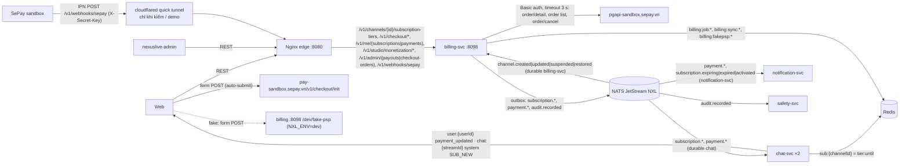
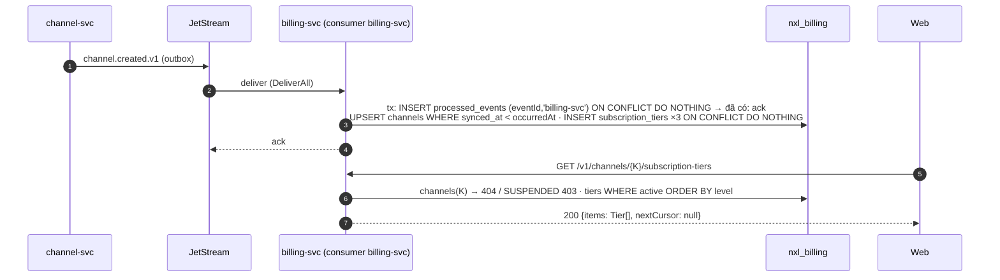
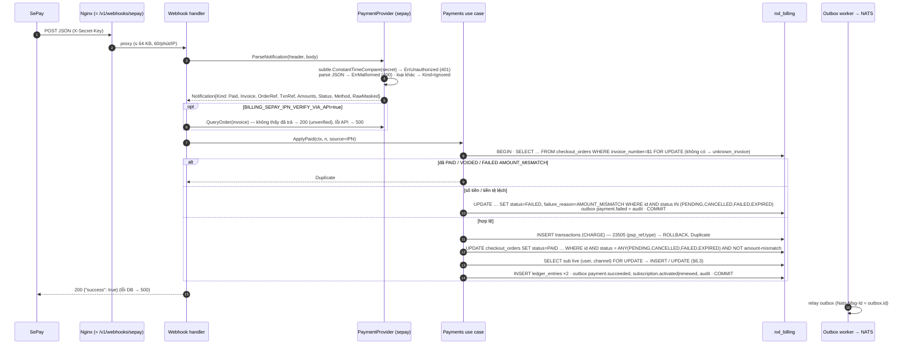
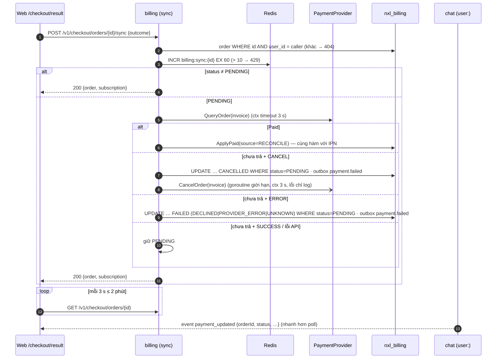
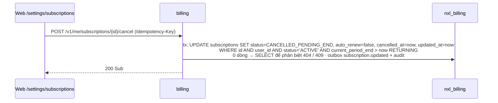
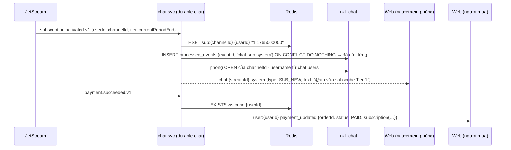
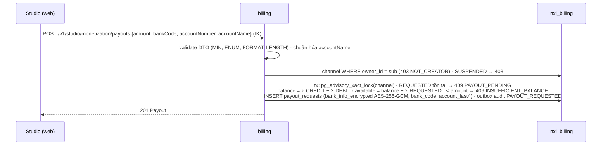

# TSD — GĐ6: Thanh toán & Subscription (billing-svc, SePay sandbox, mốc M5)

| Phiên bản | Trạng thái | Ngày | Working Plan |
| --- | --- | --- | --- |
| 1.0 | Chờ duyệt | 2026-10-20 | `docs/plans/working/2026-10-16-gd06-billing-subscriptions.md` (Approved 19/10) |

Quyết định đã chốt (19/10, chủ đồ án duyệt **G6-Q1…Q11 theo đề xuất**): **G6-Q1** chấp nhận NH-Q1, Q4–Q9, Q11–Q13 của NXL-H
(trả trước 30 ngày + nhắc gia hạn, không đổi tier khi còn hạn, `order_description` ASCII ≤ 100, một trạng thái chờ `PENDING`,
Mod / VIP / Admin dùng emote Tier 1, không giữ tiền, không Gift Sub, phí 5%, tier tạo từ `channel.created.v1`); NH-Q2 xong,
NH-Q3 đóng theo E-32 · **G6-Q2** không đưa tunnel vào compose; cloudflared quick tunnel chạy tay (`scripts/tunnel.ps1`) chỉ
khi kiểm IPN sandbox và buổi demo · **G6-Q3** `billing dev-ipn replay|synth` (CLI, chỉ `NXL_ENV=dev`, không endpoint mới) ·
**G6-Q4** billing-svc cổng **8098** · **G6-Q5** gọi `POST order/cancel` best-effort khi người dùng hủy / đơn hết hạn ·
**G6-Q6** `sub:{channelId}` = `"{tier}:{untilUnix}"`, đọc được `"{tier}"` cũ · **G6-Q7** emote kênh qua lệnh
`chat emote add` + seed demo (xem lệch nhỏ ở §13 mục 9) · **G6-Q8** admin có Rút tiền + Đơn cần xem lại · **G6-Q9** phương
thức trên modal lấy từ `BILLING_SEPAY_METHODS` + "Chọn trên trang SePay" · **G6-Q10** 12 mã ngân hàng cố định,
`BILLING_PAYOUT_ENC_KEY` 32 byte base64 bắt buộc · **G6-Q11** brief design GĐ6 `../docs/design/2026-10-16-design-brief-gd06.md`.

Mọi thay đổi trên hợp đồng đã có là **chỉ thêm** (endpoint, trường DTO, trường payload, loại sự kiện, loại thông báo), trừ
hai hành vi đổi có chủ đích ghi ở §9.1: giá trị Redis `sub:{channelId}` đổi định dạng (đọc được định dạng cũ) và
`GET /v1/chat/emotes` thôi bỏ qua `channelId`.

## 1. Mục tiêu

- **M5 Thanh toán (sandbox):** viewer bấm Subscribe → chọn tier → xem lại → phương thức → xác nhận → trang SePay sandbox →
  `/checkout/result` → badge "Sub T1" ở tin kế tiếp, emote kênh Tier 1 dùng được, chat được ở Subs-only → `/settings/subscriptions`
  tắt nhắc gia hạn → Creator thấy +56.050 ₫ ở Studio → Thu nhập (và ô "Doanh thu hôm nay") → yêu cầu rút tiền → Admin duyệt.
- **Idempotent (AC-H05):** cùng IPN gửi hai lần → cả hai `200 {"success": true}`; 1 dòng `transactions`, 2 dòng `ledger_entries`,
  1 `subscription.activated.v1`. IPN, `sync` và reconcile chạy cùng lúc cho cùng đơn → áp đúng một lần.
- **Thất bại có lý do (S6):** hủy / lỗi / hết hạn → câu đúng theo `failureReason` + "Thử lại"; tiền tới muộn luôn thắng (BR-H20).
- **Chạy không cần tunnel:** `sync` khi quay về + `reconcile-pending` đưa đơn đã trả sang `PAID` ≤ ~3 phút (AC-H12); provider
  `fake` cho CI / E2E / dự phòng demo.
- **Không lộ bí mật:** không secret, `X-Secret-Key`, `signature`, số thẻ đầy đủ, số tài khoản ngân hàng trong log, DB thô, sự kiện.

## 2. Phạm vi

**Trong:**

- **billing-svc (code đầu tiên, cổng 8098):** bản sao kênh + 3 tier mặc định; checkout (đơn, ký form), webhook IPN SePay,
  `sync`, hủy đơn; áp thanh toán vào subscription; hủy / bật lại nhắc gia hạn; lịch sử giao dịch; sổ cái, phí 5%, Studio Thu
  nhập (tier, tổng quan, sổ cái, rút tiền); Admin (rút tiền, đơn cần xem lại); middleware `Idempotency-Key`; job
  `reconcile-pending`, `subscription-expiry`, `reconcile-daily`, `idempotency-purge`; `PaymentProvider` (`sepay`, `fake`) + trang
  `/dev/fake-psp`; CLI `backfill-channels`, `republish-entitlements`, `dev-ipn replay|synth`; outbox `subscription.*`,
  `payment.*`, `audit.recorded.v1`; metric.
- **chat-svc:** consumer `subscription.*` / `payment.*` → `sub:{channelId}` dạng mới, system message `SUB_NEW` / `SUB_RENEW`,
  `payment_updated` trên `user:`; emote kênh theo tier (gửi tin, `GET /v1/chat/emotes?channelId=`, snapshot `me.subTier`,
  `me.emoteTier`); `chat emote add|seed-demo`; `dev-grant sub` ghi định dạng mới.
- **notification-svc:** loại `SUBSCRIPTION` (9 loại trong cài đặt), consumer 6 nguồn, 3 mẫu email × vi / en.
- **`pkg/events`** (8 loại mới), Nginx (6 route + webhook, zone `nxl_webhook`), compose, Prometheus, CI, `go.work`, Makefile,
  `.env.example`.
- Web (`nexuslive-web`) và `nexuslive-admin` dùng cùng basename; TSD này là hợp đồng (WP7, WP8).

**Ngoài (NXL-H §11, Working Plan §1):** tự trừ tiền, gói 3 tháng / năm, đổi tier khi còn hạn, Gift Sub, **Donate**, hoàn tiền,
chi trả thật, Creator đặt giá / tải emote, SePay production, phương án webhook chuyển khoản, thông báo kết quả duyệt rút tiền
cho Creator, biểu đồ doanh thu, danh sách tên subscriber.

### 2.1 Mở rộng sau (Donate — chỉ thiết kế chỗ nối, không hiện thực)

Bản nháp Donate sẽ thêm loại đơn một lần lên billing (`checkout_orders.kind = SUBSCRIPTION | DONATION`, `tier_id` nullable).
GĐ6 giữ chỗ cho việc đó **chỉ thêm**:

- Cột NEW / RENEW của đơn tên là `sub_action` (không phải `kind`) nên cột `kind` còn trống cho loại đơn; DTO giữ trường
  `kind: NEW | RENEW` theo NXL-H §13.2 — Donate dùng tên trường khác cho loại đơn (đề xuất `orderType`) và để `kind = null`.
- Use case áp thanh toán tách hai bước: phần chung (khóa đơn, `transactions`, chuyển trạng thái đơn, sổ cái phí / doanh thu,
  outbox `payment.*`) và phần theo loại qua interface `OrderApplier` (`Apply`, `Void`, `LedgerKind`) chọn theo
  `entity.OrderType` (GĐ6 chỉ có `OrderTypeSubscription`, suy ra khi đọc đơn). Donate thêm một hiện thực + một giá trị enum,
  không sửa nhánh IPN / `sync` / reconcile / VOID.
- `ledger_entries.kind` mở rộng bằng migration nới CHECK (thêm `DONATION_REVENUE`); summary Studio tính theo nhóm `kind`.
- Payload `payment.*` không giả định có `tier` khác null ở phía consumer mới; GĐ6 luôn gửi `tier`.

## 3. Kiến trúc



| Service | Cổng | Database | Durable consumer | Ghi chú |
| --- | --- | --- | --- | --- |
| billing-svc ✚ | **8098** (công khai + `/dev/fake-psp` + `/metrics`, `/swagger`, `/healthz`) | `nxl_billing` (có từ GĐ0) | `billing-svc` ✚ (DeliverAll) | Không có cổng nội bộ; CLI cùng binary |
| chat-svc ✎ | 8095 (×2) | `nxl_chat` | `chat` (thêm loại) | Không migration |
| notification-svc ✎ | 8097 | `nxl_notification` | `notification-svc` (thêm loại, DeliverNew) | Không migration (`SUBSCRIPTION` có trong CHECK từ GĐ5) |
| safety-svc | 8099 | — | `safety-svc` (có `audit.recorded`) | Không đổi code: nhận thêm nguồn `billing` |

- billing-svc **không gọi đồng bộ** service khác khi phục vụ request (kênh từ bản sao, emote do chat sở hữu); chỉ gọi SePay qua
  `PaymentProvider`. `backfill-channels` gọi `GET /internal/v1/channels` của channel-svc (`:8088`, GĐ5) một lần.
- chat-svc không gọi billing khi gửi tin — chỉ đọc `sub:{channelId}` (BR-H14, AI rule 9).
- Layout như `services/stream`: `cmd/billing` (server + subcommand), `config`, `internal/{app,entity,usecase,repo,controller}`,
  `controller/{restapi/v1, events, webhook, devpsp}`, `repo/{persistent, provider/{sepay,fake}, redisstore, snapshot}`,
  `Dockerfile` dùng chung mẫu (không image mới).

### 3.1 Định tuyến Nginx (thứ tự location regex quyết định)

Thứ tự cuối cùng của file (✚ = mới; các dòng không ghi giữ nguyên GĐ5). `set $billing http://billing:8098;` thêm cạnh các
biến upstream khác.

| # | Location | Đích | Ghi chú |
| --- | --- | --- | --- |
| 1 | `~ ^/v1/auth/(login\|…)$` | identity | Có sẵn |
| 2 ✚ | `= /v1/webhooks/sepay` | billing | Exact. `limit_except POST { deny all; }`, `client_max_body_size 64k`, `limit_req zone=nxl_webhook burst=20 nodelay` (không dùng `nxl_read`/`nxl_write`), `proxy_request_buffering on`, không cache. Không JWT ở edge; CORS không áp (SePay không gửi `Origin` → `$nxl_cors_origin` rỗng) |
| 3 | `= /v1/ws`, `~ ^/v1/chat/`, `~ ^/v1/channels/[^/]+/(chat-settings\|…)` | chat | Có sẵn |
| 4 ✚ | `~ ^/v1/channels/[^/]+/subscription-tiers$` | billing | **Trước** `^/v1/channels(/\|$)` (channel) |
| 5 | `= /v1/me/channel-roles`, `= /v1/me/notification-settings`, `= /v1/reports` | chat / notification / safety | Có sẵn |
| 6 ✚ | `~ ^/v1/me/(subscriptions\|payments)(/\|$)` | billing | Trước `/v1/` (identity) — `/v1/me` vẫn về identity |
| 7 ✚ | `~ ^/v1/checkout(/\|$)` | billing | Gồm `/v1/checkout/config`, `/v1/checkout/tiers/{id}`, `/v1/checkout/orders*` |
| 8 | `~ ^/v1/channels/[^/]+/vods$`, `~ ^/v1/channels(/\|$)`, `~ ^/v1/me/(following\|…)`, `~ ^/v1/me/(watch-progress\|…)`, `~ ^/v1/notifications(/\|$)` | stream / channel / notification | Có sẵn |
| 9 ✚ | `~ ^/v1/admin/(payouts\|checkout-orders)(/\|$)` | billing | **Trước** dòng 10–11; `$nxl_admin_path` đã bao `^/v1/admin` → CORS chỉ `NXL_ADMIN_ORIGIN` |
| 10–11 | `~ ^/v1/admin/(creator-applications…\|users/[^/]+$)`, `~ ^/v1/admin(/\|$)` | identity / safety | Có sẵn |
| 12 ✚ | `~ ^/v1/studio/monetization(/\|$)` | billing | **Trước** `^/v1/studio/channel/…`, `^/v1/studio/(channel\|schedules)`, `^/v1/(studio\|streams\|vods)` |
| 13… | phần còn lại | — | Có sẵn |

- Mọi dòng ✚ trừ webhook kèm `limit_req zone=nxl_read burst=100 nodelay; limit_req zone=nxl_write burst=10 nodelay;`.
- Template `nxl-edge.conf.template` thêm `limit_req_zone $binary_remote_addr zone=nxl_webhook:1m rate=${NXL_EDGE_WEBHOOK_RATE};`
  (mặc định compose `60r/m`, NXL-H §13.9). Edge vượt ngưỡng → `429` (SePay sẽ thử lại nếu có cơ chế; reconcile là lưới an toàn).
- `/dev/fake-psp` **không** qua edge (như `/dev/player` của media): trình duyệt dev gọi thẳng `http://localhost:8098`.
- Kiểm định tuyến bằng bảng `curl` (§10): `/v1/channels/{id}/subscription-tiers` → billing nhưng `/v1/channels/{handle}` →
  channel; `/v1/me/subscriptions` → billing nhưng `/v1/me` → identity; `/v1/studio/monetization/summary` → billing nhưng
  `/v1/studio/stream` → stream; `/v1/admin/payouts` → billing nhưng `/v1/admin/reports` → safety; `GET /v1/webhooks/sepay` → `403`.

### 3.2 Consumer bền mới / mở rộng

| Service | Durable | Policy | Loại sự kiện |
| --- | --- | --- | --- |
| billing | `billing-svc` ✚ | DeliverAll | `channel.created`, `channel.updated`, `channel.suspended`, `channel.restored` |
| chat | `chat` ✎ | (có sẵn) | + `subscription.activated`, `subscription.renewed`, `subscription.updated`, `subscription.expired`, `payment.succeeded`, `payment.failed`, `payment.voided` |
| notification | `notification-svc` ✎ | DeliverNew (có sẵn) | + `payment.succeeded`, `payment.failed`, `payment.voided`, `subscription.expiring`, `subscription.expired`, `subscription.activated` |
| safety | `safety-svc` | (có sẵn) | Không đổi (đã nghe `audit.recorded`) — thêm nguồn `billing` |

Thêm loại vào durable có sẵn = đổi `FilterSubjects` qua `CreateOrUpdateConsumer` (như GĐ5); loại mới chưa từng được phát nên
không có gì để giao bù. Durable `billing-svc` mới với DeliverAll nhận lại `channel.*` còn trong stream (≤ 7 ngày) — upsert
idempotent; kênh cũ hơn lấy bằng `billing backfill-channels` (§6.10).

## 4. Kịch bản

Ký hiệu thời gian: `now` của billing (UTC trong DB); hiển thị theo múi giờ người xem. Tiền là `int64` VND.

### S1 — Kênh mới có 3 tier; Guest / chủ kênh mở modal

- Given channel-svc phát `channel.created.v1 {channelId K, ownerId O, handle "kaelen", displayName "Kaelen"}`, When billing nhận,
  Then trong một transaction: upsert `channels` (`synced_at` = `Nxl-Occurred-At`), `INSERT subscription_tiers` 3 dòng
  (level 1–3, giá `BILLING_TIER_PRICES` = 59.000 / 119.000 / 299.000, `active = true`, mô tả mặc định §6.3) `ON CONFLICT
  (channel_id, level) DO NOTHING`, `processed_events`. Giao lại → không đổi gì.
- `GET /v1/channels/K/subscription-tiers` → `200 {items: [3 Tier], nextCursor: null}` (AC-H01). Kênh không có trong bản sao
  → `404`; kênh `SUSPENDED` → `403 CHANNEL_SUSPENDED`.
- Viewer đã đăng nhập: web gọi thêm `GET /v1/me/subscriptions?channelId=K` (một dòng hiện tại hoặc dòng hết hạn gần nhất →
  trạng thái nút BR-H12), `GET /v1/chat/emotes?channelId=K` (emote mở khóa), `GET /v1/checkout/config` (phương thức).
- Chủ kênh O mở modal → web so `channel.ownerId` với `me.id` (dữ liệu channel-svc có sẵn) → chế độ chỉ xem; nếu vẫn gọi
  `POST /v1/checkout/orders` → `422 CANNOT_SUBSCRIBE_SELF` (AC-H17).
- `/checkout?tierId=T` mở trực tiếp (mobile): `GET /v1/checkout/tiers/T` → `{channel, tiers, tierId}`.



### S2 — Tạo đơn checkout (AC-H03, H10, H11, H16, H17, AF-H02/H03)

- Given viewer V (không phải chủ kênh), tier T1 `active`, chưa có sub ở K, When `POST /v1/checkout/orders {tierId: T1,
  paymentMethod: "BANK_TRANSFER"}` với `Idempotency-Key: k1`, Then `201 {order, checkout}`: đơn `PENDING`,
  `invoiceNumber = "NXL" + 10 ký tự Crockford`, `kind = NEW`, `amount 59000`, `expiresAt = now + 30 phút`; `checkout.actionUrl
  = BILLING_SEPAY_CHECKOUT_URL` (`https://pay-sandbox.sepay.vn/v1/checkout/init`), `fields[]` theo thứ tự BR-H24, phần tử
  cuối `signature` = base64(HMAC-SHA256(secret, chuỗi ký)) — khớp khi tính lại (AC-H03). Không gọi SePay.
- Bấm lại cùng `k1` + cùng body → đúng response đã lưu (cùng `order.id`, cùng `invoiceNumber`, `201`; AC-H10). Cùng `k1`, đổi
  `tierId` → `422 IDEMPOTENCY_KEY_REUSED` (AC-H11). Hai request cùng `k1` song song → request thứ hai `409 CONFLICT`.
- Key mới, đã có đơn `PENDING` còn hạn cùng kênh cùng tier → `200 {order, checkout}` đơn cũ, form ký lại cùng `invoiceNumber`
  (cập nhật `payment_method` theo request) (AF-H02). Khác tier → `409 INVALID_STATE details {reason: ORDER_PENDING, orderId,
  tierLevel}` (AF-H03).
- Đang có sub Tier 1 còn hiệu lực, tạo đơn Tier 2 → `409 INVALID_STATE {reason: TIER_CHANGE, currentTier: 1,
  currentPeriodEnd}` (AC-H16). Cùng tier → `kind = RENEW`; `currentPeriodEnd + 30d > now + 365d` → `409 {reason: MAX_PREPAID,
  currentPeriodEnd, maxPeriodEnd}`.
- Thứ tự kiểm tra cố định §6.2.1; mọi nhánh lỗi không tạo đơn.

```mermaid
sequenceDiagram
  autonumber
  participant W as Web
  participant MW as IdempotencyKey middleware
  participant H as REST handler
  participant U as Checkout use case
  participant DB as nxl_billing
  participant P as PaymentProvider
  W->>MW: POST /v1/checkout/orders {tierId, paymentMethod} (Idempotency-Key k1)
  MW->>DB: INSERT idempotency_keys (V, POST, /v1/checkout/orders, k1, sha256(body)) ON CONFLICT DO NOTHING
  alt đã có: hash khác → 422 · chưa xong → 409 · đã xong → response đã lưu
    MW-->>W: 422 / 409 / stored status+body
  end
  MW->>H: next
  H->>U: Create(ctx, V, input, key k1)
  U->>DB: tier + channel (404 / 403 SUSPENDED / 422 SELF / 409 TIER_INACTIVE)
  U->>DB: tx: pg_advisory_xact_lock(user) · live sub (TIER_CHANGE / MAX_PREPAID) · PENDING cùng kênh (AF-H02/H03) · đếm PENDING ≥ 5 → 409<br/>INSERT checkout_orders (PENDING, invoice, sub_action, expires_at)
  U->>P: BuildCheckout(order) — ký HMAC, không gọi mạng
  P-->>U: {actionUrl, fields[]}
  U-->>H: order, checkout, created=true
  H-->>MW: 201 {data}
  MW->>DB: UPDATE idempotency_keys SET status_code=201, response (chỉ lưu 2xx)
  MW-->>W: 201
  W->>W: <form method=POST action=actionUrl> + hidden inputs đúng thứ tự → submit
```



### S3 — IPN `ORDER_PAID` hợp lệ → sub `ACTIVE` (AC-H04, AC-H05)

- Given đơn `PENDING` 59.000, When SePay `POST /v1/webhooks/sepay` (`X-Secret-Key` đúng, `notification_type = ORDER_PAID`,
  `order_amount "59000.00"`, `transaction_amount "59000"`, `transaction_status APPROVED`, `order_status CAPTURED`), Then một
  transaction DB: `transactions (CHARGE, IPN, psp_ref = transaction.id, raw_webhook đã che)`; đơn `PAID` (`paid_at`, `psp_ref =
  order.id`); sub `ACTIVE` (`start = paid_at`, `end = paid_at + 30d`, `auto_renew = true`); `ledger_entries` 2 dòng (`CREDIT
  SUB_REVENUE 59000`, `DEBIT PLATFORM_FEE 2950`); outbox `payment.succeeded.v1`, `subscription.activated.v1`,
  `audit.recorded.v1 (PAYMENT_CAPTURED)`; commit → `200 {"success": true}`. ≤ 3 s: chat ghi `sub:K` field V =
  `"1:{endUnix}"` và phát system message; web nhận `payment_updated` → Thành công.
- Gửi lại cùng IPN 2 lần (song song hoặc tuần tự) → cả hai `200`; lần sau thấy đơn đã `PAID` (khóa `FOR UPDATE`) hoặc vướng
  unique `(psp_ref, type)` → rollback, `billing_ipn_total{result="duplicate"}` (AC-H05).
- Sai / thiếu `X-Secret-Key` → `401`, không đọc DB (AC-H06). JSON hỏng / thiếu trường bắt buộc → `400`. `notification_type` khác →
  `200` (`ignored`). Hóa đơn lạ → `200` (`unknown_invoice`, log `error`). Số tiền / tiền tệ lệch → đơn `FAILED AMOUNT_MISMATCH`,
  audit `PAYMENT_AMOUNT_MISMATCH`, `payment.failed.v1`, `200` (AC-H07). `transaction_status ≠ APPROVED` → `200` (`not_approved`),
  không đổi đơn (đơn vẫn chờ, reconcile xử lý).



### S4 — Quay về không có IPN: `sync` và `reconcile-pending` (AC-H12, AF-H06–H08)

- Given không có tunnel, V đã trả trên sandbox, When trình duyệt về `/checkout/result?orderId=O&r=success` và web gọi
  `POST /v1/checkout/orders/O/sync {outcome: SUCCESS}`, Then billing `QueryOrder(invoice)` (≤ `BILLING_SEPAY_API_TIMEOUT` 3 s):
  thấy đã trả → áp như S3 với `source = RECONCILE` (`psp_ref` = id giao dịch từ API) → `200 {order: PAID, subscription}`. Chưa
  trả → `200` giữ `PENDING`; web poll `GET /v1/checkout/orders/O` mỗi 3 s ≤ 2 phút + nghe `payment_updated`.
- `outcome = CANCEL` và chưa trả → `CANCELLED (CANCELLED_BY_USER)` + `CancelOrder` best-effort (G6-Q5) (AC-H08). `outcome = ERROR`
  → `FAILED` với lý do từ tra cứu (`DECLINED` / `PROVIDER_ERROR`; không tra được → `UNKNOWN`) (AC-H09).
- SePay timeout khi `sync`: `SUCCESS` → `200` giữ nguyên; `CANCEL` → `CANCELLED`; `ERROR` → `FAILED UNKNOWN`; log `warn` (E-H16).
- Đơn không còn `PENDING` → trả nguyên trạng thái, không gọi SePay. `sync` quá 10 lần / phút / đơn → `429 RATE_LIMITED`.
- Job `reconcile-pending` (mỗi 1 phút, một instance qua khóa Redis): đơn `PENDING` tạo trước `now − 2 phút`, ≤ 50 đơn, cũ trước:
  đã trả → áp; quá `expires_at` và chưa trả → `EXPIRED` + `CancelOrder` best-effort; lỗi API → bỏ đơn đó lượt này, trừ khi đã
  quá `expires_at + BILLING_RECONCILE_GIVEUP` (30 phút) → `EXPIRED` (AC-H13: ≤ 31 phút).



### S5 — Tiền tới muộn thắng (AC-H14, AF-H05, BR-H20)

- Given đơn `EXPIRED` (hoặc `CANCELLED`, `FAILED` ≠ `AMOUNT_MISMATCH`), When IPN `ORDER_PAID` hợp lệ (hoặc reconcile thấy đã trả),
  Then đơn `PAID`, áp sub như thường; `payment.succeeded.v1` có `late = true` → thông báo "Thanh toán đã được xác nhận".
- Nếu lúc đó V đã có sub **khác tier** còn hiệu lực (đã mua tier khác sau khi đơn cũ hết hạn) → đơn `PAID`, `needs_review = true`,
  không đổi sub, sổ cái vẫn ghi (tiền đã vào kênh), audit `PAYMENT_NEEDS_REVIEW`, `payment.succeeded.v1 {applied: NEEDS_REVIEW,
  subscriptionId: null}` → web hiện "Đã nhận thanh toán — đang được xem xét"; Admin thấy ở `/payments/review`.

### S6 — `TRANSACTION_VOID` (AC-H21, AF-H09, AF-H10)

- Given đơn `PAID` vừa kích hoạt sub (end = paid + 30d), When IPN `TRANSACTION_VOID` cùng `order_invoice_number`, Then một
  transaction: `transactions (VOID, psp_ref = transaction.id)`; đơn `VOIDED`; sub `end −= 30d` → `≤ now` nên `EXPIRED`
  (`expired_reason = VOIDED`, `current_period_end = GREATEST(now, start + 1 ms)`); sổ cái `DEBIT SUB_REVENUE 59000` + `CREDIT
  PLATFORM_FEE 2950` (số dư kênh giảm đúng 56.050); outbox `payment.voided.v1`, `subscription.expired.v1 {reason: VOIDED}`,
  audit `PAYMENT_VOIDED`. Sub còn kỳ sau khi trừ → giữ trạng thái, `subscription.updated.v1 {change: PERIOD_REDUCED}`.
- VOID lặp → đơn đã `VOIDED` / unique `(psp_ref, VOID)` → `200` duplicate. VOID cho đơn chưa `PAID` → `200`, log `warn`, audit
  `PAYMENT_VOID_IGNORED`, không đổi gì. Đơn `needs_review` → đảo sổ cái, không đụng sub.

### S7 — Quản lý subscription (AC-H18, AC-H15, AF-H04)

- `POST /v1/me/subscriptions/{id}/cancel` (IK) trên sub `ACTIVE` → `200 Sub (CANCELLED_PENDING_END, remindRenewal false,
  cancelledAt)`, `subscription.updated.v1 {change: CANCELLED}`, audit `SUBSCRIPTION_CANCELLED`; chat vẫn cho chat Subs-only tới
  `currentPeriodEnd` (until không đổi). Hủy lần 2 (key khác) → `409 INVALID_STATE`; cùng key → response đã lưu.
- `POST …/{id}/resume` trên `CANCELLED_PENDING_END` còn hạn → `200 Sub (ACTIVE)`, `{change: RESUMED}`, audit
  `SUBSCRIPTION_RESUMED`. Sub `ACTIVE` / `EXPIRED` → `409`. Sub người khác → `404`.
- Gia hạn: sub hết hạn 20/02 10:00, trả ngày 10/02 → `end = 20/02 10:00 + 30d = 22/03 10:00` (AC-H15); sub đang
  `CANCELLED_PENDING_END` → `ACTIVE`, `auto_renew = true`, `cancelled_at = null`, `subscription.renewed.v1` (AF-H04).



### S8 — Nhắc gia hạn và hết hạn (AC-H19, AC-H20)

- Job `subscription-expiry` mỗi 1 phút (khóa Redis): (a) sub `ACTIVE`, `auto_renew`, `end − now ≤ 3 ngày`, `end > now`,
  `expiring_notified_for IS DISTINCT FROM end` → `UPDATE … SET expiring_notified_for = end WHERE id AND status = 'ACTIVE' AND
  current_period_end = $end AND expiring_notified_for IS DISTINCT FROM $end` + outbox `subscription.expiring.v1` — đúng một
  lần mỗi kỳ (gia hạn đổi `end` → kỳ mới được nhắc lại). (b) sub `ACTIVE`/`CANCELLED_PENDING_END` có `end ≤ now` → `UPDATE …
  SET status = EXPIRED, expired_reason = PERIOD_ENDED WHERE id AND status IN (…) AND current_period_end = $end` + outbox
  `subscription.expired.v1`. ≤ 500 dòng mỗi nhánh mỗi lượt; mỗi dòng một transaction ngắn.
- chat tự coi `until ≤ now` là hết quyền ngay (BR-H13), sự kiện `expired` chỉ dọn field.

### S9 — Quyền lợi trong chat

- `subscription.activated|renewed|updated` → `HSET sub:{channelId} {userId} "{tier}:{endUnix}"`; `expired` → xóa field nếu giá trị
  đang lưu có `until ≤ event.currentPeriodEnd` (Lua, §6.11) — tránh xóa sub mới khi sự kiện cũ giao lại.
- Gửi tin: Subs-only qua khi `tier > 0 && (until == 0 || until > now)`; badge `SUB_T{tier}`; emote kênh `tier_required ≤ emoteTier`
  thành emote, ngược lại là chữ (BR17, BR-H16). `emoteTier` = 3 (chủ kênh), `max(subTier, 1)` (Mod / VIP / Admin), `subTier` (khác).
- `activated` / `renewed` (không phải `replay`) khi kênh có phòng `OPEN` → system message `{type: SUB_NEW|SUB_RENEW, text:
  "@an vừa subscribe Tier 1" | "@an đã gia hạn Tier 1", meta: {userId, username, tier}}` vào mọi phòng `OPEN` của kênh, một
  lần mỗi sự kiện (`processed_events`) (AC-H26).
- `payment.succeeded|failed|voided` → `user:{userId}` event `payment_updated` (chỉ khi có kết nối).



### S10 — Studio Thu nhập và rút tiền (AC-H22, AC-H23)

- Given một đơn 59.000 `PAID` hôm nay, When Creator O `GET /v1/studio/monetization/summary?range=7d&tz=Asia/Ho_Chi_Minh`, Then
  `{gross 59000, platformFee 2950, net 56050, todayNet 56050, balance 56050, available 56050, pendingPayout 0, subscribers
  {tier1: 1, tier2: 0, tier3: 0, total: 1}, feeBps 500, payoutMin 100000}` (AC-H22). Người chưa có kênh → `403 NOT_CREATOR`.
- `POST /v1/studio/monetization/payouts {amount: 50000, …}` (IK) → `400 VALIDATION_FAILED details.amount = MIN`; `{amount:
  100000}` → `409 INVALID_STATE {reason: INSUFFICIENT_BALANCE, available: 56050}` (AC-H23). Đủ số dư → `201 Payout (REQUESTED)`,
  audit `PAYOUT_REQUESTED`; yêu cầu thứ hai khi còn `REQUESTED` → `409 {reason: PAYOUT_PENDING}`; kênh bị khóa → `403
  CHANNEL_SUSPENDED`.



### S11 — Admin duyệt / từ chối rút tiền (AC-H24)

- `POST /v1/admin/payouts/{id}/approve` → tx: `SELECT … FOR UPDATE`; `REQUESTED` → `APPROVED` (`reviewed_by`, `reviewed_at`) +
  `ledger_entries DEBIT PAYOUT amount (payout_request_id)` + audit `PAYOUT_APPROVED` → `200 AdminPayout`. Duyệt lại → `409
  INVALID_STATE`. Không chặn khi số dư hiện tại < số tiền (UI cảnh báo; số dư có thể âm).
- `…/reject {reason}` (10–500 ký tự) → `REJECTED`, `reject_reason`, audit `PAYOUT_REJECTED`; số tiền trở lại `available`.
- `GET /v1/admin/payouts/{id}/bank-account` → `200 {bankCode, bankName, accountNumber, accountName}` (giải mã) + audit
  `PAYOUT_BANK_INFO_VIEWED` mỗi lần xem; header `Cache-Control: no-store`. Giải mã lỗi → `500 INTERNAL_ERROR` (UI "Không giải
  mã được thông tin ngân hàng").
- `GET /v1/admin/checkout-orders?needsReview=true` → danh sách chỉ đọc.

### S12 — Provider `fake` và `/dev/fake-psp` (CI, E2E, dự phòng demo)

- Given `NXL_ENV=dev`, `BILLING_PAYMENT_PROVIDER=fake`, When tạo đơn, Then `checkout.actionUrl = BILLING_FAKE_PSP_URL`
  (`http://localhost:8098/dev/fake-psp`), cùng `fields[]` và chữ ký như SePay. Trình duyệt POST form → billing kiểm chữ ký
  (sai → `400` trang lỗi) → trang HTML "Đơn NXL… · Kaelen · Tier 1 · 59.000 ₫" với 3 nút.
- **Trả tiền** → `POST /dev/fake-psp/{invoice}/pay` → lưu trạng thái fake `PAID` (Redis), dựng IPN đúng định dạng SePay
  (`ORDER_PAID`, `transaction.id` UUID mới) và gửi `POST BILLING_FAKE_IPN_URL` kèm `X-Secret-Key` (mặc định
  `http://localhost:8098/v1/webhooks/sepay` — đi đúng handler S3) → `303` tới `success_url`. **Hủy** → trạng thái `CANCELLED`,
  `303 cancel_url` (không IPN). **Báo lỗi** → trạng thái `DECLINED`, `303 error_url`.
- `fake.QueryOrder` đọc trạng thái fake → `sync` / reconcile chạy như với SePay. Ngoài dev → mọi `/dev/*` trả `404`; billing không
  khởi động với `fake` khi `NXL_ENV ≠ dev`.

### S13 — IPN trùng chạy tay (M5) và IPN dựng lại

- `billing dev-ipn replay --transaction <uuid> --times 2` đọc `transactions.raw_webhook` (đã che) và gửi lại nguyên văn tới
  `BILLING_DEV_IPN_URL` (mặc định `http://localhost:8080/v1/webhooks/sepay`, qua edge) kèm `X-Secret-Key` → in `HTTP 200
  {"success":true}` ×2; kiểm `transactions` 1 dòng (AC-H05).
- `billing dev-ipn synth --invoice NXL… [--type ORDER_PAID|TRANSACTION_VOID] [--times N]`: `ORDER_PAID` dựng IPN từ
  `QueryOrder` thật (đơn đã trả trên sandbox, không có tunnel); `TRANSACTION_VOID` dựng từ `raw_webhook` của giao dịch `CHARGE`
  của đơn (kiểm AC-H21 cục bộ). Chỉ `NXL_ENV=dev`; không có endpoint HTTP mới.

### S14 — Thông báo `SUBSCRIPTION`

- `payment.succeeded` → người mua: in-app + email `payment_receipt` (bắt buộc: bỏ qua cài đặt email và trần ngày; vẫn chỉ gửi
  tới email đã xác minh — NE-Q4); `payment.failed` → in-app; `payment.voided` → in-app + email `payment_voided` (bắt buộc);
  `subscription.expiring` → in-app + email `subscription_expiring` (theo cài đặt, có link hủy nhận); `subscription.expired` →
  in-app; `subscription.activated` (không `replay`) → chủ kênh: in-app gộp theo `sub-new:{channelId}` trong 60 phút
  ("@an và 4 người khác vừa subscribe kênh của bạn"). Chi tiết payload / link §6.12.

## 5. Hợp đồng

### 5.1 Kiểu dùng chung (JSON camelCase, trường không có giá trị trả `null`, thời điểm RFC 3339 UTC)

| Kiểu | Trường |
| --- | --- |
| `Money` | `{amount: int64, currency: "VND"}` |
| `ChannelRef` | `id, handle, displayName, avatarUrl \| null` (bản sao billing) |
| `TierRef` | `id, level (1–3), name ("Tier 1"), price: Money, active` |
| `Tier` | `id, channelId, level, name, price: Money, description, active, periodDays (30)` |
| `StudioTier` | `Tier` + `activeSubscribers` (sub `ACTIVE`/`CANCELLED_PENDING_END`, `end > now`), `updatedAt` |
| `Order` | `id, invoiceNumber, channelId, channel: ChannelRef, tier: TierRef, kind (NEW\|RENEW), amount: Money, paymentMethod (CARD\|BANK_TRANSFER\|NAPAS_BANK_TRANSFER\|null), status (PENDING\|PAID\|CANCELLED\|FAILED\|EXPIRED\|VOIDED), failureReason (CANCELLED_BY_USER\|DECLINED\|EXPIRED\|AMOUNT_MISMATCH\|PROVIDER_ERROR\|UNKNOWN\|null), needsReview, periodDays, expiresAt, createdAt, paidAt \| null, updatedAt` |
| `Checkout` | `actionUrl, method: "POST", fields: [{name, value}]` — thứ tự BR-H24, cuối là `signature` |
| `Sub` | `id, channel: ChannelRef, tier: TierRef, status (ACTIVE\|CANCELLED_PENDING_END\|EXPIRED), currentPeriodStart, currentPeriodEnd, remindRenewal (= auto_renew), cancelledAt \| null, expiredReason (PERIOD_ENDED\|VOIDED\|null), renewable, createdAt` |
| `LedgerEntry` | `id, createdAt, kind (SUB_REVENUE\|PLATFORM_FEE\|PAYOUT), direction (CREDIT\|DEBIT), amount: Money, source (CHARGE\|VOID\|PAYOUT), invoiceNumber \| null, payoutId \| null, payoutCode \| null` |
| `Payout` | `id, code ("PO-0012"), amount: Money, bank: {code, name, last4, accountName \| null}, status (REQUESTED\|APPROVED\|REJECTED), rejectReason \| null, createdAt, reviewedAt \| null` |
| `AdminPayout` | `Payout` + `channel: ChannelRef + ownerId, balance: Money, available: Money, reviewedBy: {id} \| null` |
| `AdminOrder` | `Order` + `userId, subscriptionId \| null, pspRef \| null` |

- `Order.paymentMethod`: phương thức người dùng chọn; nếu chọn "trên trang SePay" (`null`) thì khi trả được điền từ
  `transaction.payment_method` của IPN / tra cứu (khi thuộc 3 giá trị trên).
- `Sub.renewable` = sub còn hiệu lực ∧ tier `active` ∧ `currentPeriodEnd + 30d ≤ now + 365d` (nút "Gia hạn" khóa khi `false`).
- `Payout.bank.accountName` giải mã khi đọc (chỉ chủ kênh và Admin thấy); lỗi giải mã → `null` + log `error` (không lộ lỗi).
- Tên ngân hàng (`bank.name`) từ bảng hằng G6-Q10: `VCB` Vietcombank · `TCB` Techcombank · `BIDV` BIDV · `VTB` VietinBank · `ACB`
  ACB · `MB` MB Bank · `VPB` VPBank · `TPB` TPBank · `STB` Sacombank · `VIB` VIB · `SHB` SHB · `HDB` HDBank (web giữ bản sao cùng
  thứ tự).
- Người dùng (người mua, người duyệt) chỉ trả `id`: billing không có bản sao `users`; admin hiện `@username` bằng
  `GET /v1/admin/users/{id}` (identity, cache theo id phía admin).

### 5.2 REST — billing-svc

Auth: `—` không cần · `B` Bearer · `C` Bearer, kênh tra theo `channels.owner_id = sub` (không có → `403 NOT_CREATOR`) · `A`
Bearer `role = ADMIN` (khác → `403 FORBIDDEN`) · `IK` bắt buộc `Idempotency-Key` (UUID; thiếu → `400 VALIDATION_FAILED
details.idempotencyKey = REQUIRED`, sai dạng → `= FORMAT`). Phân trang: `limit` 1–50 (mặc định 20), `cursor` mờ (base64url của
`(created_at, id)`), `nextCursor` hoặc `null`.

| Method | Path | Auth | Request | Response | Lỗi |
| --- | --- | --- | --- | --- | --- |
| GET | `/v1/channels/{channelId}/subscription-tiers` | — | — | `200 {items: Tier[] (chỉ active, theo level), nextCursor: null}` | `NOT_FOUND`, `CHANNEL_SUSPENDED` |
| GET | `/v1/checkout/config` ✚ | — | — | `200 {provider: SEPAY\|FAKE, paymentMethods: [...], periodDays: 30, renewReminderDays: 3, maxPrepaidDays: 365, orderTtlSec: 1800, maxPending: 5}` | — |
| GET | `/v1/checkout/tiers/{tierId}` ✚ | — | — | `200 {tierId, channel: ChannelRef + ownerId + status, tiers: Tier[]}` | `NOT_FOUND` (tier / kênh không có, tier tắt vẫn trả), `CHANNEL_SUSPENDED` |
| POST | `/v1/checkout/orders` | B, IK | `{tierId, paymentMethod?}` | `201 {order: Order, checkout: Checkout}` · `200` (AF-H02) | `VALIDATION_FAILED` (`tierId = REQUIRED\|INVALID`, `paymentMethod = ENUM`), `IDEMPOTENCY_KEY_REUSED`, `CONFLICT` (đang chạy; `details.limit = 5`), `NOT_FOUND`, `INVALID_STATE` (`TIER_INACTIVE`, `TIER_CHANGE`, `MAX_PREPAID`, `ORDER_PENDING`), `CANNOT_SUBSCRIBE_SELF`, `CHANNEL_SUSPENDED` |
| GET | `/v1/checkout/orders/{id}` | B | — | `200 {order: Order, subscription: Sub \| null}` | `NOT_FOUND` (không có / của người khác / id sai dạng) |
| POST | `/v1/checkout/orders/{id}/sync` | B | `{outcome: SUCCESS\|ERROR\|CANCEL}` | `200 {order, subscription}` | `VALIDATION_FAILED` (`outcome = REQUIRED\|ENUM`), `NOT_FOUND`, `RATE_LIMITED` (`details.retryAfterSec`) |
| POST | `/v1/checkout/orders/{id}/cancel` | B | — | `200 {order}` | `NOT_FOUND`, `INVALID_STATE` (không còn `PENDING`) |
| GET | `/v1/me/subscriptions?status=current\|expired&channelId=&cursor=&limit=` | B | `status` mặc định `current`; có `channelId` và không có `status` → tối đa 1 dòng: sub hiện tại, không có thì sub hết hạn gần nhất | `200 {items: Sub[], nextCursor}` (current: `currentPeriodEnd` tăng dần; expired: mới nhất trước) | `VALIDATION_FAILED` (`status = ENUM`, `channelId = INVALID`, `cursor = INVALID`) |
| POST | `/v1/me/subscriptions/{id}/cancel` | B, IK | — | `200 Sub` | `NOT_FOUND`, `INVALID_STATE`, `IDEMPOTENCY_KEY_REUSED`, `CONFLICT` |
| POST | `/v1/me/subscriptions/{id}/resume` | B | — | `200 Sub` | `NOT_FOUND`, `INVALID_STATE` |
| GET | `/v1/me/payments?status=&cursor=&limit=` | B | `status` CSV tùy chọn | `200 {items: Order[], nextCursor}` (mới nhất trước) | `VALIDATION_FAILED` |
| GET | `/v1/studio/monetization/tiers` | C | — | `200 {items: StudioTier[] (cả tắt), nextCursor: null}` | `NOT_CREATOR` |
| PATCH | `/v1/studio/monetization/tiers/{level}` | C | `{active?, description?}` | `200 StudioTier` | `VALIDATION_FAILED` (`level = ENUM`, `description = LENGTH`, `active = INVALID` khi tắt Tier 1, body rỗng → `body = REQUIRED`), `NOT_CREATOR`, `CHANNEL_SUSPENDED` |
| GET | `/v1/studio/monetization/summary?range=7d\|28d&tz=` | C | `range` mặc định `7d`, `tz` IANA mặc định `Asia/Ho_Chi_Minh` | `200 Summary` (§5.3) | `VALIDATION_FAILED` (`range = ENUM`, `tz = FORMAT`), `NOT_CREATOR` |
| GET | `/v1/studio/monetization/ledger?cursor=&limit=` | C | — | `200 {items: LedgerEntry[], nextCursor}` (mới nhất trước) | `NOT_CREATOR`, `VALIDATION_FAILED` |
| GET | `/v1/studio/monetization/payouts?cursor=&limit=` | C | — | `200 {items: Payout[], nextCursor}` (mới nhất trước) | `NOT_CREATOR` |
| POST | `/v1/studio/monetization/payouts` | C, IK | `{amount, bankCode, accountNumber, accountName}` | `201 Payout` | `VALIDATION_FAILED` (`amount = REQUIRED\|MIN\|MAX`, `bankCode = ENUM`, `accountNumber = FORMAT`, `accountName = LENGTH\|FORMAT`), `INVALID_STATE` (`INSUFFICIENT_BALANCE` + `available`, `PAYOUT_PENDING`), `NOT_CREATOR`, `CHANNEL_SUSPENDED`, `IDEMPOTENCY_KEY_REUSED` |
| GET | `/v1/admin/payouts?status=REQUESTED\|APPROVED\|REJECTED\|ALL&cursor=&limit=` | A | mặc định `REQUESTED` | `200 {items: AdminPayout[], nextCursor}` (`REQUESTED`: cũ trước; còn lại: mới trước) | `FORBIDDEN`, `VALIDATION_FAILED` |
| GET | `/v1/admin/payouts/pending-count` ✚ | A | — | `200 {requested}` (badge menu, hỏi lại 30 s) | `FORBIDDEN` |
| GET | `/v1/admin/payouts/{id}` ✚ | A | — | `200 AdminPayout` | `NOT_FOUND` |
| GET | `/v1/admin/payouts/{id}/bank-account` ✚ | A | — | `200 {bankCode, bankName, accountNumber, accountName}` + audit | `NOT_FOUND` |
| POST | `/v1/admin/payouts/{id}/approve` | A | — | `200 AdminPayout` | `NOT_FOUND`, `INVALID_STATE` |
| POST | `/v1/admin/payouts/{id}/reject` | A | `{reason}` | `200 AdminPayout` | `VALIDATION_FAILED` (`reason = REQUIRED\|LENGTH`), `NOT_FOUND`, `INVALID_STATE` |
| GET | `/v1/admin/checkout-orders?needsReview=&status=&q=&cursor=&limit=` | A | `needsReview` bool tùy chọn; `status` CSV; `q` = tiền tố `invoiceNumber` (không phân biệt hoa thường) | `200 {items: AdminOrder[], nextCursor}` (mới nhất trước) | `FORBIDDEN`, `VALIDATION_FAILED` |
| POST | `/v1/webhooks/sepay` | `X-Secret-Key` | IPN JSON (§5.4) | `200 {"success": true}` · `400` · `401` · `500` (không envelope NXL-00) | — |

Ràng buộc trường: `paymentMethod` ∈ `BILLING_SEPAY_METHODS` (ngoài danh sách cấu hình → `ENUM`); `description` ≤ 200 ký tự sau
trim (rỗng được — modal ẩn mô tả); `amount` số nguyên `100000 ≤ amount ≤ 1.000.000.000` (`MIN` / `MAX`; số không nguyên / chuỗi →
`REQUIRED`); `accountNumber` `^[0-9]{6,20}$`; `accountName` trim + gộp khoảng trắng + in hoa, 2–100 ký tự (`LENGTH`), chỉ
`A–Z` và khoảng trắng (`FORMAT` — chữ có dấu bị từ chối); `reason` 10–500 sau trim; `tz` qua `time.LoadLocation`.

### 5.3 Ví dụ JSON

`POST /v1/checkout/orders` → `201`:

```json
{
  "data": {
    "order": {
      "id": "0199f0a3-0000-7000-8000-000000000001",
      "invoiceNumber": "NXL7Q2K9M4X1C",
      "channelId": "0199e000-0000-7000-8000-0000000000aa",
      "channel": {"id": "0199e000-0000-7000-8000-0000000000aa", "handle": "kaelen", "displayName": "Kaelen", "avatarUrl": "/media/channels/0199e000-0000-7000-8000-0000000000aa/avatar.webp"},
      "tier": {"id": "0199e001-0000-7000-8000-000000000001", "level": 1, "name": "Tier 1", "price": {"amount": 59000, "currency": "VND"}, "active": true},
      "kind": "NEW",
      "amount": {"amount": 59000, "currency": "VND"},
      "paymentMethod": "BANK_TRANSFER",
      "status": "PENDING",
      "failureReason": null,
      "needsReview": false,
      "periodDays": 30,
      "expiresAt": "2026-10-16T13:44:05Z",
      "createdAt": "2026-10-16T13:14:05Z",
      "paidAt": null,
      "updatedAt": "2026-10-16T13:14:05Z"
    },
    "checkout": {
      "actionUrl": "https://pay-sandbox.sepay.vn/v1/checkout/init",
      "method": "POST",
      "fields": [
        {"name": "order_amount", "value": "59000"},
        {"name": "merchant", "value": "<BILLING_SEPAY_MERCHANT_ID>"},
        {"name": "currency", "value": "VND"},
        {"name": "operation", "value": "PURCHASE"},
        {"name": "order_description", "value": "NexusLive Sub Tier 1 @kaelen 30 ngay"},
        {"name": "order_invoice_number", "value": "NXL7Q2K9M4X1C"},
        {"name": "customer_id", "value": "0199f0a2-7c1e-7b3a-9d4e-1a2b3c4d5e6f"},
        {"name": "payment_method", "value": "BANK_TRANSFER"},
        {"name": "success_url", "value": "http://localhost:5173/checkout/result?orderId=0199f0a3-0000-7000-8000-000000000001&r=success"},
        {"name": "error_url", "value": "http://localhost:5173/checkout/result?orderId=0199f0a3-0000-7000-8000-000000000001&r=error"},
        {"name": "cancel_url", "value": "http://localhost:5173/checkout/result?orderId=0199f0a3-0000-7000-8000-000000000001&r=cancel"},
        {"name": "signature", "value": "<base64 HMAC-SHA256>"}
      ]
    }
  }
}
```

`409` `ORDER_PENDING` / `TIER_CHANGE` / `MAX_PREPAID` / `INSUFFICIENT_BALANCE` (khóa `details` là chuỗi như NXL-00 §4.1, số in
dạng thập phân, thời điểm RFC 3339):

```json
{"error": {"code": "INVALID_STATE", "message": "You have a pending payment for another tier", "details": {"reason": "ORDER_PENDING", "orderId": "0199f0a3-…", "tierLevel": "2"}}}
{"error": {"code": "INVALID_STATE", "message": "…", "details": {"reason": "TIER_CHANGE", "currentTier": "1", "currentPeriodEnd": "2026-11-15T13:14:41Z"}}}
{"error": {"code": "INVALID_STATE", "message": "…", "details": {"reason": "MAX_PREPAID", "currentPeriodEnd": "2027-10-10T00:00:00Z", "maxPeriodEnd": "2027-10-16T13:14:05Z"}}}
{"error": {"code": "INVALID_STATE", "message": "…", "details": {"reason": "INSUFFICIENT_BALANCE", "available": "56050"}}}
```

`GET /v1/checkout/orders/{id}` → `200 {"data": {"order": {…PAID…}, "subscription": {"id": "…", "channel": {…}, "tier": {…},
"status": "ACTIVE", "currentPeriodStart": "2026-10-16T13:14:41Z", "currentPeriodEnd": "2026-11-15T13:14:41Z", "remindRenewal":
true, "cancelledAt": null, "expiredReason": null, "renewable": true, "createdAt": "2026-10-16T13:14:41Z"}}}`. Đơn `needsReview`
→ `subscription` = sub hiện tại của người mua ở kênh (nếu có, để web hiện tier đang dùng) hoặc `null`.

`GET /v1/studio/monetization/summary?range=7d&tz=Asia/Ho_Chi_Minh` → `200`:

```json
{"data": {"range": "7d", "tz": "Asia/Ho_Chi_Minh", "from": "2026-10-09T17:00:00Z", "to": "2026-10-16T13:20:00Z",
  "subscribers": {"tier1": 1, "tier2": 0, "tier3": 0, "total": 1},
  "gross": {"amount": 59000, "currency": "VND"}, "platformFee": {"amount": 2950, "currency": "VND"},
  "net": {"amount": 56050, "currency": "VND"}, "todayNet": {"amount": 56050, "currency": "VND"},
  "balance": {"amount": 56050, "currency": "VND"}, "available": {"amount": 56050, "currency": "VND"},
  "pendingPayout": {"amount": 0, "currency": "VND"}, "feeBps": 500, "payoutMin": {"amount": 100000, "currency": "VND"}}}
```

`POST /v1/studio/monetization/payouts` → `201 {"data": {"id": "…", "code": "PO-0001", "amount": {"amount": 100000, "currency":
"VND"}, "bank": {"code": "VCB", "name": "Vietcombank", "last4": "6789", "accountName": "NGUYEN VAN AN"}, "status": "REQUESTED",
"rejectReason": null, "createdAt": "…", "reviewedAt": null}}`.

### 5.4 Webhook SePay (hợp đồng bên ngoài, đọc lại 20/10 — khớp §9.1 Working Plan)

Request (rút gọn; chỉ trường billing đọc):

```json
{
  "timestamp": 1757058220,
  "notification_type": "ORDER_PAID",
  "order": {"id": "e2c195be-…", "order_id": "NPSETVI00101000042R", "order_status": "CAPTURED", "order_currency": "VND",
            "order_amount": "59000.00", "order_invoice_number": "NXL7Q2K9M4X1C", "order_description": "…"},
  "transaction": {"id": "384c66dd-…", "payment_method": "BANK_TRANSFER", "transaction_id": "68ba94ac80123",
                  "transaction_type": "PAYMENT", "transaction_date": "2025-09-01 00:00:15", "transaction_status": "APPROVED",
                  "transaction_amount": "59000", "transaction_currency": "VND", "card_number": "4111XXXXXXXX1111", "card_brand": "VISA"},
  "customer": {"id": "bae12d2f-…", "customer_id": "0199f0a2-…"}
}
```

| Bước | Điều kiện | HTTP | Ghi |
| --- | --- | --- | --- |
| 1 | Body > 64 KB | 400 | `result="malformed"` |
| 2 | `X-Secret-Key` thiếu / sai (`subtle.ConstantTimeCompare` với `BILLING_SEPAY_IPN_SECRET`) | 401 `{"success": false}` | `unauthorized`, log `warn` không có header |
| 3 | JSON hỏng; thiếu `notification_type`, `order.order_invoice_number` (với loại hỗ trợ) | 400 | `malformed`, log ≤ 4 KB body **đã che** |
| 4 | `notification_type ∉ {ORDER_PAID, TRANSACTION_VOID}` | 200 | `ignored` |
| 5 | Không có đơn theo `order_invoice_number` | 200 | `unknown_invoice`, log `error` |
| 6 | `ORDER_PAID` mà `transaction_status ≠ APPROVED` | 200 | `not_approved`, đơn không đổi |
| 7 | Tiền tệ ≠ `VND` hoặc số tiền lệch | 200 | `mismatch` — đơn `FAILED AMOUNT_MISMATCH` |
| 8 | Trùng | 200 | `duplicate` |
| 9 | Áp xong | 200 `{"success": true}` | `applied` |
| 10 | Lỗi DB / lỗi tạm thời | 500 | `error` |

- **Parse số tiền** (BR-H25): chuỗi `^[0-9]{1,15}(\.[0-9]{1,2})?$`; phần lẻ khác `0`/`00` → lệch; bỏ phần `.00` → `int64`. Cả
  `order_amount` và `transaction_amount` phải bằng `amount_vnd`. Thiếu `transaction_amount` → chỉ dùng `order_amount`.
- `customer.customer_id ≠ user_id` → chỉ log `warn`. `timestamp` cũ hơn `SEPAY_IPN_MAX_AGE` (7 ngày) → xử lý + log `warn`.
- `order_status` dùng để ghi log / so khớp, **không** chặn áp: ORDER_PAID + `APPROVED` là đủ (E-33: `CAPTURED` ở IPN,
  `COMPLETED` ở API). `TRANSACTION_VOID` không cần `transaction_status`.
- **Che dữ liệu** (BR-H36) trước khi lưu `raw_webhook` hoặc log: xóa mọi `transaction.card_*` trừ `card_brand`, thay
  `card_number` bằng `card_last4` (4 số cuối); xóa `order.ip_address`, `order.user_agent`, `transaction.card_holder_name`. Không lưu
  header.

### 5.5 `/dev/fake-psp` (chỉ `NXL_ENV=dev` + `BILLING_PAYMENT_PROVIDER=fake`, cổng 8098, không qua edge)

| Method | Path | Request | Response |
| --- | --- | --- | --- |
| POST | `/dev/fake-psp` | form `application/x-www-form-urlencoded` các trường BR-H24 | `200 text/html` trang 3 nút (banner "Môi trường dev — cổng thanh toán giả"); chữ ký sai / thiếu trường → `400 text/html` |
| POST | `/dev/fake-psp/{invoice}/pay` | — | Gửi IPN `ORDER_PAID` (§S12) rồi `303 Location: success_url`; IPN lỗi → `502 text/html` có nút thử lại |
| POST | `/dev/fake-psp/{invoice}/cancel` | — | `303 cancel_url` |
| POST | `/dev/fake-psp/{invoice}/fail` | — | `303 error_url` |

Trang dùng `html/template`, không JS; `success_url`… lấy từ đơn đã lưu (dựng lại từ `BILLING_WEB_BASE_URL`), không lấy từ form.

### 5.6 chat-svc (thay đổi)

| Bề mặt | Thay đổi |
| --- | --- |
| `GET /v1/chat/emotes?channelId=` | Có `channelId` hợp lệ → emote toàn cục **và** emote kênh; mỗi mục thêm `channelId \| null`, `tierRequired \| null` (✚). Thứ tự: kênh trước (`tierRequired`, `code`), rồi toàn cục (`code`). `channelId` không có emote / không biết → chỉ toàn cục (không `404`). Cache 1 phút / kênh như emote toàn cục |
| WS `subscribed.snapshot` của `chat:` | `me.subTier` ✚ (0–3, đã xét `until`), `me.emoteTier` ✚ (0–3, BR-H16). `me.badges` có `SUB_T{n}` như GĐ3 |
| WS `chat:` `system` | `data.type` thêm `SUB_NEW`, `SUB_RENEW`; `data.meta = {userId, username, tier}` |
| WS `user:{userId}` | `type: payment_updated`, `data: {orderId, invoiceNumber, status, failureReason \| null, needsReview, subscription: {id, channelId, tier, status, currentPeriodEnd} \| null}` |
| Gửi tin | Fragment emote kênh theo `emoteTier` của người gửi; Subs-only dùng `subTier` (đã xét `until`) |
| CLI | `chat emote add --channel <uuid> --tier 1-3 --code <code> --image </emotes/channel/x.webp> [--animated]`; `chat emote remove --channel --code`; `chat emote seed-demo --channel <uuid>` (5 emote §6.11); `chat dev-grant sub --tier N [--minutes M]` ghi `"{N}:{now+M phút}"` (M = 0 → 30 ngày) |

`payment_updated` từ `payment.succeeded`: `status = PAID`, `subscription` từ payload (`status = ACTIVE`) hoặc `null` khi
`needsReview`; `payment.failed`: `status` của payload; `payment.voided`: `status = VOIDED`, `subscription` theo payload.

### 5.7 notification-svc (thay đổi)

- `SUBSCRIPTION` thành loại thứ 9 trong `Types()` (thêm **cuối** — chỉ số byte của token hủy nhận không đổi):
  `{InApp: true, Email: true, EmailAvailable: true}`; `GET /v1/me/notification-settings` trả 9 dòng (BR-E02 ✓ / ✓).
- Email `payment_receipt`, `payment_voided`: `Mandatory = true` (bỏ qua cài đặt, trần ngày, không link hủy nhận); email
  `subscription_expiring`: theo cài đặt `SUBSCRIPTION.email`, có link hủy nhận. In-app `SUBSCRIPTION` theo cài đặt `inApp`.
- Payload thông báo (`Notification.payload`) — §6.12.

### 5.8 Sự kiện (`pkg/events`)

Phát qua outbox billing cùng transaction với thay đổi; `Nats-Msg-Id` = id dòng outbox; `Nxl-Producer = billing`;
`aggregate_type`: `subscription` / `checkout_order` / `payout`. Mọi payload thời điểm RFC 3339 UTC, tiền `int64`.

| Type | Nguồn → nghe | Payload | Khi |
| --- | --- | --- | --- |
| `subscription.activated.v1` ✚ | billing → chat, notification | `subscriptionId, userId, channelId, tier, currentPeriodStart, currentPeriodEnd, orderId \| null, replay` | Sub mới tạo khi đơn `PAID`; `republish-entitlements` (`replay = true`, `orderId = null`) |
| `subscription.renewed.v1` ✚ | billing → chat | `subscriptionId, userId, channelId, tier, currentPeriodEnd, orderId` | Đơn `PAID` cùng tier nối kỳ |
| `subscription.updated.v1` ✚ | billing → chat | `subscriptionId, userId, channelId, tier, status, currentPeriodEnd, change (CANCELLED\|RESUMED\|PERIOD_REDUCED)` | Hủy / bật lại nhắc; VOID còn kỳ |
| `subscription.expiring.v1` ✚ | billing → notification | `subscriptionId, userId, channelId, tier, currentPeriodEnd, price, renewable` | Còn ≤ 3 ngày, một lần mỗi kỳ |
| `subscription.expired.v1` ✚ | billing → chat, notification | `subscriptionId, userId, channelId, tier, reason (PERIOD_ENDED\|VOIDED), currentPeriodEnd` | Hết kỳ / VOID hết kỳ |
| `payment.succeeded.v1` ✚ | billing → chat, notification | `orderId, invoiceNumber, userId, channelId, tier, kind (NEW\|RENEW), amount, paymentMethod \| null, paidAt, applied (ACTIVATED\|RENEWED\|NEEDS_REVIEW), subscriptionId \| null, currentPeriodEnd \| null, late, source (IPN\|RECONCILE)` | Đơn → `PAID` |
| `payment.failed.v1` ✚ | billing → chat, notification | `orderId, invoiceNumber, userId, channelId, tier, status (FAILED\|CANCELLED\|EXPIRED), failureReason` | Đơn → `FAILED`/`CANCELLED`/`EXPIRED` |
| `payment.voided.v1` ✚ | billing → chat, notification | `orderId, invoiceNumber, userId, channelId, tier, amount, subscriptionId \| null, subscriptionStatus \| null, currentPeriodEnd \| null` | Đơn → `VOIDED` |
| `channel.created/updated/suspended/restored.v1` | channel → **billing** ✚ | không đổi | Bản sao kênh, 3 tier |
| `audit.recorded.v1` | **billing** ✚ → safety | có sẵn (`actorRole`, `action`, `resourceType ORDER\|SUBSCRIPTION\|TIER\|PAYOUT`, `resourceId`, `reason`, `metadata`) | §6.14 |

```go
// pkg/events — additions (JSON tags camelCase as the existing payloads; pointer = nullable).
const (
    TypeSubscriptionActivated = "subscription.activated.v1"
    TypeSubscriptionRenewed   = "subscription.renewed.v1"
    TypeSubscriptionUpdated   = "subscription.updated.v1"
    TypeSubscriptionExpiring  = "subscription.expiring.v1"
    TypeSubscriptionExpired   = "subscription.expired.v1"
    TypePaymentSucceeded      = "payment.succeeded.v1"
    TypePaymentFailed         = "payment.failed.v1"
    TypePaymentVoided         = "payment.voided.v1"
)

// Values of subscription.updated.change, subscription.expired.reason and payment.succeeded.applied.
const (
    SubChangeCancelled, SubChangeResumed, SubChangePeriodReduced = "CANCELLED", "RESUMED", "PERIOD_REDUCED"
    SubExpiredPeriodEnded, SubExpiredVoided                      = "PERIOD_ENDED", "VOIDED"
    PaymentAppliedActivated, PaymentAppliedRenewed, PaymentAppliedNeedsReview = "ACTIVATED", "RENEWED", "NEEDS_REVIEW"
    PaymentSourceIPN, PaymentSourceReconcile                     = "IPN", "RECONCILE"
)

type SubscriptionActivated struct {
    SubscriptionID, UserID, ChannelID string
    Tier                                 int
    CurrentPeriodStart, CurrentPeriodEnd time.Time
    OrderID                              *string
    Replay                               bool // republish-entitlements: rebuild copies only, no system message / notification
}
type SubscriptionRenewed struct {
    SubscriptionID, UserID, ChannelID string; Tier int; CurrentPeriodEnd time.Time; OrderID string
}
type SubscriptionUpdated struct {
    SubscriptionID, UserID, ChannelID string; Tier int; Status string; CurrentPeriodEnd time.Time; Change string
}
type SubscriptionExpiring struct {
    SubscriptionID, UserID, ChannelID string; Tier int; CurrentPeriodEnd time.Time; Price int64; Renewable bool
}
type SubscriptionExpired struct {
    SubscriptionID, UserID, ChannelID string; Tier int; Reason string; CurrentPeriodEnd time.Time
}
type PaymentSucceeded struct {
    OrderID, InvoiceNumber, UserID, ChannelID string
    Tier                                      int
    Kind                                      string
    Amount                                    int64
    PaymentMethod                             *string
    PaidAt                                    time.Time
    Applied                                   string
    SubscriptionID                            *string
    CurrentPeriodEnd                          *time.Time
    Late                                      bool
    Source                                    string
}
type PaymentFailed struct {
    OrderID, InvoiceNumber, UserID, ChannelID string; Tier int; Status, FailureReason string
}
type PaymentVoided struct {
    OrderID, InvoiceNumber, UserID, ChannelID string; Tier int; Amount int64
    SubscriptionID, SubscriptionStatus *string; CurrentPeriodEnd *time.Time
}
```

### 5.9 Go — billing-svc

```go
// internal/entity
type (
    OrderStatus   string // PENDING|PAID|CANCELLED|FAILED|EXPIRED|VOIDED
    FailureReason string // CANCELLED_BY_USER|DECLINED|EXPIRED|AMOUNT_MISMATCH|PROVIDER_ERROR|UNKNOWN
    SubAction     string // NEW|RENEW (column sub_action, DTO kind)
    OrderType     string // SUBSCRIPTION (derived; DONATION later — §2.1)
    PaymentMethod string // CARD|BANK_TRANSFER|NAPAS_BANK_TRANSFER
    SubStatus     string // ACTIVE|CANCELLED_PENDING_END|EXPIRED
    LedgerKind    string // SUB_REVENUE|PLATFORM_FEE|PAYOUT
    PayoutStatus  string // REQUESTED|APPROVED|REJECTED
)
// Channel{ID, OwnerID, Handle, DisplayName, AvatarURL, Status}, Tier, Order, Subscription, Transaction, LedgerEntry,
// Payout, BankAccount{Code, Number, Name}, Summary; Money helpers: Fee(amount, bps) = amount*bps/10000 (int64 floor),
// NewInvoiceNumber(rand) = "NXL" + 10 Crockford base32 chars (alphabet 0123456789ABCDEFGHJKMNPQRSTVWXYZ).
var (
    ErrNotFound          = errors.New("not found")                // 404 NOT_FOUND
    ErrNotCreator        = errors.New("caller has no channel")    // 403 NOT_CREATOR
    ErrForbidden         = errors.New("forbidden")                // 403 FORBIDDEN
    ErrChannelSuspended  = errors.New("channel suspended")        // 403 CHANNEL_SUSPENDED
    ErrSubscribeSelf     = errors.New("cannot subscribe to own channel") // 422 CANNOT_SUBSCRIBE_SELF
    ErrInvalidState      = errors.New("invalid state")            // 409 INVALID_STATE (+ StateError details)
    ErrPendingLimit      = errors.New("too many pending orders")  // 409 CONFLICT details.limit
    ErrRateLimited       = errors.New("rate limited")             // 429 RATE_LIMITED
    ErrIdemReused        = errors.New("idempotency key reused")   // 422 IDEMPOTENCY_KEY_REUSED
    ErrIdemInProgress    = errors.New("idempotency key in progress") // 409 CONFLICT
    ErrBadCursor         = errors.New("bad cursor")               // 400 cursor = INVALID
    // provider
    ErrUnauthorized      = errors.New("notification secret mismatch") // webhook 401
    ErrMalformed         = errors.New("malformed notification")       // webhook 400
    ErrProviderUnavailable = errors.New("payment provider unavailable") // sync: keep state; jobs: skip
    ErrProviderNotFound  = errors.New("order unknown to provider")      // QueryOrder: never submitted
)
// StateError carries details.reason (+ extra keys) for ErrInvalidState; errors.Is(err, ErrInvalidState) holds.
type StateError struct { Reason string; Details map[string]string }

// internal/usecase/contracts.go
type (
    Catalog interface {
        PublicTiers(ctx context.Context, channelID string) ([]entity.Tier, error)
        TierContext(ctx context.Context, tierID string) (entity.Channel, []entity.Tier, error)
        Config() CheckoutConfig
    }
    Checkout interface {
        // Create returns created=false for the AF-H02 pending order (200).
        Create(ctx context.Context, userID string, in CreateOrderInput) (o entity.Order, c entity.Checkout, created bool, err error)
        Get(ctx context.Context, userID, orderID string) (OrderView, error)
        Sync(ctx context.Context, userID, orderID string, outcome Outcome) (OrderView, error)
        Cancel(ctx context.Context, userID, orderID string) (entity.Order, error)
    }
    Payments interface { // shared by webhook, sync, reconcile, fake PSP, dev-ipn
        HandleNotification(ctx context.Context, n provider.Notification) (IPNResult, error)
        ApplyPaid(ctx context.Context, p provider.PaidOrder, source string) (IPNResult, error)
        ApplyVoid(ctx context.Context, v provider.VoidedOrder) (IPNResult, error)
    }
    Subscriptions interface {
        Mine(ctx context.Context, userID string, f SubFilter, cursor string, limit int) (SubPage, error)
        Cancel(ctx context.Context, userID, subID string) (entity.Subscription, error)
        Resume(ctx context.Context, userID, subID string) (entity.Subscription, error)
        Payments(ctx context.Context, userID string, statuses []entity.OrderStatus, cursor string, limit int) (OrderPage, error)
    }
    Studio interface {
        Tiers(ctx context.Context, ownerID string) ([]StudioTier, error)
        UpdateTier(ctx context.Context, ownerID string, level int, in TierPatch) (StudioTier, error)
        Summary(ctx context.Context, ownerID string, rng Range, loc *time.Location) (entity.Summary, error)
        Ledger(ctx context.Context, ownerID, cursor string, limit int) (LedgerPage, error)
        Payouts(ctx context.Context, ownerID, cursor string, limit int) (PayoutPage, error)
        RequestPayout(ctx context.Context, ownerID string, in PayoutInput) (entity.Payout, error)
    }
    Admin interface {
        Payouts(ctx context.Context, status *entity.PayoutStatus, cursor string, limit int) (AdminPayoutPage, error)
        PendingCount(ctx context.Context) (int, error)
        Payout(ctx context.Context, id string) (AdminPayout, error)
        BankAccount(ctx context.Context, adminID, id string) (entity.BankAccount, error) // audits PAYOUT_BANK_INFO_VIEWED
        Approve(ctx context.Context, adminID, id string) (AdminPayout, error)
        Reject(ctx context.Context, adminID, id, reason string) (AdminPayout, error)
        Orders(ctx context.Context, f AdminOrderFilter, cursor string, limit int) (AdminOrderPage, error)
    }
    Replica interface { // durable billing-svc + backfill
        ChannelCreated(ctx context.Context, eventID string, at time.Time, e events.ChannelCreated) error
        ChannelUpdated(ctx context.Context, eventID string, at time.Time, e events.ChannelUpdated) error
        ChannelStatus(ctx context.Context, eventID string, at time.Time, channelID string, suspended bool) error
        Backfill(ctx context.Context) (int, error)
    }
    Jobs interface {
        ReconcilePending(ctx context.Context) (int, error)
        SubscriptionExpiry(ctx context.Context) (reminded, expired int, err error)
        ReconcileDaily(ctx context.Context, day time.Time) (ReconcileReport, error)
        PurgeIdempotency(ctx context.Context) (int64, error)
        RepublishEntitlements(ctx context.Context) (int, error)
    }
    CreateOrderInput struct { TierID string; PaymentMethod *entity.PaymentMethod; IdempotencyKey string }
    Outcome          string // SUCCESS|ERROR|CANCEL
    IPNResult        string // applied|duplicate|unknown_invoice|mismatch|ignored|not_approved|unverified|void_ignored
    OrderView        struct { Order entity.Order; Subscription *entity.Subscription }
)

// internal/usecase/payments — extension seam (§2.1).
type OrderApplier interface {
    // Apply runs inside the payment tx after the order row is locked and moved to PAID.
    Apply(ctx context.Context, tx repo.Tx, o entity.Order, paidAt time.Time) (Applied, error)
    // Void runs inside the void tx after the order row is locked and moved to VOIDED.
    Void(ctx context.Context, tx repo.Tx, o entity.Order, at time.Time) (VoidEffect, error)
    RevenueKind() entity.LedgerKind // SUB_REVENUE for subscriptions
}

// internal/repo/provider — ADR-009 PaymentProvider, adjusted to the 16/10 SePay docs (Working Plan §9.1).
type PaymentProvider interface {
    Name() string // "SEPAY" | "FAKE" (checkout_orders.psp)
    // BuildCheckout signs the form; no network call.
    BuildCheckout(ctx context.Context, o CheckoutOrder) (entity.Checkout, error)
    // ParseNotification checks X-Secret-Key in constant time (ErrUnauthorized) and parses the body (ErrMalformed).
    ParseNotification(header http.Header, body []byte) (Notification, error)
    // QueryOrder: GET /v1/order/detail/{invoice}; ErrProviderNotFound, ErrProviderUnavailable.
    QueryOrder(ctx context.Context, invoice string) (OrderState, error)
    // ListOrders: GET /v1/order?from_created_at&to_created_at&per_page=100&page=n, all pages.
    ListOrders(ctx context.Context, from, to time.Time) ([]OrderState, error)
    // CancelOrder: POST /v1/order/cancel; best effort, callers only log errors.
    CancelOrder(ctx context.Context, invoice string) error
}
type DevVoider interface { VoidTransaction(ctx context.Context, invoice string) error } // sepay only, dev CLI

type (
    CheckoutOrder struct { ID, Invoice, UserID, Description string; Amount int64; Method *entity.PaymentMethod }
    NotificationKind string // PAID|VOID|IGNORED
    Notification struct {
        Kind NotificationKind; Invoice, ProviderOrderID, TxnID string
        OrderAmount, TxnAmount Amount // Amount{Value int64; Fractional bool; Present bool}
        Currency, OrderStatus, TxnStatus, Method, CustomerID string
        SentAt time.Time; RawMasked json.RawMessage
    }
    OrderStatusKind string // PAID|PENDING|CANCELLED|FAILED|UNKNOWN
    OrderState struct {
        Invoice, ProviderOrderID string; Status OrderStatusKind; Failure entity.FailureReason
        Amount int64; Currency, Method, TxnID string; PaidAt *time.Time; Raw json.RawMessage // masked
    }
    PaidOrder   struct { Invoice, ProviderOrderID, TxnID, Method string; OrderAmount, TxnAmount Amount; Currency string; Raw json.RawMessage }
    VoidedOrder struct { Invoice, TxnID string; Raw json.RawMessage }
)

// internal/repo/contracts.go
type (
    Tx interface { // pgx.Tx wrapper; all tx methods take it so the payment flow is one transaction
        Exec(ctx context.Context, sql string, args ...any) (pgconn.CommandTag, error)
    }
    ChannelRepo interface {
        Channel(ctx context.Context, id string) (entity.Channel, error)
        ByOwner(ctx context.Context, ownerID string) (entity.Channel, error) // ErrNotCreator
        // UpsertChannel records processed_events(eventID) and skips rows whose synced_at is newer than at;
        // withTiers inserts the 3 default tiers ON CONFLICT DO NOTHING in the same tx.
        UpsertChannel(ctx context.Context, eventID string, at time.Time, c entity.Channel, withTiers []entity.Tier) error
        SetStatus(ctx context.Context, eventID string, at time.Time, channelID string, s string) error
    }
    TierRepo interface {
        Tier(ctx context.Context, id string) (entity.Tier, error)
        ByChannel(ctx context.Context, channelID string, activeOnly bool) ([]entity.Tier, error)
        ActiveSubscribers(ctx context.Context, channelID string) (map[int]int, error)
        Update(ctx context.Context, channelID string, level int, patch TierPatch, audit events.AuditRecorded) (entity.Tier, bool, error)
    }
    OrderRepo interface {
        // CreateOrReuse runs the §6.2.1 checks 7–10 under pg_advisory_xact_lock(user) and inserts the order.
        CreateOrReuse(ctx context.Context, o entity.Order, rules CreateRules) (entity.Order, bool, error)
        Order(ctx context.Context, id string) (entity.Order, error)
        ForUser(ctx context.Context, userID string, statuses []entity.OrderStatus, after *Cursor, limit int) ([]entity.Order, error)
        Admin(ctx context.Context, f AdminOrderFilter, after *Cursor, limit int) ([]entity.Order, error)
        // Transition is a conditional UPDATE (status = ANY(from)) + outbox rows in one tx; false = state moved on.
        Transition(ctx context.Context, id string, from []entity.OrderStatus, to entity.OrderStatus, reason *entity.FailureReason, out []Outbox) (bool, error)
        DuePending(ctx context.Context, createdBefore time.Time, limit int) ([]entity.Order, error)
        PaidBetween(ctx context.Context, from, to time.Time) ([]entity.Order, error)
        // WithLockedOrder runs fn in one tx with SELECT … FOR UPDATE on the order of invoice (ErrNotFound).
        WithLockedOrder(ctx context.Context, invoice string, fn func(tx Tx, o entity.Order) error) error
    }
    PaymentTxRepo interface { // used only inside WithLockedOrder
        InsertTransaction(ctx context.Context, tx Tx, t entity.Transaction) (inserted bool, err error) // 23505 → false
        MarkPaid(ctx context.Context, tx Tx, orderID string, from []entity.OrderStatus, paidAt time.Time, providerOrderID string, method *entity.PaymentMethod, needsReview bool, subID *string) (bool, error)
        MarkVoided(ctx context.Context, tx Tx, orderID string) (bool, error)
        MarkMismatch(ctx context.Context, tx Tx, orderID string) (bool, error)
        LiveSubForUpdate(ctx context.Context, tx Tx, userID, channelID string) (*entity.Subscription, error)
        SubForUpdate(ctx context.Context, tx Tx, subID string) (*entity.Subscription, error)
        InsertSub(ctx context.Context, tx Tx, s entity.Subscription) (entity.Subscription, error)
        ExtendSub(ctx context.Context, tx Tx, subID string, newEnd time.Time) (entity.Subscription, error)
        ReduceSub(ctx context.Context, tx Tx, subID string, by time.Duration, now time.Time) (entity.Subscription, bool, error) // expired?
        InsertLedger(ctx context.Context, tx Tx, e []entity.LedgerEntry) error
        InsertOutbox(ctx context.Context, tx Tx, rows []Outbox) error
    }
    SubRepo interface {
        Mine(ctx context.Context, userID string, f SubFilter, after *Cursor, limit int) ([]entity.Subscription, error)
        Cancel(ctx context.Context, userID, subID string, now time.Time, out []Outbox) (entity.Subscription, error) // ErrNotFound / ErrInvalidState
        Resume(ctx context.Context, userID, subID string, now time.Time, out []Outbox) (entity.Subscription, error)
        DueReminders(ctx context.Context, now time.Time, window time.Duration, limit int) ([]entity.Subscription, error)
        MarkReminded(ctx context.Context, subID string, end time.Time, out []Outbox) (bool, error)
        DueExpiry(ctx context.Context, now time.Time, limit int) ([]entity.Subscription, error)
        Expire(ctx context.Context, subID string, end time.Time, out []Outbox) (bool, error)
        Live(ctx context.Context, afterID string, limit int) ([]entity.Subscription, error) // republish
        CountActive(ctx context.Context) (map[int]int, error) // gauge
    }
    LedgerRepo interface {
        Totals(ctx context.Context, channelID string, from, to time.Time) (entity.Totals, error)
        Balance(ctx context.Context, channelID string) (balance, pending int64, err error)
        Entries(ctx context.Context, channelID string, after *Cursor, limit int) ([]entity.LedgerEntry, error)
    }
    PayoutRepo interface {
        Create(ctx context.Context, p entity.Payout, min int64, audit events.AuditRecorded) (entity.Payout, error) // §6.13
        ForChannel(ctx context.Context, channelID string, after *Cursor, limit int) ([]entity.Payout, error)
        List(ctx context.Context, status *entity.PayoutStatus, after *Cursor, limit int) ([]entity.Payout, error)
        Get(ctx context.Context, id string) (entity.Payout, error)
        Review(ctx context.Context, id, adminID string, to entity.PayoutStatus, reason *string, audit events.AuditRecorded) (entity.Payout, error)
        CountRequested(ctx context.Context) (int, error)
    }
    IdempotencyRepo interface {
        Begin(ctx context.Context, k IdemKey, hash []byte, staleAfter time.Duration) (IdemState, error) // New|InProgress|Done(stored)|Mismatch
        Complete(ctx context.Context, k IdemKey, status int, body []byte) error
        Abort(ctx context.Context, k IdemKey) error
        Purge(ctx context.Context, before time.Time) (int64, error)
    }
    Audit interface { Outbox(e events.AuditRecorded) Outbox } // builds the audit.recorded.v1 outbox row
    JobLock interface { // Redis
        TryLock(ctx context.Context, name string, ttl time.Duration) (release func(), ok bool, err error)
    }
    SyncLimiter interface { Hit(ctx context.Context, orderID string) (n int, ttl time.Duration, err error) }
    Cipher interface { // AES-256-GCM, BILLING_PAYOUT_ENC_KEY
        Seal(plain []byte, aad []byte) ([]byte, error)
        Open(blob []byte, aad []byte) ([]byte, error)
    }
    ChannelSnapshot interface { // channel-svc internal API, backfill only
        Channels(ctx context.Context, after string, limit int) ([]entity.Channel, string, error)
    }
)
```

Controller: `restapi/v1` (`tiers.go`, `checkout.go`, `me.go`, `studio.go`, `admin.go` + `request/`, `response/`), middleware
`idempotency.go` (chỉ gắn vào 3 route IK), `controller/webhook` (Fiber handler đọc `ctx.Body()` thô, không qua validator /
envelope), `controller/devpsp` (chỉ đăng ký khi dev + fake), `controller/events` (durable `billing-svc`). Wiring chỉ ở
`internal/app/app.go`; goroutine job khởi tạo ở đó, dừng theo context shutdown.

### 5.10 Go — chat-svc, notification-svc

```go
// chat — internal/entity
type SubGrant struct { Tier int; Until time.Time } // Until zero = legacy "{tier}" value, no expiry
// ParseSub reads "{tier}" or "{tier}:{untilUnix}"; malformed → zero grant (not subscribed) + caller logs.
func ParseSub(v string) SubGrant
func (g SubGrant) Active(now time.Time) bool   // Tier 1..3 && (Until.IsZero() || Until.After(now))
func (g SubGrant) Encode() string               // "{tier}:{untilUnix}"
// Standing gains EmoteTier() int: Streamer → 3; Moderator/VIP/Admin → max(SubTier, 1); else SubTier.
// Emote gains ChannelID *string, TierRequired *int.

// chat — repo additions (realtime.Store / persistent.Repo); existing SetSub(tier int) is replaced by:
type SubStore interface {
    SetSub(ctx context.Context, channelID, userID string, g entity.SubGrant) error
    // RemoveSubIfNotNewer deletes the field only when the stored Until <= until (Lua CAS, §6.11).
    RemoveSubIfNotNewer(ctx context.Context, channelID, userID string, until time.Time) error
    Audience(ctx context.Context, channelID, userID string) (*time.Time, entity.SubGrant, error) // + SubTiers → map[string]SubGrant
}
type EmoteRepo interface { // + existing GlobalEmotes
    ChannelEmotes(ctx context.Context, channelID string) ([]entity.Emote, error)
    AddChannelEmote(ctx context.Context, e entity.Emote) error // ON CONFLICT (channel_id, code) WHERE scope='CHANNEL' DO UPDATE
    RemoveChannelEmote(ctx context.Context, channelID, code string) error
}
// chat — usecase additions
type Entitlements interface { // consumer chat
    Activated(ctx context.Context, eventID string, e events.SubscriptionActivated) error
    Renewed(ctx context.Context, eventID string, e events.SubscriptionRenewed) error
    Updated(ctx context.Context, e events.SubscriptionUpdated) error
    Expired(ctx context.Context, e events.SubscriptionExpired) error
    PaymentUpdated(ctx context.Context, userID string, data entity.PaymentUpdate) error // relays to user:{userId}
}
// Chat.Emotes(ctx, channelID *string) replaces Emotes(ctx); Grants.Subscribe(ctx, channelID, userID string, g SubGrant).

// notification — entity: TypeSubscription Type = "SUBSCRIPTION" appended to Types(); defaults
// TypeSubscription: {InApp: true, Email: true, EmailAvailable: true}. Sources gains:
type BillingSources interface {
    PaymentSucceeded(ctx context.Context, eventID string, e events.PaymentSucceeded) error
    PaymentFailed(ctx context.Context, eventID string, e events.PaymentFailed) error
    PaymentVoided(ctx context.Context, eventID string, e events.PaymentVoided) error
    SubExpiring(ctx context.Context, eventID string, e events.SubscriptionExpiring) error
    SubExpired(ctx context.Context, eventID string, e events.SubscriptionExpired) error
    NewSubscriber(ctx context.Context, eventID string, e events.SubscriptionActivated) error // skips Replay
}
```

### 5.11 SQL (migration mới — không sửa migration GĐ0)

Chưa có code nào ghi `nxl_billing` trước GĐ6 nên các cột `NOT NULL` mới thêm thẳng không cần backfill. Tên ràng buộc không
đặt tên ở GĐ0 theo quy tắc Postgres: `checkout_orders_status_check`, `checkout_orders_check` (paid_at),
`transactions_type_check`.

**`nxl_billing` `20261016100001_gd6_billing.up.sql`**

```sql
-- Channel copy (channel.created/updated/suspended/restored + backfill-channels). BR-H35.
CREATE TABLE channels (
    id           uuid        PRIMARY KEY,
    owner_id     uuid        NOT NULL,
    handle       varchar(25) NOT NULL,
    display_name varchar(50) NOT NULL,
    avatar_url   text,
    status       varchar(10) NOT NULL DEFAULT 'ACTIVE' CHECK (status IN ('ACTIVE', 'SUSPENDED')),
    -- Occurred-at of the newest event applied; older replays do not overwrite newer data.
    synced_at    timestamptz NOT NULL
);
CREATE INDEX channels_owner_idx ON channels (owner_id);

ALTER TABLE subscription_tiers ADD COLUMN updated_at timestamptz NOT NULL DEFAULT now();

ALTER TABLE checkout_orders
    ADD COLUMN channel_id     uuid        NOT NULL,
    -- NEW / RENEW. Not called "kind": that name is kept for the order type (subscription / donation) later.
    ADD COLUMN sub_action     varchar(6)  NOT NULL CHECK (sub_action IN ('NEW', 'RENEW')),
    ADD COLUMN period_days    smallint    NOT NULL DEFAULT 30 CHECK (period_days > 0),
    ADD COLUMN invoice_number varchar(32) NOT NULL,
    ADD COLUMN payment_method varchar(24) CHECK (payment_method IN ('CARD', 'BANK_TRANSFER', 'NAPAS_BANK_TRANSFER')),
    ADD COLUMN failure_reason varchar(24) CHECK (failure_reason IN ('CANCELLED_BY_USER', 'DECLINED', 'EXPIRED',
        'AMOUNT_MISMATCH', 'PROVIDER_ERROR', 'UNKNOWN')),
    ADD COLUMN needs_review   boolean     NOT NULL DEFAULT false,
    ADD COLUMN updated_at     timestamptz NOT NULL DEFAULT now();
ALTER TABLE checkout_orders ADD CONSTRAINT checkout_orders_invoice_key UNIQUE (invoice_number);
ALTER TABLE checkout_orders ADD CONSTRAINT checkout_orders_psp_check CHECK (psp IN ('SEPAY', 'FAKE'));
ALTER TABLE checkout_orders DROP CONSTRAINT checkout_orders_status_check;
ALTER TABLE checkout_orders ADD CONSTRAINT checkout_orders_status_check
    CHECK (status IN ('PENDING', 'PAID', 'CANCELLED', 'FAILED', 'EXPIRED', 'VOIDED'));
ALTER TABLE checkout_orders DROP CONSTRAINT checkout_orders_check;
ALTER TABLE checkout_orders ADD CONSTRAINT checkout_orders_paid_at
    CHECK ((status IN ('PAID', 'VOIDED')) = (paid_at IS NOT NULL));
ALTER TABLE checkout_orders ADD CONSTRAINT checkout_orders_failure
    CHECK ((status IN ('CANCELLED', 'FAILED', 'EXPIRED')) = (failure_reason IS NOT NULL)
        AND (failure_reason IS DISTINCT FROM 'AMOUNT_MISMATCH' OR status = 'FAILED'));
-- BR-H19 / AF-H02 / AF-H03: at most one pending order per viewer and channel (race-proof).
CREATE UNIQUE INDEX checkout_orders_one_pending_idx ON checkout_orders (user_id, channel_id) WHERE status = 'PENDING';
CREATE INDEX checkout_orders_review_idx ON checkout_orders (created_at DESC, id DESC) WHERE needs_review;
CREATE INDEX checkout_orders_paid_idx ON checkout_orders (paid_at) WHERE paid_at IS NOT NULL;
CREATE INDEX checkout_orders_invoice_prefix_idx ON checkout_orders (invoice_number varchar_pattern_ops);

ALTER TABLE transactions DROP CONSTRAINT transactions_type_check;
ALTER TABLE transactions ADD CONSTRAINT transactions_type_check CHECK (type IN ('CHARGE', 'REFUND', 'VOID'));
ALTER TABLE transactions ADD COLUMN source varchar(10) NOT NULL DEFAULT 'IPN' CHECK (source IN ('IPN', 'RECONCILE'));
CREATE INDEX transactions_order_idx ON transactions (order_id);

ALTER TABLE subscriptions
    ADD COLUMN expiring_notified_for timestamptz,
    ADD COLUMN expired_reason        varchar(16) CHECK (expired_reason IN ('PERIOD_ENDED', 'VOIDED')),
    ADD COLUMN updated_at            timestamptz NOT NULL DEFAULT now();
ALTER TABLE subscriptions ADD CONSTRAINT subscriptions_expired_reason
    CHECK ((status = 'EXPIRED') = (expired_reason IS NOT NULL));
CREATE INDEX subscriptions_expiry_idx ON subscriptions (current_period_end)
    WHERE status IN ('ACTIVE', 'CANCELLED_PENDING_END');
CREATE INDEX subscriptions_user_idx ON subscriptions (user_id, current_period_end DESC);

ALTER TABLE payout_requests
    ADD COLUMN number        bigint      GENERATED ALWAYS AS IDENTITY,
    ADD COLUMN bank_code     varchar(8)  NOT NULL CHECK (bank_code IN ('VCB', 'TCB', 'BIDV', 'VTB', 'ACB', 'MB', 'VPB',
        'TPB', 'STB', 'VIB', 'SHB', 'HDB')),
    ADD COLUMN account_last4 char(4)     NOT NULL CHECK (account_last4 ~ '^[0-9]{4}$'),
    ADD COLUMN reject_reason text;
ALTER TABLE payout_requests ADD CONSTRAINT payout_requests_number_key UNIQUE (number);
ALTER TABLE payout_requests ADD CONSTRAINT payout_requests_reject_reason
    CHECK ((status = 'REJECTED') = (reject_reason IS NOT NULL)
        AND (reject_reason IS NULL OR char_length(reject_reason) BETWEEN 10 AND 500));
-- BR-H33: one open request per channel.
CREATE UNIQUE INDEX payout_requests_one_open_idx ON payout_requests (channel_id) WHERE status = 'REQUESTED';
CREATE INDEX payout_requests_status_idx ON payout_requests (status, created_at, id);

CREATE INDEX ledger_entries_transaction_idx ON ledger_entries (transaction_id) WHERE transaction_id IS NOT NULL;

-- NXL-00 §8 / BR-H23. status_code NULL = the first request is still running.
CREATE TABLE idempotency_keys (
    user_id      uuid         NOT NULL,
    method       varchar(7)   NOT NULL,
    path         varchar(200) NOT NULL,
    key          varchar(64)  NOT NULL,
    request_hash bytea        NOT NULL,
    status_code  smallint,
    response     jsonb,
    created_at   timestamptz  NOT NULL DEFAULT now(),
    completed_at timestamptz,
    PRIMARY KEY (user_id, method, path, key),
    CHECK ((status_code IS NULL) = (completed_at IS NULL))
);
CREATE INDEX idempotency_keys_created_idx ON idempotency_keys (created_at);
```

**Down** (`…_gd6_billing.down.sql`): mọi dữ liệu tiền trong `nxl_billing` là của GĐ6, nên down xóa sạch dữ liệu rồi đảo DDL
(TRUNCATE không chạy trigger chỉ-thêm theo dòng):

```sql
TRUNCATE ledger_entries, transactions, payout_requests, checkout_orders, subscriptions, subscription_tiers;
DROP TABLE idempotency_keys;
DROP INDEX ledger_entries_transaction_idx;
DROP INDEX payout_requests_status_idx, payout_requests_one_open_idx;
ALTER TABLE payout_requests DROP CONSTRAINT payout_requests_reject_reason, DROP CONSTRAINT payout_requests_number_key,
    DROP COLUMN reject_reason, DROP COLUMN account_last4, DROP COLUMN bank_code, DROP COLUMN number;
DROP INDEX subscriptions_user_idx, subscriptions_expiry_idx;
ALTER TABLE subscriptions DROP CONSTRAINT subscriptions_expired_reason, DROP COLUMN updated_at, DROP COLUMN expired_reason,
    DROP COLUMN expiring_notified_for;
DROP INDEX transactions_order_idx;
ALTER TABLE transactions DROP COLUMN source, DROP CONSTRAINT transactions_type_check;
ALTER TABLE transactions ADD CONSTRAINT transactions_type_check CHECK (type IN ('CHARGE', 'REFUND'));
DROP INDEX checkout_orders_invoice_prefix_idx, checkout_orders_paid_idx, checkout_orders_review_idx,
    checkout_orders_one_pending_idx;
ALTER TABLE checkout_orders DROP CONSTRAINT checkout_orders_failure, DROP CONSTRAINT checkout_orders_paid_at,
    DROP CONSTRAINT checkout_orders_status_check, DROP CONSTRAINT checkout_orders_psp_check,
    DROP CONSTRAINT checkout_orders_invoice_key;
ALTER TABLE checkout_orders ADD CONSTRAINT checkout_orders_status_check
    CHECK (status IN ('PENDING', 'PAID', 'FAILED', 'EXPIRED'));
ALTER TABLE checkout_orders ADD CONSTRAINT checkout_orders_check CHECK ((status = 'PAID') = (paid_at IS NOT NULL));
ALTER TABLE checkout_orders DROP COLUMN updated_at, DROP COLUMN needs_review, DROP COLUMN failure_reason,
    DROP COLUMN payment_method, DROP COLUMN invoice_number, DROP COLUMN period_days, DROP COLUMN sub_action,
    DROP COLUMN channel_id;
ALTER TABLE subscription_tiers DROP COLUMN updated_at;
DROP TABLE channels;
```

chat-svc, notification-svc: **không có migration** (`emotes.channel_id`, `tier_required`, index `emotes_channel_code_idx` có từ
GĐ0; `SUBSCRIPTION` có trong CHECK `notifications` / `notification_settings` từ GĐ5).

### 5.12 Redis

| Khóa | Kiểu / TTL | Service | Dùng |
| --- | --- | --- | --- |
| `sub:{channelId}` ✎ | hash, field `userId` → `"{tier}:{untilUnix}"` (không TTL) | chat ghi (consumer, `dev-grant`), đọc khi gửi / snapshot / lịch sử | Định dạng cũ `"{tier}"` vẫn đọc được (coi như không hạn). Giá trị hỏng → coi như không sub + log `warn` |
| `billing:job:{name}` ✚ | string = id instance, `SET NX PX` = 2 × chu kỳ (daily: 30 phút) | billing | Một instance chạy job; nhả bằng Lua so giá trị |
| `billing:job:reconcile-daily:last` ✚ | string `YYYY-MM-DD` (ngày đã đối soát, giờ VN), không TTL | billing | Không chạy lại / chạy bù sau khi khởi động lại |
| `billing:sync:{orderId}` ✚ | int, `INCR` + `EXPIRE 60 NX` | billing | `sync` ≤ 10 / phút / đơn; `retryAfterSec` = TTL |
| `billing:fakepsp:{invoice}` ✚ | hash `{status PAID\|CANCELLED\|DECLINED, txnId, paidAt, amount, method}`, EX 7 ngày | billing (fake) | Trạng thái cho `fake.QueryOrder` / `ListOrders` |

Redis lỗi: job bỏ lượt (log + metric), `sync` bỏ qua giới hạn (log `warn`), chat đọc `sub:` lỗi → coi như không sub (như GĐ3).

## 6. Chi tiết kỹ thuật

### 6.1 State machine — ai kích hoạt

**CheckoutOrder** (mọi chuyển: `UPDATE … WHERE id = $1 AND status = ANY($from) [AND …] RETURNING`; 0 dòng = trạng thái đã đổi):

| Từ | Sang | Kích hoạt (ai) | Điều kiện thêm | Tác động cùng transaction | Sự kiện ra |
| --- | --- | --- | --- | --- | --- |
| — | `PENDING` | Viewer `POST /v1/checkout/orders` | §6.2.1 | INSERT đơn | — (log `event=subscribe_start`) |
| `PENDING`, `CANCELLED`, `FAILED`*, `EXPIRED` | `PAID` | IPN `ORDER_PAID` (SePay / fake PSP / `dev-ipn`); `sync` hoặc `reconcile-pending` / `reconcile-daily` thấy đã trả | số tiền khớp; `failure_reason` ≠ `AMOUNT_MISMATCH` | `transactions CHARGE`, `paid_at`, `psp_ref`, `failure_reason = NULL`, `payment_method = COALESCE(…)`, áp sub (§6.3), 2 bút toán, audit `PAYMENT_CAPTURED` | `payment.succeeded` + `subscription.activated\|renewed` (không có khi `needs_review`) |
| `PENDING` | `CANCELLED` | Viewer `POST …/cancel`; `sync {CANCEL}` khi chưa trả | — | `failure_reason = CANCELLED_BY_USER`; sau commit `CancelOrder` best-effort | `payment.failed` |
| `PENDING` | `FAILED` | `sync {ERROR}` khi chưa trả | — | `failure_reason` ∈ `DECLINED`, `PROVIDER_ERROR`, `UNKNOWN` | `payment.failed` |
| `PENDING`, `CANCELLED`, `FAILED`, `EXPIRED` | `FAILED` | IPN / tra cứu lệch số tiền hoặc tiền tệ | — | `failure_reason = AMOUNT_MISMATCH` (trạng thái cuối), audit `PAYMENT_AMOUNT_MISMATCH` | `payment.failed` (chỉ khi từ `PENDING`) |
| `PENDING` | `EXPIRED` | Job `reconcile-pending`; `Create` gặp đơn `PENDING` cùng tier đã quá hạn | `expires_at ≤ now` và tra cứu chưa trả (hoặc API lỗi quá `expires_at + 30 phút`) | `failure_reason = EXPIRED`; `CancelOrder` best-effort | `payment.failed` |
| `PAID` | `VOIDED` | IPN `TRANSACTION_VOID` | — | `transactions VOID`, giảm kỳ (§6.4), 2 bút toán đảo, audit `PAYMENT_VOIDED` | `payment.voided` + `subscription.expired\|updated` |

\* `FAILED` với `AMOUNT_MISMATCH` là cuối; `VOIDED` là cuối. `GET`/`sync` của web không bao giờ đưa đơn sang `PAID` từ tham số
chuyển hướng (BR-H21).

**Subscription:**

| Từ | Sang | Kích hoạt | Điều kiện (SQL) | Sự kiện |
| --- | --- | --- | --- | --- |
| — | `ACTIVE` | áp đơn `PAID` (không có sub sống) | unique `subscriptions_one_live_idx` | `subscription.activated` |
| `ACTIVE`/`CANCELLED_PENDING_END` | `ACTIVE`, `end = GREATEST(end, paid_at) + 30d` | áp đơn `PAID` cùng tier | `FOR UPDATE` dòng sub | `subscription.renewed` |
| `ACTIVE` | `CANCELLED_PENDING_END` | Viewer `POST …/cancel` (IK) | `status='ACTIVE' AND current_period_end > now` | `subscription.updated {CANCELLED}` |
| `CANCELLED_PENDING_END` | `ACTIVE` | Viewer `POST …/resume` | `status='CANCELLED_PENDING_END' AND current_period_end > now` | `subscription.updated {RESUMED}` |
| `ACTIVE` | `ACTIVE` (`expiring_notified_for = end`) | Job `subscription-expiry` | §S8 (a) | `subscription.expiring` |
| `ACTIVE`/`CANCELLED_PENDING_END` | `EXPIRED (PERIOD_ENDED)` | Job `subscription-expiry` | `current_period_end = $seen AND ≤ now` | `subscription.expired` |
| `ACTIVE`/`CANCELLED_PENDING_END` | giữ, `end −= 30d` | IPN VOID | `end − 30d > now` | `subscription.updated {PERIOD_REDUCED}` |
| `ACTIVE`/`CANCELLED_PENDING_END` | `EXPIRED (VOIDED)`, `end = GREATEST(now, start + 1 ms)` | IPN VOID | `end − 30d ≤ now` | `subscription.expired {VOIDED}` |

Sub `EXPIRED` không mở lại; mua lại tạo dòng mới (BR-H11). Trạng thái `PENDING` của sub không dùng.

**PayoutRequest:** `REQUESTED → APPROVED` (Admin approve; `DEBIT PAYOUT`) · `REQUESTED → REJECTED` (Admin reject + lý do).
Không có chuyển nào khác (Creator không hủy). Điều kiện `status = 'REQUESTED'` dưới `FOR UPDATE`.

### 6.2 Transaction, đồng thời, idempotent

**6.2.1 Thứ tự kiểm khi tạo đơn** (dừng ở lỗi đầu tiên):

1. DTO: `tierId` UUID; `paymentMethod` ∈ `BILLING_SEPAY_METHODS` hoặc vắng. 2. `Idempotency-Key` (middleware, §6.6).
3. Tier tồn tại và kênh có trong bản sao → `404`. 4. Kênh `SUSPENDED` → `403 CHANNEL_SUSPENDED`. 5. `owner_id = userId` →
`422 CANNOT_SUBSCRIBE_SELF`. 6. Tier `active = false` → `409 TIER_INACTIVE`. 7. Mở transaction, `SELECT
pg_advisory_xact_lock(hashtextextended('billing:checkout:' || $userId, 0))`. 8. Sub sống của `(user, channel)`: khác tier →
`TIER_CHANGE`; cùng tier → `sub_action = RENEW`, `GREATEST(end, now) + 30d > now + 365d` → `MAX_PREPAID`. 9. Đơn `PENDING` cùng
kênh: quá `expires_at` → chuyển `EXPIRED` ngay (outbox `payment.failed`) rồi đi tiếp; còn hạn, cùng tier → cập nhật
`payment_method`, trả đơn đó (`created = false`, `200`); khác tier → `ORDER_PENDING`. 10. Đếm `PENDING` còn hạn của user ≥ 5 →
`409 CONFLICT details.limit = "5"`. 11. `INSERT` đơn (`invoice_number` sinh ngẫu nhiên; trùng unique → sinh lại tối đa 3 lần),
`idempotency_key` = key của request. Commit. 12. `BuildCheckout` (ngoài transaction, không I/O).

**6.2.2 Thứ tự khóa:** luồng tiền luôn khóa **đơn rồi sub** (`WithLockedOrder` → `LiveSubForUpdate`/`SubForUpdate`); job hết
hạn và hủy / bật lại chỉ chạm dòng sub bằng update có điều kiện; không luồng nào khóa sub rồi đơn → không deadlock.

**6.2.3 Ma trận đua:**

| Đua | Kết quả |
| --- | --- |
| Hai IPN `ORDER_PAID` giống nhau song song | Cả hai chờ `FOR UPDATE` đơn; người sau thấy `PAID` → `duplicate`. Lưới thứ hai: unique `(psp_ref, type)` (23505 → rollback → `duplicate`) |
| IPN và `sync` / `reconcile-pending` cùng lúc | Cùng `ApplyPaid` → như trên. `psp_ref` của reconcile = id giao dịch từ API (khớp `transaction.id` của IPN); API không trả id giao dịch → `psp_ref = "order:" + order.id` của SePay — vẫn chỉ áp một lần nhờ khóa đơn |
| IPN tới sau `cancel` / `EXPIRED` / `FAILED` | `MarkPaid` cho phép từ các trạng thái đó (BR-H20) → `PAID`, `late = true` |
| `cancel` / `sync CANCEL` / job `EXPIRED` sau IPN | `WHERE status = 'PENDING'` → 0 dòng → trả trạng thái hiện tại (`cancel` → `409 INVALID_STATE`) |
| Gia hạn được trả đúng lúc job hết hạn chạy | Job dùng `WHERE … current_period_end = $seen`; payment tx đã nối kỳ → 0 dòng; nếu job thắng trước → payment thấy không còn sub sống → tạo sub mới `ACTIVE` từ `paid_at` (`applied = ACTIVATED`) |
| Hủy gia hạn cùng lúc job hết hạn | Một trong hai cập nhật có điều kiện thắng; bên thua → `409` (hủy) hoặc bỏ qua (job) |
| VOID cùng lúc job hết hạn | VOID khóa đơn rồi `SubForUpdate`; nếu job đã `EXPIRED` → không đụng sub, chỉ đảo sổ cái |
| Hai yêu cầu rút tiền song song | Advisory lock theo kênh + unique `payout_requests_one_open_idx` → một `201`, một `409 PAYOUT_PENDING` |
| Admin duyệt hai lần / duyệt và từ chối cùng lúc | `FOR UPDATE` + `status = 'REQUESTED'` → một thắng, người sau `409` |
| Hai đơn mới cùng kênh cùng lúc (key khác) | Advisory lock theo user + unique `checkout_orders_one_pending_idx` → request sau thấy đơn đầu (AF-H02/H03) |
| Hai request cùng `Idempotency-Key` | `INSERT … ON CONFLICT DO NOTHING` → request sau thấy `status_code NULL` → `409 CONFLICT` |

**6.2.4 Outbox và commit:** đơn, `transactions`, sub, sổ cái, outbox (`payment.*`, `subscription.*`, `audit.recorded`) trong **một**
transaction (AI rule 2); handler trả `200` sau commit. `CancelOrder` của SePay chạy sau commit trong goroutine có giới hạn
(semaphore 4, ctx 3 s, không chặn response, dừng khi shutdown).

### 6.3 Áp thanh toán (`ApplyPaid`) — thuật toán

```
WithLockedOrder(invoice):                            // SELECT … FOR UPDATE
  if o.status in (PAID, VOIDED) or o.failure_reason = AMOUNT_MISMATCH → duplicate
  if currency ≠ VND or amount(order_amount) ≠ o.amount or (txnAmount present and ≠ o.amount) or fractional
      → MarkMismatch (from PENDING|CANCELLED|FAILED|EXPIRED) + audit + payment.failed (if was PENDING) → mismatch
  inserted := InsertTransaction(CHARGE, psp_ref = txnID, amount = o.amount, source, raw = masked)
  if !inserted → duplicate (rollback)
  paidAt := now ; late := o.status ≠ PENDING
  sub := LiveSubForUpdate(o.user, o.channel)          // status IN (ACTIVE, CANCELLED_PENDING_END)
  switch:
    sub == nil              → InsertSub(ACTIVE, start = paidAt, end = paidAt + period, auto_renew = true)
                              applied = ACTIVATED → outbox subscription.activated
    sub.tier_id == o.tier_id → ExtendSub(end = GREATEST(sub.end, paidAt) + period; status ACTIVE; auto_renew true;
                                cancelled_at NULL; expiring_notified_for unchanged) applied = RENEWED → subscription.renewed
    else                    → needs_review = true; applied = NEEDS_REVIEW; audit PAYMENT_NEEDS_REVIEW
  MarkPaid(o, from PENDING|CANCELLED|FAILED|EXPIRED, paidAt, providerOrderID, method, needsReview, subID)
  fee := floor(o.amount × BILLING_PLATFORM_FEE_BPS / 10000)
  InsertLedger(CREDIT SUB_REVENUE o.amount; DEBIT PLATFORM_FEE fee if fee > 0; transaction_id = charge)
  outbox payment.succeeded {applied, late, source, …}, audit PAYMENT_CAPTURED {amount, invoiceNumber, source}
```

- Kỳ tính bằng giây từ `paid_at` (BR-H06: 30 × 24 h, không theo lịch). BR-H09 không chặn khi áp (tiền đã nhận).
- `paid_at` = `now()` của billing lúc áp (không tin `transaction_date` của SePay — múi giờ không rõ); `transaction_date` giữ trong
  `raw_webhook`.
- Mô tả tier mặc định khi tạo (`benefits.description`): T1 "Badge Sub T1, emote kênh Tier 1, chat khi bật chế độ chỉ
  Subscriber." · T2 "Mọi quyền lợi Tier 1, badge Sub T2 và thêm emote Tier 2." · T3 "Mọi quyền lợi Tier 2, badge Sub T3 và emote
  Tier 3 độc quyền." Tên tier dựng từ level ("Tier N"), không lưu.

### 6.4 VOID (`ApplyVoid`)

```
WithLockedOrder(invoice):
  if o.status = VOIDED → duplicate ; if o.status ≠ PAID → void_ignored (log warn + audit PAYMENT_VOID_IGNORED)
  inserted := InsertTransaction(VOID, psp_ref = txnID, amount = o.amount) ; !inserted → duplicate
  MarkVoided(o)                                       // status PAID → VOIDED (paid_at kept)
  if o.subscription_id ≠ nil and not o.needs_review:
     sub := SubForUpdate(o.subscription_id)
     if sub.status ≠ EXPIRED: newEnd := sub.end − period
        newEnd > now → UPDATE end = newEnd → subscription.updated {PERIOD_REDUCED}
        else         → EXPIRED, expired_reason VOIDED, end = GREATEST(now, start + 1 ms) → subscription.expired {VOIDED}
  fee := floor(o.amount × bps / 10000) (same bps as at payment: read from the CHARGE ledger rows, not from config)
  InsertLedger(DEBIT SUB_REVENUE o.amount; CREDIT PLATFORM_FEE fee if fee > 0; transaction_id = void)
  outbox payment.voided, audit PAYMENT_VOIDED
```

`expiring_notified_for` không đổi khi giảm kỳ (kỳ mới có `end` khác → nhắc lại được).

### 6.5 Sổ cái, phí, số liệu Studio

- Phí `floor`: 59.000 → 2.950 (net 56.050); 119.000 → 5.950 (113.050); 299.000 → 14.950 (284.050). Tính trong `int64`
  (`amount ≤ 1e12`, không tràn). `fee = 0` → không ghi dòng phí (`amount_vnd > 0`).
- Bút toán theo sự kiện: `PAID` → `CREDIT SUB_REVENUE amount` + `DEBIT PLATFORM_FEE fee` · `VOIDED` → `DEBIT SUB_REVENUE amount` +
  `CREDIT PLATFORM_FEE fee` · Admin `APPROVED` → `DEBIT PAYOUT amount (payout_request_id)` · `REQUESTED` / `REJECTED` → không bút
  toán (giữ chỗ bằng tính toán).
- `LedgerEntry.source`: `CHARGE` / `VOID` (theo `transactions.type`), `PAYOUT`; `invoiceNumber` join qua `transactions.order_id`.
- Tổng (một truy vấn trên `ledger_entries (channel_id, created_at)`; `from` = 00:00 theo `tz` của ngày `today − (n − 1)`, `to` =
  `now`; `todayNet` cùng công thức với `from` = 00:00 hôm nay theo `tz`):
  - `gross = Σ CREDIT SUB_REVENUE − Σ DEBIT SUB_REVENUE` · `platformFee = Σ DEBIT PLATFORM_FEE − Σ CREDIT PLATFORM_FEE` ·
    `net = gross − platformFee`.
  - `balance = Σ CREDIT − Σ DEBIT` (mọi thời gian, gồm `PAYOUT`) · `pendingPayout = Σ amount REQUESTED` · `available = balance −
    pendingPayout` (có thể âm).
  - `subscribers.tierN` = sub `ACTIVE`/`CANCELLED_PENDING_END` có `end > now` theo level; `total` = tổng.

### 6.6 Middleware `Idempotency-Key`

Gắn vào `POST /v1/checkout/orders`, `POST /v1/me/subscriptions/{id}/cancel`, `POST /v1/studio/monetization/payouts`; chạy sau
auth.

1. Đọc header; thiếu → `400 details.idempotencyKey = REQUIRED`; không phải UUID → `= FORMAT`.
2. `hash = SHA-256(canonical(body))`: body JSON được decode vào `map[string]any` rồi `json.Marshal` (khóa sắp xếp, bỏ khoảng
   trắng); body rỗng → SHA-256 của chuỗi rỗng; JSON hỏng → để handler trả `400` (không lưu key).
3. `Begin`: `INSERT … (user_id, method, path = đường dẫn thật đã chuẩn hóa không query, key, hash) ON CONFLICT DO NOTHING
   RETURNING`. Có dòng cũ: hash khác → `422 IDEMPOTENCY_KEY_REUSED`; `status_code NULL` và `created_at > now − 60 s` → `409
   CONFLICT`; `status_code NULL` và cũ hơn 60 s (request trước chết) → chiếm lại (`UPDATE … SET created_at = now WHERE … AND
   status_code IS NULL AND created_at = $old`) rồi chạy; đã xong → trả nguyên `status_code` + `response` (header `Idempotent-Replay:
   true`).
4. Sau handler: status `2xx` → `Complete` (lưu status + body envelope); khác → `Abort` (xóa dòng) để client sửa trạng thái và
   thử lại cùng key. Chỉ lưu `2xx` vì chỉ thành công mới có tác dụng tiền cần chống làm lại; lỗi được tính lại mỗi lần.
5. Job xóa dòng `created_at < now − 24 h` (`IDEMPOTENCY_TTL`).

### 6.7 Adapter SePay (`repo/provider/sepay`)

- **Ký form (BR-H24):** danh sách cặp theo thứ tự cố định `order_amount, merchant, currency, operation, order_description,
  order_invoice_number, customer_id, payment_method, success_url, error_url, cancel_url`, bỏ cặp có giá trị rỗng; chuỗi ký =
  `name=value` nối bằng `,` (giá trị nguyên văn, không URL-encode); `signature = base64.StdEncoding(HMAC-SHA256(SECRET_KEY,
  chuỗi))`; `fields[]` = các cặp theo cùng thứ tự + `signature` cuối (thỏa cả PHP mẫu và SDK Node — E-37).
  `order_description` = `fmt.Sprintf("NexusLive Sub Tier %d @%s %d ngay", level, handle, periodDays)` → bỏ dấu, chỉ giữ
  ASCII in được, cắt 100 ký tự. `order_amount` không có phần lẻ.
- **Vector cố định (unit test):** secret `nxl-test-secret`, merchant `MERCHANT_TEST`, amount `59000`, description `NexusLive
  Sub Tier 1 @kaelen 30 ngay`, invoice `NXL7Q2K9M4X1C`, customer `0199f0a2-7c1e-7b3a-9d4e-1a2b3c4d5e6f`, method
  `BANK_TRANSFER`, URL base `http://localhost:5173`, order id `0199f0a3-0000-7000-8000-000000000001` →
  `btG/4ERe420k0wZr3SdUK8MaqPQM4ZKLG28ReRqoI3I=`; cùng dữ liệu không có `payment_method` →
  `wVSTuaopJdijPBfDhCcFeREP7rnBUma5bsMioF4WZlQ=` (tính bằng `openssl dgst -sha256 -hmac … -binary | base64`).
- **HTTP client:** `net/http` với `Timeout = BILLING_SEPAY_API_TIMEOUT` (3 s) + ctx; header `Authorization: Basic
  base64(merchant_id:secret_key)`, `Content-Type: application/json`; không log header / body thô (chỉ status, đường dẫn, thời
  gian). `GET /v1/order/detail/{invoice}`; `GET /v1/order?from_created_at=&to_created_at=&per_page=100&page=n` (đọc `meta.has_more`);
  `POST /v1/order/cancel {order_invoice_number}`; dev: `POST /v1/order/voidTransaction {order_invoice_number}`. `404` →
  `ErrProviderNotFound`; `5xx`, timeout, `429` → `ErrProviderUnavailable`; `401/403` → `ErrProviderUnavailable` + log `error`
  "credentials rejected".
- **Ánh xạ trạng thái** (giá trị lạ → `UNKNOWN` + log `warn` có giá trị; chốt lại bằng fixture WP9 D — §6.15):

| Nguồn | Giá trị | → `OrderStatusKind` / `FailureReason` |
| --- | --- | --- |
| `order_status` | `CAPTURED`, `COMPLETED`, `PAID` | `PAID` (cần thêm số tiền khớp khi áp) |
| `order_status` | `CANCELLED`, `CANCELED` | `CANCELLED` |
| `order_status` | `FAILED`, `DECLINED`, `REJECTED` | `FAILED / DECLINED` |
| `order_status` | `PENDING`, `CREATED`, `PROCESSING`, `AUTHORIZED` | `PENDING` |
| `transaction_status` (giao dịch mới nhất) | `APPROVED` | `PAID` (ưu tiên hơn `order_status`) |
| `transaction_status` | `DECLINED`, `FAILED`, `REJECTED` | `FAILED / DECLINED` |
| HTTP | `404` | `ErrProviderNotFound` → coi như chưa trả |
| HTTP | lỗi / timeout | `ErrProviderUnavailable` → `sync {ERROR}`: `FAILED / UNKNOWN`; lỗi máy chủ SePay `5xx` khi `ERROR` → `PROVIDER_ERROR` |

- **Fail fast khi khởi động (E-H17):** `BILLING_PAYMENT_PROVIDER=sepay` cần `BILLING_SEPAY_MERCHANT_ID`, `…_SECRET_KEY`,
  `…_IPN_SECRET` khác rỗng; `BILLING_SEPAY_ENV` chỉ nhận `sandbox` (đồ án); host của `BILLING_SEPAY_CHECKOUT_URL` phải là
  `pay-sandbox.sepay.vn` và của `BILLING_SEPAY_API_URL` là `pgapi-sandbox.sepay.vn` khi `sandbox` (URL production + sandbox →
  từ chối); `BILLING_WEB_BASE_URL` là URL tuyệt đối `http(s)`; `BILLING_PAYOUT_ENC_KEY` base64 32 byte. `fake` chỉ khi
  `NXL_ENV=dev`. Lỗi → log `fatal` nêu **tên** biến (không giá trị).

### 6.8 Provider `fake`

- `BuildCheckout` dùng cùng hàm ký (secret = `BILLING_SEPAY_SECRET_KEY` nếu có, không có → secret ngẫu nhiên sinh lúc khởi động
  + cảnh báo), `actionUrl = BILLING_FAKE_PSP_URL`, `merchant = "FAKE"`. `ParseNotification` dùng cùng parser SePay (IPN fake
  đúng định dạng §5.4). `QueryOrder` / `ListOrders` đọc `billing:fakepsp:*` (không có → `ErrProviderNotFound`). `CancelOrder` ghi
  `CANCELLED` nếu chưa `PAID`.
- IPN secret ở dev khi `BILLING_SEPAY_IPN_SECRET` rỗng: sinh ngẫu nhiên lúc khởi động (dùng cho cả handler và trang fake) — lệnh
  `dev-ipn` khi đó đọc lỗi rõ ràng "set BILLING_SEPAY_IPN_SECRET".
- `psp = 'FAKE'` trên đơn. CI / E2E dùng `fake`; demo dự phòng đổi biến rồi khởi động lại billing (đơn `SEPAY` cũ vẫn đọc được,
  không tra cứu được tới khi đổi lại).

### 6.9 Job

| Job | Nhịp | Khóa Redis | Việc | Giới hạn / lỗi |
| --- | --- | --- | --- | --- |
| `reconcile-pending` | `BILLING_RECONCILE_INTERVAL` (1 phút) | `billing:job:reconcile-pending` PX 2 phút | Đơn `PENDING` có `created_at < now − BILLING_RECONCILE_AFTER` (2 phút), cũ trước, ≤ 50: `QueryOrder` → `PAID` áp (`RECONCILE`); `expires_at ≤ now` và chưa trả → `EXPIRED`; `ErrProviderNotFound` + quá hạn → `EXPIRED`; lỗi API → bỏ, trừ khi `expires_at + BILLING_RECONCILE_GIVEUP` (30 phút) đã qua → `EXPIRED` | Gọi tuần tự, mỗi gọi ≤ 3 s; ctx của job ≤ 55 s |
| `subscription-expiry` | 1 phút | `billing:job:subscription-expiry` | §S8 (a) nhắc + (b) hết hạn; cập nhật gauge `billing_subscriptions_active{tier}`, `billing_orders_needs_review` | ≤ 500 dòng / nhánh / lượt |
| `reconcile-daily` | 02:00 `Asia/Ho_Chi_Minh` (kiểm mỗi 5 phút; chạy khi `last < hôm qua`) | `billing:job:reconcile-daily` PX 30 phút | Ngày D = hôm qua (giờ VN): `ListOrders(D 00:00, D+1 00:00)`; mỗi đơn SePay `PAID`: không có đơn local → mismatch `UNKNOWN_INVOICE`; local chưa `PAID`/`VOIDED` → `ApplyPaid(RECONCILE)`; số tiền khác → mismatch `AMOUNT`. Đơn local `PAID` trong D (provider khớp) mà SePay không liệt kê là đã trả → mismatch `MISSING_AT_PROVIDER`. Mỗi mismatch: `billing_reconcile_mismatches_total{kind}` + audit `PAYMENT_RECONCILE_MISMATCH`. Xong → `SET …:last = D` | Lỗi API → `result=error`, thử lại ở lần kiểm 5 phút kế; không tự sửa ngoài áp đơn thiếu |
| `idempotency-purge` | 1 giờ | — (DELETE an toàn khi chạy song song) | `DELETE FROM idempotency_keys WHERE created_at < now − 24h` (lô 1.000); `processed_events` > 30 ngày | — |
| outbox relay | `pkg/outbox` (có sẵn) | — | Phát `subscription.*`, `payment.*`, `audit.recorded` | — |

Goroutine khởi ở `app.go`, dừng theo context; lỗi một lượt → log + `billing_reconcile_runs_total{job, result="error"}`.

### 6.10 CLI (`cmd/billing`, cùng binary; `docker compose exec billing billing <cmd>`)

| Lệnh | Môi trường | Việc |
| --- | --- | --- |
| `billing backfill-channels` | mọi | Đọc `GET /internal/v1/channels?after=&limit=500` (`BILLING_CHANNEL_INTERNAL_URL`, `X-Internal-Secret`) → upsert bản sao (`synced_at` = `updatedAt` của snapshot) + 3 tier `ON CONFLICT DO NOTHING`. In số kênh / tier tạo. Chạy lại an toàn |
| `billing republish-entitlements [--channel <uuid>]` | mọi | Mỗi sub `ACTIVE`/`CANCELLED_PENDING_END` có `end > now` (keyset theo id, lô 500): outbox `subscription.activated.v1 {replay: true, orderId: null}` — chat ghi lại `sub:`; chat / notification bỏ system message và thông báo khi `replay` |
| `billing dev-ipn replay --transaction <uuid> [--times N] [--url U]` | `NXL_ENV=dev` | Gửi `raw_webhook` (đã che) của giao dịch N lần (mặc định 2) tới `U` (mặc định `BILLING_DEV_IPN_URL`) kèm `X-Secret-Key = BILLING_SEPAY_IPN_SECRET`; in status + body từng lần |
| `billing dev-ipn synth --invoice <NXL…> [--type ORDER_PAID\|TRANSACTION_VOID] [--times N] [--url U]` | `NXL_ENV=dev` | `ORDER_PAID`: `QueryOrder` (provider đang cấu hình) phải là `PAID` → dựng IPN §5.4 từ kết quả (`transaction.id` = id giao dịch từ API). `TRANSACTION_VOID`: dựng từ `raw_webhook` của giao dịch `CHARGE` của đơn, đổi `notification_type` |
| `billing dev-void --invoice <NXL…>` | `NXL_ENV=dev`, `sepay` | Gọi `voidTransaction` sandbox thật (kiểm AC-H21 khi có tunnel) — G6-Q5 |

Lệnh `dev-*` thoát lỗi ngay khi `NXL_ENV ≠ dev`. Không in secret.

### 6.11 chat-svc — quyền lợi

- **Ghi bản sao:** `activated` / `renewed` / `updated` → `SetSub(channelId, userId, {tier, currentPeriodEnd})` (`HSET`, ghi đè —
  `updated` có thể giảm `until` khi VOID). `expired` → Lua:
  `local v = redis.call('HGET', KEYS[1], ARGV[1]); if not v then return 0 end; local u = tonumber(string.match(v, ':(%d+)$') or
  '0'); if u <= tonumber(ARGV[2]) then return redis.call('HDEL', KEYS[1], ARGV[1]) end; return 0` (`ARGV[2]` =
  `currentPeriodEnd` Unix; giá trị cũ không có `:` → `u = 0` → xóa).
- **Đọc:** `Audience` / `SubTiers` trả `SubGrant`; `Standing.SubTier = grant.Tier` khi `grant.Active(now)`, ngược lại 0 —
  badge, Subs-only, `me.subTier` cùng một nguồn. Lịch sử tin dùng badge đã lưu theo tin (như GĐ3).
- **Emote:** `emoteCodes(ctx, channelID, emoteTier)` = toàn cục + emote kênh có `tier_required ≤ emoteTier` (cache danh sách emote
  kênh 1 phút / kênh trong tiến trình, lọc theo tier mỗi lần gửi). Emote kênh trùng mã emote toàn cục → emote kênh thắng.
- **System message:** chỉ `activated` (không `replay`) và `renewed`; `processed_events (eventId, 'chat-sub-system')` trong
  transaction trước khi phát; username từ `chat.users` (thiếu → chữ "Một người xem"). Kênh không có phòng `OPEN` → không phát.
- **`payment_updated`:** chỉ khi `EXISTS ws:conn:{userId}`; không `seq` riêng (dùng cơ chế chủ đề `user:` có sẵn).
- **`chat emote add`:** kiểm UUID kênh, `--tier` 1–3, `--code` theo CHECK `^[A-Za-z0-9_]{2,30}$`, `--image` phải bắt đầu bằng
  `/emotes/channel/` hoặc `/media/` (đường dẫn edge phục vụ). Ảnh demo commit ở `deploy/emotes/channel/` (Nginx `/emotes/` là `alias` nên phục
  vụ cả thư mục con; ảnh `.webp` vì `default_type image/webp`). `seed-demo --channel X` thêm `kaelenGG`, `kaelenHi` (T1), `kaelenHype`, `kaelenClutch` (T2), `kaelenGOAT`
  (T3). Chạy được khi `NXL_ENV` bất kỳ (thao tác vận hành, BR-H17).
- **`dev-grant sub`:** `--minutes M` với `sub` = thời hạn (mặc định 0 → 30 ngày); `--revoke` xóa field. Dữ liệu demo cũ
  `"{tier}"` vẫn chạy (không hạn) tới khi ghi lại.

### 6.12 notification-svc — loại `SUBSCRIPTION`

| Nguồn | Người nhận | `payload` (`Notification.payload`) | `link` | Email |
| --- | --- | --- | --- | --- |
| `payment.succeeded` (`late = false`) | người mua | `{kind: PAYMENT_SUCCEEDED, orderId, invoiceNumber, channel {id, handle, displayName, avatarUrl}, tier, subAction, applied, amount, currentPeriodEnd}` | `/{handle}` | `payment_receipt` (bắt buộc) |
| `payment.succeeded` (`late = true`) | người mua | như trên, `kind: PAYMENT_CONFIRMED_LATE` | `/{handle}` | `payment_receipt` (bắt buộc) |
| `payment.succeeded` (`applied = NEEDS_REVIEW`) | người mua | `kind: PAYMENT_UNDER_REVIEW` | `/settings/payments` | `payment_receipt` (bắt buộc, dòng "đang được xem xét") |
| `payment.failed` | người mua | `{kind: PAYMENT_FAILED, orderId, invoiceNumber, channel, tier, status, failureReason}` | `/settings/payments` | — |
| `payment.voided` | người mua | `{kind: PAYMENT_VOIDED, orderId, invoiceNumber, channel, tier, amount, subscriptionStatus, currentPeriodEnd}` | `/settings/payments` | `payment_voided` (bắt buộc) |
| `subscription.expiring` | người mua | `{kind: SUB_EXPIRING, subscriptionId, channel, tier, currentPeriodEnd, price, renewable}` | `/{handle}?subscribe=renew` | `subscription_expiring` (theo cài đặt, link hủy nhận) |
| `subscription.expired` | người mua | `{kind: SUB_EXPIRED, subscriptionId, channel, tier, reason}` | `/{handle}` | — |
| `subscription.activated` (không `replay`) | chủ kênh | `{kind: NEW_SUBSCRIBER, channelId, lastSubscriber {id, username}, tier}`; gộp `group_key = sub-new:{channelId}` trong `NOTIFY_FOLLOWER_GROUP_WINDOW` (60 phút) → `groupCount` | `/studio/monetization` | — |

- Mọi nguồn idempotent theo unique `(user_id, source_event_id)` (một người nhận / sự kiện) như GĐ5; email bắt buộc vẫn chỉ gửi tới
  email đã xác minh của bản sao `users` (NE-Q4) — chưa xác minh → chỉ in-app.
- Tên kênh / ảnh từ bản sao `channels` của notification; thiếu → bỏ người nhận + log `warn` (E-E11).
- Mẫu mới (vi + en, `.html` + `.txt`, theo brief E1): `payment_receipt` (mã đơn, thời điểm theo `timezone` người nhận, gói +
  Mua mới / Gia hạn, hiệu lực tới, phương thức, tổng; nút "Về kênh"; chân "Đây là email giao dịch bắt buộc."),
  `subscription_expiring` (hết hạn lúc …, nút "Gia hạn {price}" → `{WEB_BASE_URL}/{handle}?subscribe=renew`; chân hủy nhận),
  `payment_voided` (mã đơn, hiệu lực mới / "Subscription đã kết thúc", nút "Xem lịch sử giao dịch"). Tiền render `59.000 ₫`
  (vi) / `59,000 ₫` (en).

### 6.13 Bảo mật

- Secret chỉ từ env (`config.go`), `.env.example` để trống, không log / không vào sự kiện / không vào `raw_webhook` (AC-H27).
  Middleware log của billing bỏ header `X-Secret-Key`, `Authorization`, `Idempotency-Key` và body của `/v1/webhooks/sepay`,
  `/dev/fake-psp`, `POST …/payouts`.
- **Thông tin ngân hàng:** `bank_info_encrypted` = `0x01 ‖ nonce(12) ‖ AES-256-GCM(key, nonce, JSON{bankCode, accountNumber,
  accountName}, aad = "payout:" + channelId)`; khóa = base64-decode(`BILLING_PAYOUT_ENC_KEY`) đúng 32 byte; nonce
  `crypto/rand`. Plaintext riêng: `bank_code`, `account_last4`. Đổi khóa ngoài phạm vi (byte phiên bản dành sẵn).
- IDOR: đơn / sub lọc `user_id = sub` trong câu SQL (không đọc rồi so) → `404`; Studio tra kênh theo `owner_id`; Admin kiểm
  `role = ADMIN` trên mọi `/v1/admin/*`.
- Không open redirect: URL trả về dựng từ `BILLING_WEB_BASE_URL` + `orderId`; trang fake lấy URL từ đơn đã lưu.
- So sánh secret `subtle.ConstantTimeCompare` (độ dài khác → so với chính nó rồi trả sai, không rò độ dài sớm).

### 6.14 Audit, log, metric

Audit qua outbox `audit.recorded.v1` (`actorRole`: `USER` cho viewer / Creator thao tác của mình — `OWNER` cho Studio, `ADMIN`,
`SYSTEM` cho IPN / job):

| `action` | `resourceType` / `resourceId` | `metadata` |
| --- | --- | --- |
| `PAYMENT_CAPTURED` | `ORDER` / order id | `amount, invoiceNumber, source, late, applied` |
| `PAYMENT_AMOUNT_MISMATCH` | `ORDER` | `expected, orderAmount, transactionAmount, currency, invoiceNumber` |
| `PAYMENT_NEEDS_REVIEW` | `ORDER` | `invoiceNumber, orderTier, currentTier` |
| `PAYMENT_VOIDED` · `PAYMENT_VOID_IGNORED` | `ORDER` | `invoiceNumber, status` |
| `PAYMENT_RECONCILE_MISMATCH` | `ORDER` (null khi hóa đơn lạ) | `kind, invoiceNumber, day` |
| `SUBSCRIPTION_CANCELLED` · `SUBSCRIPTION_RESUMED` | `SUBSCRIPTION` | `channelId, tier, currentPeriodEnd` |
| `TIER_UPDATED` | `TIER` | `level, before {active, description}, after {…}` |
| `PAYOUT_REQUESTED` · `PAYOUT_APPROVED` · `PAYOUT_REJECTED` | `PAYOUT` | `channelId, amount, bankCode, last4` (+ `reason`) |
| `PAYOUT_BANK_INFO_VIEWED` | `PAYOUT` | `channelId` |

Metric (registry riêng, `/metrics`): `billing_ipn_total{type, result}`, `billing_ipn_duration_seconds`,
`billing_checkout_orders_total{status, method, reason}`, `billing_provider_requests_total{op, result}`,
`billing_provider_duration_seconds{op}`, `billing_reconcile_runs_total{job, result}`, `billing_reconcile_mismatches_total{kind}`,
`billing_orders_needs_review` (gauge), `billing_subscriptions_active{tier}` (gauge), `billing_voids_total`,
`billing_payouts_total{status}`, `billing_idempotency_total{result (new|replay|reused|in_progress)}` + `pkg/httpmetrics`. Log JSON
có `orderId`, `invoiceNumber`, `userId`, `channelId`, `event=subscribe_start|subscribe_complete|checkout_failed`.

### 6.15 SePay sandbox và tunnel (WP9)

- **Không tunnel (mặc định ngày thường):** `BILLING_WEB_BASE_URL=http://localhost:5173`; IPN không tới; đơn `PAID` qua `sync` /
  `reconcile-pending` (AC-H12); IPN chứng minh bằng `billing dev-ipn`.
- **Có tunnel (kiểm WP9 D, buổi demo — G6-Q2):** `powershell -ExecutionPolicy Bypass -File scripts/tunnel.ps1` mở cloudflared
  quick tunnel tới edge `:8080`, in IPN URL `https://<x>.trycloudflare.com/v1/webhooks/sepay` để dán vào my.sepay.vn (auth type
  `SECRET_KEY`; giá trị `X-Secret-Key` điền vào `BILLING_SEPAY_IPN_SECRET`). Nếu sandbox không chấp nhận URL trả về `localhost`
  (E-34, kiểm WP9 B): chạy thêm `-Web`, đặt `BILLING_WEB_BASE_URL=<web tunnel>`, **và** `NXL_WEB_ORIGIN=<web tunnel>` (CORS edge,
  `CHAT_ALLOWED_ORIGINS`) rồi khởi động lại billing, edge, chat. Tunnel mở cả edge ra Internet — chỉ bật trong lúc kiểm / demo,
  tắt bằng Ctrl+C; URL đổi mỗi lần → cập nhật dashboard SePay.
- **Kiểm sandbox (ghi Completed Plan):** AC-H03, H04, H08, H09, H12; lưu một IPN `ORDER_PAID`, một response `order/detail`, một
  trang `GET /v1/order` (đã che, không secret) làm fixture `internal/repo/provider/sepay/testdata/`; bảng `order_status` /
  `transaction_status` thật cập nhật vào §6.7 (TSD v1.1).
- Em không gõ / đọc / chụp màn hình secret; chủ đồ án tự điền `.env`.

## 7. Lỗi

Mã mới: `CANNOT_SUBSCRIBE_SELF` (422). Dùng lần đầu: `IDEMPOTENCY_KEY_REUSED` (422). Dòng `PAYMENT_*` dự phòng ở NXL-00 §5.2
bỏ. Khóa `details` mới: `reason` (`TIER_INACTIVE`, `TIER_CHANGE`, `MAX_PREPAID`, `ORDER_PENDING`, `INSUFFICIENT_BALANCE`,
`PAYOUT_PENDING`), `orderId`, `tierLevel`, `currentTier`, `currentPeriodEnd`, `maxPeriodEnd`, `available`, `idempotencyKey`.

| Trường hợp | Sentinel | HTTP | Mã |
| --- | --- | --- | --- |
| Thiếu / sai token | middleware | 401 | `UNAUTHORIZED` |
| Thiếu / sai dạng `Idempotency-Key`; DTO sai; cursor hỏng | `Validation` / `ErrBadCursor` | 400 | `VALIDATION_FAILED` |
| Cùng key khác body | `ErrIdemReused` | 422 | `IDEMPOTENCY_KEY_REUSED` |
| Cùng key, request đầu chưa xong | `ErrIdemInProgress` | 409 | `CONFLICT` |
| Quá 5 đơn `PENDING` | `ErrPendingLimit` | 409 | `CONFLICT` (`details.limit = "5"`) |
| Tier / kênh / đơn / sub / payout không có, của người khác, id sai dạng | `ErrNotFound` | 404 | `NOT_FOUND` |
| Kênh bị khóa: xem tier, tạo đơn, Studio ghi (tier, rút tiền) | `ErrChannelSuspended` | 403 | `CHANNEL_SUSPENDED` |
| Subscribe kênh mình | `ErrSubscribeSelf` | 422 | `CANNOT_SUBSCRIBE_SELF` |
| Tier tắt; đổi tier; vượt 365 ngày; đơn chờ khác tier; số dư không đủ / âm; đã có yêu cầu rút; hủy / bật lại / hủy đơn sai trạng thái; duyệt lại payout | `ErrInvalidState` (+ `StateError`) | 409 | `INVALID_STATE` |
| `sync` > 10 / phút | `ErrRateLimited` | 429 + `Retry-After` | `RATE_LIMITED` (`details.retryAfterSec`) |
| Không có kênh gọi Studio | `ErrNotCreator` | 403 | `NOT_CREATOR` |
| Không phải Admin ở `/v1/admin/payouts*`, `/checkout-orders` | `ErrForbidden` | 403 | `FORBIDDEN` |
| SePay lỗi khi `sync` | `ErrProviderUnavailable` | 200 (đơn giữ / `FAILED UNKNOWN`) | — |
| billing dừng | edge | 503 | `SERVICE_UNAVAILABLE` (ô "Doanh thu hôm nay" lỗi riêng — NXL-G2 E-G2-20) |
| PG / Redis (đường ghi) lỗi | — | 500 | `INTERNAL_ERROR` |
| Webhook: secret sai / JSON hỏng / lỗi tạm | `ErrUnauthorized` / `ErrMalformed` / — | 401 / 400 / 500 | thân `{"success": false}` (không envelope) |

Consumer billing (`channel.*`): payload sai / UUID hỏng → `eventbus.ErrSkip`; lỗi PG → nak. Consumer chat / notification mới: như
GĐ5 (`ErrSkip` cho payload sai, `tier ∉ 1..3`, `channelId` không phải UUID).

## 8. Cấu hình (`config.go`, `.env.example`, compose)

| Biến | Mặc định | Service | Ghi chú |
| --- | --- | --- | --- |
| `BILLING_HTTP_PORT` · `BILLING_LOG_LEVEL` · `BILLING_APP_NAME` | `8098` · `debug` · `billing-svc` | billing | |
| `NXL_PG_URL_BILLING` | **required** (đã có trong `.env.example`) | billing | `nxl_billing` |
| `BILLING_JWKS_URL` · `BILLING_REDIS_ADDR` | `http://localhost:8090/v1/auth/.well-known/jwks.json` · `localhost:6379` | billing | + `IDENTITY_JWT_ISSUER`, `NATS_URL`, `NXL_INTERNAL_SECRET`, `NXL_ENV` dùng chung |
| `BILLING_PAYMENT_PROVIDER` | `fake` | billing | `sepay` \| `fake` (`fake` chỉ khi `NXL_ENV=dev`); compose: `${BILLING_PAYMENT_PROVIDER:-fake}` |
| `BILLING_SEPAY_ENV` | `sandbox` | billing | Chỉ `sandbox` được chấp nhận |
| `BILLING_SEPAY_CHECKOUT_URL` · `BILLING_SEPAY_API_URL` | `https://pay-sandbox.sepay.vn/v1/checkout/init` · `https://pgapi-sandbox.sepay.vn` | billing | Kiểm host (§6.7) |
| `BILLING_SEPAY_MERCHANT_ID` · `BILLING_SEPAY_SECRET_KEY` · `BILLING_SEPAY_IPN_SECRET` | trống | billing | **required khi `sepay`**; chủ đồ án tự điền `.env` |
| `BILLING_SEPAY_IPN_VERIFY_VIA_API` | `false` | billing | `true` → tra cứu trước khi áp IPN |
| `BILLING_SEPAY_METHODS` | `BANK_TRANSFER` | billing | CSV con của `CARD,BANK_TRANSFER,NAPAS_BANK_TRANSFER`; chốt theo WP9 B (G6-Q9) |
| `BILLING_SEPAY_API_TIMEOUT` | `3s` | billing | `SEPAY_API_TIMEOUT` |
| `BILLING_WEB_BASE_URL` | `http://localhost:5173` | billing | Compose `${BILLING_WEB_BASE_URL:-${NXL_WEB_ORIGIN:-http://localhost:5173}}` |
| `BILLING_PAYOUT_ENC_KEY` | **required** (base64 32 byte) | billing | `.env.example` có lệnh sinh `openssl rand -base64 32`; compose dev đặt giá trị dev cố định qua `${BILLING_PAYOUT_ENC_KEY:-…}` |
| `BILLING_TIER_PRICES` | `59000,119000,299000` | billing | Đúng 3 số nguyên dương; chỉ áp cho kênh mới (BR-H02) |
| `BILLING_PLATFORM_FEE_BPS` | `500` | billing | 0–10000 |
| `BILLING_PAYOUT_MIN` | `100000` | billing | |
| `BILLING_ORDER_TTL` · `BILLING_RECONCILE_AFTER` · `BILLING_RECONCILE_INTERVAL` · `BILLING_RECONCILE_GIVEUP` | `30m` · `2m` · `1m` · `30m` | billing | `CHECKOUT_*` |
| `BILLING_RENEW_REMINDER_DAYS` | `3` | billing | `SUB_RENEW_REMINDER_DAYS` |
| `BILLING_CHANNEL_INTERNAL_URL` | `http://localhost:8088` | billing | Backfill |
| `BILLING_FAKE_PSP_URL` · `BILLING_FAKE_IPN_URL` | `http://localhost:8098/dev/fake-psp` · `http://localhost:8098/v1/webhooks/sepay` | billing | Compose: IPN URL `http://billing:8098/v1/webhooks/sepay` (gọi trong mạng Docker) |
| `BILLING_DEV_IPN_URL` | `http://localhost:8080/v1/webhooks/sepay` | billing (CLI) | Compose (CLI chạy trong container billing): `http://nginx/v1/webhooks/sepay` |
| `NXL_EDGE_WEBHOOK_RATE` | `60r/m` | edge (template) | Zone `nxl_webhook` |

Hằng trong code (ghi NXL-00 §12): `SUB_PERIOD_DAYS` 30, `SUB_MAX_PREPAID_DAYS` 365, `CHECKOUT_MAX_PENDING` 5,
`TIER_DESCRIPTION_MAX` 200, `SEPAY_IPN_MAX_AGE` 7 ngày, `IDEMPOTENCY_TTL` 24 h, `IDEMPOTENCY_STALE` 60 s, `CHECKOUT_SYNC_RATE` 10 /
phút / đơn, `PAYOUT_MAX` 1.000.000.000, `ADMIN_REASON_MIN/MAX` 10 / 500, `WEBHOOK_BODY_MAX` 64 KB, danh sách 12 ngân hàng,
`CHECKOUT_RESULT_POLL_MAX` 2 phút / 3 s (web).

Compose (profile `nxl`): service `billing` (build `services/billing/Dockerfile`, port `8098:8098`, depends `db-migrate`, `nats`,
`redis`, alias `billing.lvh.me`); edge thêm `NXL_EDGE_WEBHOOK_RATE`; `db-migrate` đã có `billing` trong `NXL_SERVICES`.
Prometheus thêm `billing:8098`. `go.work`, `NXL_GO_MODULES`, CI matrix, `make nxl-swag` thêm `services/billing`; Makefile thêm
`nxl-billing-test`, `nxl-tunnel` (gọi `scripts/tunnel.ps1` trên Windows, in hướng dẫn trên shell khác). Thư viện: **không thêm**
(`crypto/hmac`, `crypto/aes`, `crypto/cipher`, `crypto/subtle`, `net/http`, `html/template`; `pgx`, `go-redis`, `uuid`, Fiber đã có).

## 9. Tương thích và rollout / rollback

### 9.1 Hợp đồng

- **Chỉ thêm:** service, route, sự kiện, loại thông báo `SUBSCRIPTION` (thêm cuối `Types()` — token hủy nhận cũ vẫn đúng),
  trường snapshot `me.subTier`, `me.emoteTier`, trường emote `channelId`, `tierRequired`, `system.type` `SUB_NEW`/`SUB_RENEW`,
  `user:` `payment_updated`.
- **Đổi có chủ đích:** (1) giá trị `sub:{channelId}` từ `"{tier}"` sang `"{tier}:{untilUnix}"` — code mới đọc cả hai; code chat
  cũ đọc giá trị mới bằng `strconv.Atoi` → lỗi → coi như **không sub** ⇒ phải triển khai chat mới **trước** khi billing phát sự
  kiện (§9.2). (2) `GET /v1/chat/emotes?channelId=` trả thêm emote kênh (trước đây bỏ qua tham số) — web cũ hiện thêm emote,
  không vỡ. (3) `/v1/channels/{id}/subscription-tiers`, `/v1/me/(subscriptions|payments)`, `/v1/studio/monetization/*`,
  `/v1/admin/(payouts|checkout-orders)` trước đây rơi vào channel / identity / stream / safety và trả `404` — không client nào dùng.
- Client: web / admin dẫn TSD này (cùng basename); DTO `response/` của §5 là nguồn cho `src/features/billing/types.ts`.

### 9.2 Thứ tự triển khai

1. Migration `nxl_billing` (`db-migrate`). 2. `pkg/events`. 3. **chat-svc ×2** (đọc hai định dạng `sub:`, consumer mới, emote
kênh) — chạy được khi billing chưa có. 4. notification-svc (loại `SUBSCRIPTION`, consumer). 5. billing-svc với `fake`
(`backfill-channels` một lần). 6. Nginx (route mới + `nxl_webhook`) + Prometheus. 7. Web, admin. 8. `chat emote seed-demo` cho
kênh demo; `dev-grant sub` lại cho dữ liệu demo cũ (tùy chọn). 9. Đổi `BILLING_PAYMENT_PROVIDER=sepay` khi đã có credential; WP9
C–D với tunnel.

### 9.3 Rollback

- Nginx về bản GĐ5 → route billing `404`, webhook `404` (SePay gửi lại / reconcile khi bật lại); `docker compose stop billing` —
  xem, chat, Studio khác không phụ thuộc đồng bộ vào billing (ô "Doanh thu hôm nay" báo lỗi riêng).
- chat-svc về image GĐ5: phải trả `sub:` về định dạng cũ — chạy script `chat dev-grant` không đủ; dùng `redis-cli --scan
  --pattern 'sub:*'` + Lua cắt phần `:until` (ghi trong README GĐ6). Vì vậy rollback chat chỉ làm khi bắt buộc.
- notification-svc về GĐ5: consumer cũ không có loại `payment.*` / `subscription.*` trong filter → không nhận; dòng `SUBSCRIPTION`
  đã lưu vẫn hợp lệ với CHECK.
- Migration `down` xóa toàn bộ dữ liệu billing (§5.11) — chỉ dùng trên môi trường dev; dừng billing trước.

## 10. Kiểm thử

- **Unit (table-driven, `t.Parallel()`):** ký form (2 vector §6.7, bỏ trường rỗng, thứ tự, mô tả ASCII + cắt 100); parse số tiền
  (`"59000.00"`, `"59000"`, `"59000.50"`, `"5,9000"`, rỗng, âm, 16 chữ số); `ConstantTimeCompare` (đúng / sai / độ dài khác / rỗng);
  che `raw_webhook` (không còn `card_number`, `card_holder_name`, `ip_address`); ánh xạ trạng thái §6.7 (mọi dòng + giá trị lạ); phí
  `floor` (59.000 / 119.000 / 299.000 / 1 / 19 / 20); kỳ (mới, nối kỳ, nối khi `end ≤ paid_at`, AC-H15 20/02 → 22/03, trần 365);
  invoice Crockford (độ dài 13, bảng chữ, va chạm → sinh lại); `ParseSub` (cũ / mới / hỏng / hết hạn); `EmoteTier` (mọi vai trò ×
  tier); canonical JSON của idempotency (thứ tự khóa, khoảng trắng); AES-GCM (seal / open / sai AAD / sai khóa / byte phiên bản).
- **Use case (mock):** `Create` mọi nhánh §6.2.1 + AF-H02/H03 + E-H05…E-H13; `ApplyPaid` (mới / gia hạn / `CANCELLED_PENDING_END` /
  khác tier → review / trùng / lệch / muộn / `not_approved`); `ApplyVoid` (còn kỳ / hết kỳ / trùng / chưa `PAID` / review); `Sync`
  (3 outcome × trả / chưa / API lỗi / 404 / không còn `PENDING` / rate); cancel / resume (409, 404); payout (MIN, MAX, ENUM, FORMAT,
  INSUFFICIENT, âm, PENDING, suspended, NOT_CREATOR); approve / reject (409, lý do 9 / 501 ký tự); summary (tz, 7 / 28 ngày, VOID,
  PAYOUT); jobs (nhắc một lần / kỳ, hết hạn có điều kiện, reconcile-pending: trả / hết hạn / lỗi API / giveup, daily: thiếu / lệch /
  hóa đơn lạ).
- **Repo test PG** (`NXL_TEST_PG_URL_BILLING`): migration `up → down → up`; **IPN trùng song song** (2–8 goroutine cùng payload →
  1 `transactions`, 2 `ledger_entries`, 1 outbox `subscription.activated`); IPN ∥ `sync` ∥ reconcile cùng đơn; VOID trùng song song;
  trigger chỉ-thêm (`UPDATE`/`DELETE` `transactions`, `ledger_entries` lỗi); unique một đơn `PENDING` / kênh; unique một payout
  `REQUESTED`; idempotency (cùng body / khác body / đang chạy / chiếm lại sau 60 s); job hết hạn ∥ gia hạn; CHECK `checkout_orders_failure`.
- **Controller:** mỗi route §5.2 (2xx / 4xx / envelope / `Idempotent-Replay`); webhook bảng §5.4 (401 / 400 / 200 ×6 / 500 khi DB
  tắt) với fixture IPN thật đã che; `/dev/fake-psp` (chữ ký sai, 3 nút, 404 khi không dev); consumer `channel.*` (ErrSkip).
- **chat / notification:** consumer mới (idempotent khi giao lại, `replay`, Lua xóa có điều kiện), Subs-only với `until` qua,
  badge, emote kênh theo vai trò, system message một lần, `payment_updated` chỉ khi online; notification 8 hàng §6.12, email bắt
  buộc vượt cài đặt / trần, gộp `NEW_SUBSCRIBER`, render 3 mẫu × 2 locale, 9 dòng cài đặt.
- **Định tuyến edge:** bảng `curl` §3.1 (đặc biệt các cặp billing / route cũ), `GET /v1/webhooks/sepay` → `403`, body 65 KB → `413`,
  61 IPN / phút → `429`, `/internal/*` `404`.
- **E2E (web Playwright, provider `fake`):** **M5 Thanh toán** (subscribe Tier 1 → `/dev/fake-psp` Trả → kết quả Thành công → tin
  có badge Sub T1, emote Tier 1, chat ở Subs-only → `/settings/subscriptions` tắt nhắc → Creator Studio +56.050 ₫ → rút 100.000 sau
  khi đủ số dư (seed thêm đơn) → admin duyệt); **M5 IPN trùng** (`billing dev-ipn replay --times 2` → 1 dòng); **M5 thất bại**
  (Hủy, Báo lỗi, hết hạn với `BILLING_ORDER_TTL=1m`); admin Playwright (Rút tiền, Đơn cần xem lại); hồi quy M1–M4 (đặc biệt M3 Subs-
  only / badge sau đổi định dạng `sub:`).
- **Hostile (Working Plan §8):** IPN thiếu / sai secret, JSON hỏng, lệch tiền, hóa đơn lạ, trùng song song, tới sau `EXPIRED`, VOID
  trùng / chưa trả, cùng key khác body, tự subscribe, đổi tier, vượt 365, IDOR đơn / sub, `sync` khi SePay timeout (`BILLING_SEPAY_API_URL`
  trỏ cổng chết), rút vượt / dưới min / âm, duyệt hai lần, người thường gọi Studio / Admin, kênh bị khóa, `grep` log + `raw_webhook`
  không có secret / số thẻ / số tài khoản.
- **Sandbox thật (tay):** §6.15.

## 11. Ước lượng

| Gói | Backend | Web / Admin | Tổng (ngày công) |
| --- | --- | --- | --- |
| WP1 khung billing, migration, `pkg/events`, Nginx, compose, CI, bản sao + tier, backfill, idempotency | 3,5 | — | 3,5 |
| WP2 checkout, `PaymentProvider` sepay + fake, webhook, `/dev/fake-psp` | 4 | — | 4 |
| WP3 áp thanh toán, sub, VOID, job ×4, CLI | 3,5 | — | 3,5 |
| WP4 sổ cái, Studio, rút tiền + mã hóa, Admin API | 2,5 | — | 2,5 |
| WP5 chat (bản sao mới, emote kênh, system message, `payment_updated`, CLI) | 2 | — | 2 |
| WP6 notification (loại 9, 6 nguồn, 3 mẫu × 2) | 1,5 | — | 1,5 |
| WP7 web (nút, modal 4 bước, `/checkout`, chuyển SePay, kết quả, cài đặt ×2, Studio Thu nhập, ô Dashboard, chat) | — | 5,5 | 5,5 |
| WP8 admin (Rút tiền, Đơn cần xem lại) | — | 1,5 | 1,5 |
| WP9 sandbox + tunnel (cùng chủ đồ án) | 1 | — | 1 |
| WP11–WP12 tài liệu, E2E M5, Completed Plan | 1 | 1,5 | 2,5 |
| **Tổng** | **19** | **8,5** | **≈ 27,5 ngày công** |

Dư ~14 tuần so với lịch GĐ6; nếu trễ cắt theo thứ tự: `reconcile-daily`, trang `/payments/review`, `billing dev-void`.

## 12. Errata cần ghi

| # | Nơi | Hiện ghi | Chốt theo TSD |
| --- | --- | --- | --- |
| 1 | NXL-H §13.6, ADR-009 | `ListTransactions(from, to)`; đường dẫn API "xác nhận khi tích hợp" | `ListOrders`, `CancelOrder`, (`DevVoider`); đường dẫn E-32; `Name()` |
| 2 | NXL-H §7.5 | `checkout_orders.kind (NEW/RENEW)`; bản sao `channels` không ảnh, không `synced_at` | Cột `sub_action` (DTO vẫn `kind`); `channels.avatar_url`, `synced_at`; `payout_requests.bank_code`, `number`; CHECK `checkout_orders_failure`, `subscriptions_expired_reason`; unique một đơn `PENDING` / kênh và một payout `REQUESTED` / kênh; `idempotency_keys.completed_at` |
| 3 | NXL-H §13 | Thiếu API cho `/checkout?tierId=`, phương thức cấu hình, badge admin, xem số tài khoản đầy đủ | `GET /v1/checkout/config`, `GET /v1/checkout/tiers/{tierId}`, `GET /v1/admin/payouts/pending-count`, `GET /v1/admin/payouts/{id}`, `GET /v1/admin/payouts/{id}/bank-account` |
| 4 | NXL-H §13.2–§13.5 DTO | `Order.channelId`; `Sub.tier {id, level, name}`; `Payout.bank {code, last4, accountName}` | Thêm `Order.channel`, `needsReview`, `updatedAt`; `TierRef` có `price`, `active`; `Sub.cancelledAt`, `expiredReason`, `renewable`; `Payout.code`, `bank.name`; `LedgerEntry.source`, `payoutCode`; Summary thêm `subscribers.total`, `from`, `to`, `tz`, `feeBps`, `payoutMin` |
| 5 | NXL-H §13.8, NXL-00 §11.1 | Payload đề xuất | §5.8: `activated + replay`, `expiring + price, renewable`, `expired + currentPeriodEnd`, `payment.succeeded + applied, late, source`, `payment.failed + tier`, `payment.voided + tier, subscriptionId, subscriptionStatus, currentPeriodEnd`; `renewed` chỉ tới chat (notification không nghe) |
| 6 | NXL-H §3.5, §7.2 | Gia hạn `end += 30d` | `end = GREATEST(end, paid_at) + 30d`; sub hết kỳ do VOID có `end = GREATEST(now, start + 1 ms)` |
| 7 | NXL-H BR-H23, NXL-00 §8 | "Cùng key + cùng body → response đã lưu" (mọi response) | Chỉ lưu `2xx`; lỗi được tính lại; khóa "đang chạy" quá 60 s được chiếm lại |
| 8 | NXL-H §3.4 | Reconcile lỗi API "bỏ qua lượt" | Thêm `BILLING_RECONCILE_GIVEUP` 30 phút sau `expires_at` → `EXPIRED` |
| 9 | NXL-H BR-H17, G6-Q7 | Ảnh emote kênh vào MinIO `nxl-public` | `chat emote add --image` nhận đường dẫn edge; ảnh demo ở `deploy/emotes/channel/` (không thêm `minio-go` vào chat — §13 mục 9) |
| 10 | NXL-B BR15/BR17, NXL-00 §10.3 | Snapshot `me` | Thêm `me.subTier`, `me.emoteTier`; `system.type` `SUB_NEW`/`SUB_RENEW`; `user:` `payment_updated` + `invoiceNumber`, `needsReview` |
| 11 | NXL-E §7.4, BR-E01/E02 | `SUBSCRIPTION` chưa có payload / mẫu | §6.12: 8 dạng payload, 3 mẫu email; biên nhận + giao dịch bị hủy bắt buộc nhưng chỉ tới email đã xác minh |
| 12 | NXL-00 §5.2, §12, §12.1 | `PAYMENT_*` dự phòng; thiếu hằng / cổng | Bỏ `PAYMENT_*`; thêm `CANNOT_SUBSCRIBE_SELF`; hằng §8; billing 8098; `NXL_EDGE_WEBHOOK_RATE` |
| 13 | Lộ trình GĐ6 "webhook có xác minh chữ ký"; PRD FR-MN-01 "tự gia hạn" | — | `X-Secret-Key` + đối chiếu đơn (+ tra cứu tùy chọn); nhắc gia hạn thay tự trừ tiền |
| 14 | API catalog `docs/api/README.md`, kiến trúc §4, ERD billing | Billing 📋 | Bảng §3.1, §5.2; ERD theo §5.11 |
| 15 | NXL-H AC-H22, design brief | — | Summary trả cả `balance`, `available`, `pendingPayout` để Studio hiện "Số dư khả dụng" |

## 13. Quyết định trong TSD chưa có trong Working Plan

1. **Cột `sub_action`** thay `kind` cho NEW / RENEW (DTO giữ `kind`) — để Donate thêm `checkout_orders.kind` không đụng tên; seam
   `OrderApplier` (§2.1).
2. **Unique một đơn `PENDING` / (user, kênh)** và **một payout `REQUESTED` / kênh** bằng index một phần + advisory lock — chống đua
   thay vì chỉ kiểm bằng `SELECT`.
3. **Thứ tự khóa đơn → sub** cho mọi luồng tiền; reconcile không có id giao dịch dùng `psp_ref = "order:" + id` (vẫn một lần nhờ khóa đơn).
4. **Idempotency chỉ lưu `2xx`**, chiếm lại khóa treo sau 60 s, header `Idempotent-Replay`.
5. **Gia hạn nối từ `GREATEST(end, paid_at)`**; VOID hết kỳ đặt `end = GREATEST(now, start + 1 ms)` để giữ CHECK GĐ0.
6. **Đơn `needs_review` vẫn ghi sổ cái** (tiền đã vào kênh); VOID của nó chỉ đảo sổ cái.
7. **`BILLING_RECONCILE_GIVEUP`** (30 phút) để đơn không treo `PENDING` khi API SePay hỏng lâu.
8. **`paid_at` = giờ billing lúc áp**, không dùng `transaction_date` (múi giờ không tài liệu).
9. **Emote kênh không qua MinIO**: `chat emote add --image <đường dẫn edge>` + ảnh demo trong `deploy/emotes/channel/` — tránh thêm
   `minio-go` vào module chat (AGENTS cấm thêm dependency khi chưa hỏi). Nếu chủ đồ án muốn giữ MinIO đúng G6-Q7: thêm `--file` +
   `minio-go` vào chat (cần duyệt dependency).
10. **Endpoint thêm** cho design: `GET /v1/checkout/config`, `GET /v1/checkout/tiers/{tierId}`, `GET /v1/admin/payouts/pending-count`,
    `GET /v1/admin/payouts/{id}`, `GET /v1/admin/payouts/{id}/bank-account` (audit mỗi lần xem); trường `Order.channel`,
    `needsReview`, `Sub.renewable`, `Payout.code` (`payout_requests.number`).
11. **Không có bản sao `users` trong billing**: admin tra `@username` qua identity `GET /v1/admin/users/{id}`.
12. **`replay` trên `subscription.activated.v1`** cho `republish-entitlements` (không system message / thông báo lặp).
13. **Xóa bản sao chat có điều kiện** (Lua so `until`) khi nhận `expired`.
14. **`/dev/fake-psp` trên cổng 8098 không qua edge**, IPN fake đi đúng handler webhook; `dev-ipn synth --type TRANSACTION_VOID`,
    `billing dev-void`.
15. **Provider mặc định `fake`** trong compose / `.env.example` (stack chạy được khi chưa có credential); `sepay` bật bằng `.env`.
16. **Mô tả tier mặc định** (§6.3), `order_description` `NexusLive Sub Tier N @handle 30 ngay`.
17. **Down migration xóa dữ liệu billing** (TRUNCATE) — chấp nhận vì GĐ6 là nơi ghi đầu tiên.

## 14. Tham chiếu

Working Plan GĐ6 (§9.1 SePay, §10 G6-Q1…Q11); NXL-H v1.0 (§3–§8, §10, §13, §15–§17); NXL-00 v1.5 (§4, §5, §8, §10.3, §11, §12);
NXL-B (BR11, BR15, BR17, BR21); NXL-E (BR-E01/E02, §7.4); NXL-G2 (Dashboard, Thu nhập); NXL-F (audit, kênh tạm ngưng); brief design
`../docs/design/2026-10-16-design-brief-gd06.md`; TSD GĐ3 (realtime, `sub:`), GĐ5 (§3.1 Nginx, §5.7 snapshot kênh, §6.8 email);
SePay: IPN (đọc lại 20/10), Tổng quan API, SDK Node (E-32…E-37); `services/billing/migrations/2026101000000{1,2}_*`,
`services/chat/internal/repo/realtime/presence.go`, `services/chat/internal/app/devgrant.go`, `services/notification/internal/entity/entity.go`,
`deploy/nginx/nginx.conf`, `deploy/nginx/templates/nxl-edge.conf.template`, `scripts/tunnel.ps1`.

## 15. Document control

| Phiên bản | Ngày | Thay đổi |
| --- | --- | --- |
| 1.0 | 2026-10-20 | Bản đầu sau khi duyệt Working Plan (G6-Q1…Q11 theo đề xuất, 19/10); chờ duyệt |
