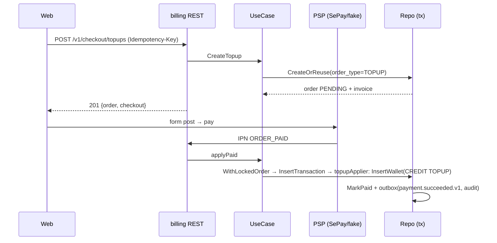
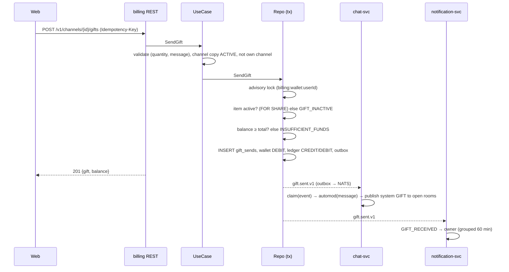

# TSD — Donate bằng vật phẩm: ví, nạp tiền, danh mục vật phẩm, tặng quà

Working Plan: `docs/plans/working/2026-11-27-donate.md` (duyệt 2026-11-27 theo các giả định A1–A8). TSD này chốt hợp đồng;
web (`nexuslive-web`) và admin (`nexuslive-admin`) lấy kiểu dữ liệu và mã lỗi từ §4 và §6.

## 1. Objective

Thêm vào billing-svc ba khả năng:

- **Ví VND:** sổ bút toán append-only theo từng người dùng.
- **Nạp tiền:** một loại order mới `TOPUP`, đi chung pipeline checkout của GĐ6.
- **Quà tặng:** admin quản lý danh mục vật phẩm; viewer dùng số dư ví mua vật phẩm và tặng cho kênh. Creator nhận doanh thu vào
  sổ cái kênh (rút được qua payout). chat-svc hiện dòng quà, notification-svc báo cho creator.

## 2. Scope

**In:**

- billing-svc: migration, entity, repo, usecase, REST, config, CLI `gift seed-demo`, Swagger.
- `pkg/events`; chat-svc; notification-svc (2 template e-mail); Nginx.
- web: ví, nạp tiền, tặng quà, dòng chat, Studio, thông báo.
- admin: danh mục vật phẩm, hiển thị order nạp.
- Tài liệu.

**Out:** như Working Plan §1, gồm:

- rút hoặc hoàn số dư ví, coin;
- Gift Sub, Goal, Leaderboard;
- overlay cho OBS, tặng ẩn danh;
- upload ảnh vật phẩm, admin chỉnh số dư tay.

## 3. Scenarios

### S1 — Nạp tiền

- Given ví 0 ₫, When `POST /v1/checkout/topups {amount:100000}`, rồi trả tiền trên trang fake/SePay, Then:
  - order `orderType=TOPUP` chuyển `PAID`;
  - ví có một bút toán `CREDIT TOPUP 100.000` (gắn `transaction_id` của giao dịch charge);
  - phát `payment.succeeded.v1` (`orderType: TOPUP`, `channelId: ""`, `tier: 0`);
  - notification gửi in-app `TOPUP_SUCCEEDED` kèm e-mail bắt buộc `topup_receipt`.
- IPN trùng → giao dịch đã có (`(psp_ref, type)` unique) → không cộng lần hai. Tiền tới muộn (order đã `EXPIRED`/`CANCELLED`)
  → vẫn cộng (BR-H20).
- Void → `DEBIT TOPUP_VOID` bằng số tiền; số dư có thể âm.



### S2 — Danh mục vật phẩm

- Admin `POST /v1/admin/gift-items {name:"Hoa hồng", price:10000, icon:"rose", active:true, sortOrder:2}` → 201; ghi audit
  `GIFT_ITEM_CREATED`.
- `PATCH` đổi giá → các lần tặng cũ giữ giá cũ (`gift_sends` chụp lại tên, icon, đơn giá).
- `active=false` → vật phẩm biến mất khỏi `GET /v1/gift-items`; tặng vật phẩm này → 409 `GIFT_INACTIVE`.

### S3 — Tặng quà

- Given số dư 100.000 ₫, vật phẩm 10.000 ₫ đang bật, kênh `ACTIVE` không phải của mình, When
  `POST /v1/channels/{id}/gifts {itemId, quantity:5, message:"Chúc stream vui!"}`, Then trong **một** transaction:
  - `gift_sends` (tổng 50.000, phí 2.500);
  - ví `DEBIT GIFT_SPEND 50.000`;
  - sổ cái kênh `CREDIT GIFT_REVENUE 50.000` + `DEBIT PLATFORM_FEE 2.500`;
  - outbox `gift.sent.v1` + audit `GIFT_SENT`.

  Trả 201 `{gift, balance: 50.000}`.
- chat-svc: nếu kênh có phòng chat đang mở (đang live) thì phát đúng một dòng `system` loại `GIFT`. Kênh không live thì không
  có dòng chat, nhưng tiền và thông báo vẫn có (giống dòng sub hiện nay).
- notification-svc: `GIFT_RECEIVED` cho chủ kênh, gộp theo kênh trong 60 phút (như `NEW_SUBSCRIBER`).



### S4 — Thiếu số dư, bấm hai lần

- Tổng > số dư → 409 `INVALID_STATE` (`reason: INSUFFICIENT_FUNDS`, `balance`); không ghi gì.
- Hai lần tặng song song: advisory lock tuần tự hóa; lần sau thấy số dư mới. Trùng `Idempotency-Key` → middleware trả lại đúng
  response của lần đầu (cơ chế sẵn có, như checkout).

## 4. Contracts

### 4.1 SQL — `20261127000002_wallet_gifts`

**up**

```sql
-- Orders: subscription (GĐ6) or wallet top-up.
ALTER TABLE checkout_orders
    ADD COLUMN order_type varchar(12) NOT NULL DEFAULT 'SUBSCRIPTION' CHECK (order_type IN ('SUBSCRIPTION', 'TOPUP')),
    ALTER COLUMN channel_id DROP NOT NULL,
    ALTER COLUMN tier_id DROP NOT NULL,
    ALTER COLUMN sub_action DROP NOT NULL;
ALTER TABLE checkout_orders ADD CONSTRAINT checkout_orders_type_fields CHECK ((order_type = 'SUBSCRIPTION') =
    (channel_id IS NOT NULL AND tier_id IS NOT NULL AND sub_action IS NOT NULL));
-- checkout_orders_one_pending_idx (user_id, channel_id) ignores TOPUP rows (channel NULL): one pending top-up per user.
CREATE UNIQUE INDEX checkout_orders_one_pending_topup_idx ON checkout_orders (user_id)
    WHERE status = 'PENDING' AND order_type = 'TOPUP';

CREATE TABLE gift_items (
    id         uuid        PRIMARY KEY DEFAULT uuidv7(),
    name       varchar(40) NOT NULL CHECK (char_length(name) BETWEEN 1 AND 40),
    price_vnd  bigint      NOT NULL CHECK (price_vnd BETWEEN 1000 AND 5000000),
    icon       varchar(16) NOT NULL,
    active     boolean     NOT NULL DEFAULT true,
    sort_order integer     NOT NULL DEFAULT 0,
    created_at timestamptz NOT NULL DEFAULT now(),
    updated_at timestamptz NOT NULL DEFAULT now()
);
CREATE INDEX gift_items_active_idx ON gift_items (sort_order, created_at) WHERE active;

-- One gift: the item is copied so later edits do not change history.
CREATE TABLE gift_sends (
    id             uuid         PRIMARY KEY DEFAULT uuidv7(),
    user_id        uuid         NOT NULL,
    channel_id     uuid         NOT NULL,
    gift_item_id   uuid         NOT NULL REFERENCES gift_items (id),
    item_name      varchar(40)  NOT NULL,
    icon           varchar(16)  NOT NULL,
    unit_price_vnd bigint       NOT NULL CHECK (unit_price_vnd > 0),
    quantity       smallint     NOT NULL CHECK (quantity BETWEEN 1 AND 99),
    total_vnd      bigint       NOT NULL CHECK (total_vnd = unit_price_vnd * quantity),
    fee_vnd        bigint       NOT NULL CHECK (fee_vnd BETWEEN 0 AND total_vnd),
    message        varchar(200),
    created_at     timestamptz  NOT NULL DEFAULT now()
);
CREATE INDEX gift_sends_channel_idx ON gift_sends (channel_id, created_at DESC);
CREATE INDEX gift_sends_user_idx ON gift_sends (user_id, created_at DESC);

CREATE TABLE wallet_entries (
    id             uuid        PRIMARY KEY DEFAULT uuidv7(),
    user_id        uuid        NOT NULL,
    direction      varchar(6)  NOT NULL CHECK (direction IN ('CREDIT', 'DEBIT')),
    kind           varchar(12) NOT NULL CHECK (kind IN ('TOPUP', 'TOPUP_VOID', 'GIFT_SPEND')),
    amount_vnd     bigint      NOT NULL CHECK (amount_vnd > 0),
    transaction_id uuid        REFERENCES transactions (id),
    gift_send_id   uuid        REFERENCES gift_sends (id),
    created_at     timestamptz NOT NULL DEFAULT now(),
    CHECK (num_nonnulls(transaction_id, gift_send_id) = 1)
);
CREATE INDEX wallet_entries_user_idx ON wallet_entries (user_id, created_at DESC, id DESC);
CREATE UNIQUE INDEX wallet_entries_source_idx ON wallet_entries (COALESCE(transaction_id, gift_send_id), kind);

ALTER TABLE ledger_entries ADD COLUMN gift_send_id uuid REFERENCES gift_sends (id);
ALTER TABLE ledger_entries DROP CONSTRAINT ledger_entries_check;
ALTER TABLE ledger_entries ADD CONSTRAINT ledger_entries_source
    CHECK (num_nonnulls(transaction_id, payout_request_id, gift_send_id) = 1);
ALTER TABLE ledger_entries DROP CONSTRAINT ledger_entries_kind_check;
ALTER TABLE ledger_entries ADD CONSTRAINT ledger_entries_kind_check
    CHECK (kind IN ('SUB_REVENUE', 'PLATFORM_FEE', 'PAYOUT_HOLD', 'PAYOUT_REVERSAL', 'GIFT_REVENUE'));

CREATE TRIGGER wallet_entries_append_only BEFORE UPDATE OR DELETE ON wallet_entries
    FOR EACH ROW EXECUTE FUNCTION forbid_update_delete();
CREATE TRIGGER gift_sends_append_only BEFORE UPDATE OR DELETE ON gift_sends
    FOR EACH ROW EXECUTE FUNCTION forbid_update_delete();
```

Tên `ledger_entries_check` (CHECK cấp bảng không đặt tên ở migration init) đã kiểm trên DB dev: đúng tên này.

**down** (chỉ dùng ở dev):

1. Drop trigger, `wallet_entries`, cột `ledger_entries.gift_send_id`, các dòng sổ cái `GIFT_REVENUE` và phí gắn quà (tạm tắt
   trigger append-only), `gift_sends`, `gift_items`.
2. Xóa order `TOPUP` cùng giao dịch của chúng (tạm tắt trigger của `transactions`).
3. Khôi phục `NOT NULL`, các CHECK cũ, drop `order_type` và index.

Migration này chỉ thêm (không phá dữ liệu cũ): mọi order hiện có nhận `order_type = 'SUBSCRIPTION'`.

### 4.2 Entity (`internal/entity`)

```go
const (
	OrderTypeTopup OrderType = "TOPUP"     // Order.Type() now returns the stored order_type

	LedgerGiftRevenue LedgerKind = "GIFT_REVENUE"

	ReasonInsufficientFunds = "INSUFFICIENT_FUNDS"
	ReasonGiftInactive      = "GIFT_INACTIVE"
)

var ErrGiftSelf = errors.New("cannot gift own channel")

type WalletKind string // TOPUP | TOPUP_VOID | GIFT_SPEND

type WalletEntry struct {
	ID, UserID    string
	Direction     Direction
	Kind          WalletKind
	Amount        int64
	TransactionID *string
	GiftSendID    *string
	CreatedAt     time.Time
	// Read-side joins.
	InvoiceNumber *string
	Gift          *GiftSend
}

type GiftItem struct {
	ID, Name, Icon       string
	Price                int64
	Active               bool
	SortOrder            int
	CreatedAt, UpdatedAt time.Time
}

type GiftSend struct {
	ID, UserID, ChannelID, ItemID, ItemName, Icon string
	UnitPrice, Total, Fee                         int64
	Quantity                                      int
	Message                                       *string
	CreatedAt                                     time.Time
	Channel                                       Channel // read side
}

// Order gains Type OrderType (column). ChannelID / TierID stay strings, "" for a top-up; Channel / Tier are zero.
func GiftIcons() []string // heart, rose, star, fire, clap, cake, diamond, crown, trophy, rocket, car, castle
func NewTopup(amount *int64, min, max int64) (int64, error)            // amount REQUIRED | MIN | MAX
func NewGiftItem(name string, price *int64, icon string) (GiftItem, error) // name LENGTH, price MIN|MAX, icon ENUM
func GiftMessage(s string) (*string, error)                           // trim, ≤200 runes, no control chars; "" → nil
func GiftQuantity(q *int, unit, maxTotal int64) (int, error)           // 1..99, unit·q ≤ maxTotal (quantity MIN|MAX)
```

### 4.3 Repo (`internal/repo/contracts.go`)

```go
OrderRepo.CreateOrReuse(ctx, o entity.Order, rules CreateRules) // signature kept; for TOPUP: no live-sub / tier
	// checks; pending reuse is per user (same amount → reuse, other amount → ORDER_PENDING with details.orderId)

PaymentTx interface {
	// … existing …
	InsertWallet(ctx context.Context, e []entity.WalletEntry) error
}

WalletRepo interface {
	Balance(ctx context.Context, userID string) (int64, error)
	WalletEntries(ctx context.Context, userID string, after *Cursor, limit int) ([]entity.WalletEntry, error)
}

GiftItemRepo interface {
	ActiveGiftItems(ctx context.Context) ([]entity.GiftItem, error)
	GiftItems(ctx context.Context, active *bool) ([]entity.GiftItem, error) // admin, sort_order, created_at
	GiftItem(ctx context.Context, id string) (entity.GiftItem, error)
	CreateGiftItem(ctx context.Context, it entity.GiftItem, out func(entity.GiftItem) []Outbox) (entity.GiftItem, error)
	UpdateGiftItem(ctx context.Context, id string, p GiftItemPatch,
		out func(before, after entity.GiftItem) []Outbox) (entity.GiftItem, error)
}

// GiftItemPatch: nil fields stay.
GiftItemPatch struct { Name *string; Price *int64; Icon *string; Active *bool; SortOrder *int }

GiftRepo interface {
	// SendGift locks the sender's wallet (advisory lock), refuses an inactive item (GIFT_INACTIVE) or a balance
	// below the total (INSUFFICIENT_FUNDS), then writes the gift, the wallet debit, the channel ledger and out().
	SendGift(ctx context.Context, g entity.GiftSend, feeBps int, out func(entity.GiftSend) []Outbox) (entity.GiftSend, int64, error)
}

LedgerRepo.Totals → entity.Totals gains Gifts int64; Gross counts SUB_REVENUE + GIFT_REVENUE.
```

Truy vấn order: `JOIN channels` / `JOIN subscription_tiers` thành `LEFT JOIN` + `COALESCE(...)` cho các cột kênh và tier, để
`scanOrder` giữ nguyên kiểu (chuỗi rỗng / số 0 cho order nạp).

### 4.4 Usecase

```go
// Checkout
CreateTopup(ctx context.Context, userID string, in TopupInput) (entity.Order, entity.Checkout, bool, error)
TopupInput struct { Amount *int64; PaymentMethod *string; IdempotencyKey string }

// Wallet (new)
Wallet(ctx context.Context, userID string) (int64, error)
WalletEntries(ctx context.Context, userID, cursor string, limit int) (WalletPage, error)

// Gifts (new)
GiftItems(ctx context.Context) ([]entity.GiftItem, error)
SendGift(ctx context.Context, userID, channelID string, in GiftInput) (entity.GiftSend, int64, error)
GiftInput struct { ItemID string; Quantity *int; Message string }

// Admin (added)
AdminGiftItems(ctx context.Context, active *bool) ([]entity.GiftItem, error)
CreateGiftItem(ctx context.Context, adminID string, in GiftItemInput) (entity.GiftItem, error)
UpdateGiftItem(ctx context.Context, adminID, id string, in GiftItemPatchInput) (entity.GiftItem, error)
```

**Thanh toán** dùng applier theo `Order.Type()`:

```go
type orderApplier interface {
	Apply(ctx, tx, o, paidAt, txnID, fee) (applied, error) // subscription: sub + SUB_REVENUE/fee; top-up: wallet CREDIT TOPUP
	Void(ctx, tx, o, now, txnID, fee) (voidEffect, error)  // subscription: as today; top-up: wallet DEBIT TOPUP_VOID
}
```

`settle` và `reverse` gọi applier thay vì `subscriptionApplier{}` cứng. Phần ghi sổ cái kênh chuyển vào applier sub; order nạp
không thu phí và không ghi sổ cái kênh.

### 4.5 REST (billing, qua edge)

| Method / path | Auth | Body | 2xx | Lỗi |
| --- | --- | --- | --- | --- |
| `POST /v1/checkout/topups` | user, `Idempotency-Key` | `{amount, paymentMethod?}` | 201/200 `{order, checkout}` | 400, 409 `ORDER_PENDING`/`CONFLICT` |
| `GET /v1/me/wallet` | user | — | `{balance: Money}` | 401 |
| `GET /v1/me/wallet/entries?cursor&limit` | user | — | `Page[WalletEntry]` | 400, 401 |
| `GET /v1/gift-items` | công khai | — | `{items: GiftItem[]}` (chỉ vật phẩm đang bật) | — |
| `POST /v1/channels/{id}/gifts` | user, `Idempotency-Key` | `{itemId, quantity, message?}` | 201 `{gift: GiftSend, balance: Money}` | 400, 403, 404, 409 `INSUFFICIENT_FUNDS`/`GIFT_INACTIVE`, 422 `CANNOT_GIFT_SELF` |
| `GET /v1/admin/gift-items?active=` | admin | — | `{items: AdminGiftItem[]}` | 401, 403 |
| `POST /v1/admin/gift-items` | admin | `{name, price, icon, active?, sortOrder?}` | 201 `AdminGiftItem` | 400, 403 |
| `PATCH /v1/admin/gift-items/{id}` | admin | các trường tùy chọn | 200 `AdminGiftItem` | 400, 403, 404 |

DTO:

```ts
GiftItem      { id, name, price: Money, icon, sortOrder }
AdminGiftItem { ...GiftItem, active, createdAt, updatedAt }
GiftSend      { id, item: { id, name, icon }, quantity, unitPrice: Money, total: Money, message, channel: ChannelRef, createdAt }
WalletEntry   { id, kind: 'TOPUP'|'TOPUP_VOID'|'GIFT_SPEND', direction, amount: Money, createdAt,
                invoiceNumber: string|null, gift: { item: {name, icon}, quantity, channel: ChannelRef } | null }
Order         // existing; adds orderType: 'SUBSCRIPTION'|'TOPUP'; channelId, channel, tier become nullable
              // (null for TOPUP); `kind` stays the sub action (NEW / RENEW), null for TOPUP
Summary       // adds gifts: Money; gross includes gift revenue
LedgerEntry   // kind may be GIFT_REVENUE; source "GIFT"
```

### 4.6 Sự kiện (`pkg/events`)

```go
TypeGiftSent = "gift.sent.v1"

type GiftSent struct {
	GiftSendID string    `json:"giftSendId"`
	UserID     string    `json:"userId"`
	ChannelID  string    `json:"channelId"`
	ItemID     string    `json:"itemId"`
	ItemName   string    `json:"itemName"`
	Icon       string    `json:"icon"`
	Quantity   int       `json:"quantity"`
	Total      int64     `json:"total"`
	Message    *string   `json:"message"`
	SentAt     time.Time `json:"sentAt"`
}

// PaymentSucceeded / PaymentFailed / PaymentVoided gain:
OrderType string `json:"orderType"` // "SUBSCRIPTION" | "TOPUP"; absent = SUBSCRIPTION. TOPUP: channelId "", tier 0.
```

### 4.7 chat-svc

- Consumer `gift.sent.v1` (UUID của `userId`, `channelId`, `giftSendId`; sai → `ErrSkip`).
- `announceGift`: lấy các phòng đang mở của kênh (không có → xong); claim event id (idempotent); đọc luật automod của kênh
  (`Terms` + `BlockLinks`), `Check(message, Standing{})` lỗi thì bỏ lời nhắn.
- Phát `system` payload:

  ```json
  {"type": "GIFT", "text": "@an tặng 5 × Hoa hồng (50.000 ₫): Chúc stream vui!",
   "meta": {"userId": "…", "username": "an", "itemName": "Hoa hồng", "icon": "rose", "quantity": 5, "total": 50000,
            "message": "Chúc stream vui!"}}
  ```

  `meta.message = null` khi lời nhắn bị ẩn hoặc không có.
- Consumer `payment.*`: không đổi (khóa là `userId`, `orderId`), order nạp đi qua bình thường.

### 4.8 notification-svc

- `gift.sent.v1` → chủ kênh (lấy từ bản sao kênh); type `SUBSCRIPTION`, kind `GIFT_RECEIVED`.
  - payload `{kind, giftSendId, channelId, lastSender{id, username, displayName}, itemName, icon, quantity, total}`;
  - link `/studio/monetization`; gộp `GroupKey "gift:" + channelId` trong 60 phút (`deliverSmall`); chỉ in-app.
- `payment.*` với `orderType = TOPUP` (kiểm trước tier/kênh):

  | Event | Kind | Kênh gửi | Template |
  | --- | --- | --- | --- |
  | `payment.succeeded.v1` | `TOPUP_SUCCEEDED` | in-app + e-mail bắt buộc | `topup_receipt` (vi/en; Invoice, Amount, Method, When, Link) |
  | `payment.failed.v1` | `TOPUP_FAILED` | in-app | — |
  | `payment.voided.v1` | `TOPUP_VOIDED` | in-app | — |

  Link `/wallet`. Order sub đi đường cũ.

### 4.9 Config, CLI, edge

- Config: `BILLING_TOPUP_MIN` (10000), `BILLING_TOPUP_MAX` (5000000), `BILLING_GIFT_MAX_TOTAL` (5000000). Có default, không bắt
  buộc. Thêm vào `.env.example` và `docker-compose.yml`.
- CLI `billing gift seed-demo`: tạo 6 vật phẩm nếu danh mục rỗng (Tim 1.000, Hoa hồng 10.000, Bánh kem 20.000, Kim cương
  50.000, Vương miện 100.000, Tên lửa 500.000).
- Nginx:
  - `^/v1/me/(subscriptions|payments|wallet)(/|$)` → billing;
  - `^/v1/admin/(payouts|checkout-orders|gift-items)(/|$)` → billing;
  - mới `^/v1/gift-items$` → billing;
  - mới `^/v1/channels/[^/]+/gifts$` → billing, đặt trước `^/v1/channels(/|$)`.

## 5. Key technical details

- **Bất biến:** số dư ví = `Σ(CREDIT − DEBIT)` của `wallet_entries`. Mỗi lần tặng có đúng 1 `GIFT_SPEND` = `total` và đúng 1
  `GIFT_REVENUE` = `total`, cộng 1 `PLATFORM_FEE` = `fee` khi `fee > 0`. Mỗi giao dịch charge của order nạp có đúng 1 `TOPUP`
  (unique `wallet_entries_source_idx`).
- **Khóa:** gửi quà dùng `pg_advisory_xact_lock(hashtextextended('billing:wallet:' || user_id, 0))`; nạp tiền chỉ cộng, không
  cần khóa ví. Order nạp dùng chung khóa checkout theo user hiện có.
- **Phí:** `entity.Fee(total, BILLING_PLATFORM_FEE_BPS)` lúc tặng, lưu vào `gift_sends.fee_vnd`. Order nạp không có phí
  (`ChargeFee` = 0).
- **Ví âm:** chỉ xảy ra khi void order nạp. Không chặn void; số dư < 0 khiến mọi lần tặng sau bị `INSUFFICIENT_FUNDS`.
- **Kênh:** đọc bản sao `channels` của billing (đã có, BR-H35). Kênh không có trong bản sao → 404.
- **Audit:** `GIFT_ITEM_CREATED`, `GIFT_ITEM_UPDATED` (meta before/after), `GIFT_SENT` (meta channel, item, quantity, total).
  Order nạp dùng các audit order sẵn có.
- **Metrics:** `billing_gifts_total`, `billing_gift_vnd_total` (counter); `billing_orders_total` đã có, giữ label hiện tại.

## 6. Error handling

| Case | Sentinel | HTTP | Code (details) |
| --- | --- | --- | --- |
| amount / quantity / message / name / price / icon sai | `Invalid(field, REQUIRED\|MIN\|MAX\|LENGTH\|FORMAT\|ENUM)` | 400 | `VALIDATION_FAILED` |
| Thiếu số dư | `StateError(ReasonInsufficientFunds, "balance", n)` | 409 | `INVALID_STATE` (`INSUFFICIENT_FUNDS`, `balance`) |
| Vật phẩm đã tắt | `StateError(ReasonGiftInactive)` | 409 | `INVALID_STATE` (`GIFT_INACTIVE`) |
| Tặng kênh của mình | `ErrGiftSelf` | 422 | `CANNOT_GIFT_SELF` |
| Kênh bị khóa | `ErrChannelSuspended` | 403 | `CHANNEL_SUSPENDED` |
| Kênh / vật phẩm không có, id sai | `ErrNotFound` | 404 | `NOT_FOUND` |
| Đã có order nạp chờ với số tiền khác | `StateError(ReasonOrderPending, "orderId", id)` | 409 | `INVALID_STATE` (`ORDER_PENDING`) |
| Quá giới hạn order chờ | `ErrPendingLimit` | 409 | `CONFLICT` |
| Consumer: payload sai | — | — | `ErrSkip` |
| Consumer: lỗi DB tạm thời | — | — | redeliver |

## 7. Compatibility & rollback

- **API:** chỉ thêm route và trường. Thay đổi cần client cập nhật cùng đợt:
  - `Order.channel`, `channelId`, `tier`, `kind` thành nullable (chỉ null với order nạp; client cũ chỉ gặp nếu user đã nạp);
  - Studio `gross` gồm cả doanh thu quà.
- **Sự kiện:** `orderType` là trường thêm, thiếu = `SUBSCRIPTION`. `gift.sent.v1` mới.
- **Thứ tự deploy:** migration → billing → chat, notification → Nginx → web, admin. Notification bản cũ nhận `payment.*` của
  order nạp sẽ `ErrSkip` (`channelId` rỗng) — không lỗi, chỉ không có biên nhận. Vì vậy deploy notification ngay sau billing.
- **Rollback:** migration down một bước (dev, xóa dữ liệu ví và quà) + image cũ; gỡ route Nginx.

### 7.1 Client (khảo sát code 2026-11-27)

**Web (`nexuslive-web/src`):**

- **Order:**
  - `features/billing/types.ts` khai `Order.channel`, `tier`, `kind` không null.
  - `lib/parse.ts` `parseOrder` **tự điền tier mặc định** ("Tier 1"), nên order nạp sẽ hiện như sub Tier 1 giả. Phải đọc
    `orderType` và để `channel` / `tier` / `kind` là `null`.
  - Sửa theo: `pages/redirect-page.tsx`, `pages/result-page.tsx` + `lib/state.ts`, `pages/payments-page.tsx` (`planLabel`,
    hàng desktop và thẻ mobile).
- **Ví:**
  - Badge số dư cạnh `NotificationBell` trong `app/shell/top-bar.tsx`.
  - Route lazy `/wallet` trong nhóm `RequireAuth` của `app/router.tsx`, đặt trên `/:handle`.
  - Query key nằm dưới prefix `billingKeys.account(userId)`, để `invalidateAccountBilling` làm mới số dư sau thanh toán.
- **Nạp tiền:** dùng lại `MethodStep` / `ConfirmStep`, `useCheckoutConfig`, `lib/idempotency.ts`, `lib/checkout-form.ts` và
  luồng `/checkout/redirect` → `/checkout/result`. Bước chọn tier không dùng; thay bằng bước chọn mức tiền.
- **Tặng quà:**
  - Nút cạnh `EmotePicker` trong `features/chat/components/chat-input.tsx`, và ở header kênh (`features/channels/profile-page.tsx`).
  - Bảng icon là một `Record<GiftIcon, LucideIcon>` cố định (lucide có sẵn, không thêm dependency).
- **Dòng chat:** `features/chat/lib/parse.ts` `parseSystemEvent` thêm loại `gift`; `lib/chat-state.ts` thêm notice `gift`;
  `components/chat-message.tsx` `NoticeText` (`data-testid="chat-gift-notice"`).
- **Studio:** `LedgerKind` (types + danh sách cứng trong `parseLedgerEntry`, kind lạ bị bỏ) thêm `GIFT_REVENUE`, source
  `GIFT`; `ledgerLabel`; `overview-tab.tsx` thêm `gifts`.
- **Thông báo:** `features/notifications/{types,lib/parse,lib/sentence,components/notification-text}` thêm `GIFT_RECEIVED`,
  `TOPUP_*`.
- **i18n:** namespace `billing` / `chat` / `studio` / `notifications`.
- **Test:** vitest `src/**/*.test.ts`; E2E mới `e2e/gift.spec.ts` (helper `topupOverApi` theo mẫu `subscribeOverApi`).

**Admin (`nexuslive-admin/src`):**

- **Menu:** `app/shell/nav-items.ts`, nhóm `nav.billingGroup`, thêm `/gift-items`; route trong `app/router.tsx`.
- **Trang:** theo mẫu `payouts-page.tsx` (`AdminPage`, `DataTable`). Dialog tạo/sửa theo `admin-action-dialog.tsx`
  (react-hook-form + zod có sẵn). Admin chưa có `ui/dialog.tsx`: chép từ web, ghi ngày chép (quy tắc AGENTS).
- **Review order:** `features/payment-review` **không parse** response (`orders-api.ts` chỉ ép kiểu), nên `o.tier.name` /
  `o.channel.displayName` sẽ **crash** với order nạp. Ở `payment-review-page.tsx` và `order-detail.tsx` phải xử lý `null`.
- **Audit:** `features/audit/types.ts` + `locales/*/audit.json` thêm `GIFT_ITEM_CREATED`, `GIFT_ITEM_UPDATED`, `GIFT_SENT`.

## 8. Estimation

| WP | Nội dung | Ngày |
| --- | --- | --- |
| WP1 | Dữ liệu, entity | 0,5 |
| WP2 | Ví, nạp tiền | 1 |
| WP3 | Danh mục vật phẩm | 0,5 |
| WP4 | Tặng quà | 0,5 |
| WP5 | REST, edge, sự kiện, chat, thông báo | 1 |
| WP6 | Web | 1,5 |
| WP7 | Admin | 1 |
| WP8 | Tài liệu | 0,5 |

## 9. References

Working Plan cùng basename; PRD FR-MN-04, FR-MN-06; NXL-H; ADR-009, ADR-015; `2026-11-27-payout-settlement`;
`services/billing/internal/usecase/billing/payments.go` (`settle`, `reverse`, `subscriptionApplier`),
`internal/repo/persistent/orders.go`, `services/chat/internal/usecase/rooms/entitlements.go` (`announceSub`),
`services/chat/internal/entity/automod.go`, `services/notification/internal/usecase/notify/billing.go`.

## 10. Document control

| Version | Date | Change |
| --- | --- | --- |
| 1.0 | 2026-11-27 | Initial |
| 1.1 | 2026-11-27 | As shipped (§11) |

## 11. As shipped (v1.1)

Khác với 1.0, không đổi hợp đồng REST, sự kiện hay schema:

- **Repo:** `GiftItemRepo` và `GiftRepo` gộp làm một `GiftRepo`. `SendGift(ctx, g, rules GiftRules{FeeBps, MaxTotal}, out)`
  khóa vật phẩm, kiểm tổng tiền và số dư trong cùng transaction (`priceGift`).
- **Tên method:** số dư ví là `WalletBalance`, vì `Repo.Balance` đã là số dư của kênh.
- **Quantity:** `GiftInput.Quantity` có kiểu `*int64`. JSON không phải số nguyên → `quantity: REQUIRED`.
- **chat-svc:** hàm dùng chung `announceOnce` (dòng sub và dòng quà); lời nhắn lọc qua `TermSource` (moderation usecase, có
  cache) và `SettingsRepo.BlockLinks`.
- **Metrics:** không thêm `billing_gifts_total` / `billing_gift_vnd_total` (§5). Đếm được qua audit `GIFT_SENT` và bảng
  `gift_sends`; để làm sau.
- **Nginx:** route quà dùng chung location với `subscription-tiers`: `^/v1/channels/[^/]+/(subscription-tiers|gifts)$`.
