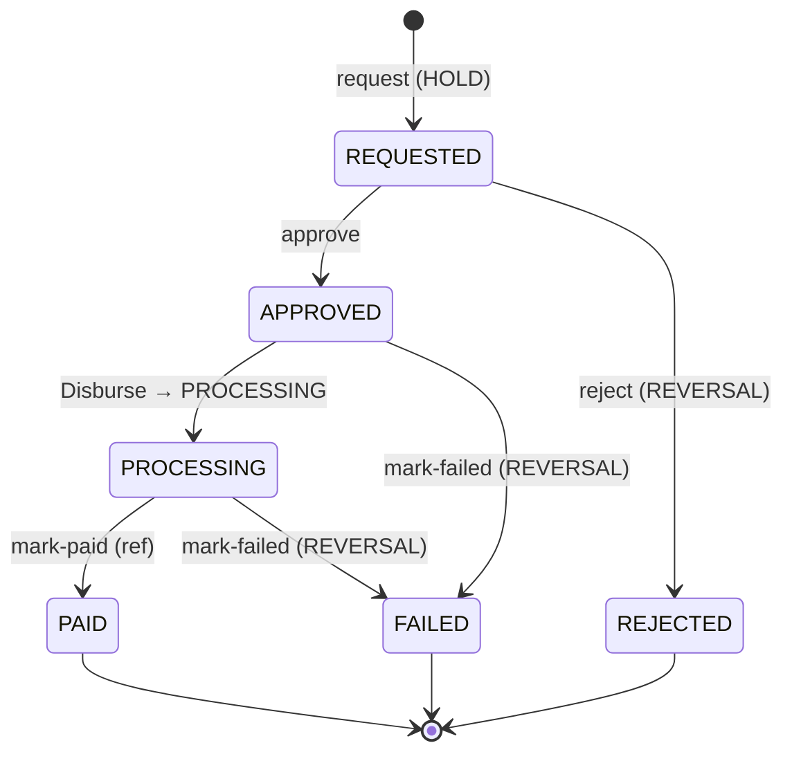
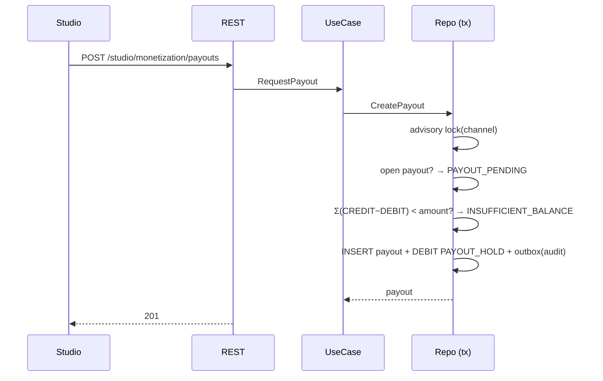
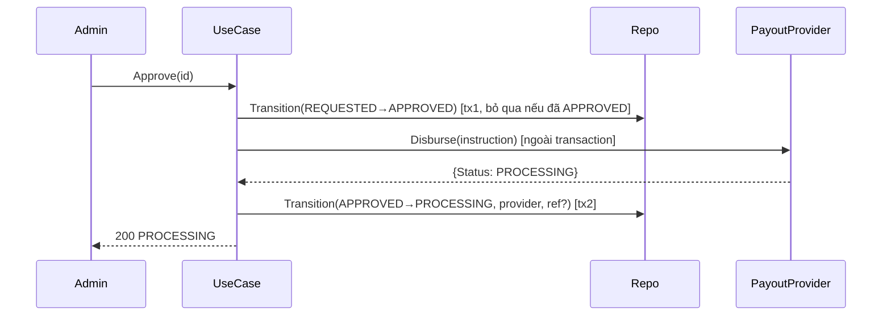

# TSD — Rút tiền cho streamer: vòng đời chi trả, sổ cái hai pha, PayoutProvider

Working Plan: `docs/plans/working/2026-11-27-payout-settlement.md` (Approved 2026-11-27). TSD này chốt hợp đồng; web
(`nexuslive-web`) và admin (`nexuslive-admin`) lấy kiểu/mã lỗi từ §4 và §6.

## 1. Objective

Tách "admin duyệt" khỏi "đã chi tiền". Payout có vòng đời `REQUESTED → APPROVED → PROCESSING → PAID` với hai nhánh thoát
`REJECTED` / `FAILED`. Tiền bị giữ bằng một bút toán `DEBIT/PAYOUT_HOLD` ngay khi gửi yêu cầu và được hoàn bằng
`CREDIT/PAYOUT_REVERSAL` khi bị từ chối hoặc thất bại. Bước chi tiền nằm sau interface `PayoutProvider` (bản `manual`).

## 2. Scope

**In:** billing-svc (migration, entity, repo, usecase, REST, provider `manual`, config, metrics, swagger), `pkg/events`
(3 sự kiện), notification-svc (3 kind + 1 template e-mail), nexuslive-web (Studio → Monetization), nexuslive-admin
(payouts), tài liệu (NXL-H, ADR-015, DL-23, data-model, features, api/README).

**Out:** rail ngân hàng thật, webhook/job đối soát tự động, KYC/thuế, phí rút, ngoại tệ, đổi badge `pending-count`
(vẫn chỉ đếm `REQUESTED`).

## 3. Scenarios

### Máy trạng thái



`entity.Payout.CanMoveTo(to)` là nguồn sự thật duy nhất cho bảng cạnh này (repo gọi nó dưới `FOR UPDATE`).

### S1 — Gửi yêu cầu (giữ tiền ngay)

- Given số dư khả dụng = 100k, When creator `POST /v1/studio/monetization/payouts` 100k, Then 201 `REQUESTED`; sổ cái có
  một `DEBIT/PAYOUT_HOLD` 100k; khả dụng = 0; yêu cầu thứ hai → 409 `INVALID_STATE` reason `PAYOUT_PENDING`.



### S2 — Duyệt = gọi provider, chưa phải đã chi

- Given `REQUESTED`, When admin approve, Then `APPROVED` rồi `PROCESSING` (`provider='MANUAL'`), không thêm bút toán.
- Provider lỗi: payout ở lại `APPROVED`, trả 500 `INTERNAL_ERROR` (v1.1, xem §8.7); admin bấm approve lại → chỉ gọi lại `Disburse`
  (approve hợp lệ từ `REQUESTED` hoặc `APPROVED`). `Instruction.PayoutID` là khóa idempotent cho provider thật sau này.



Gọi provider ngoài transaction để không giữ khóa hàng trong lúc chờ mạng. `Result.Status` = `PAID` (cần `Ref`) hoặc
`FAILED` (cần lý do) được hỗ trợ ngay trong tx2 để provider đồng bộ sau này không phải đổi usecase.

### S3 — Đánh dấu đã chi

- Given `PROCESSING`, When `POST /v1/admin/payouts/:id/mark-paid {reference:"FT123"}`, Then `PAID`, `provider_ref`,
  `paid_at`, `settled_*`; không bút toán mới; outbox `payout.paid.v1` + audit `PAYOUT_PAID`.

### S4 — Thất bại / từ chối (hoàn tiền)

- Given `APPROVED` hoặc `PROCESSING`, When `mark-failed {reason}`, Then `FAILED`, một `CREDIT/PAYOUT_REVERSAL`; khả dụng hồi
  đủ; outbox `payout.failed.v1`.
- Given `REQUESTED`, When `reject {reason}`, Then `REJECTED` + reversal; outbox `payout.rejected.v1`.

```mermaid
sequenceDiagram
  participant A as Admin
  participant H as REST
  participant U as UseCase
  participant R as Repo (tx)
  A->>H: POST /admin/payouts/:id/mark-failed
  H->>U: MarkFailed(reason)
  U->>R: Transition(→FAILED)
  R->>R: SELECT … FOR UPDATE; CanMoveTo? else PAYOUT_STATE
  R->>R: UPDATE payout; INSERT CREDIT PAYOUT_REVERSAL
  R->>R: outbox(payout.failed.v1, audit)
  H-->>A: 200 FAILED
```

### S5 — Bấm hai lần / sai trạng thái

- mark-paid trên `REQUESTED`/`APPROVED`/`PAID`/… → 409 `INVALID_STATE` reason `PAYOUT_STATE`; lần bấm thứ hai sau khi đã
  chuyển cũng nhận 409, không ghi thêm bút toán hay sự kiện (UI refetch). Unique index chặn reversal thứ hai ở mức DB.

## 4. Contracts

### 4.1 SQL — `20261127000001_payout_settlement`

**up**

```sql
ALTER TABLE payout_requests DROP CONSTRAINT payout_requests_status_check;
ALTER TABLE payout_requests ADD CONSTRAINT payout_requests_status_check
    CHECK (status IN ('REQUESTED', 'APPROVED', 'PROCESSING', 'PAID', 'REJECTED', 'FAILED'));
ALTER TABLE payout_requests
    ADD COLUMN provider       varchar(16) CHECK (provider IN ('MANUAL')),
    ADD COLUMN provider_ref   varchar(64),
    ADD COLUMN paid_at        timestamptz,
    ADD COLUMN settled_by     uuid,
    ADD COLUMN settled_at     timestamptz,
    ADD COLUMN failure_reason varchar(500);
-- data: APPROVED of GĐ6 already debited the money → PAID (before the constraints below)
UPDATE payout_requests SET status = 'PAID', provider = 'MANUAL', provider_ref = 'LEGACY', paid_at = reviewed_at,
    settled_by = reviewed_by, settled_at = reviewed_at WHERE status = 'APPROVED';
ALTER TABLE payout_requests
    ADD CONSTRAINT payout_requests_paid CHECK ((status = 'PAID') = (paid_at IS NOT NULL)
        AND (status <> 'PAID' OR (provider_ref IS NOT NULL AND provider IS NOT NULL))),
    ADD CONSTRAINT payout_requests_processing CHECK (status <> 'PROCESSING' OR provider IS NOT NULL),
    ADD CONSTRAINT payout_requests_failure CHECK ((status = 'FAILED') = (failure_reason IS NOT NULL)
        AND (failure_reason IS NULL OR char_length(failure_reason) >= 10)),
    ADD CONSTRAINT payout_requests_settled CHECK ((status IN ('PAID', 'FAILED')) = (settled_at IS NOT NULL)
        AND (settled_at IS NULL) = (settled_by IS NULL));
DROP INDEX payout_requests_one_open_idx;
CREATE UNIQUE INDEX payout_requests_one_open_idx ON payout_requests (channel_id)
    WHERE status IN ('REQUESTED', 'APPROVED', 'PROCESSING');

ALTER TABLE ledger_entries DROP CONSTRAINT ledger_entries_kind_check;
-- Rename PAYOUT → PAYOUT_HOLD (same meaning, same sign). The append-only trigger is lifted for this statement only.
ALTER TABLE ledger_entries DISABLE TRIGGER ledger_entries_append_only;
UPDATE ledger_entries SET kind = 'PAYOUT_HOLD' WHERE kind = 'PAYOUT';
ALTER TABLE ledger_entries ENABLE TRIGGER ledger_entries_append_only;
ALTER TABLE ledger_entries ADD CONSTRAINT ledger_entries_kind_check
    CHECK (kind IN ('SUB_REVENUE', 'PLATFORM_FEE', 'PAYOUT_HOLD', 'PAYOUT_REVERSAL'));
-- REQUESTED of GĐ6 had no ledger row (the balance subtracted them as "pending") → backfill the hold
INSERT INTO ledger_entries (channel_id, payout_request_id, direction, kind, amount_vnd, created_at)
    SELECT channel_id, id, 'DEBIT', 'PAYOUT_HOLD', amount_vnd, created_at FROM payout_requests WHERE status = 'REQUESTED';
-- at most one hold and one reversal per payout (double reversal is impossible even under a race)
CREATE UNIQUE INDEX ledger_entries_payout_kind_idx ON ledger_entries (payout_request_id, kind)
    WHERE payout_request_id IS NOT NULL;
```

**down** (dev rollback; về đúng mô hình GĐ6):

1. Gỡ trigger tạm; xóa `PAYOUT_REVERSAL` và các `PAYOUT_HOLD` của payout `REQUESTED`/`REJECTED`/`FAILED` (net 0 hoặc mô hình
   cũ tính bằng "pending"); đổi `PAYOUT_HOLD` còn lại → `PAYOUT`; bật lại trigger.
2. `PROCESSING`, `PAID` → `APPROVED`; `FAILED` → `REJECTED` (`reject_reason = failure_reason`).
3. Drop index/constraint/cột mới; khôi phục CHECK status 3 giá trị, CHECK kind cũ, `one_open_idx` cũ.

### 4.2 Entity (`internal/entity`)

```go
const (
	PayoutProcessing PayoutStatus = "PROCESSING"
	PayoutPaid       PayoutStatus = "PAID"
	PayoutFailed     PayoutStatus = "FAILED"

	LedgerPayoutHold     LedgerKind = "PAYOUT_HOLD"     // replaces LedgerPayout
	LedgerPayoutReversal LedgerKind = "PAYOUT_REVERSAL"

	ReasonPayoutState = "PAYOUT_STATE" // details.reason of INVALID_STATE
)

type Payout struct { /* existing fields */
	Provider      *string
	ProviderRef   *string
	PaidAt        *time.Time
	SettledBy     *string
	SettledAt     *time.Time
	FailureReason *string
}

func (p Payout) CanMoveTo(to PayoutStatus) bool // the state table of §3
func (s PayoutStatus) Open() bool               // REQUESTED | APPROVED | PROCESSING
func PayoutReference(s string) (string, error)  // trim, ^[A-Za-z0-9._/-]{4,64}$ → Invalid("reference", FORMAT)
// mark-failed reason reuses AdminReason (10–500 after trim), like reject.
```

### 4.3 Repo (`internal/repo/contracts.go`)

```go
LedgerRepo interface {
	// Balance: available = Σ CREDIT − Σ DEBIT (holds included); held = Σ amount of open payouts.
	Balance(ctx context.Context, channelID string) (available, held int64, err error) // signature kept, meaning changed
}

// PayoutMove is one state change; the repo fills the columns of the target status.
type PayoutMove struct {
	To       entity.PayoutStatus
	ActorID  string
	At       time.Time
	Reason   *string // REJECTED, FAILED
	Provider *string // PROCESSING (and PAID/FAILED straight from a synchronous provider)
	Ref      *string // PAID
}

PayoutRepo interface {
	CreatePayout(...)                     // unchanged signature; now also inserts DEBIT PAYOUT_HOLD
	ForChannel(...); ListPayouts(...); Payout(...); CountRequested(...) // unchanged
	// Move locks the row, refuses a move CanMoveTo forbids (StateError PAYOUT_STATE) and writes the
	// CREDIT PAYOUT_REVERSAL on REJECTED / FAILED, all in one transaction with out().
	Move(ctx context.Context, id string, m PayoutMove, out func(entity.Payout) []Outbox) (entity.Payout, error)
}
```

`Review` bị xóa (thay bằng `Move`). `balance()` mới:

```sql
SELECT (SELECT COALESCE(sum(CASE WHEN direction = 'CREDIT' THEN amount_vnd ELSE -amount_vnd END), 0)
          FROM ledger_entries WHERE channel_id = $1),
       (SELECT COALESCE(sum(amount_vnd), 0) FROM payout_requests
          WHERE channel_id = $1 AND status IN ('REQUESTED', 'APPROVED', 'PROCESSING'))
```

`payoutAllowed` chỉ so `available` (không trừ pending nữa) và kiểm "có payout mở" theo 3 trạng thái.

### 4.4 PayoutProvider (`internal/repo/provider`)

```go
const NamePayoutManual = "MANUAL" // payout_requests.provider

// PayoutProvider moves the money of an approved payout (ADR-015). Disburse must be idempotent on PayoutID.
type PayoutProvider interface {
	Name() string
	Disburse(ctx context.Context, in PayoutInstruction) (PayoutResult, error) // entity.ErrProviderUnavailable
}

type PayoutInstruction struct {
	PayoutID string
	Code     string // PO-0012, the transfer description
	Amount   int64
	Account  entity.BankAccount
}

type PayoutResult struct {
	Status entity.PayoutStatus // PROCESSING | PAID | FAILED
	Ref    *string
	Reason *string
}
```

`provider/manual`: trả `{Status: PROCESSING}`, không gọi mạng. Config `BILLING_PAYOUT_PROVIDER` (`envDefault:"manual"`, chỉ
nhận `manual`, `ErrPayoutProvider` nếu khác), thêm vào `.env.example` và `docker-compose.yml`.

### 4.5 Usecase (`internal/usecase/contracts.go` — `Admin`)

```go
Approve(ctx context.Context, adminID, id string) (AdminPayout, error)                // REQUESTED|APPROVED → PROCESSING
Reject(ctx context.Context, adminID, id, reason string) (AdminPayout, error)         // unchanged signature
MarkPaid(ctx context.Context, adminID, id, reference string) (AdminPayout, error)    // new
MarkFailed(ctx context.Context, adminID, id, reason string) (AdminPayout, error)     // new
AdminPayouts(...)  // status filter: "" = REQUESTED, ALL, or any of the 6 statuses
```

`AdminPayout.Balance` = available + held, `.Available` = available. Studio `Summary`: `balance` = available + held,
`available` = available, `pendingPayout` = held (giữ nguyên tên trường JSON).

### 4.6 REST (billing-svc, qua edge `/v1/...` — prefix `/v1/admin/payouts` đã có route Nginx)

| Method / path | Body | 200 | Lỗi |
| --- | --- | --- | --- |
| `POST /v1/admin/payouts/:id/approve` | — | `AdminPayout` (`PROCESSING`) | 404, 409 `INVALID_STATE`/`PAYOUT_STATE`, 500 nếu provider lỗi |
| `POST /v1/admin/payouts/:id/reject` | `{reason}` 10–500 | `AdminPayout` (`REJECTED`) | 400 `VALIDATION_FAILED`, 404, 409 |
| `POST /v1/admin/payouts/:id/mark-paid` | `{reference}` 4–64, `[A-Za-z0-9._/-]` | `AdminPayout` (`PAID`) | 400, 404, 409 |
| `POST /v1/admin/payouts/:id/mark-failed` | `{reason}` 10–500 | `AdminPayout` (`FAILED`) | 400, 404, 409 |
| `GET /v1/admin/payouts?status=` | — | `Page[AdminPayout]` | 400 nếu status ngoài 6 giá trị + `ALL` |

Response `Payout` (studio + admin) thêm các trường, không đổi/xóa trường cũ:

```json
{
  "status": "REQUESTED | APPROVED | PROCESSING | PAID | REJECTED | FAILED",
  "provider": "MANUAL",
  "providerRef": "FT123",
  "failureReason": null,
  "paidAt": "2026-11-27T10:00:00Z",
  "settledAt": "2026-11-27T10:00:00Z"
}
```

`AdminPayout` thêm `settledBy: {id} | null`. Ledger entry `kind` có thể là `PAYOUT_HOLD`, `PAYOUT_REVERSAL` (không còn
`PAYOUT`); `source` của hai kind này là `PAYOUT`.

### 4.7 Sự kiện (`pkg/events`)

```go
TypePayoutPaid     = "payout.paid.v1"
TypePayoutFailed   = "payout.failed.v1"
TypePayoutRejected = "payout.rejected.v1"

// PayoutClosed is the payload of payout.paid / failed / rejected.v1.
type PayoutClosed struct {
	PayoutID  string  `json:"payoutId"`
	Code      string  `json:"code"`
	ChannelID string  `json:"channelId"`
	Amount    int64   `json:"amount"`
	Reference *string `json:"reference"` // paid
	Reason    *string `json:"reason"`    // failed, rejected
}
```

Outbox aggregate `payout`, cùng transaction với `Move`.

### 4.8 notification-svc

- Thêm 3 type vào `SourceTypes()` và route `on(...)` (decode `payoutId`, `channelId` là UUID, sai → `ErrSkip`).
- Người nhận = `owner_id` từ bản sao channel (như `NewSubscriber`); không có bản sao → suppress + log.
- Notification type **`SUBSCRIPTION`** (nhóm thanh toán hiện có), `payload.kind` = `PAYOUT_PAID` | `PAYOUT_FAILED` |
  `PAYOUT_REJECTED`, `link = /studio/monetization`. Không thêm type mới để khỏi migration CHECK `type` và không đụng thứ
  tự byte của unsubscribe token.
- E-mail: một template `payout_update` (vi/en × txt/html) rẽ nhánh theo `Kind`; `mandatory: true` như biên nhận thanh toán
  (thông báo về tiền của creator).
- Idempotent theo event id (cơ chế `uc.one` sẵn có).

## 5. Key technical details

- **Transaction & khóa:** `CreatePayout` giữ advisory lock theo channel như cũ; `Move` dùng `SELECT … FOR UPDATE`. Unique
  index `ledger_entries_payout_kind_idx` là lưới an toàn cuối cho "≤ 1 hold, ≤ 1 reversal / payout".
- **Bất biến:** khả dụng = `Σ(CREDIT − DEBIT)`; mỗi payout có đúng 1 hold; payout `REJECTED`/`FAILED` có đúng 1 reversal,
  các trạng thái khác có 0. Repo test kiểm cả ba sau mỗi transition.
- **Append-only:** chỉ migration tạm tắt trigger cho một câu `UPDATE` rename kind; code runtime không bao giờ sửa sổ cái.
- **Metrics:** `billing_payouts_total{status}` nhận thêm `PROCESSING`, `PAID`, `FAILED`.
- **Audit:** `PAYOUT_APPROVED`, `PAYOUT_PROCESSING` (meta `provider`), `PAYOUT_PAID` (meta `reference`), `PAYOUT_FAILED`,
  `PAYOUT_REJECTED` — đều qua `payoutAudit`.

## 6. Error handling

| Case | Sentinel | HTTP | Code (details) |
| --- | --- | --- | --- |
| Chuyển trạng thái sai (gồm bấm lần hai) | `StateError(ReasonPayoutState)` | 409 | `INVALID_STATE` (`reason: PAYOUT_STATE`) |
| Có payout mở | `StateError(ReasonPayoutPending)` | 409 | `INVALID_STATE` (`reason: PAYOUT_PENDING`) |
| Không đủ khả dụng | `StateError(ReasonInsufficientBalance)` | 409 | `INVALID_STATE` (`reason: INSUFFICIENT_BALANCE`, `available`) |
| `reference` / `reason` sai | `Invalid(field, FORMAT/LENGTH)` | 400 | `VALIDATION_FAILED` |
| Provider lỗi khi approve | lỗi bọc từ `Disburse` | 500 | `INTERNAL_ERROR` (payout ở lại `APPROVED`) |
| id sai / không có | `ErrNotFound` | 404 | `NOT_FOUND` |
| Event consumer: payload sai | — | — | `ErrSkip` |
| Event consumer: lỗi DB/tạm thời | — | — | retry (redeliver) |

## 7. Compatibility & rollback

- **API:** chỉ thêm trường/route. Thay đổi ngữ nghĩa: `approve` trả `PROCESSING` thay vì `APPROVED`; ledger không còn kind
  `PAYOUT` (thành `PAYOUT_HOLD`); `balance` = khả dụng + đang giữ. Web/admin cập nhật cùng đợt (WP6/WP7).
- **Thứ tự triển khai:** migration → billing-svc → notification-svc → web/admin. Notification chạy bản cũ vẫn an toàn (không
  subscribe 3 subject mới).
- **Rollback:** `make nxl-migrate-down` một bước (down §4.1) + image billing cũ. Down xóa hold/reversal của payout không còn
  mở — chỉ dùng ở dev.

## 8. Lệch so với Working Plan (cần duyệt)

1. **Mã lỗi:** plan viết code mới `PAYOUT_STATE` (409) và validation 422. Code billing dùng `409 INVALID_STATE` +
   `details.reason` (như `PAYOUT_PENDING`, `INSUFFICIENT_BALANCE`) và `400 VALIDATION_FAILED`. TSD theo code:
   `INVALID_STATE` + `reason: PAYOUT_STATE`, validation 400. Web/admin không phải xử lý thêm một code.
2. **Độ dài `reference`:** plan WP4 ghi 10–64 nhưng DoD dùng `FT123` (5 ký tự). TSD chọn **4–64**, `[A-Za-z0-9._/-]`.
3. **Bấm hai lần:** plan §7 nói "mark-* idempotent theo trạng thái đích". TSD chọn: lần hai trả 409, không ghi gì thêm (khớp
   DoD "chặn sai" và approve hiện tại). Không cần thêm header Idempotency-Key cho admin.
4. **Approve khi provider lỗi:** thêm cạnh "approve lại từ `APPROVED`" để gọi lại `Disburse` (plan không nói).
5. **Notification:** dùng type `SUBSCRIPTION` sẵn có + một template e-mail `payout_update`, không thêm type mới.
6. **Ràng buộc `provider_ref`:** "có khi `PAID`" thay vì "⇔ `PAID`", để provider bất đồng bộ sau này có thể trả mã ngay ở
   `PROCESSING`.

7. **(v1.1) Không có 503 `PROVIDER_UNAVAILABLE`:** bản 1.0 ghi nhầm là billing đã có mapping này. Thực tế `fail()` chưa map
   `ErrProviderUnavailable`; thêm mapping sẽ đổi mã lỗi của các luồng checkout/sync hiện có. Provider `manual` không bao giờ lỗi,
   nên lỗi provider khi approve trả 500, payout ở lại `APPROVED`, admin approve lại. Thêm 503 khi có rail thật (follow-up).
8. **(v1.1) Payout `REJECTED` của GĐ6:** không có dòng sổ cái nào (mô hình cũ không giữ tiền), nên bất biến "REJECTED có đúng 1
   hold + 1 reversal" chỉ áp cho payout tạo sau migration. Net vẫn bằng 0, số dư khả dụng không đổi (đã kiểm trên bản sao DB).

## 9. Estimation

WP1–WP2 0.5 ngày · WP3–WP4 0.5 ngày · WP5 0.5 ngày · WP6 + WP7 1 ngày · WP8 0.5 ngày.

## 10. References

Working Plan cùng basename; ADR-009; GĐ6 Completed Plan `2026-10-16-gd06-billing-subscriptions.md`;
`services/billing/migrations/20261010000001_init_billing.up.sql`, `20261016100001_gd6_billing.up.sql`;
`services/billing/internal/repo/persistent/ledger.go`; `services/notification/internal/usecase/notify/billing.go`.

## 11. Document control

| Version | Date | Change |
| --- | --- | --- |
| 1.0 | 2026-11-27 | Initial |
| 1.1 | 2026-11-27 | As shipped: provider lỗi → 500 (§8.7); `PayoutProvider` tiêm qua `billing.Repos.Disburser`; payout `REJECTED` cũ không có hold/reversal (§8.8) |
