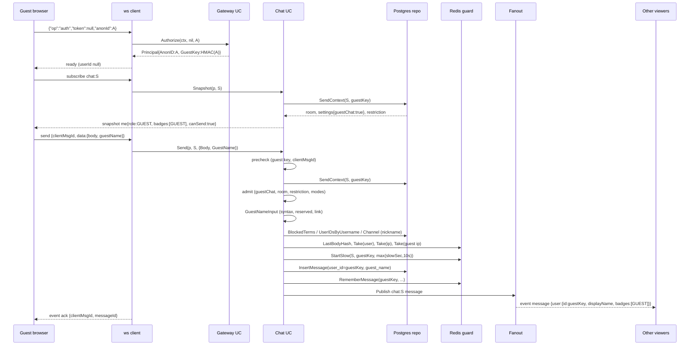
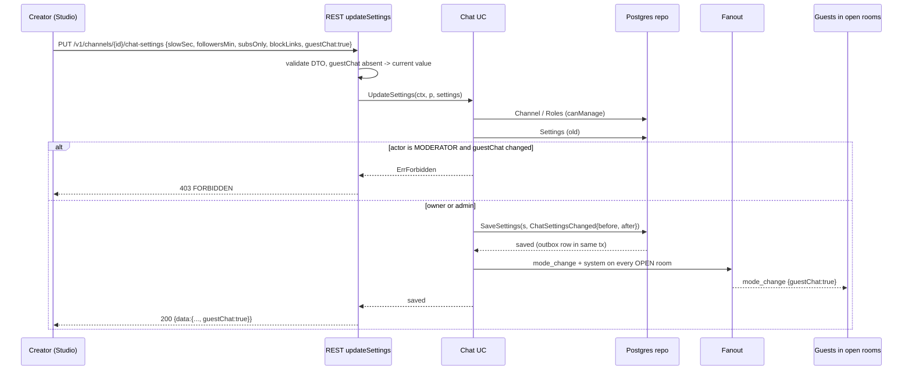
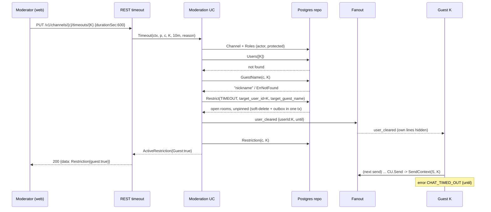
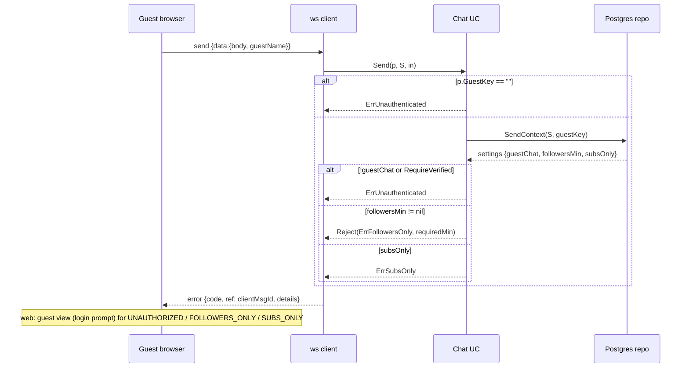

# TSD — Khách (chưa đăng nhập) chat trên kênh

Working Plan: `docs/plans/working/2026-11-28-guest-chat.md` (Full, Approved 2026-11-28). Web: `../nexuslive-web/docs/plans/working/2026-11-28-guest-chat.md`.

## 1. Objective

Khi chủ kênh bật cờ kênh `guestChat` (mặc định tắt), khách chưa đăng nhập được gửi tin trong phòng chat của kênh:

- khách tự đặt biệt danh;
- tin luôn mang huy hiệu `GUEST`;
- giới hạn chặt hơn người dùng thường: 10 s/tin, bucket theo IP, 200 ký tự, không link, không mention;
- mod và streamer xóa tin, ghim, timeout, ban khách qua đúng các route hiện có, theo một định danh do server dẫn xuất
  (`guestKey`).

Followers-only và Subs-only vẫn chặn khách. Số người xem không đổi.

## 2. Scope

**In:**

- chat-svc: migration, config, entity, repo, usecase (gateway, chat, moderation), WS `send`, REST `chat-settings` /
  `restrictions`, Swagger.
- `pkg/events.ChatModes.guestChat`.
- Tài liệu API, spec, decision log.
- nexuslive-web (Working Plan riêng).

**Out:**

- Ban theo IP.
- Giới hạn đổi biệt danh.
- Khách @mention người khác.
- Khách báo cáo vi phạm.
- User card của khách.
- Hiện biệt danh khách trong safety-svc / nexuslive-admin.
- Cấu hình giới hạn theo kênh.
- Số người xem.

## 3. Scenarios

Ký hiệu: `G` = trình duyệt của khách, `V` = người xem khác, `WS` = `controller/ws` (client + actor),
`GW` = `usecase/gateway`, `CU` = `usecase/chat`, `MU` = `usecase/moderation`, `PG` = `repo/persistent`,
`RD` = `repo/realtime` (Redis), `FO` = fanout (Redis seq + core NATS).

### S1 — Khách đặt biệt danh và gửi tin (WS)

- **Given** kênh có `guestChat = true`, phòng `OPEN`, không Followers-only / Subs-only; khách có `anonId` hợp lệ trong
  `localStorage`, chưa từng gửi tin.
- **When** khách bấm ô chat. Web thấy chưa có biệt danh nên hỏi biệt danh, lưu `nxl.guestName`, rồi gửi
  `send {body, guestName}`.
- **Then** server:
  1. tính `guestKey` lúc `auth`;
  2. kiểm tra cú pháp biệt danh, rồi admit (guest chat bật, phòng mở, không bị hạn chế, qua các chế độ);
  3. kiểm tra biệt danh theo kênh (từ cấm, trùng username, trùng handle/tên kênh);
  4. chống trùng tin, bucket theo `guestKey`, bucket IP chung, bucket IP riêng của khách;
  5. auto-mod (từ cấm + **luôn** chặn link);
  6. slow `max(slowSec, CHAT_GUEST_SLOW)`;
  7. lưu `chat_messages(user_id = guestKey, guest_name = biệt danh)`;
  8. phát `message` có `user = {id: guestKey, username: "", displayName: biệt danh, badges: ["GUEST"]}`;
  9. trả `ack` cho khách.
- **And** tin thứ hai trong 10 s nhận `CHAT_SLOW_MODE` (`retryAfterSec`). Biệt danh trùng username thật nhận
  `VALIDATION_FAILED {guestName: TAKEN}`. Tin có link nhận `CHAT_CONTENT_BLOCKED {reason: LINK}`. Tin dài hơn 200 ký tự nhận
  `VALIDATION_FAILED {body: LENGTH}`.



### S2 — Creator bật / tắt "Cho phép khách chat" (REST)

- **Given** chủ kênh (hoặc admin) đã đăng nhập.
- **When** gửi `PUT /v1/channels/{channelId}/chat-settings` có `guestChat: true` (hoặc `false`).
- **Then** `chat_settings.guest_chat` đổi. Outbox có `chat.settings_changed.v1` với `before/after.guestChat`. Mọi phòng `OPEN`
  của kênh nhận `mode_change` với `guestChat` mới và một dòng `system MODE_CHANGE`. Response `200 {data: ChatSettings}` có
  `guestChat`.
- **And** moderator gửi `guestChat` khác giá trị hiện tại thì nhận `403 FORBIDDEN`. Moderator không gửi trường này thì giá trị
  giữ nguyên và 200.
- **And** sau khi tắt, lần gửi kế tiếp của khách nhận `UNAUTHORIZED`. Web nhận `mode_change` thì đổi ô chat về nút đăng nhập.



### S3 — Mod timeout khách (REST + WS)

- **Given** khách `K` (`guestKey`) đã gửi tin trong phòng `OPEN` của kênh. Mod mở menu tin đó.
- **When** mod gửi `PUT /v1/channels/{channelId}/timeouts/{K}` với `{durationSec: 600}`.
- **Then** `MU.restrict` chạy theo thứ tự:
  1. `actor` (mod);
  2. `protected` (K không phải chủ kênh hay mod);
  3. `knownUser(K)` → `NOT_FOUND`;
  4. `GuestName(channel, K)` → biệt danh gần nhất;
  5. `Restrict` ghi `mod_actions(type=TIMEOUT, target_user_id=K, target_guest_name)`, xóa mềm tin của K trong các phòng
     `OPEN` và đưa `chat.mod_action.v1` vào outbox;
  6. phát `user_cleared {userId: K, reason: "timeout", until}`;
  7. trả `200 {data: Restriction{user:{id:K, username:"", displayName: biệt danh}, guest:true, type:TIMEOUT, until}}`.
- **And** lần gửi tiếp theo của khách nhận `CHAT_TIMED_OUT {until}`, vì `SendContext(…, K)` thấy hạn chế. Snapshot mới có
  `me.restriction`.
- **And** `GET /v1/channels/{channelId}/restrictions` có dòng của khách. `DELETE …/timeouts/{K}` gỡ hạn chế và phát
  `user_restored`. Ban và unban đi cùng đường.
- **And** một uuid chưa từng gửi tin trong kênh (không phải user, không phải khách) nhận `404 NOT_FOUND` như trước.



### S4 — Khách bị chặn: guest chat tắt / Followers-only / Subs-only

- **Given** `guestChat = false`. **When** khách subscribe `chat:S`. **Then** snapshot
  `me = {role: GUEST, badges: [], canSend: false, reason: UNAUTHORIZED}`, giống hệt hiện nay. Khách vẫn cố gửi thì nhận
  `error UNAUTHORIZED`.
- **Given** `guestChat = true` và Followers-only bật. **When** khách subscribe. **Then** `me.canSend = false`,
  `me.reason = CHAT_FOLLOWERS_ONLY` (`followedMinutes` của khách là nil). Gửi thì nhận `CHAT_FOLLOWERS_ONLY {requiredMin}`.
- **Given** `guestChat = true` và Subs-only bật. **Then** nhận `CHAT_SUBS_ONLY`.
- **Given** `CHAT_REQUIRE_VERIFIED_EMAIL = true`. **Then** khách nhận `UNAUTHORIZED` dù kênh bật guest chat.
- **Given** khách không có `anonId` hợp lệ. **Then** `GuestKey` rỗng nên nhận `UNAUTHORIZED`.



### S5 — Đọc lại, ghim, báo cáo

- History (`GET /v1/chat/rooms/{S}/messages`), `room.pinned` và sự kiện `pin` trả tin khách với `displayName` =
  `guest_name`, `username ""`, `badges ["GUEST"]` và màu `ColorOf(guestKey)`. `decorate` không ghi đè tên thành
  `user-xxxxxxxx`.
- Người dùng đã đăng nhập báo cáo tin của khách qua safety-svc. Evidence nội bộ trả `userId = guestKey`, nên report có
  `targetUserId = guestKey`. Không đổi code, chỉ nhãn admin hiện `@?` (Follow-up).

## 4. Contracts

### 4.1 SQL — `services/chat/migrations/20261128100001_guest_chat`

(v1.1: timestamp `100001` thay cho `000001` để không trùng với migration chat-svc của nhánh `feat/stream-overlay` cùng ngày.)

`up.sql`:

```sql
-- Guests (no account) may send messages in the channel's rooms; off by default.
ALTER TABLE chat_settings ADD COLUMN guest_chat boolean NOT NULL DEFAULT false;

-- NULL for an account's message; for a guest's message, the nickname it was sent under (user_id then holds the
-- guest key derived from the browser's anonId, never a users.id). Added on the partitioned parent, so every
-- existing and future daily partition gets it.
ALTER TABLE chat_messages ADD COLUMN guest_name varchar(20);

-- The guest's nickname when target_user_id is a guest key (restrictions list in the Studio).
ALTER TABLE mod_actions ADD COLUMN target_guest_name varchar(20);
```

`down.sql`:

```sql
-- Old code would show a guest's message with a "user-xxxxxxxx" fallback name: hide them before dropping the name.
UPDATE chat_messages SET deleted_at = now(), pinned = false WHERE guest_name IS NOT NULL AND deleted_at IS NULL;

ALTER TABLE mod_actions DROP COLUMN IF EXISTS target_guest_name;
ALTER TABLE chat_messages DROP COLUMN IF EXISTS guest_name;
ALTER TABLE chat_settings DROP COLUMN IF EXISTS guest_chat;
```

Ghi chú:

- `ADD COLUMN` nullable, hoặc có default hằng, chỉ đổi metadata (PG ≥ 11), không viết lại bảng.
- `createPartition` (`LIKE chat_messages` + `INSERT … SELECT *` từ `DEFAULT`) vẫn đúng, vì cột mới nằm cuối ở cả bảng cha lẫn
  mọi partition.
- Không đổi kiểu `user_id` hay `target_user_id`, không đổi CHECK: `guestKey` là một UUID.
- `GuestName` dùng được index `chat_messages_user_idx (stream_id, user_id, created_at DESC)` qua join `chat_rooms`.

### 4.2 Entity

```go
// entity.go
type Principal struct {
    UserID     string
    GlobalRole string
    AnonID     string
    // GuestKey is the guest's public id, derived from AnonID by the gateway; empty for accounts and for guests
    // without a valid anonId.
    GuestKey  string
    ConnID    string
    IP        string
    ExpiresAt time.Time
}

// AuthorID is who a message, a restriction or a rate bucket belongs to: the account, else the guest key.
func (p Principal) AuthorID() string

const BadgeGuest = "GUEST"

// IsGuest reports a guest author (the GUEST badge is set by the server only).
func (a Author) IsGuest() bool

type SendInput struct {
    ClientMsgID string
    Body        string
    // GuestName is required from guests and ignored for accounts.
    GuestName string
}

// guest.go (new)
const (
    GuestNameMinRunes = 3
    GuestNameMaxRunes = 20
)

// GuestKey derives a guest's public id from the browser's anonId: HMAC-SHA256(secret, "nxl-guest-chat:v1:"+anonID),
// truncated to 128 bits and laid out as a UUID (version 8). The fixed label keeps this use of NXL_INTERNAL_SECRET
// separate from its other uses. It cannot be chosen by the client, so it never equals a users.id.
func GuestKey(secret []byte, anonID string) string

// GuestNameInput applies the rules that need no data: NFC, spaces collapsed, 3–20 runes, letters / digits /
// space / _ - . only, at least one letter or digit, no link, not a reserved name.
// Errors are ErrValidation with details guestName = REQUIRED | LENGTH | FORMAT | TAKEN | BLOCKED.
func GuestNameInput(raw string) (string, error)

// settings.go
type ChatSettings struct { /* … */ GuestChat bool }
type Mode struct { /* … */ GuestChat bool `json:"guestChat"` }
// SameModes also compares GuestChat.

// moderation.go
type ModAction struct { /* … */ TargetGuestName *string }
type ActiveRestriction struct { /* … */ Guest bool } // User.Username "" and User.DisplayName = nickname
```

Tên dành riêng được so sau `Normalize`, theo nguyên từ (`MatchTerm`): `admin`, `administrator`, `mod`, `moderator`,
`nexuslive`, `nexus live`, `streamer`, `system`, `support`, `guest`, `khach`, `he thong`, `quan tri`, `quan tri vien`,
`ho tro`. Danh sách là hàm trong entity, không phải biến toàn cục.

### 4.3 Repo (`internal/repo/contracts.go`)

Chỉ **thêm** một method. Chữ ký các method có sẵn giữ nguyên, chỉ hành vi được mở rộng:

```go
ModerationRepo interface {
    // …existing…
    // GuestName returns the nickname of the guest's latest message in the channel's rooms; entity.ErrNotFound when
    // guestKey never sent one there.
    GuestName(ctx context.Context, channelID, guestKey string) (string, error)
}
```

| Method | Thay đổi hành vi |
| --- | --- |
| `RoomRepo.SendContext` | đọc thêm `s.guest_chat`; `userID` có thể là `guestKey` (đã tra được hạn chế) |
| `SettingsRepo.Settings` / `SaveSettings` | đọc / ghi `guest_chat` |
| `MessageRepo.InsertMessage` | ghi `guest_name = m.User.DisplayName` khi `m.User.IsGuest()` |
| `MessageRepo.History`, `ModerationRepo.Message/Pin/Pinned` (`_messageCols`/`scanMessage`) | `guest_name` khác NULL thì `DisplayName = guest_name`, `Username = ""`, `Badges = [GUEST]` |
| `ModerationRepo.Restrict` (`insertAction`) | ghi `target_guest_name` |
| `ModerationRepo.Restrictions` / `Restriction` | tên lấy từ `users` khi có, nếu không thì từ `target_guest_name`; `Guest = target_guest_name IS NOT NULL` |

### 4.4 Usecase

- `gateway.Deps`: thêm `GuestSecret []byte` (`NXL_INTERNAL_SECRET`). `Authorize` đặt
  `p.GuestKey = entity.GuestKey(secret, p.AnonID)` khi `AnonID` hợp lệ.
- `chat.Config`: thêm `GuestSlow time.Duration`, `GuestRateLimitIP int`, `GuestMaxChars int`.
- `chat.UseCase.Send`, theo thứ tự rẻ nhất trước:
  1. `precheck`: khách thiếu `GuestKey` → `ErrUnauthenticated`. Kiểm tra `clientMsgId`. (v1.1: `GuestNameInput` chuyển xuống
     bước 5, sau `admit`, để kênh tắt guest chat luôn trả `UNAUTHORIZED` như S4, kể cả khi biệt danh sai.)
  2. `retried(AuthorID)`.
  3. `prepare`: `NormalizeBody`. Khách dài hơn `GuestMaxChars` → `Reject(ErrValidation, "body", LENGTH)`.
     `load(SendContext(S, AuthorID))`.
  4. `admit`: khách khi `!GuestChat || RequireVerified` → `ErrUnauthenticated`. Sau đó chạy luật phòng, hạn chế, chế độ như
     cũ.
  5. Biệt danh: `GuestNameInput` (cú pháp, tên dành riêng, link), rồi theo kênh: từ cấm (`automod.BlockedTerms`, có cache 5 s) → `BLOCKED`; `Users.UserIDsByUsername([lower])` và
     `Users.Channel` (handle, display name, đã `Normalize`) → `TAKEN`.
  6. `limit`: chống trùng (`AuthorID`); `rates`: bucket theo người (`AuthorID`), bucket IP chung, cộng bucket
     `chat:rate:gip:{ip}` (`GuestRateLimitIP`) cho khách. `autoMod`: `BlockLinks = settings.BlockLinks || guest`. `slow`:
     khách dùng `max(SlowSec, GuestSlow)` và không được miễn.
  7. `store`: khách không resolve mention; `author()` của khách =
     `{ID: guestKey, DisplayName: name, Color: ColorOf(guestKey), Badges: [GUEST]}`.
  8. `RememberMessage(AuthorID, …)`.
- `chat.UseCase.Snapshot` / `me()`: khách có `GuestKey` → `role GUEST`, `badges [GUEST]`, `color ColorOf(guestKey)`;
  `canSend` và `reason` lấy từ `admit`. `SlowLeft(S, AuthorID)` cũng được kiểm tra cho khách khi `SlowSec = 0`. Khách không
  có key giữ nguyên hành vi cũ.
- `chat.UseCase.UpdateSettings`: `role == ActorModerator && s.GuestChat != old.GuestChat` → `ErrForbidden`. `modesOf` thêm
  `GuestChat`.
- `chat.UseCase.decorate` (History): tác giả `IsGuest()` thì chỉ đặt `Color`, giữ tên và huy hiệu.
- `moderation.UseCase.restrict`: `knownUser` → `ErrNotFound` → `Mod.GuestName` → đặt `TargetGuestName`; nếu vẫn
  `ErrNotFound` thì trả `ErrNotFound`. `decorate` (pin): tác giả là khách thì giữ huy hiệu `GUEST`.

### 4.5 WebSocket (`/v1/ws`)

```jsonc
// C→S, guest (guestName required for guests, ignored for accounts)
{"op":"send","topic":"chat:<streamId>","type":"message","clientMsgId":"<uuid>",
 "data":{"body":"xin chào","guestName":"Mèo Con"}}

// S→C message event of a guest
{"op":"event","topic":"chat:<streamId>","seq":42,"type":"message","ts":"…",
 "data":{"id":"<uuid>","streamId":"<uuid>",
         "user":{"id":"<guestKey>","username":"","displayName":"Mèo Con","color":"#74C0FC","badges":["GUEST"]},
         "body":"xin chào","fragments":[{"type":"text","text":"xin chào"}],"type":"NORMAL",
         "createdAt":"…","pinned":false,"deleted":false}}

// snapshot of chat:<streamId> for a guest, guest chat on
{"room":{"status":"OPEN","mode":{"slowSec":0,"followersMin":null,"subsOnly":false,"blockLinks":false,"guestChat":true},"pinned":null},
 "me":{"role":"GUEST","subTier":0,"emoteTier":0,"badges":["GUEST"],"color":"#74C0FC","canSend":true,
       "canModerate":false,"restriction":null}}

// mode_change
{"slowSec":0,"followersMin":null,"subsOnly":false,"blockLinks":false,"guestChat":false}
```

Frame `auth` và `ready` không đổi.

### 4.6 REST (qua edge, không đổi route)

```go
// request.UpdateChatSettings
// GuestChat lets guests send messages (owner and admins only); absent = unchanged.
GuestChat *bool `json:"guestChat"`

// response.ChatSettings
GuestChat bool `json:"guestChat"`

// response.Restriction
// Guest marks a guest: user.username is empty and user.displayName is the nickname.
Guest bool `json:"guest"`
```

`PUT/DELETE /v1/channels/{channelId}/timeouts/{userId}` và `…/bans/{userId}` nhận `guestKey` làm `userId` (vẫn là uuid, nên
`ids()` không đổi). `GET …/users/{userId}/card` với `guestKey` vẫn trả `404` (ngoài phạm vi).

### 4.7 Sự kiện (`pkg/events`)

```go
type ChatModes struct {
    SlowSec      int  `json:"slowSec"`
    FollowersMin *int `json:"followersMin"`
    SubsOnly     bool `json:"subsOnly"`
    BlockLinks   bool `json:"blockLinks"`
    GuestChat    bool `json:"guestChat"` // new, additive
}
```

`chat.mod_action.v1`: không đổi shape. `targetUserId` có thể là `guestKey`, và safety-svc lưu nó như một `resource_id` uuid.

### 4.8 Config

| Biến | Kiểu | Default | Field |
| --- | --- | --- | --- |
| `CHAT_GUEST_SLOW` | duration | `10s` | `Chat.GuestSlow` |
| `CHAT_GUEST_RATE_LIMIT_IP` | int | `10` | `Chat.GuestRateLimitIP` (cửa sổ = `CHAT_RATE_WINDOW`) |
| `CHAT_GUEST_MAX_CHARS` | int | `200` | `Chat.GuestMaxChars` |

Không có biến bắt buộc mới. HMAC dùng `NXL_INTERNAL_SECRET`, đã có và đã bị từ chối nếu trống ngoài `dev`.

## 5. Key technical details

- **Vì sao không dùng thẳng `anonId`:** `anonId` do client chọn. `user.id` của mọi tài khoản lộ trong payload tin. Nếu
  `user_id = anonId` thì khách có thể đặt `anonId` = id của streamer, và History (`LEFT JOIN users`) sẽ hiện tin dưới tên
  streamer, còn mod ban "khách" sẽ ban nhầm tài khoản thật. HMAC 128 bit có khóa bí mật loại bỏ khả năng này mà vẫn khớp cột
  `uuid`. `anonId` thô chỉ đi trong frame `auth` và header playback, không bao giờ được phát ra ngoài.
- **Biệt danh theo từng tin**, không lưu trạng thái riêng: không thêm frame, không thêm key Redis, không phải xử lý trường
  hợp biệt danh hết hạn. Moderation tính theo `guestKey`, nên đổi tên không giúp lách. Lịch sử tin vẫn giữ tên tại thời
  điểm gửi.
- **Hai lớp bucket cho khách:** `chat:slow:{S}:{guestKey}` (một danh tính) và `chat:rate:gip:{ip}` (mọi danh tính trên một
  IP, chặn việc xoay `anonId`). IP lấy theo `clientIP` của hub (phần tử cuối `X-Forwarded-For` do Nginx gắn).
- **Thứ tự lỗi:** lỗi không tốn trạng thái báo trước. Biệt danh và chế độ được kiểm tra trước khi trừ token. Từ cấm trong
  thân tin vẫn tốn token như hiện nay (BR-F12).
- **Transaction:** không có transaction mới. `Restrict` giữ khóa hàng kênh và ghi outbox như cũ.
- **Concurrency:** `StartSlow` dùng `SETNX`, nên hai tab cùng `anonId` vẫn chịu chung 10 s.
- **Tracing / metrics:** `Observer.Rejected(code)` đếm các lỗi của khách theo mã sẵn có. Không thêm metric.
- **Sampling** (`ws/actor.go priority`): so với `AuthorID()` để khách luôn thấy tin của chính mình khi phòng đông.

## 6. Error handling

| Case | Sentinel | HTTP status | Error code (WS / REST) | Event consumer |
| --- | --- | --- | --- | --- |
| Khách không có key / guest chat tắt / yêu cầu email xác minh | `ErrUnauthenticated` | — | `UNAUTHORIZED` | — |
| Biệt danh thiếu / sai độ dài / sai ký tự | `ErrValidation` | — | `VALIDATION_FAILED` `guestName: REQUIRED\|LENGTH\|FORMAT` | — |
| Biệt danh trùng / dành riêng | `ErrValidation` | — | `VALIDATION_FAILED` `guestName: TAKEN` | — |
| Biệt danh có từ cấm / link | `ErrValidation` | — | `VALIDATION_FAILED` `guestName: BLOCKED` | — |
| Tin khách dài hơn 200 ký tự | `ErrValidation` | — | `VALIDATION_FAILED` `body: LENGTH` | — |
| Tin khách có link | `ErrContentBlocked` | — | `CHAT_CONTENT_BLOCKED` `reason: LINK` | — |
| Khách gửi trong 10 s | `ErrSlowMode` | — | `CHAT_SLOW_MODE` `retryAfterSec` | — |
| Bucket IP của khách cạn | `ErrRateLimited` | — | `RATE_LIMITED` `retryAfterSec` | — |
| Followers-only / Subs-only | `ErrFollowersOnly` / `ErrSubsOnly` | — | `CHAT_FOLLOWERS_ONLY` / `CHAT_SUBS_ONLY` | — |
| Khách bị timeout / ban | `ErrTimedOut` / `ErrBanned` | — | `CHAT_TIMED_OUT` / `CHAT_BANNED` | — |
| Moderator đổi `guestChat` | `ErrForbidden` | 403 | `FORBIDDEN` | — |
| Timeout / ban uuid lạ | `ErrNotFound` | 404 | `NOT_FOUND` | — |
| Lỗi Redis / Postgres | wrapped | 500 | `INTERNAL_ERROR` (log server, message chung) | — |
| `chat.settings_changed.v1` có `guestChat` (safety-svc) | — | — | — | decode bình thường, không skip |

## 7. Compatibility & rollback

- **Client cũ** (web trước bản này):
  - Bỏ qua `guestChat` trong mode và settings.
  - `parseBadge` bỏ huy hiệu lạ, nên tin khách hiện không có huy hiệu.
  - Thứ tự deploy vì vậy là backend → web → mới cho creator bật cờ. Cờ mặc định tắt nên backend deploy trước không đổi gì.
- **`PUT chat-settings` thiếu `guestChat`:** giữ nguyên giá trị. Popover chế độ chat và tab Từ cấm của web hiện tại không vỡ.
- **Web client:** `../nexuslive-web/docs/plans/working/2026-11-28-guest-chat.md`.
- **Admin web / safety-svc:** không đổi. Báo cáo tin khách hiện `@?` (Follow-up).
- **Versioning:** chỉ thêm trường, vẫn là `v1`. Không đổi tên trường, route hay mã lỗi.
- **Migration:** một bước, chỉ thêm cột. Không cần tách bước dọn dẹp.
- **Rollback:**
  1. Tắt cờ của mọi kênh: `UPDATE chat_settings SET guest_chat = false`, hoặc tắt từng kênh qua API.
  2. Rollback image chat-svc.
  3. `make nxl-migrate-down` một bước. `down.sql` xóa mềm tin khách trước khi bỏ cột, để code cũ không hiện tên
     `user-xxxxxxxx`.
  4. Dòng `mod_actions` của khách vẫn còn và vô hại, vì `target_user_id` không trùng tài khoản nào.

## 8. Estimation

| Hạng mục | Giờ |
| --- | --- |
| Migration + entity + config/wiring + gateway | 4.0 |
| Repo (settings, messages, moderation, `GuestName`) + mocks + repo tests | 3.0 |
| Usecase chat (send pipeline, snapshot, settings, decorate, biệt danh) | 4.0 |
| Usecase moderation (restrict, pin) | 1.0 |
| Controller WS + REST + Swagger + `pkg/events` | 2.0 |
| Unit tests (usecase, entity, ws, restapi) | 3.5 |
| Tài liệu (API README, spec, decision log) | 1.5 |
| Kiểm tra stack + luồng cũ | 2.0 |
| **Backend** | **≈ 21 h** |
| Web (Working Plan web) | ≈ 14 h |
| **Tổng** | **≈ 35 h** |

Nếu chủ dự án trả lời "có" cho các open question: ban theo IP +6–8 h; tên khách trong báo cáo và admin +4–5 h.

## 9. References

- Code: `services/chat/internal/{entity,usecase/{gateway,chat,moderation},repo/{contracts.go,persistent,realtime},controller/{ws,restapi/v1}}`,
  `services/chat/migrations/*`, `pkg/events` (`ChatModes`, `ChatModAction`), `services/safety/internal/usecase/safety/reports.go`
  (`checkMessage`), `services/safety/internal/controller/events/audit.go` (`modAction`).
- Spec: `../docs/ba/specs/NXL-B-live-chat.md` (BR01, BR31, AF10, §9B), `NXL-F-moderation-and-safety.md` (BR-F02, BR-F09–F12),
  `NXL-00-platform-foundation.md` (§5, §10.1–10.5, §12); `../docs/ba/analysis/decision-log.md` (DL-17).
- Plans: `docs/plans/technical/2026-10-14-gd03-chat-realtime.md` (§5.1 giao thức WS),
  `2026-10-15-gd05-safety-notifications.md` (moderation).

## 10. Document control

| Version | Date | Change |
| --- | --- | --- |
| 1.0 | 2026-11-28 | Initial |
| 1.1 | 2026-11-28 | As shipped: migration `20261128100001_guest_chat`; nickname syntax checked after `admit` (S4 holds for a bad nickname too) |
