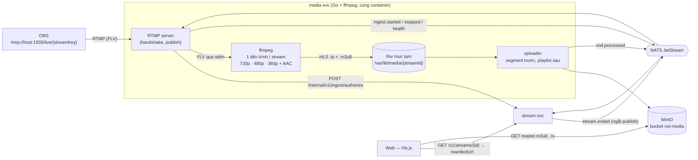

# Working Plan — Core livestream: OBS → RTMP → ffmpeg (ABR) → MinIO → HLS

| Track | Trạng thái | Ngày |
| --- | --- | --- |
| **Full** (2 service mới, hạ tầng media, hợp đồng API và sự kiện mới, hai repo) | Approved v2 (§4 đã chốt: thư viện RTMP Go, làm từng giai đoạn, TSD trước) — chờ duyệt TSD | 2026-10-11 |

## 1. Task Brief

- **Mục tiêu:** Creator bật OBS, đẩy luồng vào server trung gian qua RTMP bằng stream key của mình. Server dùng ffmpeg chuyển thành nhiều mức chất lượng (adaptive bitrate), lưu segment HLS vào MinIO. Người xem mở web, xem trực tiếp bằng HLS, tự đổi chất lượng và **tua lại ngay trong lúc live** (DVR, DL-10). Khi tắt OBS, buổi phát trở thành VOD xem lại được.
- **Nguồn yêu cầu:**
  - Mô tả trong chat.
  - PRD §4.3, §4.10, §4.11, §8.7.
  - NXL-A (Player & Stream Page, state machine §7A).
  - Kiến trúc §6.1, §6.2, §7.
  - ADR-004 (tự xây media server).
  - Use case UC-A01–A06, UC-G01–G05, G13, G14.
  - ERD `stream` (đã migrate).
- **Spec NXL-G1 chưa viết.** Plan này là nguồn yêu cầu tạm, sẽ chép thành NXL-G1 khi xong (roadmap §4: NXL-G1 trước GĐ2).
- **Vị trí trong lộ trình:** gộp **PoC media của GĐ0** (đang ở tuần 1, đúng lịch) và **Streaming core của GĐ2**. Chia 4 giai đoạn có điểm dừng kiểm tra (§5).
- **Trong phạm vi:**
  - **media-svc:** RTMP ingest, xác thực stream key, chạy ffmpeg ABR, đẩy HLS lên MinIO, thumbnail, báo sự kiện ingest.
  - **stream-svc:** stream key, vòng đời stream theo NXL-A §7A, thông tin phát, VOD.
  - **Web:** trang Studio (stream key, hướng dẫn OBS, trạng thái), trang xem với hls.js (chọn chất lượng, **tua lại khi live**, các trạng thái), danh sách đang phát.
- **Ngoài phạm vi:**
  - Chat, viewer count realtime qua WebSocket. Web tạm hỏi trạng thái mỗi 5s — NXL-A cho phép polling làm phương án dự phòng.
  - Channel-svc, duyệt Creator.
  - LL-HLS/WebRTC, Clip, transcode GPU, ảnh xem trước khi rê chuột trên thanh thời gian.
  - URL HLS có chữ ký: chỉ đặt chỗ ở GĐ-L4, làm thật cùng API Gateway.
- **Giả định:**
  - **G1:** Chưa có channel-svc, nên tạm coi **mỗi user là một kênh**: `channel_id = user_id`, mọi user đã đăng nhập đều phát được. Khi có channel-svc và duyệt Creator thì thay. Ghi vào Known Debt.
  - **G2:** OBS gửi H.264 + AAC (mặc định của OBS). Codec khác bị từ chối kèm thông báo.
  - **G3:** Mỗi kênh tối đa một luồng publish cùng lúc (unique index trong ERD đã đảm bảo phía DB).
  - **G4:** Máy demo dùng CPU (libx264), giới hạn `MEDIA_MAX_CONCURRENT_STREAMS` mặc định 2.

## 2. Kiến trúc của tính năng



**Vì sao làm như vậy:**

- **RTMP server viết bằng Go (thư viện), không để ffmpeg tự nghe cổng.** `ffmpeg -listen` chỉ nhận một luồng mỗi cổng và không kiểm tra được stream key. Có server trung gian mới xác thực được key trước khi nhận dữ liệu, chạy nhiều stream trên cùng cổng 1935, và biết chính xác lúc OBS ngắt.
- **ffmpeg ghi ra đĩa tạm, uploader đẩy lên MinIO.** ffmpeg không tự ký request S3 được. Uploader đảm bảo segment luôn lên trước playlist trỏ tới nó, để người xem không gặp 404.
- **Playlist kiểu `EVENT`:** một bộ file dùng cho cả live, **tua lại khi live** lẫn VOD. Playlist giữ mọi segment từ đầu buổi phát nên người xem tua lại được bất kỳ lúc nào; khi stream kết thúc, playlist có thêm `#EXT-X-ENDLIST` và trở thành VOD ngay, không phải transcode lại.
- **Lệch so với kiến trúc §6.1:** xác thực stream key dùng **HTTP nội bộ** thay cho gRPC. Môi trường hiện tại chưa có toolchain `protoc`; hợp đồng giữ nguyên ý nghĩa nên đổi sang gRPC sau được. Sự kiện vẫn qua NATS đúng kiến trúc.

## 3. Thiết kế chi tiết

### 3.1 Ingest và transcode (media-svc)

- **Kết nối:** OBS đẩy tới `rtmp://<host>:1935/live/{streamKey}`.
- **Khi OBS publish:**
  - media-svc gọi `authorize(streamKey)`.
  - Sai key, kênh đang có luồng khác, hoặc vượt `MEDIA_MAX_CONCURRENT_STREAMS` → đóng kết nối.
- **Chọn bậc chất lượng theo độ phân giải nguồn** (đọc từ `onMetaData` của OBS). Không phóng to: nguồn 720p thì chỉ có 720p/480p/360p; nguồn 480p thì chỉ có 480p/360p.

| Bậc | Độ phân giải | Video | Audio |
| --- | --- | --- | --- |
| 720p | 1280×720, 30 fps | 2 500 kbps (maxrate 2 675, bufsize 3 750) | AAC 128 kbps stereo |
| 480p | 854×480, 30 fps | 1 200 kbps | AAC 128 kbps |
| 360p | 640×360, 30 fps | 700 kbps | AAC 96 kbps |

- **Lệnh ffmpeg (khung):**

  ```
  ffmpeg -f flv -i pipe:0
    -filter_complex "[0:v]split=3[a][b][c];[a]scale=-2:720[v720];[b]scale=-2:480[v480];[c]scale=-2:360[v360]"
    -map [v720] -map [v480] -map [v360] -map a:0 -map a:0 -map a:0
    -c:v libx264 -preset veryfast -tune zerolatency -r 30 -g 60 -keyint_min 60 -sc_threshold 0
    -b:v:0 2500k ... -b:v:2 700k   -c:a aac -ar 48000 -ac 2
    -f hls -hls_time 2 -hls_playlist_type event -hls_flags independent_segments+temp_file
    -hls_segment_filename "%v/seg_%05d.ts" -master_pl_name master.m3u8
    -var_stream_map "v:0,a:0,name:720p v:1,a:1,name:480p v:2,a:2,name:360p" "%v/index.m3u8"
  ```

  - GOP 60 khung ở 30 fps = keyframe mỗi 2s, khớp với segment 2s. Nhờ vậy mọi bậc cắt segment cùng thời điểm và đổi chất lượng giữa chừng không bị giật.
  - Thêm một đầu ra thumbnail: `fps=1/30, scale=320:-1` → `thumb.jpg`.
- **Sức khỏe luồng:** đọc `-progress` của ffmpeg (fps, bitrate, `drop_frames`, speed) mỗi 5s → sự kiện `ingest.health`.
- **ffmpeg chết giữa chừng:**
  - Ghi log và phát `ingest.stopped{reason: transcoder_failed}`.
  - Đóng kết nối RTMP. OBS tự kết nối lại, khi đó luồng mới vẫn thuộc stream cũ nếu còn trong thời gian chờ.
- **Nối lại vào cùng stream** (`authorize` trả `resumed = true`):
  - Không được ghi đè phần đã phát. media-svc đọc số segment cuối của mỗi bậc trong playlist đang có, chạy ffmpeg mới với `-start_number <cuối + 1>` và `-hls_flags append_list`. ffmpeg tự chèn `#EXT-X-DISCONTINUITY` tại chỗ nối.
  - Nếu nguồn mới có độ phân giải khác, vẫn giữ đúng các bậc của lần đầu (scale theo bậc cũ) để master playlist không đổi.
  - Bản xem lại và DVR có một khoảng nhảy đúng lúc rớt mạng, player phát liền qua chỗ nối.

### 3.2 Lưu trữ (MinIO)

| Đường dẫn trong bucket `nxl-media` | Nội dung | Cache-Control |
| --- | --- | --- |
| `streams/{streamId}/master.m3u8` | Master playlist liệt kê các bậc | `no-cache` |
| `streams/{streamId}/{720p,480p,360p}/index.m3u8` | Playlist từng bậc (EVENT → có ENDLIST khi kết thúc) | `max-age=1` khi live, `max-age=3600` khi VOD |
| `streams/{streamId}/{bậc}/seg_00001.ts` … | Segment 2s | `public, max-age=31536000, immutable` |
| `streams/{streamId}/thumb.jpg` | Ảnh thu nhỏ mới nhất | `max-age=30` |

- **Quy tắc upload:**
  1. Segment (ffmpeg ghi `.tmp` rồi đổi tên, nhờ `temp_file`) được upload ngay khi xuất hiện.
  2. Playlist chỉ được upload sau khi mọi segment nó liệt kê đã lên MinIO.
  3. Upload lỗi thì thử lại tối đa 3 lần với backoff; vẫn lỗi thì báo `ingest.health{uploadErrors}`.
- **Kết thúc stream:**
  1. Chờ ffmpeg thoát.
  2. Upload playlist cuối có `ENDLIST`. Nếu ffmpeg thoát bất thường và playlist thiếu dòng này, media-svc tự thêm `#EXT-X-ENDLIST` trước khi upload.
  3. Xóa thư mục tạm.
  4. Phát `vod.processed{streamId, durationSec, playlistPath}`.
- **Xóa VOD hết hạn:** lifecycle rule của bucket xóa `streams/` sau 14 ngày (PRD Q4, cấu hình được).
- **Truy cập khi dev:** prefix `streams/` cho đọc công khai; Vite proxy `/hls` → MinIO. Ở GĐ-L4 chuyển sang Nginx `secure_link` (kiến trúc §9).

### 3.3 Vòng đời stream (stream-svc, theo NXL-A §7A)

| Sự kiện | Chuyển trạng thái | Ghi chú |
| --- | --- | --- |
| `authorize` hợp lệ, kênh không có stream đang phát | tạo `streams` → **LIVE** khi nhận `ingest.started` | Tiêu đề và category lấy từ cài đặt Stream Manager |
| `authorize` hợp lệ, kênh có stream **INTERRUPTED** còn trong `INGEST_GRACE_PERIOD` | dùng lại `streamId` cũ → **LIVE** | OBS kết nối lại sau sự cố mạng không tạo stream mới |
| `ingest.stopped` | **LIVE → INTERRUPTED**, ghi `interrupted_at` | Người xem thấy "Streamer sẽ quay lại ngay" |
| Hết `INGEST_GRACE_PERIOD` (mặc định 60s, PRD Q1 của NXL-A) | **INTERRUPTED → ENDED**, `end_reason = ingest_timeout` | Một job quét mỗi 5s |
| Creator bấm "Kết thúc" | **LIVE/INTERRUPTED → ENDED**, `end_reason = creator` | Phát `stream.ended`, media-svc ngắt OBS |
| `vod.processed` | Tạo `vods` **READY**, `expires_at = +14 ngày` | |

- Sự kiện phát qua NATS JetStream bằng outbox, đúng kiến trúc §5.2.
- Worker đẩy outbox được viết dùng chung trong `pkg/outbox`; identity-svc dùng lại được.

### 3.4 Hợp đồng API

**stream-svc — công khai** (Bearer JWT, xác minh cục bộ bằng JWKS của identity-svc):

| Method | Path | Mô tả |
| --- | --- | --- |
| GET | `/v1/studio/stream-key` | Trả `{hasKey, rtmpUrl, createdAt}`; không trả lại key |
| POST | `/v1/studio/stream-key` | Tạo hoặc tạo lại key; trả `{streamKey, rtmpUrl}` **một lần duy nhất**, key cũ bị thu hồi |
| GET | `/v1/studio/stream` | Cài đặt buổi phát kế tiếp và trạng thái hiện tại kèm sức khỏe luồng |
| PUT | `/v1/studio/stream` | `{title, tags?, isMature}` cho buổi phát kế tiếp hoặc đang phát |
| POST | `/v1/studio/stream/end` | Kết thúc buổi phát đang diễn ra |
| GET | `/v1/streams?status=live&cursor=` | Danh sách đang phát (không cần đăng nhập) |
| GET | `/v1/streams/{streamId}` | Chi tiết, trạng thái, `manifestUrl`, `thumbnailUrl`, `vodId?` |
| GET | `/v1/vods/{vodId}` | VOD và `manifestUrl` |

- Phiên phát có chữ ký (`POST /v1/streams/{id}/playback-sessions`, NXL-A API 02) làm ở GĐ-L4.
- Trước đó, `manifestUrl` là đường dẫn công khai.

**stream-svc — nội bộ** (cổng riêng, không qua Gateway, có shared secret):

| Method | Path | Mô tả |
| --- | --- | --- |
| POST | `/internal/v1/ingest/authorize` | `{streamKey, clientIp}` → `{streamId, channelId, resumed}`, hoặc 403 `INVALID_STREAM_KEY` / 409 `ALREADY_LIVE` |

**Sự kiện NATS:**

| Subject | Phát bởi | Payload chính |
| --- | --- | --- |
| `nxl.ingest.started.v1` | media-svc | `streamId, renditions[], sourceWidth, sourceHeight` |
| `nxl.ingest.stopped.v1` | media-svc | `streamId, reason (publisher_disconnected / transcoder_failed / kicked)` |
| `nxl.ingest.health.v1` | media-svc | `streamId, fps, bitrateKbps, droppedFrames, speed, uploadErrors` |
| `nxl.vod.processed.v1` | media-svc | `streamId, durationSec, playlistPath` |
| `nxl.stream.started.v1` / `nxl.stream.ended.v1` | stream-svc | `streamId, channelId, endReason?` |

### 3.5 Web (nexuslive-web)

- **`/studio/stream` (cần đăng nhập):**
  - RTMP server URL; stream key (ẩn, Hiện / Sao chép / Tạo lại có xác nhận).
  - Form tiêu đề.
  - Trạng thái Offline / Live / Interrupted kèm sức khỏe luồng.
  - Nút Kết thúc, preview player.
  - Hướng dẫn cấu hình OBS: Keyframe Interval 2s, x264 hoặc NVENC, bitrate ≤ 6 000 kbps, 30 fps.
- **`/live/:streamId`:**
  - hls.js với `liveSyncDurationCount = 2` để giảm độ trễ; chọn chất lượng Auto (hiện "Auto · 720p") hoặc một bậc cố định.
  - **Tua lại khi live (DVR, DL-10):**
    - Thanh thời gian hiện cả khi live, từ đầu buổi phát tới điểm live; không kéo được quá điểm live.
    - Cho tạm dừng khi live; bấm phát lại thì xem tiếp từ chỗ dừng (bị lùi so với live).
    - Khi lùi so với live hơn 2 segment (≈ 4s): nhãn khoảng lệch (ví dụ `-05:12`) và nút **Về trực tiếp** (FR-ST-02); phím tắt `→` tua tới 10s, `←` lùi 10s.
    - Badge LIVE đổi màu xám khi đang xem lùi, đỏ khi ở điểm live.
    - Đang `INTERRUPTED`: người xem phía sau vẫn xem tiếp phần đã phát; chạm điểm live mới hiện "Streamer sẽ quay lại ngay".
    - Stream kết thúc khi người xem đang lùi: xem tiếp tới hết rồi mới hiện "Buổi phát đã kết thúc" + Xem lại.
    - hls.js: không đặt `liveMaxLatencyDuration` (để không tự kéo người xem về live), dùng `hls.liveSyncPosition` cho nút Về trực tiếp.
  - Theater/Fullscreen, phím tắt.
  - Đủ trạng thái NXL-A: Live, Buffering, Reconnecting, Interrupted, Ended → nút Xem lại, Offline, Error.
- **`/vod/:vodId`:** phát VOD, lưu vị trí xem thuộc phần sau (UC-A07).
- **Trang chủ:** lưới "Đang phát" từ `GET /v1/streams?status=live`, thumbnail 16:9.
- **Cập nhật trạng thái:** hỏi lại `GET /v1/streams/{id}` mỗi 5s cho tới khi có realtime gateway.

### 3.6 Triển khai

- **media-svc:** `services/media`, image `golang:1.27-alpine` build xong chép sang `alpine` có gói `ffmpeg`. Cổng 1935 (RTMP) và 8091 (health/metrics). Volume tạm `media_tmp`.
- **stream-svc:** `services/stream`, cổng 8092 (công khai) và 8093 (nội bộ).
- **Compose:** cả hai trong profile `nxl`, phụ thuộc `db-migrate`, `nats`, `minio-init`. `minio-init` tạo thêm bucket `nxl-media`, đặt chính sách đọc công khai cho `streams/` và lifecycle 14 ngày.
- **Vite proxy:** `/v1/studio`, `/v1/streams`, `/v1/vods` → 8092; `/hls` → MinIO. Proxy `/v1/auth` → 8090 giữ nguyên.

## 4. Quyết định cần bạn chốt (§9 có lựa chọn đề xuất)

1. **Cách nhận RTMP:**
   - Đề xuất: thư viện RTMP thuần Go trong media-svc (ví dụ `github.com/yutopp/go-rtmp`).
   - Phương án khác: `nginx-rtmp` gọi callback `on_publish` sang media-svc (nhanh hơn nhưng ít "tự xây"), hoặc `ffmpeg -listen` (không xác thực được, mỗi cổng một luồng).
2. **Dependency Go mới** (quy tắc yêu cầu hỏi trước): thư viện RTMP ở mục 1, `github.com/minio/minio-go/v7` (client S3).
3. **Dependency FE mới:** `hls.js`.
4. **Phạm vi lần này:**
   - Đề xuất: làm hết 4 giai đoạn, dừng kiểm tra cùng bạn sau mỗi giai đoạn.
   - Phương án khác: chỉ làm GĐ-L1 (PoC) rồi quyết tiếp.

## 5. Các giai đoạn

| GĐ | Nội dung | Kết quả kiểm chứng (dừng lại cho bạn thử) |
| --- | --- | --- |
| **L1 — PoC pipeline** | media-svc độc lập: RTMP server, key cố định trong cấu hình, ffmpeg ABR, uploader lên MinIO, trang HTML thử với hls.js | OBS → xem được trên trình duyệt, đổi 3 mức chất lượng; **đo độ trễ và CPU** với 1–2 luồng, ghi vào `DATN/docs/report/measurements/` (tiêu chí S1, S2) |
| **L2 — stream-svc** | Stream key (băm SHA-256, hiện một lần), `authorize`, state machine qua NATS + outbox, job hết thời gian chờ, kết thúc từ Studio (API) | Tắt OBS → INTERRUPTED → bật lại trong 60s vẫn cùng stream; để quá 60s → ENDED; key sai bị từ chối |
| **L3 — Web** | Studio, trang xem, danh sách đang phát, đủ trạng thái player | Hành trình Creator và Viewer chạy trọn trên web |
| **L4 — VOD và ổn định** | `vod.processed` → VOD, trang VOD, thumbnail, giới hạn luồng đồng thời, ngắt OBS khi Creator bấm kết thúc, dọn file tạm, (tùy chọn) URL có chữ ký | Kết thúc → "Xem lại" phát được từ đầu; 3 luồng khi giới hạn 2 → luồng thứ 3 bị từ chối |

**Các bước trong mỗi giai đoạn:** code → test → kiểm tra → cập nhật Completed Plan (một file chung, ghi theo giai đoạn).

**Trước GĐ-L1:** viết TSD (sequence diagram cho publish, reconnect trong thời gian chờ, kết thúc bởi Creator, upload segment rồi playlist). Chờ duyệt, trừ khi bạn chọn làm cùng lúc như lần trước.

## 6. Rủi ro

| Rủi ro | Tác động | Giảm thiểu |
| --- | --- | --- |
| CPU không đủ cho 3 bậc libx264 | Giật, `speed < 1` | `preset veryfast`, bỏ bậc trên mức nguồn, giới hạn luồng đồng thời; đo ngay ở GĐ-L1 |
| Độ trễ vượt 6s | Không đạt tiêu chí S2 | Segment 2s, GOP 2s, hls.js `liveSyncDurationCount=2`, upload song song; hướng dẫn OBS đặt keyframe 2s |
| OBS đặt keyframe khác 2s, hoặc VFR | Segment lệch nhau giữa các bậc | ffmpeg ép GOP (`-g 60 -sc_threshold 0`) và `-r 30` nên không phụ thuộc OBS |
| Thư viện RTMP Go chưa đủ ổn định | Lỗi handshake với OBS | Thử ngay ở GĐ-L1 với OBS thật; phương án lùi là nginx-rtmp + `on_publish` (giữ nguyên phần còn lại) |
| Docker Desktop Windows: cổng 1935 và hiệu năng file I/O của volume | Mất kết nối, chậm | Thư mục tạm là volume Docker (không bind-mount ổ Windows); kiểm tra bằng OBS trên chính máy đó |
| Playlist EVENT dài với stream nhiều giờ (cũng là phạm vi DVR) | Mỗi lần tải lại playlist khi live nặng dần | Chấp nhận cho đồ án (2 giờ ≈ 3 600 dòng/bậc, khoảng 200 KB); nếu cần, giới hạn cửa sổ DVR bằng playlist trượt riêng cho live và giữ playlist EVENT cho VOD |
| Nối lại ghi đè segment cũ | Hỏng DVR và VOD | `-start_number` + `append_list` (§3.1), có test riêng |
| **Môi trường của Claude không có Docker/OBS** | Không tự thử với OBS thật | Tôi kiểm tra bằng ffmpeg giả lập OBS (`-re -f lavfi testsrc` đẩy RTMP), S3 giả lập thay MinIO, Chromium + hls.js; phần OBS thật bạn thử ở điểm dừng mỗi giai đoạn |

## 7. Checklist kiểm tra

- [ ] Unit test: chọn bậc theo độ phân giải nguồn; dựng lệnh ffmpeg (kể cả lệnh nối lại với `-start_number`); đọc số segment cuối từ playlist; tự thêm `ENDLIST`; uploader chỉ đẩy playlist khi segment đã lên; state machine (mọi chuyển trạng thái trong §3.3, không có chuyển trạng thái ngoài NXL-A §7A); băm và thu hồi stream key.
- [ ] Tích hợp: ffmpeg giả lập OBS → media-svc → S3 → hls.js phát được 3 bậc; ngắt rồi nối lại trong thời gian chờ (segment không bị ghi đè, có `DISCONTINUITY`); key sai bị từ chối.
- [ ] DVR (Playwright): đang live tua về đầu buổi phát → phát đúng; "Về trực tiếp" → về điểm live; tạm dừng 30s rồi phát → lùi ~30s và nút Về trực tiếp hiện.
- [ ] Đo: độ trễ glass-to-glass (đồng hồ trong khung hình), CPU theo số luồng — bạn đo với OBS thật.
- [ ] Web: `pnpm build`, `oxlint`, Playwright cho Studio và trang xem.
- [ ] Không phá phần đã có: identity-svc, đăng nhập web, `make compose-up` và app mẫu.

## 8. Tiêu chí hoàn thành

- Given Creator đã có stream key, When phát từ OBS, Then trong ≤ 10s kênh hiện Live trên trang chủ và người xem phát được video, với độ trễ mục tiêu ≤ 6s.
- Given đang xem ở Auto, When băng thông giảm, Then player tự xuống 480p/360p không dừng phát; người xem chọn tay được từng bậc.
- Given đang live, When OBS mất mạng < 60s rồi nối lại, Then vẫn là cùng một buổi phát; người xem thấy "Streamer sẽ quay lại ngay" trong lúc chờ.
- Given buổi phát kết thúc, When người xem mở lại, Then thấy "Buổi phát đã kết thúc" và nút Xem lại phát VOD từ đầu.
- Given stream key sai hoặc đã thu hồi, When OBS kết nối, Then bị từ chối và không tạo stream nào.
- Given đang xem live, When kéo thanh thời gian về 10 phút trước, Then phát đúng đoạn đó; When bấm "Về trực tiếp", Then về điểm live với độ trễ ≤ 6s.
- Given OBS rớt mạng rồi nối lại trong thời gian chờ, When người xem tua lại qua thời điểm rớt, Then phát liền qua chỗ nối, không mất phần đã phát trước đó.

## 9. Đề xuất cho các quyết định ở §4

| # | Đề xuất |
| --- | --- |
| 1 | Thư viện RTMP thuần Go trong media-svc |
| 2 | Đồng ý `go-rtmp` + `minio-go` |
| 3 | Đồng ý `hls.js` |
| 4 | Làm cả 4 giai đoạn, dừng kiểm tra sau mỗi giai đoạn |
