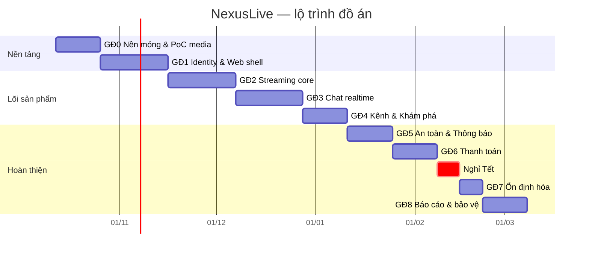

# NexusLive — Lộ trình phát triển (đồ án)

| | |
| --- | --- |
| **Phiên bản** | 1.1 |
| **Cập nhật** | 2026-10-13 |
| **Nhân lực** | 1 người (backend, frontend, media, tài liệu) |
| **Thời gian** | 20 tuần làm việc + 1 tuần nghỉ Tết: **12/10/2026 → 05/03/2027** |
| **Thay cho** | Lộ trình gốc trong `DATN/docs/ba/requirements/NexusLive-Core-Features-and-Roadmap.md` (giả định đội ~12 người) |

## 1. Nguyên tắc lập lộ trình

1. **Rủi ro cao làm trước.** Media pipeline (RTMP → ffmpeg → HLS) là thứ dễ làm hỏng cả đồ án nhất,
   nên được PoC ngay tuần 1–2, trước khi viết dòng code nghiệp vụ nào.
2. **Mỗi giai đoạn kết thúc bằng một bản demo chạy được** trên `docker compose up`, không có giai đoạn "chỉ làm nền".
3. **Service được dựng khi cần** (ADR-001), không dựng sẵn cả 8 từ đầu.
4. **Spec xong trước khi code ≥ 1 tuần.** Mỗi giai đoạn bắt đầu bằng Working Plan (và TSD nếu là Full track) theo `AGENTS.md`.
5. **Giữ 3 tuần cho cuối kỳ:** 1 tuần ổn định hóa, 2 tuần báo cáo và chuẩn bị bảo vệ. Không lấn sang phần này.

## 2. Tổng quan

| GĐ | Tuần | Thời gian | Trọng tâm | Service mới | Mốc |
| --- | --- | --- | --- | --- | --- |
| GĐ0 | 1–2 | 12/10 – 23/10 | Monorepo, hạ tầng, PoC media, NXL-00 | — | — |
| GĐ1 | 3–5 | 26/10 – 13/11 (**bắt đầu sớm 13/10**) | Đăng ký/đăng nhập, Guest, Web shell, đơn Creator, web quản trị | identity, channel (tối thiểu); web `nexuslive-admin` | **M1** |
| GĐ2 | 6–8 | 16/11 – 04/12 | Go Live, transcode, phát HLS, trang xem, VOD | stream, media | **M2** |
| GĐ3 | 9–11 | 07/12 – 25/12 | Chat realtime, realtime gateway, viewer count | chat | **M3** |
| GĐ4 | 12–13 | 28/12 – 08/01 | Follow, Profile, Schedule, Home, Browse, Search | (channel đầy đủ) | — |
| GĐ5 | 14–15 | 11/01 – 22/01 | Kiểm duyệt, Report, Admin, thông báo | safety, notification | **M4** |
| GĐ6 | 16–17 | 25/01 – 05/02 | Subscription, Checkout sandbox, quyền lợi Sub | billing | **M5** |
| — | — | 08/02 – 12/02 | Nghỉ Tết (điều chỉnh theo lịch thực tế) | — | — |
| GĐ7 | 18 | 15/02 – 19/02 | Load test, đo độ trễ, sửa lỗi, responsive | — | **M6** |
| GĐ8 | 19–20 | 22/02 – 05/03 | Báo cáo, slide, kịch bản demo, dự phòng | — | **Bảo vệ** |

## 3. Chi tiết từng giai đoạn

### GĐ0 — Nền móng & PoC media (tuần 1–2)

**Mục tiêu:** dựng xong "đường ray" cho mọi service, và chứng minh pipeline video chạy được trên máy thật.

- Chuyển repo sang monorepo (`services/`, `pkg/`, `web/`, `deploy/`, `go.work`); cập nhật `AGENTS.md` cho nhiều service.
- `pkg/` dùng chung: logger, cấu hình, postgres, tracing, JWT verify, NATS + outbox, HTTP/gRPC server.
- `deploy/docker-compose.yml`: Nginx, PostgreSQL, Redis, NATS JetStream, MinIO, Mailpit, Prometheus, Grafana.
- CI: lint + test theo từng service.
- **PoC media:**
  - OBS → RTMP → ffmpeg 3 rendition → HLS → hls.js trên một trang HTML tĩnh.
  - Đo độ trễ và CPU cho 1, 2 và 3 stream đồng thời.
- Viết **NXL-00**: quy ước API, mã lỗi, phân trang, giao thức WebSocket, sự kiện.
- Viết **NXL-D**.

**Hoàn thành khi:**

- `docker compose up` chạy hạ tầng.
- PoC phát được với độ trễ ≤ 6s.
- Có số liệu CPU để chốt `MAX_CONCURRENT_TRANSCODES`.
- NXL-00 và NXL-D được duyệt.

### GĐ1 — Identity & Web shell (tuần 3–5)

> **Trạng thái 13/10/2026:** GĐ0 xong sớm ~10 ngày làm việc; GĐ1 **bắt đầu 13/10** (Working Plan GĐ1 v1.1 được
> duyệt, G1-Q1). Plan: `../plans/working/2026-10-13-gd01-identity-web-shell.md`; TSD cùng tên trong
> `../plans/technical/`. Màn quản trị tách thành project **`nexuslive-admin`** (ADR-013).

- **identity-svc:**
  - Đăng ký email, xác minh email (Mailpit), đăng nhập, refresh token xoay vòng, đăng xuất.
  - JWKS, quên mật khẩu.
  - Đăng ký Creator, Admin duyệt.
- **channel-svc tối thiểu:** tạo Channel khi Creator được duyệt (nghe `creator.approved`), `GET /v1/channels/{handle}`, cổng 8094.
- **stream-svc:** Studio chỉ cho Creator (`NOT_CREATOR`), tên kênh trên stream/VOD.
- **Cổng vào Nginx** (có từ GĐ0 — errata E-13, không phải service riêng): thêm rate limit, CORS (origin web + admin), header bảo mật, route `/v1/channels`.
- **Web:**
  - Vite + React + TypeScript, design tokens Obsidian Pulse, i18n.
  - Global Shell (top bar, sidebar trống, bottom nav).
  - Trang đăng nhập/đăng ký, Guest mode, modal "đăng nhập để tiếp tục" quay về đúng ngữ cảnh.
  - Trang xác minh email, quên mật khẩu, cài đặt tài khoản, đơn Creator, trang hệ thống (phiên hết hạn, tài khoản khóa).
- **Web quản trị `nexuslive-admin`** (project mới): đăng nhập Admin, hàng đợi và duyệt/từ chối đơn Creator.
- Tài liệu: PRD v2.1, NXL-A/B/C v1.1, NXL-00/NXL-D v1.2, **NXL-G1** (viết theo pipeline đã chạy) — xong 13/10.

**M1 — Demo:** đăng ký → nhận email xác minh → đăng nhập → gửi đơn Creator → Admin duyệt trên `nexuslive-admin` → kênh được tạo tự động → Studio mở, phát được, trang xem hiện tên kênh.

### GĐ2 — Streaming core (tuần 6–8)

- **stream-svc:**
  - Stream key (tạo, xem một lần, reset).
  - State machine Stream đúng NXL-A §7A.
  - Playback session có chữ ký, kiểm tra mature/khóa kênh.
  - Vod, WatchProgress.
- **media-svc:**
  - RTMP ingest, xác thực key qua gRPC.
  - Chạy và giám sát ffmpeg, ghi HLS lên MinIO.
  - Thumbnail, sự kiện ingest, `ingest.health`.
- **VOD:** đóng playlist khi kết thúc, xóa theo hạn.
- **Web:**
  - Stream Manager (key, tiêu đề, category, sức khỏe).
  - Trang xem NXL-A: player, đủ 9 trạng thái, phím tắt, Theater/Fullscreen.
  - Trang VOD có resume.
- Viết **NXL-G2**.

**M2 — Demo:** Creator mở OBS → Go Live → người xem thấy video, đổi 720p/480p/360p → tua lại vài phút rồi bấm "Về trực tiếp" (DVR) → tắt OBS → "Streamer sẽ quay lại ngay" → hết thời gian chờ → "Buổi phát đã kết thúc" → xem VOD.

### GĐ3 — Chat realtime (tuần 9–11)

- **chat-svc:**
  - Realtime gateway `/v1/ws` với chủ đề `chat:`, `stream:`, `user:`.
  - Tin nhắn, fragments, emote toàn cầu, @mention.
  - Slow / Followers-only / Subs-only. Bản sao follow/sub trong Redis tạm dựng từ dữ liệu giả cho tới GĐ4/GĐ6.
  - Rate limit, chống trùng, resume.
  - Fan-out qua NATS giữa nhiều instance.
  - Chuyển `stream_status_changed`, `viewer_count` từ stream-svc.
- **Web:** chat panel virtualized, auto-scroll thông minh, reconnect + resume, optimistic UI, emote picker.
- **Load test sớm** bằng k6 để phát hiện điểm nghẽn trước GĐ7.
- Viết **NXL-F** và **NXL-E**.

**M3 — Demo:**

- Hai trình duyệt cùng xem và chat.
- Bật Slow mode thấy hiệu lực ngay.
- Tắt một instance chat-svc, client tự nối lại không mất tin.
- Load test 1.000 kết nối đạt P95 < 500ms.

### GĐ4 — Kênh & Khám phá (tuần 12–13)

- **channel-svc đầy đủ:**
  - Follow + chuông thông báo.
  - Creator Profile (Home / Videos / About / Schedule).
  - Schedule + Set Reminder; Category.
  - Bảng đọc tìm kiếm (full-text + `unaccent`).
- **Web:** Home (Hero, Continue Watching, Followed Live, Live đề xuất, Categories), Browse/Category, Search Ctrl+K, Following, sidebar realtime.
- Nối bản sao follow thật vào chat-svc (Followers-only có hiệu lực thật).
- Studio: Dashboard tối thiểu, quản lý VOD, tạo/hủy lịch phát.
- Viết **NXL-H** (cổng thanh toán phải được chọn trước tuần 14).

**Kiểm chứng:** hành trình Discovery và Creator (PRD §15) chạy trọn.

### GĐ5 — An toàn & Thông báo (tuần 14–15)

- **chat-svc:** Delete / Timeout / Ban / Pin, gán Mod/VIP, từ khóa chặn, chặn link.
- **safety-svc:** Report (tự đính kèm 10 tin gần nhất), Admin xử lý report, khóa tài khoản, gỡ stream, audit log.
- **stream-svc:** age gate cho nội dung mature.
- **identity-svc:** Block người dùng.
- **notification-svc:**
  - Thông báo "Creator đang phát", stream sắp bắt đầu (từ Reminder), mention, kết quả report.
  - Gửi in-app realtime + email; notification center cơ bản.

**M4 — Demo:**

- Hành trình Moderator trọn vẹn.
- Follow một kênh → kênh Go Live → nhận thông báo in-app và email.
- Dừng notification-svc → xem và chat vẫn chạy → bật lại thì thông báo tồn đọng được gửi (tiêu chí S7).

### GĐ6 — Thanh toán (tuần 16–17)

- **billing-svc:**
  - Tier mặc định cho kênh mới.
  - Checkout với Idempotency-Key; tích hợp PSP sandbox qua `PaymentProvider`.
  - Webhook có xác minh chữ ký; job đối soát đơn treo.
  - Subscription và gia hạn mô phỏng bằng job; hủy.
  - Sổ cái số dư Creator, yêu cầu rút tiền.
- Nối `subscription.*` vào chat-svc: badge tier, emote khóa theo tier, Subs-only thật.
- **Web:** modal Subscribe, trang Checkout và kết quả, quản lý subscription, lịch sử giao dịch, trang Monetization trong Studio.

**M5 — Demo:**

- Hành trình Thanh toán trọn vẹn trên sandbox.
- Gửi lại cùng một webhook hai lần → chỉ ghi nhận một lần.
- Thanh toán thất bại hiển thị đúng lý do (tiêu chí S6).

### GĐ7 — Ổn định hóa (tuần 18)

- Load test chat theo tiêu chí S3/S4; đo độ trễ video theo S2 — ghi số liệu cho báo cáo.
- Rà các trạng thái lỗi:
  - mất mạng;
  - token hết hạn;
  - danh sách rỗng;
  - không có quyền;
  - service khác lỗi.
- Responsive mobile cơ bản, trợ năng cơ bản (contrast, focus, phím tắt).
- Dữ liệu mẫu cho demo (kênh, category, emote, lịch).
- Nếu còn thời gian: Google OAuth.

**M6 — Bản đóng băng tính năng:** không thêm tính năng sau mốc này, chỉ sửa lỗi.

### GĐ8 — Báo cáo & bảo vệ (tuần 19–20)

- Viết báo cáo dựa trên tài liệu trong `docs/`. Nội dung chính:
  - kiến trúc và các ADR;
  - kết quả đo;
  - thiết kế media pipeline.
- Slide, kịch bản demo theo 5 hành trình, video demo dự phòng (phòng khi mạng hoặc máy lỗi lúc bảo vệ).
- Thời gian dự phòng cho các trễ hạn trước đó.

## 4. Lịch viết spec

| Spec | Viết trong | Phục vụ | Phụ thuộc quyết định |
| --- | --- | --- | --- |
| NXL-00 Nền tảng chung | Tuần 1 — **xong 13/10 (v1.2 theo hợp đồng GĐ1)** | Mọi giai đoạn | — |
| NXL-D Tài khoản & Kênh | Tuần 2 — **xong 13/10 (v1.2 theo hợp đồng GĐ1)** | GĐ1, GĐ4 | Q3 (đã có hướng rút gọn) |
| NXL-G1 Go Live & vòng đời Stream | Tuần 3–4 — **xong 13/10 (v1.0)** | GĐ2 | Q5 đã chốt (ADR-012) — viết theo pipeline đã chạy (TSD core livestream) |
| NXL-G2 Creator Studio | Tuần 7 | GĐ4, GĐ5 | — |
| NXL-F Kiểm duyệt & An toàn | Tuần 10 | GĐ5 | — |
| NXL-E Thông báo | Tuần 11 | GĐ5 | — |
| NXL-H Thu nhập | Tuần 12–13 | GĐ6 | **Q1 chọn PSP — trước tuần 12** |
| Errata PRD v2.1, NXL-A/B/C v1.1 | Tuần 2 (sau NXL-00) — **xong 13/10** (errata v1.3; PRD v2.1, NXL-A/B/C v1.1; NXL-00, NXL-D v1.2) | Mọi giai đoạn | — |

Lịch này thay cho thứ tự đợt trong
`plans/working/2026-10-10-nexuslive-missing-specs.md`. Thay đổi so với plan đó: errata được làm sớm,
ngay sau NXL-00, vì các mâu thuẫn ở WebSocket và mã lỗi ảnh hưởng trực tiếp tới GĐ2–GĐ3.

## 5. Mốc quyết định

| Hạn | Quyết định | Ảnh hưởng nếu trễ |
| --- | --- | --- |
| Cuối tuần 2 | Kết quả PoC media: ghi segment vào đâu, bao nhiêu rendition, giới hạn stream đồng thời | GĐ2 phải thiết kế lại |
| Tuần 4 | Chi tiết media pipeline (Q5) cho NXL-G1 — **đã chốt 13/10 (ADR-012, DL-13)** | GĐ2 bắt đầu không có spec |
| Cuối tuần 11 | Có gộp safety + notification thành một tiến trình không (ADR-001, nếu trễ ≥ 2 tuần) | GĐ5 quá tải |
| Tuần 12 | Chọn PSP sandbox và đăng ký tài khoản sandbox (Q1) | GĐ6 không có môi trường thử |
| Cuối tuần 18 | Đóng băng tính năng | Không còn thời gian báo cáo |

## 6. Phần nào cắt trước khi bị trễ

Thứ tự cắt khi lộ trình trễ, từ dễ cắt nhất đến khó cắt nhất. Mỗi mục cắt được mà không phá hành trình demo:

1. Google OAuth (GĐ7).
2. Payout: chỉ hiển thị số dư, bỏ yêu cầu rút tiền.
3. Dashboard Studio: chỉ giữ viewers hiện tại.
4. Email thông báo: chỉ giữ in-app, vẫn giữ email xác minh tài khoản.
5. Responsive mobile: chỉ giữ trang xem + chat.
6. Gộp safety-svc và notification-svc vào một tiến trình.

**Không bao giờ cắt:** media pipeline, chat realtime, thanh toán sandbox — đó là ba trụ kỹ thuật của đồ án.

## 7. Rủi ro lộ trình

| Rủi ro | Xác suất | Tác động | Biện pháp |
| --- | --- | --- | --- |
| PoC media khó hơn dự kiến | Trung bình | Rất cao | Làm ngay tuần 1; nếu tới cuối tuần 2 chưa phát được, dùng một media server mã nguồn mở làm ingest tạm và giữ media-svc chỉ điều phối |
| Microservices làm chậm tốc độ một người | Cao | Cao | Khuôn code chung, dựng service theo giai đoạn, phương án gộp ở §6 |
| Chat không đạt tải mục tiêu | Trung bình | Cao | Load test sớm ở GĐ3, không đợi GĐ7 |
| Đăng ký sandbox PSP mất thời gian | Trung bình | Trung bình | Bắt đầu thủ tục từ tuần 10; có provider giả lập cho phát triển |
| Ốm, việc cá nhân, lịch học | Trung bình | Trung bình | 2 tuần GĐ8 là dự phòng cuối cùng; cắt theo §6 thay vì kéo dài |
| Máy demo không đủ CPU | Thấp | Cao | Số liệu từ PoC; demo tối đa 2 stream đồng thời; có video dự phòng |

## 8. Nhịp làm việc

- **Đầu tuần:** chọn việc trong giai đoạn hiện tại, mở Working Plan nếu là task mới (`AGENTS.md`).
- **Cuối tuần:**
  - Chạy demo của giai đoạn trên `docker compose up` sạch.
  - Viết Completed Plan cho task đã xong.
  - Cập nhật cột "Giai đoạn" trong [features.md](features.md) nếu có thay đổi.
- **Cuối mỗi giai đoạn:**
  - So tiến độ với bảng §2.
  - Trễ ≥ 1 tuần thì áp dụng thứ tự cắt ở §6 ngay, không dồn sang giai đoạn sau.

## 9. Lịch sử

| Phiên bản | Ngày | Thay đổi |
| --- | --- | --- |
| 1.1 | 2026-10-13 | GĐ1 bắt đầu 13/10; thêm web quản trị `nexuslive-admin` (ADR-013); "Gateway" → cổng vào Nginx (E-13); cập nhật lịch spec (NXL-G1, errata, NXL-00/D v1.2) |
| 1.0 | 2026-10-10 | Bản đầu |
